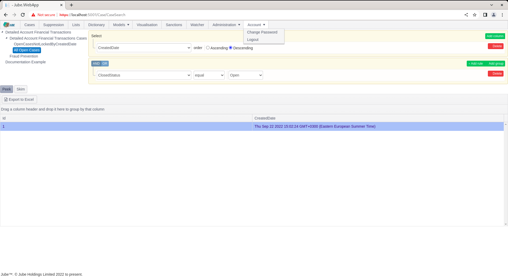
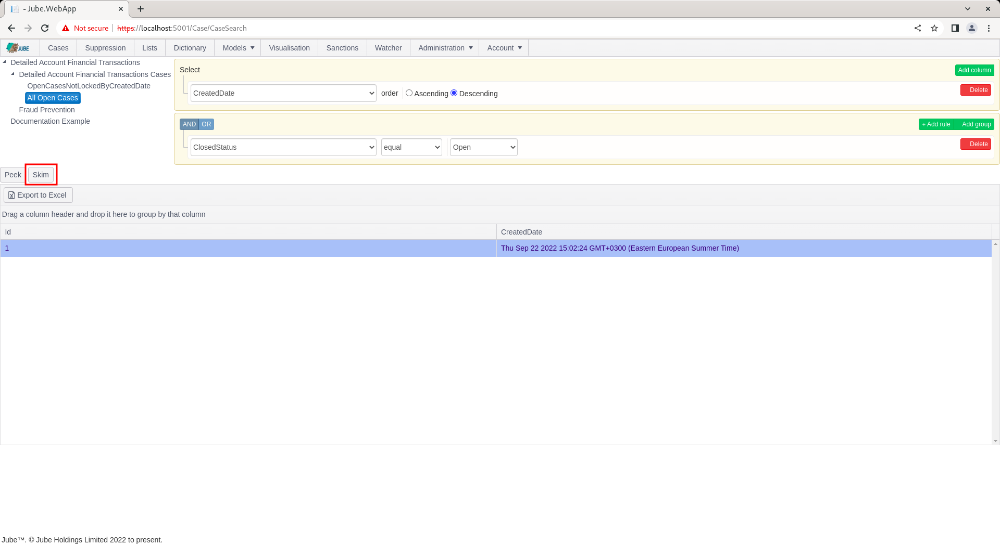
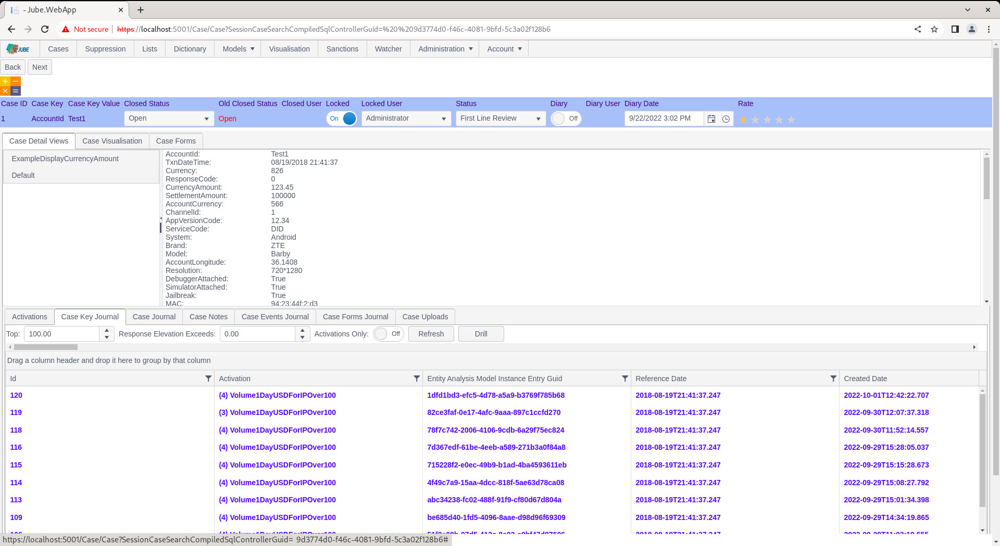
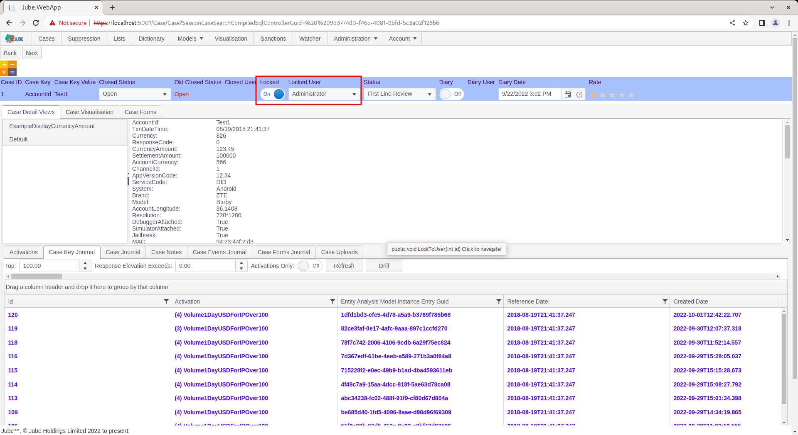
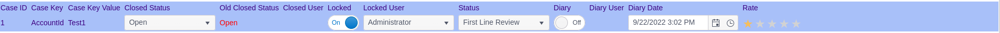
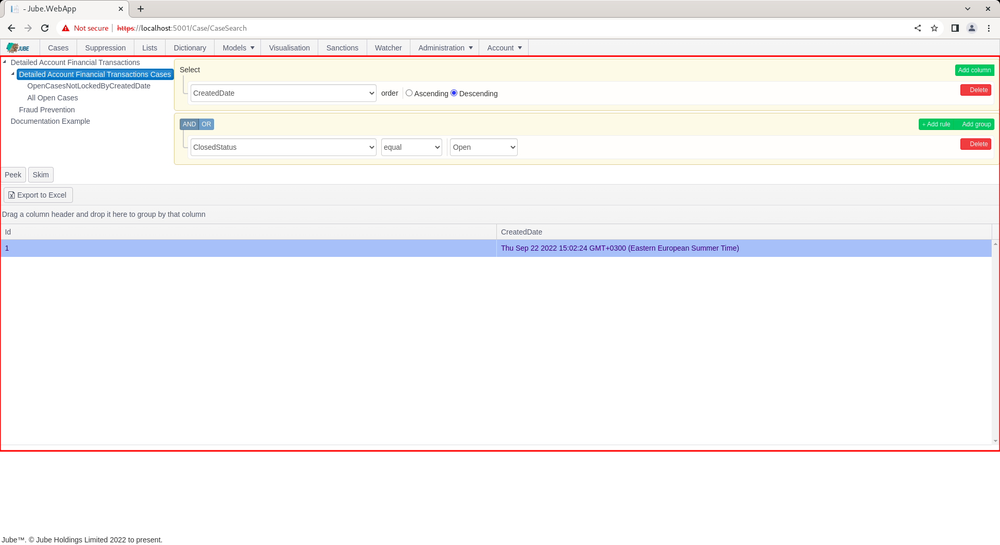
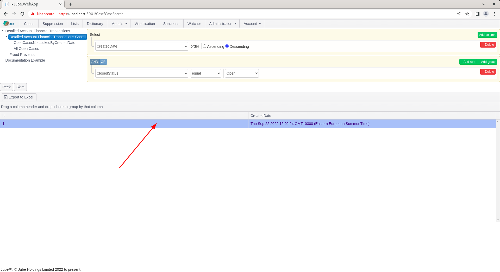
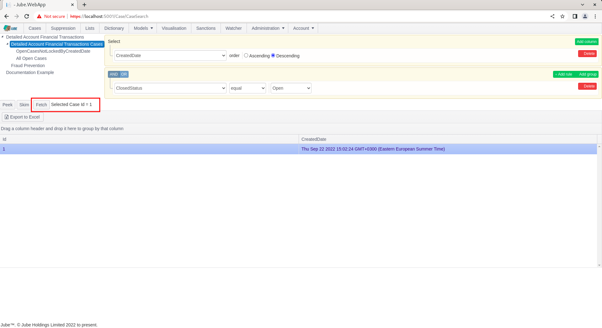
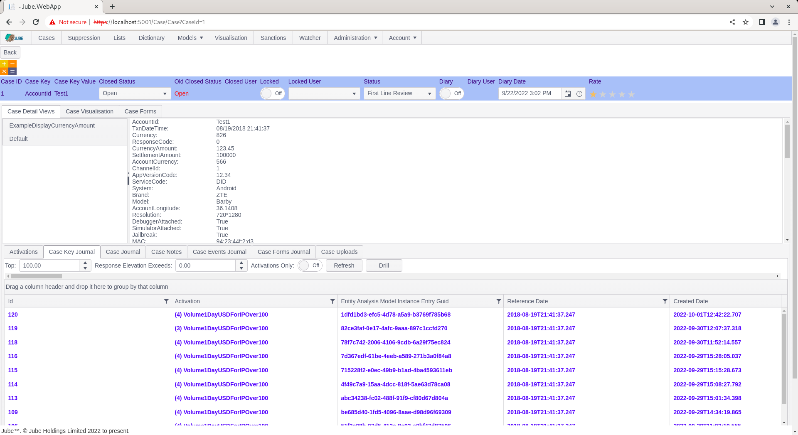
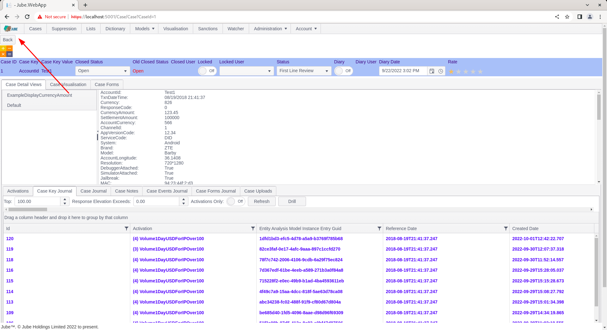

# Navigating Case Record
Having created a case record and having it available for review,  the case record must be expanded upon for the purposes of working.

Navigate to a the journal of created cases:

There are two ways to navigate to a case,  Skim and Fetch.

Skim is the function of taking the first available case off the top of the available cases (keeping in mind the sorting specified),  opening it then locking it to avoid collision in a multi user environment.  Skim is useful to ensure that cases are worked in a priority order and agents are not colliding on cases.

To open a case by Skim,  simply click the Skim button above the cases grid:

The Skim function will re-execute the cases workflow filter and take the very top record (keeping in mind ordering of the preset filter),  opening it in the case page:

Note the availability of the Next button,  which will Skim the next case (but only if the case has been updated to not match the cases workflow filter in question):

Notice also the Locked button, which is set to Locked as a consequence of Skim (and not Fetch) having taken place:

The status bar contains the properties of the case record and is covered in more detail, at this stage, note the colour corresponds to the cases workflow status and as per the grid of all cases available as filter:

Click the Back button to return to the Cases page:

Notice how the filter definition has been retrieved from the session,  and executed:

Locked cases do not automatically unlock, thus had a filter explicitly excluded locked status,  it would not be available.  It follows that locked is a means to avoid collision in a multiuser environment (such as many call centre users examining cases).

An alternative method of retrieving cases is the individual selection.  To individually select a case,  directly click on the row in the cases grid for selection:

Upon clicking on the row,the Fetch button will be exposed, along with a text description of the selected Case Id:

Click the Fetch button to navigate the selected case id to the case page:

Notice the absence of the Next button.  On Fetch a case is not locked automatically, unlike Skim.  In this example,  the case is only locked having originally been skimmed:

# Manually Creating a Case

Ordinarily a Case is only ever raised automatically, by an Activation Rule with Create Case enabled reacting to a
live transaction. There is also a Create Case panel on the Cases search page, for raising a Case by hand against a
Case Key/Value combination without waiting for (or re-triggering) a live transaction - for example, to open a case
against an entity flagged by a source outside of a model invocation.

Selecting a Case Workflow node in the search tree (not the tree's root) exposes the panel:

* Case Workflow Status and Case Key are both populated from the Case Workflow selected in the tree; Case Workflow
  Status defaults to the first entry. Case Key Value is free text - the value to match against.
* The Create Case button is enabled only once both Case Key and Case Key Value have a value.
* On creation, the most recent Archived transaction matching the chosen Case Key/Value is located and its payload is
  used as the new Case's Json - manual creation does not require the transaction to be live in memory, only that it
  has previously been processed and archived. If no matching transaction is found, creation is rejected with an
  error above the panel.
* If a Case is already open for the same Case Workflow, Case Key and Case Key Value, creation is rejected with an
  error above the panel rather than merging into the existing Case, unlike the automated path's priority-based
  merge behaviour.
* A manually created Case is always Open - it is never subject to Suspend Bypass sampling, since that only applies
  to automated rule evaluation against a live model invocation.
* Creating a Case this way requires the same Case read/write permission as working an existing Case; no additional
  permission is needed.