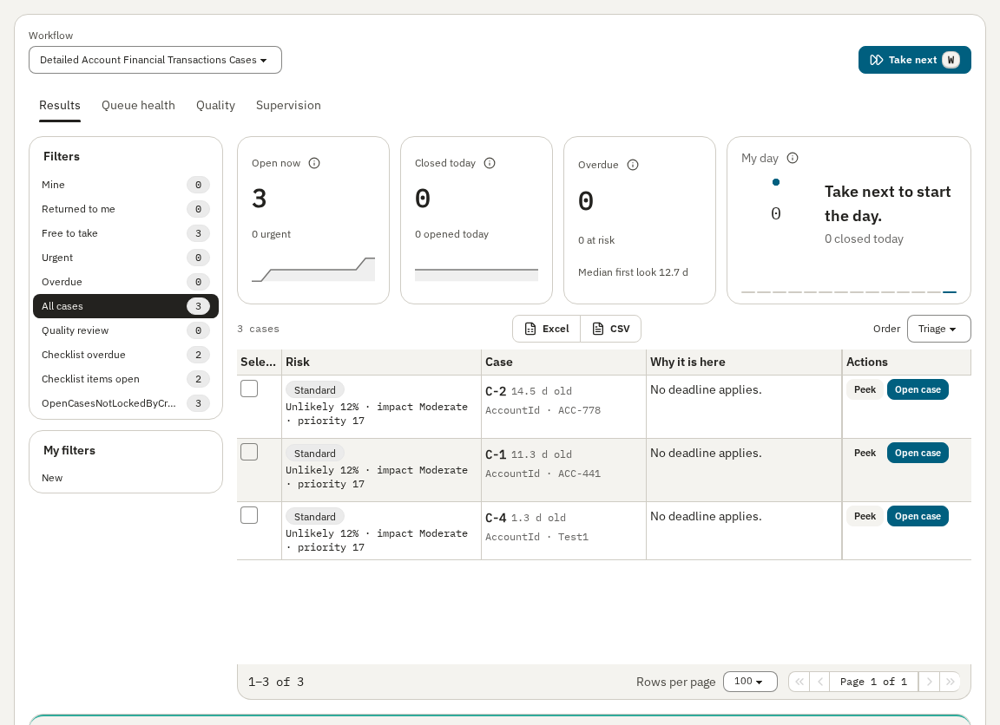
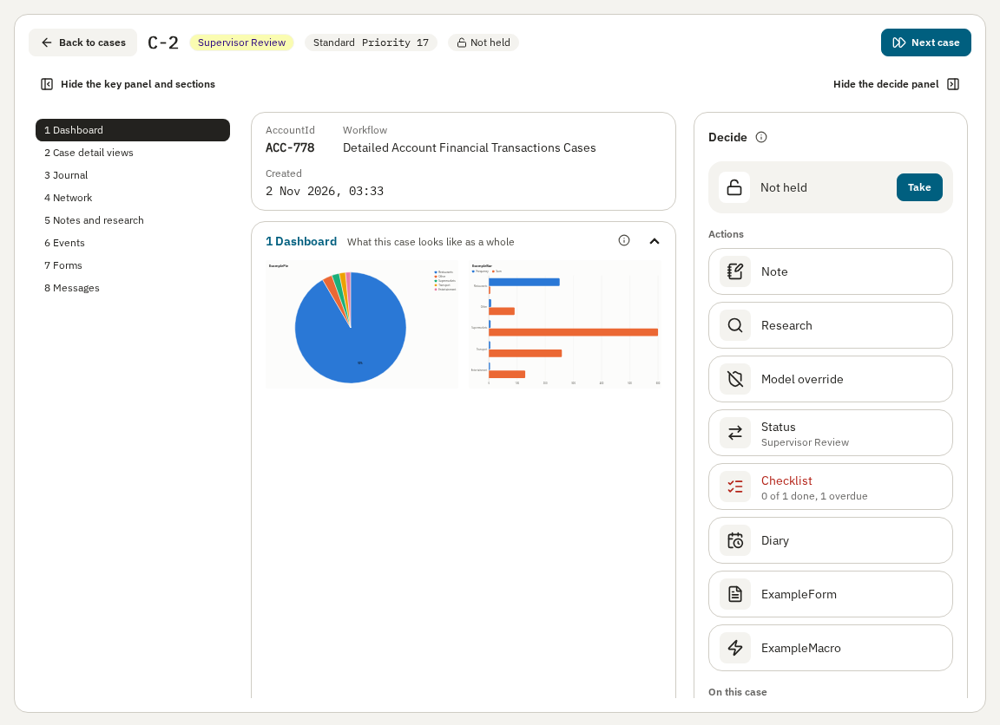
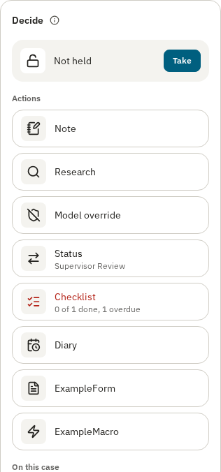

# Navigating Case Record

Having created a case record and having it available for review, the case record must be expanded upon for the purposes of working. This page is the orientation for the case page, which is to say the page upon which a single case is read and decided, and it describes how a case is reached, how the page is arranged, and where each of the functions described elsewhere in this section is to be found.

## Where it lives

Navigate through the menu to Cases, which presents the queue of cases for a Case Workflow, described in [Working Skim, Lock and Next](../WorkingSkimLockNext/index.html). A case is opened from the queue into the case page, and the address in the browser takes the form `/cases/1234`, where 1234 is the Case Id, such that a case can be linked to directly. A case is referred to throughout by its Case Id prefixed with C, for example C-1234.

SHOT id=case-management-navigating-case-record-queue
     route=/cases
     steps=click:All cases
     frame=page
     state=the Cases page on the Results tab for the demonstration workflow, the All cases view selected in the rail, the pulse panel above a list of several cases in triage order, some held and some free
     conveys=cases are reached from a queue, and each row can be peeked at or opened
     alt=The Cases page showing the rail of filters with counts, the pulse panel and the list of cases in triage order with Peek and Open case on each row



## Reaching a case

There are two ways to navigate to a case, which in earlier versions were known as Skim and Fetch:

| Manner    | Description                                                                                                                                                                                                                                                                                              |
|-----------|----------------------------------------------------------------------------------------------------------------------------------------------------------------------------------------------------------------------------------------------------------------------------------------------------------|
| Take next | Formerly Skim. Takes the first available case off the top of the queue, in triage order, opening it then locking it to the user to avoid collision in a multi user environment. Take next is useful to ensure that cases are worked in a priority order and that analysts are not colliding on cases.   |
| Open case | Formerly Fetch. Opens the case of a chosen row in the list, or the case shown in the Peek. The case is not locked upon being opened in this manner, and it remains held by whomever held it beforehand, or by nobody.                                                                                  |

Opening a case by either manner is recorded in the events of the case, Take next being recorded as Skimmed and Open case as Opened in full, as described in [Working Case Event Journal](../WorkingCaseEventJournal/index.html). Peek, which presents a summary of a case beside the queue without leaving it, is recorded as Peeked.

## The case page

The case page is arranged as a header, beneath which there are three columns: an index of the sections, the story of the case, and the Decide pane.

SHOT id=case-management-navigating-case-record-page
     route=/cases
     steps=open-demo-case
     frame=page
     state=the case page of a demonstration case held by the signed in user, showing the header with status, lane, priority and lock, the index of sections on the left, the key panel and the Case detail views section in the middle, and the Decide pane on the right
     conveys=the case page is a header, a story of numbered sections that is read only, and a Decide pane where everything is done
     alt=The case page with its header, the index of case sections on the left, the case key panel and Case detail views in the middle, and the Decide pane on the right



### The header

The header contains the properties of the case record which are of most immediate concern:

| Element       | Description                                                                                                                                                                              | Example        |
|---------------|------------------------------------------------------------------------------------------------------------------------------------------------------------------------------------------|----------------|
| Back to cases | Returns to the Cases page.                                                                                                                                                               |                |
| Case          | The Case Id, prefixed with C.                                                                                                                                                            | C-1234         |
| Status        | The Cases Workflow Status, in the colours configured for that status, as per the list of cases in the queue. See [Working Case Status](../WorkingCaseStatus/index.html).                | Reported       |
| Closed        | Shown where the Closed Status of the case is other than Open. See [Working Closed, Diary Date and Suspend](../WorkingClosedDiarySuspend/index.html).                                    | Closed         |
| Risk          | The lane and the priority of the case in the queue, shown once the case has been assessed. See [Working Case Risk and Service Levels](../WorkingCaseRiskAndServiceLevels/index.html).                                                                                               | Priority 72    |
| Lock          | Held by, followed by the user to whom the case is locked, or Not held. See [Working Lock, Allocation and Unlock](../WorkingLockAllocationUnlock/index.html).                             | Held by Robert |
| Similar       | The number of similar cases, shown only where there are any, which moves to that part of the page upon being clicked. See [Working Similar Cases](../WorkingSimilarCases/index.html).    | 4 similar      |
| Next case     | Takes the next case of the queue without returning to the Cases page, as described below.                                                                                                |                |

Beneath the header, at the top of the story, a panel states the Case Key and Case Key Value, the Workflow and the date and time the case was Created.

The Risk badge reads the lane, being one of Live money, Mandatory, Deadline near or Standard, followed by the priority, for example "Standard Priority 72", and is absent until the case has been assessed. The Closed badge is shown for every Closed Status other than Open, which is to say for a suspended case as well as for a closed one.

The page can be in one of four states. While it is being read, placeholders are drawn in place of the header and the story. Where the case does not exist, is not visible to the user, or the address does not carry a whole number above zero, the page states This case could not be loaded, with Back to cases beneath. Where the user does not hold permission 1, the page states Your role is not permitted to work cases. Otherwise the case is presented as described here.

### The sections

The story is a single scrolling column of numbered sections, replacing the tabs of earlier versions. Each section can be collapsed and expanded, and the index on the left, titled Case sections, moves to a section upon it being clicked. Each section is described in turn, with its states and what can be followed from it, in [Working Case Story Points](../WorkingCaseStoryPoints/index.html). The sections are as follows:

| Section            | Described in the page as                               | Description                                                                                                                                                                                                                                                                                                                                                          |
|--------------------|--------------------------------------------------------|----------------------------------------------------------------------------------------------------------------------------------------------------------------------------------------------------------------------------------------------------------------------------------------------------------------------------------------------------------------------|
| Dashboard          | What this case looks like as a whole                   | A Visualisation drawn for the case from the Case Key and Case Key Value. The section is present only where the Case Workflow has a Visualisation enabled. See [Working Case Research and Dashboard](../WorkingCaseResearchNetworkAndDashboard/index.html).                                                                                                                                                                                                            |
| Case detail views  | What it is, why it is here and what is at stake        | Why the case is in the queue, the Likelihood, the Impact, the value At stake and the Similar cases, followed by the payload fields of the event \ transaction that created the case, as configured in [Case Workflow XPath](../CreatingCaseWorkflowXPath/index.html). Where the Case Workflow has [Case Workflow Displays](../CreatingCaseWorkflowDisplay/index.html), a View chooser offers each as an alternative to Payload fields. The [Analyst assessment](../WorkingAnalystAssessment/index.html) is shown here also. |
| Journal            | Every transaction on this key                          | The [Case Key Journal](../WorkingCaseKeyJournal/index.html), including the [Activations](../WorkingActivations/index.html).                                                                                                                                                                                                                                          |
| Network            | Entities and links around the key                      | The graph of entities and links around the Case Key Value. The section is present only where the Case Workflow has a Graph enabled.                                                                                                                                                                                                                                  |
| Notes and research | Notes and research on this key                         | See [Working Case Note](../WorkingCaseNote/index.html) and [Working Uploading and Recalling Files](../WorkingUploadingRecallingFiles/index.html).                                                                                                                                                                                                                    |
| Events             | Everything that happened to this case and key          | See [Working Case Journal](../WorkingCaseJournal/index.html) and [Working Case Event Journal](../WorkingCaseEventJournal/index.html).                                                                                                                                                                                                                                |
| Forms              | Structured forms for this workflow                     | See [Working Case Form Journal](../WorkingCaseFormJournal/index.html). The section is collapsed upon the page being opened.                                                                                                                                                                                                                                          |
| Messages           | Every email, text and web call sent for this case key  | Everything the Case Workflow sent for the Case Key Value, newest first, whether fired by a Form, a Macro, an Action, a Status or a Release hook, stating whether it was Sent, Failed or Refused, where it went and what it said. The section is collapsed upon the page being opened.                                                                                |

The sections are numbered in the order shown, and as Dashboard and Network are present only where configured, the numbering follows the sections present. As the sections other than Case detail views retrieve their information based on the Case Key Value combination, rather than the Case Id, it follows that they present the history of the Case Key Value across every case record created for it.

Every section is expanded upon the page being opened other than Forms and Messages. Each section carries a help mark beside its title that explains it at greater length. Selecting a section in the index expands it where it was collapsed, moves to it, and writes it to the address as, for example, `/cases/1234?section=notes`, so that a link can be made to a given section of a given case, and a case opened from such a link moves to that section upon being drawn. Which sections are collapsed is otherwise not remembered, the page returning to the arrangement above each time a case is opened.

A case having no Case Key shows, in the Journal section, This case has no key, so there is no journal to show, and its Notes and research and Events sections are empty. Where nothing has yet been written on the key, the Notes and research section states Nothing is recorded on this key yet. Notes and research are added from Decide.

### The Decide pane

Nothing in the story changes the case, which is to say that the sections are read only and a safe place to start reading. Everything that can be done to a case is done from the Decide pane, on the right of the page, every tile, lightbox and card of which is described in [Working Case Lightboxes](../WorkingCaseLightboxes/index.html).

SHOT id=case-management-navigating-case-record-decide
     route=/cases
     steps=open-demo-case
     frame=decide-pane
     state=the Decide pane of an open case held by the signed in user, showing Held by you with Release, the Actions tiles including a form and a macro of the workflow, the On this case cards, and the Close tile at the foot
     conveys=every action on a case is gathered in one pane, as tiles that open a lightbox and cards that act in place
     alt=The Decide pane showing who holds the case, the Actions tiles, the On this case cards and the Close tile



The Decide pane is arranged, from top to bottom, as follows:

* The holder of the case, being Held by you, Held by followed by the user (alongside the reminder that a supervisor can break this lock), or Not held, with Take or Release as is appropriate. See [Working Lock, Allocation and Unlock](../WorkingLockAllocationUnlock/index.html).
* Actions, a set of tiles, each of which opens a lightbox over the page.
* On this case, a set of cards, each of which is acted upon in place.
* Close, or Reopen where the case is closed. See [Working Closed, Diary Date and Suspend](../WorkingClosedDiarySuspend/index.html).

The tiles under Actions are as follows:

| Tile               | Description                                                                                                                                                                                                             |
|--------------------|-------------------------------------------------------------------------------------------------------------------------------------------------------------------------------------------------------------------------|
| Note               | Adds a note, which may carry files. See [Working Case Note](../WorkingCaseNote/index.html).                                                                                                                            |
| Research           | Records research findings with a topic and sources. See [Working Case Note](../WorkingCaseNote/index.html).                                                                                                            |
| Model override     | Asks to suppress or force a model rule for a key value. Shown only to a role granted permission 2, Read Write Suppression. See [Working Case Suppression](../WorkingCaseSuppression/index.html).                                                                                             |
| Override approvals | Model override requests on the case awaiting a decision by the user. Shown only where there are any.                                                                                                                    |
| Status             | Changes the Cases Workflow Status or escalates the case. See [Working Case Status](../WorkingCaseStatus/index.html).                                                                                                    |
| Checklist          | The checklist items for the status of the case, showing how many are done. See [Working Case Checklists](../WorkingCaseChecklists/index.html).                                                                                                                                         |
| Diary              | Sets a diary on the case. See [Working Typed Diaries](../WorkingTypedDiaries/index.html).                                                                                                                              |
| Held payment       | Reviews the payments held by the case, to release or refuse them. Shown only where a payment is held.                                                                                                                   |
| Forms              | A tile for each active [Case Workflow Form](../CreatingCaseWorkflowForm/index.html) of the workflow, titled with the name of the form.                                                                                 |
| Macros             | A tile for each active [Case Workflow Macro](../CreatingCaseWorkflowMacro/index.html) of the workflow, titled with the name of the macro. A macro has no lightbox, as it is run upon the tile being clicked.           |

The cards under On this case are the [Triage recommendation](../WorkingTriageRecommendation/index.html), [Your assessment](../WorkingAnalystAssessment/index.html), Findings (see [Working Case Note](../WorkingCaseNote/index.html)), Journal (the controls of the [Case Key Journal](../WorkingCaseKeyJournal/index.html)), Tags, [Linked cases](../WorkingLinkedCases/index.html), [Quality review](../WorkingQualityReviewSamples/index.html), [Regulatory reports](../WorkingRegulatoryReports/index.html) and Legal hold. A card is shown only where it applies to the case and to the permissions of the user.

### Making room

Above the columns there are two controls, to hide or show the index of sections, and to hide or show the decide panel, for the purposes of giving the story the width of the page. Upon the Decide pane being hidden it is not lost, rather it is presented as the first card of the story. The two controls read Hide, or Show, followed by the sections, and the decide panel, respectively. The choice is kept in the browser, and so applies to every case opened thereafter on that browser until it is changed. On a narrow screen the index of sections is not drawn, and the Decide pane is placed beneath the story.

## Next case

Next case, in the header of the case page, takes the next case from the queue without needing to return to the Cases page. It does so by taking the Workflow of the case in view, together with the filter last used on the Cases page, and performing Take next, as described in [Working Skim, Lock and Next](../WorkingSkimLockNext/index.html). It follows that the case in view will be offered again only if it is still open and either not held or held by the user, hence the customary manner of working is to close or release a case, then move to the next. Where there is nothing left, the header states Nothing left to take in this queue, and the case in view remains on the page. Where the request fails, it states The next case could not be taken. Where the Cases page has not yet been used on the browser, there being no filter last used, the All cases filter and the triage order are taken.

## Returning to the Cases page

Back to cases returns to the Cases page. The Workflow, the filter and the order last used are restored, such that the queue is presented as it was left. These are kept in the browser for the user and tenant, rather than in the session on the server as was the case in earlier versions, henceforth they survive a new session being established on the same browser.

Locked cases do not automatically unlock. It follows that locked is a means to avoid collision in a multi user environment (such as many call centre users examining cases), and that a case left locked remains so until it is released by its holder, or the lock is broken or reassigned by a supervisor as described in [Working Case Supervision](../WorkingCaseSupervision/index.html).

## Manually Creating a Case

Ordinarily a Case is only ever raised automatically, by an Activation Rule with Create Case enabled reacting to a live transaction. A Case can also be raised by hand against a Case Key Value combination without waiting for (or re-triggering) a live transaction, for example, to open a case against an entity flagged by a source outside of a model invocation.

The Create Case panel of earlier versions is not present on the Cases page, and the function is available through the API as `POST /api/Case/CreateFromCaseKeyValue`, and to Ask Jooby as the operation CaseCreateFromCaseKeyValue:

```http
POST /api/Case/CreateFromCaseKeyValue
Content-Type: application/json

{
  "caseWorkflowGuid": "5a1c0f3e-0000-0000-0000-000000000000",
  "caseWorkflowStatusGuid": "9b2d7c41-0000-0000-0000-000000000000",
  "caseKey": "AccountId",
  "caseKeyValue": "Test1"
}
```

TODO(verify): the Vue Cases page has no control to create a case by hand; confirm with the owner whether the Create Case panel is to be restored, and if so document where it lives

The behaviour is as follows:

* The Case Workflow Status must be an active status of the Case Workflow given, otherwise creation is rejected. Case Key Value is free text, being the value to match against.
* The Case Key must be a field flagged as Archive Key in the [Request XPath](../../Models/RequestXPath/index.html) of the model, as for the [Case Key Journal](../WorkingCaseKeyJournal/index.html), otherwise creation is rejected.
* On creation, the most recent Archived transaction matching the chosen Case Key Value combination is located and its payload is used as the Json of the new Case. Manual creation does not require the transaction to be live in memory, only that it has previously been processed and archived. If no matching transaction is found, creation is rejected with an error.
* If a Case is already outstanding for the same Case Workflow, Case Key and Case Key Value, creation is rejected with a conflict rather than merging into the existing Case, unlike the automated path's priority-based merge behaviour.
* A manually created Case is always Open. It is never subject to Suspend Bypass sampling, since that only applies to automated rule evaluation against a live model invocation.

## Permissions and security

The Cases page, the case page, and creating a Case by hand all require permission 1, Read Write Case, and no additional permission is needed to create a Case than to work an existing one. A user without that permission is told that their role is not permitted to work cases, and the server refuses the requests regardless. Beyond the permission, a case is visible only to a role granted the Case Workflow and the Cases Workflow Status the case is in, and a case that is not visible is reported as one that could not be loaded.
