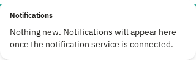

# Working Notifications

Much of what matters in case management happens while nobody is looking at the page concerned: a case passes its service level overnight, a regulatory report is sent for approval by a colleague, a model begins to score differently. A notification exists for the purposes of telling the particular user who has something to do, or who was relying upon something that has since changed, without that user needing to visit each page in turn to find out.

Notifications are created by the server, addressed to a named user, and stored, such that they are waiting for the user upon signing in and are the same in every browser. They are read from the bell at the top of every page. A notification is a single line of text and nothing more: it never carries the content of a case, and in the most part it states a count or names a case by its number, leaving the user to navigate to the page where the matter is dealt with.

The terms used in this page are as follows:

| Term      | Meaning                                                                                                                                              |
|-----------|------------------------------------------------------------------------------------------------------------------------------------------------------|
| Kind      | What happened, of which there are eight, for example a case breaching its service level. The kind decides the wording, the recipients and the label.  |
| Recipient | The user for whom the notification was created. A notification has exactly one recipient, and where several users are to be told, each receives their own. |
| Priority  | Low, Normal or High, set by the server upon creation, and presented in the panel as the label Info or Warning.                                        |
| Unread    | A notification that the recipient has not yet clicked, nor cleared with Mark all read.                                                                |

## Where it lives

The bell is presented in the header of every page, to the right. Where there are unread notifications, the bell carries a small red badge stating how many, and in the absence of any the badge is not shown. Clicking the bell opens the panel titled Notifications beneath it, and clicking elsewhere closes it.

SHOT id=case-management-notifications-panel
     route=/cases
     steps=open-menu:Notifications
     frame=popover
     state=the Notifications panel open beneath the bell for a supervisor, listing a case service level breach marked Warning and unread in bold, a case digest line and a regulatory report awaiting approval marked Info, each with its time, and Mark all read at the top
     conveys=notifications are single lines, newest first, each with a label and a time, and unread ones are in bold
     alt=The Notifications panel listing three notifications newest first, each a single line with an Info or Warning label and a time, with a Mark all read control at the top



## The panel

The panel lists the notifications of the signed in user, newest first, to a limit of the 50 most recent. Where the list is taller than the panel, it scrolls. Each notification is presented as follows:

| Element | Description                                                                                                                                                                         | Example                                                  |
|---------|-------------------------------------------------------------------------------------------------------------------------------------------------------------------------------------|----------------------------------------------------------|
| Text    | A single line, composed in the language of the user interface from the kind and the facts stored with the notification. The text is in bold while the notification is unread.       | Case C-1042 breached its service level: time to first view |
| Label   | Info or Warning, as described for each kind below. Warning is shown in the warning colour, and Info without colour.                                                                 | Warning                                                  |
| Time    | When the notification was created, in the time of the browser: the time alone for a notification of today, and otherwise the day and month followed by the time.                    | 3 Nov, 07:00                                             |

The controls of the panel are few:

* Clicking a notification marks it as read, whereupon its text ceases to be bold and the badge on the bell is reduced by one. For a case service level breach, the case is then opened in the case page. For every other kind, nothing further is opened, and the panel remains as it was.
* Mark all read, shown at the top of the panel only where something is unread, marks every notification of the user as read, including any beyond the 50 listed. The badge is removed.

Where the user has no notifications, the panel states as follows:

```text
Nothing new.
```

The panel is refreshed from the server every 60 seconds, and also upon the browser window regaining focus, hence a new notification appears within a minute of being created without the page being reloaded. There is no sound, no pop up and no email upon a notification arriving, the [Case Digest](../WorkingCaseDigest/index.html) being the only kind that may additionally be sent by email.

## What raises a notification

There are eight kinds. Each is raised by a background process or by the action of another user, and never by the recipient. Five of the eight depend upon a background process that is switched off by default, and it follows that on a fresh installation only the three kinds concerned with regulatory reports will ever appear until the Environment Variables are set, as described in [Environment Variables](../../../Concepts/EnvironmentVariables/index.html).

| Kind                                 | Raised when                                                                                                                                                                             | Recipients                                                                                                                                                  | Label                                                        | Leads to                 |
|--------------------------------------|-----------------------------------------------------------------------------------------------------------------------------------------------------------------------------------------|-------------------------------------------------------------------------------------------------------------------------------------------------------------|--------------------------------------------------------------|--------------------------|
| Case service level breached          | The service level sweep finds an open case past one of its four targets. Requires EnableCaseServiceLevelSweep.                                                                         | The user holding the case, and each active user whose role holds permission 18, Read Write Case Workflow, and is granted the Case Workflow of the case.     | Warning for time to resolution, Info for the other three.    | The case, upon clicking. |
| Sanctions rescreen found new matches | A rescreening pass completes having found new possible matches in the tenant. Requires EnableSanctionRescreen.                                                                          | Each active user holding permission 29, View Sanction, in the tenant.                                                                                       | Warning.                                                     | Nothing.                 |
| Case digest                          | Once a day, at the hour and on the days configured, for each Case Workflow having cases open or closed in the last day. Requires EnableCaseDigest.                                      | Each active user whose role holds permission 18, Read Write Case Workflow, and is granted the Case Workflow.                                                | Warning where anything is past a service level, otherwise Info. | Nothing.              |
| Model drift                          | The drift check finds that a score of a model has reached significant drift, having not been significant at the check before. Requires EnableModelDriftMonitoring.                      | Each active user holding permission 6, Read Write Model, in the tenant.                                                                                     | Warning.                                                     | Nothing.                 |
| Entity risk reviews due              | The review check finds entity risk ratings whose review date has passed. Requires EnableEntityRiskReview.                                                                               | Each active user holding permission 18, Read Write Case Workflow, in the tenant.                                                                            | Info.                                                        | Nothing.                 |
| Report awaiting approval             | A regulatory report is sent for approval by its author.                                                                                                                                 | Each active user holding permission 76, Approve Case Reports, in the tenant, other than the user who requested the approval.                                | Info.                                                        | Nothing.                 |
| Report decided                       | A regulatory report awaiting approval is approved or rejected.                                                                                                                          | The user who prepared the version that was decided.                                                                                                         | Info.                                                        | Nothing.                 |
| Report answered by the FIU           | The answer of the Financial Intelligence Unit is recorded against a filed report.                                                                                                       | The user who created the report.                                                                                                                            | Info.                                                        | Nothing.                 |

The wording of each kind, with the facts that are filled in shown in braces, is as follows:


| Kind                                 | Wording                                                                                                               |
|--------------------------------------|-----------------------------------------------------------------------------------------------------------------------|
| Case service level breached          | Case {id} breached its service level: {dimension}                                                                     |
| Sanctions rescreen found new matches | Rescreening found {count} new possible sanction matches                                                               |
| Case digest                          | {workflow}: {open} open, {unassigned} unheld, {overdue} past a service level, {closed} closed in the last day         |
| Model drift                          | Model {model}: the score {score} has drifted significantly (PSI {psi})                                                |
| Entity risk reviews due              | {count} entity risk ratings are due a review                                                                          |
| Report awaiting approval             | A regulatory report on case {id} awaits your approval                                                                 |
| Report decided                       | Your regulatory report on case {id} was {detail}                                                                      |
| Report answered by the FIU           | The FIU has answered the report on case {id}: {detail}                                                                |


A notification of a kind that the user interface does not recognise is presented as A notification.

### Case service level breached

A Case Workflow may set targets for how quickly a case is first viewed, taken into ownership and resolved, and for how long it may remain in a status, as described in [Working Case Risk and Service Levels](../WorkingCaseRiskAndServiceLevels/index.html). The dimension stated in the notification is one of time to first view, time to ownership, time to resolution or time in status.

The sweep runs every CaseServiceLevelSweepSeconds (60 by default), taking up to CaseServiceLevelSweepBatchSize (200 by default) newly breached cases for each of the four dimensions on each run. A breach is recorded once for each case and dimension, and it is upon that record being made that the notifications are created. It follows that a case is notified at most four times in its life, once for each dimension, however long it remains in breach, and that a case passing the time in status target a second time, in a later status, is not notified again.

This is the only kind upon which clicking navigates, there being a single case to open. The case number is given in the customary form, for example C-1042.

### Sanctions rescreen found new matches

One notification is created for each rescreening pass, stating the number of new possible matches found in the tenant during that pass. A pass finding nothing new creates no notification. The matches themselves are reviewed as described in [Sanction Rescreening](../../Sanctions/SanctionRescreening/index.html).

### Case digest

The digest is the daily statement of how each Case Workflow stands, as four counts, and is described in full in [Working the Case Digest](../WorkingCaseDigest/index.html). The notification is the digest: there is one for each Case Workflow that the supervisor is granted, for each day on which it is sent, and the same counts are sent by email only where CaseDigestEmail is also True. Reading the notification in the panel has no bearing upon the email, and the reverse is true also.

Keeping in mind that the digest counts the cases past a service level from the breaches recorded by the service level sweep, a supervisor will ordinarily have received the individual Case service level breached notifications for those same cases beforehand. The digest is the summary, and the breach notifications are the particulars.

### Model drift

The notification names the model and the score, and gives the Population Stability Index (PSI) to three decimal places, a PSI of 0.25 or more being significant. A score that remains significant from one check to the next is not notified again, the notification being raised upon the change. See [Model Drift](../../../Concepts/ModelDrift/index.html) for how the figure is to be read.

### Entity risk reviews due

The notification states the number of entity risk ratings in the tenant whose review date has passed, and is created at most once a day for each user. See [Entity Risk Rating](../../../Concepts/EntityRiskRating/index.html).

### Regulatory reports

The three kinds concerned with regulatory reports follow the life of a report as described in [Working Regulatory Reports](../WorkingRegulatoryReports/index.html), and need no Environment Variable. The case is stated by its number alone, for example case 1042. For Report decided the detail is approved or rejected, and for Report answered by the FIU the detail is Acknowledged, Rejected or Information requested, each being worded in the language of the user as it is on the Regulatory reports card of the case.

A further approval being requested for a later version of the same report notifies the approvers afresh, as does each further answer recorded from the Financial Intelligence Unit.

TODO(verify): the case of the three report kinds is shown as a bare number rather than in the C-1042 form used by the breach kind (notifications/fromServer.ts). Owner to decide whether it is to be formatted in the client.

## Read and unread

Read is a property of the notification and of its recipient, stored in the server. It follows that a notification read in one browser is read in every browser, and remains read after signing out. The rules are as follows:

* A notification is unread from its creation until its recipient clicks it or uses Mark all read. Opening the panel does not of itself mark anything as read.
* There is no means of marking a notification as unread again.
* Reading is immediate in the panel, the server being told in the background. Should the server not be reached, nothing is reported, and the notification returns to unread upon the next refresh.
* The badge counts the unread notifications among the 50 listed.
* As each recipient has their own notification, one supervisor reading a breach has no effect upon the same breach as presented to another supervisor, nor to the holder of the case.

## Once only

A notification is created once for the occurrence it describes, for each recipient, however many times the background process concerned observes that occurrence and however many nodes run the engine. For the purposes of the foregoing, an occurrence is as follows:

| Kind                                 | One notification for each recipient, for each                                    |
|--------------------------------------|----------------------------------------------------------------------------------|
| Case service level breached          | Case and dimension.                                                              |
| Sanctions rescreen found new matches | Rescreening pass.                                                                |
| Case digest                          | Case Workflow and day.                                                           |
| Model drift                          | Model, score and day.                                                            |
| Entity risk reviews due              | Day.                                                                             |
| Report awaiting approval             | Report and version.                                                              |
| Report decided                       | Report, version and decision.                                                    |
| Report answered by the FIU           | Report, version and answer.                                                      |

## Retention

A notification is kept indefinitely. It is not removed upon being read, there is no control to dismiss or delete one, and it does not expire with age. Neither is a notification withdrawn when the matter it describes has been dealt with, which is to say that a breach notification remains in the panel after the case has been closed, and a Report awaiting approval notification remains after the report has been decided by another approver.

The panel being limited to the 50 most recent, an older notification leaves the panel only by being displaced by newer ones, and remains in the database thereafter. Where the table is to be reduced, it is a matter for the database administrator.

TODO(verify): UserNotification has ResolvedDate and DismissedDate columns that the list excludes, but nothing sets them: UserNotificationRepository.ResolveForCaseAsync has no caller and there is no dismiss endpoint or expiry. Owner to decide whether notifications for a case are to be resolved upon the case being closed, and whether a retention period is wanted.

## What is not notified

For the avoidance of doubt, the following do not raise a notification, each being presented on its own page instead:

* A case being allocated to a user, a lock being broken or reassigned by a supervisor, and a case being escalated or reopened. See [Working Case Supervision](../WorkingCaseSupervision/index.html) and [Working Skim, Lock and Next](../WorkingSkimLockNext/index.html).
* A diary date falling due. See [Working Typed Diaries](../WorkingTypedDiaries/index.html).
* A model override or suppression awaiting approval, which is presented in the Override approvals tile of the case and the approvals panel of the Cases page.
* A change to a model awaiting approval.

The email, SMS and HTTP notifications configured against a status, a form, a macro or an action in [Creating Automation](../CreatingAutomation/index.html) are a separate matter entirely. Those are sent outwards to an address, on a transition of a case, and are not addressed to a user of Jube nor shown in the bell.

## Example

The API underlying the panel is as follows:

```http
GET /api/UserNotification
PUT /api/UserNotification/Read/{guid}
PUT /api/UserNotification/ReadAll
```

The list returns the notifications of the caller, newest first, to the limit of 50. The text is not stored: the kind and the facts are returned, and the user interface composes the wording in the language of the user.

```json
[
  {
    "guid": "0b6f3c1e-0000-0000-0000-000000000000",
    "kindId": 1,
    "priorityId": 3,
    "caseId": 1042,
    "argumentsJson": "{\"dimension\": 3}",
    "createdDate": "2026-11-03T07:00:12+00:00",
    "read": false
  }
]
```

| Value         | Description                                                                                                                                                                                             |
|---------------|---------------------------------------------------------------------------------------------------------------------------------------------------------------------------------------------------------|
| guid          | The identifier by which the notification is marked as read.                                                                                                                                             |
| kindId        | 1 Case service level breached, 2 Sanctions rescreen found new matches, 3 Case digest, 4 Model drift, 5 Entity risk reviews due, 6 Report awaiting approval, 7 Report decided, 8 Report answered by the FIU. |
| priorityId    | 1 Low, 2 Normal, 3 High.                                                                                                                                                                                |
| caseId        | The case the notification is about, for the breach and report kinds, and otherwise null.                                                                                                                |
| argumentsJson | The facts from which the wording is composed. For a breach, the dimension as 1 time to first view, 2 time to ownership, 3 time to resolution or 4 time in status.                                       |
| createdDate   | When the notification was created, in UTC.                                                                                                                                                              |
| read          | Whether the caller has read it.                                                                                                                                                                         |

Both PUT requests return the HTTP status 204 with no body, whether or not anything was changed, such that marking as read a notification already read, or one that does not exist, is not an error.

## Permissions and security

There is no permission to use the bell, and it is presented to every signed in user. What a user receives follows from the permissions of their role at the time each notification is created, as tabulated above, and it follows that a user granted a permission afterwards does not receive the notifications created beforehand.

A user reads and marks only their own notifications, within their own tenant. A request carrying the identifier of a notification belonging to another user changes nothing, and a request without a signed in user is refused with the HTTP status 401.

Two further restrictions are applied each time the list is read, rather than upon creation, for the purposes of honouring a change of access made since:

* A notification about a case is returned only while that case is visible to the user, which is to say that a role of the user is granted the Case Workflow and the current status of the case, as described in [Case Management Security Policy](../SecurityPolicy/index.html). A notification so withheld is not deleted, and is returned again should the case become visible.
* The three kinds concerned with regulatory reports are returned only while the user holds one of permission 75, File Case Reports, permission 76, Approve Case Reports, or permission 77, View Case Reports.

A notification names a case by its number at most. The Case Key Value, the payload and the content of a report are never part of a notification.
