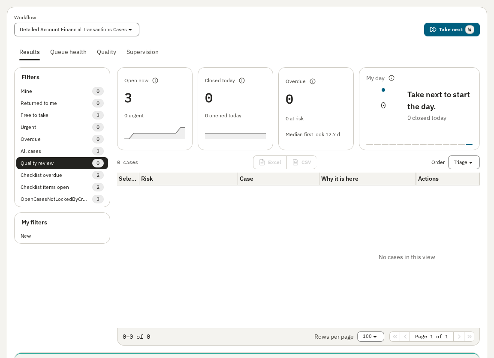

# Working Quality Review Samples

The ranking puts the cases it believes to matter in front of analysts first, it follows that the cases it ranks low are the ones it never lets anyone look at. Should the ranking be wrong about those cases, nobody finds out. A quality review sample exists to address that, by picking a small share of the low priority cases at random and placing them in the queue, so that someone does look, and so that what they find can be counted.

Two separate things are spoken of on this page and it is as well to tell them apart at the outset. A sample is a case picked at random, which then sits in the queue and is worked like any other, the purpose being to learn what the low priority cases turn out to be. A review is a second look at such a case after it has been closed, made by someone other than the person having closed it, the purpose being to judge how well it was handled. The first measures the ranking, the second measures the work.

| Term           | Meaning                                                                                                                              |
|----------------|--------------------------------------------------------------------------------------------------------------------------------------|
| Low priority   | A case in the Standard lane with a Priority below a threshold, which is 25 by default. These are the cases the ranking places last.  |
| Sample rate    | The share of the low priority cases that are picked, from 0 to 0.5. A rate of 0.05 picks about one in twenty.                        |
| Picked         | A case chosen for the sample. It is flagged QA sample.                                                                               |
| Outcome        | Whether a closed case was Confirmed or Not confirmed, taken from the status it was closed in.                                        |
| Confirmed share | Of the picked cases closed with an outcome, the proportion that were confirmed.                                                     |
| Review         | A verdict of Pass, Fail or Not applicable on a picked, closed case, recorded by a second person.                                     |

## Where it lives

There is nothing to switch on in the Cases page, as the picking is done in the background by the case risk worker of the engine. The share picked is the quality review sample rate of the Case Workflow, in the Ranking group as described in [Creating Case Workflows](../CreatingCaseWorkflows/index.html), falling back on an Environment Variable where it is left empty.

The picked cases are then met in three places:

* On the Cases page, in the Results tab, where a picked case is flagged QA sample, and the Filters card has a filter titled Quality review.
* On the Cases page, in the Quality tab, where the section titled Quality review sample counts what the picked cases turned out to be.
* On the case page of a picked case that has been closed, where the card titled Quality review is presented in the Decide pane, under On this case.

SHOT id=case-quality-review-filter
     route=/cases
     steps=click:Quality review
     frame=page
     state=the Results tab of the Cases page with the Quality review filter selected in the Filters card, listing three open cases each flagged QA sample with the reason Picked at random to check the ranking
     conveys=picked cases are ordinary cases in the queue, flagged so that the reason for their being there is plain
     alt=The Cases page with the Quality review filter selected, listing three low priority cases each carrying a QA sample flag

## How a case is picked

The case risk worker decides once for each case, the first time it assesses the case while the case is of low priority, which means in the Standard lane with a Priority below CaseRiskQaMaxPriority. A number is then drawn for the case that depends only on the case and its Case Workflow, and the case is picked where the number is below the sample rate of the Case Workflow. It follows that:

* The rate is the quality review sample rate of the Case Workflow, or CaseRiskQaSampleRate where the Case Workflow leaves it empty. A rate of 0 switches sampling off, and cases are not decided while it is off, so switching it on later still samples them.
* Because the decision is made once, raising or lowering the rate changes only the cases decided afterwards, and a case is never picked twice.
* A case that is urgent, due soon or of high priority is never eligible, so the sample never takes attention away from the cases needing it.
* Every pick is recorded as a Picked for quality review event on the case, in the name of Administrator, with the rate in force as After.

The number drawn is a fraction between 0 and 1 worked out from the Case Workflow and the case number alone, by hashing the two, so it is the same however often it is drawn and nothing about the case, its key, its value or its analyst can influence it. A case whose number comes out at 0.031 is picked at a rate of 0.05 and is not picked at a rate of 0.02. Over many cases the share picked settles at the rate, although among a handful of cases it may well be none at all, which is to be expected of a random draw and is not a fault.

The settings are as follows:

| Value                      | Description                                                                                                         | Example |
|----------------------------|---------------------------------------------------------------------------------------------------------------------|---------|
| Quality review sample rate | Set on the Case Workflow, from 0 to 0.5. The share of the low priority cases of the Case Workflow that are picked.   | 0.05    |
| CaseRiskQaSampleRate       | Environment Variable. The rate used where the Case Workflow leaves its own empty. 0.05 by default, being five in a hundred. | 0.05    |
| CaseRiskQaMaxPriority      | Environment Variable. The Priority below which a case in the Standard lane is of low priority. 25 by default.       | 25      |

TODO(verify): confirm on a running system the label under which the Case Workflow form presents RiskQaSampleRate in its Ranking group, taken here as Quality review sample rate from Creating Case Workflows; the label is not in en.json.

There is one further manner in which a case comes to be picked. Where an analyst overrides a triage recommendation, the case is drawn again at a raised rate, as described in [Working the Triage Recommendation](../WorkingTriageRecommendation/index.html), so that the cases on which person and agent disagree are sampled more often.

## Working a sample

A picked case is flagged QA sample on the Cases page, with the reason, Picked at random to check the ranking, beside it. It is ordered after the urgent, returned and due soon cases but ahead of the ordinary Standard cases, so it is reached in the normal course of skimming. The Quality review filter in the Filters card lists only the picked cases that are still open.

Nothing else about the case changes: it is worked, closed and given an outcome in the manner of any other.

## Reviewing a sample

Once a picked case has been closed, the Quality review card is presented on the case page to anyone holding the case permission, other than the user having closed the case. The reviewer records the following:

| Value                 | Description                                                                                                                     | Example |
|-----------------------|---------------------------------------------------------------------------------------------------------------------------------|---------|
| Handling of the case  | How the analyst handled the case, as Pass, Fail or Not applicable.                                                              | Pass    |
| Triage recommendation | Offered only where the triage agent made a recommendation on the case. How good that recommendation was, as Pass, Fail or Not applicable, or No verdict on the agent. | Pass    |
| Comment (optional)    | A comment, limited to 1,000 characters.                                                                                         |         |

Handling of the case is set to Pass upon the card being drawn, and Triage recommendation to No verdict on the agent, so a review recorded without touching either is a Pass on the handling with nothing said about the agent. A recommendation that was superseded before anyone saw it does not count as the agent having made one.

Record review commits the review, upon which the message Review recorded is shown, the comment is cleared and the review joins the list in the card. Reviews are append only, held in the `CaseQaReview` table, and those already recorded on the case are listed in the card with the reviewer and the verdicts, the twenty most recent being shown, each on a line such as "Administrator: handling Pass - agent Fail" followed by the comment where there is one. A review cannot be changed or removed, and nothing prevents the same reviewer, or a second reviewer, from recording a further review on the same case.

The card is presented in three circumstances and is otherwise absent:

| The case                                                          | The card shows                                  |
|-------------------------------------------------------------------|-------------------------------------------------|
| Picked, closed, and the user is not the one having closed it      | The earlier reviews and the means to record one |
| Has reviews, and the user closed it, or it has since been reopened | The earlier reviews only                       |
| Not picked, or picked and still open with no reviews              | Nothing, the card is not drawn                  |

It follows that the analyst having closed a picked case sees no Quality review card until someone has reviewed it, and then sees the verdict.

The following are refused by the server, with the message shown on the page:

| Circumstance                                                  | Message                                              | Status |
|---------------------------------------------------------------|------------------------------------------------------|--------|
| The case was never picked                                     | The case was not picked for quality review.          | 400    |
| The case is not closed                                        | Only a closed case can be reviewed.                  | 400    |
| The reviewer is the user having closed the case               | A case cannot be reviewed by the user who closed it. | 409    |
| A verdict on the agent where it made no recommendation        | There was no triage recommendation to judge.         | 400    |
| A verdict on the handling other than Pass, Fail or Not applicable | The analyst verdict must be 1, 2 or 3.           | 400    |
| A verdict on the agent other than Pass, Fail or Not applicable | The agent verdict must be 1, 2 or 3.                | 400    |
| A comment over 1,000 characters                               | The comment must be at most 1000 characters.         | 400    |

A review is a record and nothing more. It does not reopen the case, change its outcome or notify the analyst, and the verdicts are not at present counted on the Quality tab.

SHOT id=case-quality-review-card
     route=/cases
     steps=click:Quality review, open-first-row, scroll-to:Quality review
     frame=section:Quality review
     state=the Decide pane of a closed demonstration case that was picked for quality review, signed in as a user other than the one who closed it, with the Quality review card showing one earlier review and the verdict selections for the handling of the case and the triage recommendation
     conveys=a sampled case is given a second look by someone other than the analyst who closed it, and the verdict is recorded on the case
     alt=The Quality review card in the Decide pane of a closed case, listing an earlier review and offering Pass, Fail and Not applicable for the handling of the case and for the triage recommendation

## Reading the sample

The Quality tab of the Cases page has a section titled Quality review sample, described there as What randomly picked low-priority cases turn out to be. It presents:

| Count                 | Description                                                                 |
|-----------------------|-----------------------------------------------------------------------------|
| Picked                | The cases picked in the Case Workflow.                                      |
| Still open            | The picked cases that are still open.                                       |
| Closed with an outcome | The picked cases closed with a confirmed or not confirmed outcome.         |
| Confirmed             | The share of those that were confirmed.                                     |

Beneath the counts, the share confirmed among all closed cases with an outcome is stated for comparison, in the sentence "Among all closed cases with an outcome, 31% were confirmed. The sample was picked without regard to the ranking, so its share is the fair estimate for low-priority cases." Where no case has yet been picked, the section states No case has been picked for quality review in this workflow yet, and the counts are not drawn. The shares are whole percentages, and None yet is shown in place of a share where no case has closed with an outcome. The section follows the Case Workflow and the period chosen at the head of the Cases page.

By way of a worked reading, suppose the section shows Picked 40, Still open 6, Closed with an outcome 30 and Confirmed 3%, with the sentence beneath stating that 31% of all closed cases were confirmed. One low priority case in thirty turned out to be real, against nearly one in three of the cases overall, which says that the ranking is placing the right cases last. Had Confirmed read 28%, the cases the ranking places last would be turning out to be real almost as often as the rest, and the ranking would be shown to tell very little.

Because the sample was picked without regard to the ranking, its confirmed share is a fair estimate for the low priority cases the ranking would otherwise never have shown anyone. Where it is close to the overall share, a low score is not separating those cases from the rest, and the ranking is not doing its job at the bottom of the queue. Where it is much lower, a low score means what it says. The section states when fewer than ten picked cases have closed with an outcome, as "Fewer than ten sampled cases have closed with an outcome, so this share is not yet reliable.", because a share drawn from so few is not reliable.

Keep in mind that this does not correct the ranking quality and calibration charts. Those still reflect only the cases that were worked, and weighting them to remove that bias is not done.

## Permissions and security

Seeing the QA sample flag, the Quality review filter, the Quality review sample section and the Quality review card requires permission 1, Read Write Case, and a role granted the Case Workflow. Any such user can see the sampled cases and their outcomes.

A review can be recorded only on a case that was picked and has been closed, and never by the user having closed it, which is refused by the server and not merely withheld by the page.
