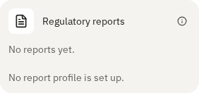

# Working Regulatory Reports

A regulatory report, being a suspicious activity or transaction report, is filed about a case and exists only as part of that case. It is built by the report engine, `Jube.RegulatoryReport`, from a profile as described in [Regulatory Reporting](../../RegulatoryReporting/index.html), approved by a second person, and then filed with the financial intelligence unit (FIU) outside Jube. Keep in mind that Jube records the filing, and does not transmit it.

Put plainly, where an investigation concludes that activity is suspicious, the institution is obliged to tell the authorities, in a file of a format the authority prescribes. This card is where that file is prepared from the case, checked against the format, signed off by a second person, downloaded for uploading to the authority, and where what the authority said in return is written down. The terms used are as follows:

| Term        | Meaning                                                                                                                                             |
|-------------|-----------------------------------------------------------------------------------------------------------------------------------------------------|
| FIU         | The financial intelligence unit, being the authority to which the report is filed.                                                                  |
| MLRO        | The money laundering reporting officer, being the person accountable for what is filed, who here is whoever holds the approve permission.           |
| Profile     | The description of one format of one FIU: a template that lays out the XML and the schema files against which it is checked.                        |
| Report type | The code by which the FIU knows the kind of report, for example STR or SAR. It is typed, and is not chosen from a list.                             |
| Report fields | The values particular to this one report that are not already known from the case, typed as a JSON object.                                        |
| Version     | One saved state of the fields and the XML built from them. A change to what was validated makes a new version, the old one being kept.              |
| Preparer    | The user having started the report.                                                                                                                 |

## Where it lives

Navigate to a case record from the Cases page. Reports are prepared, approved and recorded in the card titled Regulatory reports in the Decide pane, under On this case. The card acts in place, and is presented only to a user holding one of the three report permissions described below. To anyone else the card does not appear at all.

SHOT id=case-regulatory-reports-validated
     route=/cases
     steps=open-demo-case, scroll-to:Regulatory reports
     frame=section:Regulatory reports
     state=the Regulatory reports card on a demonstration case, signed in as a user holding File Case Reports, with one report in the state Validated showing its report type, its version line, the Report fields (JSON) box and the Request approval control
     conveys=a report is prepared on the case itself, in the Decide pane, and moves through named states towards approval
     alt=The Regulatory reports card in the Decide pane showing a validated report with its fields as JSON and the control to request approval


## Who can do what

There are three permissions, none of which is held by anyone but the Administrator role until granted:

| Permission               | Allows                                                                                                                                                                                                                              |
|--------------------------|-------------------------------------------------------------------------------------------------------------------------------------------------------------------------------------------------------------------------------------|
| 75, File Case Reports    | Starting a report, editing its fields, validating it, requesting approval, withdrawing one's own, downloading it once approved, recording that it was filed, recording what the FIU said, and correcting a rejected report as a new version. |
| 76, Approve Case Reports | Approving or rejecting a report that someone else prepared, importing report profiles, seeing the list awaiting approval, downloading an approved report, withdrawing any unfiled report, and closing a case that has a report awaiting approval. This is the role of the MLRO. |
| 77, View Case Reports    | Seeing that reports exist and reading them.                                                                                                                                                                                         |

In all circumstances the user must also be able to open the case. A user holding none of the three sees nothing: the card does not appear, the API answers forbidden, and the steps of a report are not in the Events of the case.

## Tipping-off

Reports are kept out of every place in which a person without the permissions could stumble upon them, for the purposes of not disclosing that a report exists:

* The report, its versions, its approvals and the feedback of the FIU live in their own tables and are read only through the report API.
* The generated XML is held on the version, and is not attached to the case as a file or a note, because the files and notes of a case are visible to everyone able to read the case.
* The steps of a report are not written to the Events of the case.
* The tables are blocked from the SQL of Ask Jooby, and no Ask Jooby tool reaches them.
* Notifications about reports go only to holders of the permissions.

## The life of a report

A report moves through the following states, each shown against the report in the card:

```text
Draft -> Validated -> Pending approval -> Approved -> Submitted -> Acknowledged
  ^          |               |                           |
  |          v               v                           +-> Rejected by the FIU -> new version (Draft)
  +---- edit makes a        Rejected by the approver -> Draft
        new version        Withdrawn (from Draft, Validated or Pending approval)
```

The steps are as follows:

1. **Start.** A Profile is chosen and the Report type of the FIU is given, limited to 50 characters, then Start a report. The report starts as a Draft, at version 1. Where no profile has been imported, the card states that no report profile is set up.
2. **Fields.** The fields specific to the report are entered as a JSON object in Report fields (JSON), then Save fields. The engine is also given the case (its key, key value, workflow and dates), the latest narrative note and the name of the user, and the template of the profile reads all of these. Saving a draft that has never been validated updates it in place, whereas saving a validated one makes a new version, so that what was validated is never altered.
3. **Validate.** The engine builds the XML and checks it against the schema of the FIU. Problems are returned under Problems found, each with the data path or the XML element path, line and position, and the report stays a Draft. A clean run stores the XML and its SHA-256, and moves the report to Validated.
4. **Request approval.** Holders of the approve permission are notified, and the version is thereafter frozen.
5. **Approve or reject.** A different person approves, or rejects with a note, which is required to reject and limited to 1,000 characters. A rejection returns the report to Draft. The preparer, and whoever last edited the version, can never decide it.
6. **Download.** Once approved, the stored XML can be downloaded with Download XML. Jube checks the bytes against the recorded hash on the way out, and refuses where they differ.
7. **Record the filing.** Upon the XML having been uploaded to the FIU, the FIU reference is entered, limited to 200 characters, then Record as submitted. The report becomes Submitted, and the case is placed under legal hold, with the reason Regulatory report filed, so that retention can never remove it.
8. **Record the answer of the FIU.** The FIU response is recorded as one of Acknowledged, Rejected or Information requested, with a Message of up to 2,000 characters and, optionally, the Field it refers to, then Record response. Acknowledged ends the report. Rejected returns it to the preparer, who uses Correct as a new version to produce a version superseding the rejected one, both being kept. Information requested is recorded and the report stays Submitted.

Withdraw is available to the preparer of a report, and to any holder of the approve permission, for as long as the report is a Draft, Validated or Pending approval.

Beneath each report the card lists its versions with the user having made each, the approvals and rejections with their notes, and the responses of the FIU.

## Reading the card

The card lists every report of the case, and beneath them, for a holder of File Case Reports, the line on which a new one is started. Before any report exists the card states No reports yet, and where the reports cannot be read, Could not load the reports. The help mark beside the title reads "Reports to a financial intelligence unit about this case. Only people with a report permission can see this. A second person must approve a report before it can be downloaded or filed."

Each report is headed by its Report type, the name and version of its profile in brackets, its state as a badge and, once filed, the FIU reference. What is offered beneath depends upon the state of the report and the permissions of the user, as follows:

| State               | Offered to a holder of File Case Reports                              | Offered to a holder of Approve Case Reports            |
|---------------------|-----------------------------------------------------------------------|--------------------------------------------------------|
| Draft               | Report fields (JSON), Save fields, Validate, Withdraw                 | Withdraw                                               |
| Validated           | Report fields (JSON), Save fields, Request approval, Withdraw         | Withdraw                                               |
| Pending approval    | Withdraw                                                              | Note (required to reject), Approve, Reject, Withdraw   |
| Approved            | Download XML, FIU reference, Record as submitted                      | Download XML                                           |
| Submitted           | Download XML, FIU response, Message, Field it refers to, Record response | Download XML                                        |
| Acknowledged        | Download XML, and the same means to record a further response         | Download XML                                           |
| Rejected by the FIU | Download XML, Correct as a new version                                | Download XML                                           |
| Withdrawn           | Nothing                                                               | Nothing                                                |

The controls behave as follows:

* The line for starting a report offers the Profile, set to the first profile, and the Report type, which will not accept more than 50 characters. Start a report is disabled until a Report type has been typed, and the box is cleared once the report has been started.
* Save fields is disabled while the text is not a JSON object, which is to say while it does not parse or is a list or a single value. A new report begins with its fields as an empty object.
* Problems found is a list in red beneath the fields, each problem followed by its path in brackets, and is shown only while the report is a Draft.
* Reject is disabled until a note has been typed, whereas Approve may be given with or without one. The note will not accept more than 1,000 characters.
* Record as submitted is disabled until an FIU reference has been typed, which will not accept more than 200 characters.
* Record response is disabled until an FIU response has been chosen, there being none chosen to begin with. The Message will not accept more than 2,000 characters.
* Every step that succeeds is confirmed by the message Done, and the card is read again, so the badge and the controls change in front of the user. None of the steps asks for confirmation first, Withdraw included.
* Download XML is drawn only for a holder of permission 75 or 76, and Withdraw only for the user who prepared the report or a holder of 76, such that a holder of View Case Reports alone reads the card without either.

The history beneath each report reads, for example, "Version 1 by Administrator", then "Analyst2: approved" or "Analyst2: rejected" followed by the note, then the response of the FIU, as Acknowledged, Rejected or Information requested, followed by its message and the field in brackets.

## A report from start to finish

Suppose the demonstration case on AccountId ACC-915, closed as Fraudulent, is to be reported, that the user Administrator prepares the report, and that a second user holding Approve Case Reports signs it off.

1. Administrator opens the case, and in the Regulatory reports card chooses the Profile, types STR as the Report type and selects Start a report. The card now lists STR as a Draft, with "Version 1 by Administrator" beneath.
2. Administrator types the fields the template of the profile asks for into Report fields (JSON), for example `{"reasonForSuspicion": "Card present in two countries within the hour"}`, and selects Save fields.
3. Administrator selects Validate. Where the XML does not satisfy the schema of the FIU, Problems found lists what is wrong and the report remains a Draft, to be corrected and validated again. Where it does, the badge reads Validated.
4. Administrator selects Request approval. The badge reads Pending approval, the fields can no longer be edited, and Administrator is offered only Withdraw.
5. The second user opens the same case and is offered Approve and Reject. Upon Approve the badge reads Approved and the history gains the line naming the approver. Had Administrator attempted to approve, it would have been refused with You cannot decide a report you prepared.
6. Administrator selects Download XML, uploads the file to the FIU by whatever means the FIU provides, types the reference the FIU returned into FIU reference and selects Record as submitted. The badge reads Submitted, the reference is shown in the heading of the report, and the Legal hold card of the case reads Under legal hold.
7. When the FIU answers, Administrator chooses Acknowledged under FIU response and selects Record response, and the badge reads Acknowledged.

## Refusals

The following are refused by the server, with the message shown on the page:

| Circumstance                                                            | Message                                                                     |
|-------------------------------------------------------------------------|-----------------------------------------------------------------------------|
| Starting without a profile, or with a Report type over 50 characters    | The case, profile and a report code of at most 50 characters are required.  |
| The profile no longer exists                                            | The profile was not found.                                                  |
| The fields are not JSON                                                 | The fields are not valid JSON.                                              |
| The fields are JSON but not an object                                   | The fields must be a JSON object.                                           |
| The fields exceed the size allowed                                      | The fields are too large.                                                   |
| Validating a report that is not a Draft                                 | Only a draft report can be validated.                                       |
| Validating a version already validated                                  | This version is already validated; edit it to make a new version.           |
| Approving or rejecting one's own report                                 | You cannot decide a report you prepared.                                    |
| Rejecting without a note                                                | A reason is required to reject a report.                                    |
| A note over 1,000 characters                                            | The note must be at most 1000 characters.                                   |
| Withdrawing after approval, or by someone not entitled                  | This report cannot be withdrawn.                                            |
| Recording a filing with no reference, or one over 200 characters        | The FIU reference is required and at most 200 characters.                   |
| Recording a filing on a report that is not Approved                     | Only an approved report can be recorded as submitted.                       |
| Recording a response on a report never filed                            | Only a submitted report can have FIU feedback recorded.                     |
| A message or field path that is too long                                | The message or field path is too long.                                      |
| Correcting a report the FIU did not reject                              | Only a report the FIU rejected can be corrected as a new version.           |
| Downloading before approval, or after withdrawal                        | Only an approved or filed report can be downloaded.                         |
| Two users acting on the same report at once                             | The report was changed by someone else.                                     |
| A step taken from the wrong state                                       | The report is not in the right state for that.                              |

A response of Acknowledged can be followed by a further response, so that an FIU which acknowledges a report and later rejects it, or asks for information, can be recorded faithfully.

SHOT id=case-regulatory-reports-approved
     route=/cases
     steps=open-demo-case, scroll-to:Regulatory reports
     frame=section:Regulatory reports
     state=the Regulatory reports card on a demonstration case with one report in the state Approved, showing the approval line naming the approver, the Download XML link and the FIU reference box with Record as submitted
     conveys=an approved report is downloaded for filing outside Jube, and the reference returned by the FIU is then recorded against it
     alt=The Regulatory reports card showing an approved report with its approval history, a link to download the XML and a box to record the FIU reference



## Closing the case

A case cannot be closed while one of its reports is Pending approval, or Approved but not yet Submitted. Holders of the approve permission may close it regardless.

A user holding one of the report permissions is told why. Anyone else is told only that the case cannot be closed yet, and to ask a supervisor to review it, the reason being withheld so that the existence of a report is not disclosed. Every other refusal to close (a checklist item outstanding, or the case being locked by someone else) already states specifically what is wrong.

## What is not included

The following are not available at present:

* The data given to the engine is the facts of the case, the narrative and the fields typed. Transactions chosen from the Case Key Journal, field roles, and values from a Case Workflow Form are not offered.
* The list of reports awaiting approval is available through the API only, by `GET /api/CaseReport/AwaitingApproval`, and is not presented in the approvals panel of the Cases page.
* A rejection by the FIU does not set a diary on the case.
* Profiles are imported through the API only, by `POST /api/CaseReportProfile/Import`, and there is no page for them.

## Permissions and security

The three permissions are 75, File Case Reports, 76, Approve Case Reports, and 77, View Case Reports, as tabulated above, and each is in addition to the case being visible to the user.

The separation of preparer and approver is enforced in the server: a report cannot be approved or rejected by the user who started it, nor by the user who last edited the version awaiting approval. The stored XML is verified against its recorded SHA-256 on every download.
