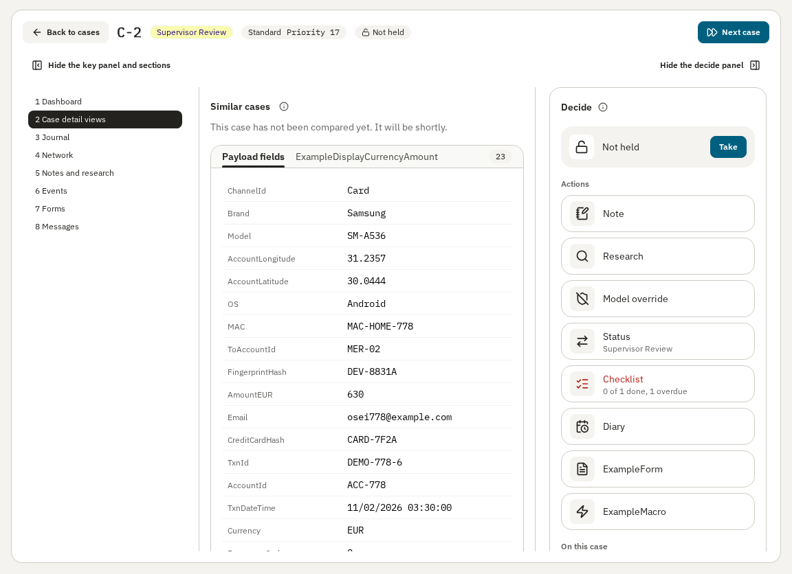

# Working Similar Cases

Upon a case being opened, the first question is usually whether anything like it has been seen before, and what was decided. The Similar cases list on the case page exists to answer that. It presents the cases of the same Case Workflow that resemble the one in view, how alike each is, how the closed ones were decided, and what the two cases share.

It is context to read, which is to say that it never changes the likelihood, the priority or the lane of a case, it does not block a decision, and it creates, links, moves and closes nothing.

The idea is a simple one. Every case is reduced to a list of plain facts about itself, such as the rules that fired, the Tags given to it, the device it used and the size of the money involved. Two cases are similar to the extent that their lists overlap, with a fact that few cases carry counting for far more than a fact that most cases carry. There is no model to train and nothing to configure, and every match is explained on the page by the facts the two cases share, so that the reader can judge whether the resemblance is one that matters.

## The terms used

The following terms are used throughout this page:

| Term              | Meaning                                                                                                                                                                         |
|-------------------|---------------------------------------------------------------------------------------------------------------------------------------------------------------------------------|
| Fact              | One plain statement about a case, for example that the rule Velocity fired, or that the field Device held a given value.                                                         |
| Kind              | The family a fact belongs to, of which there are eight: Rule, Model, Tag, Entity, Category, Measure, Feature and Band.                                                           |
| Similarity vector | The whole list of facts held for one case. It is a list and nothing more, no numbers are learned and no embedding is produced.                                                   |
| Weight            | How much a single fact counts for, worked out from how many cases of the Case Workflow carry it. Rare facts weigh a great deal, common facts very little.                        |
| Size band         | A coarse bucket for a number, so that two amounts of about the same size are treated as the same fact. Each band spans half a power of ten, for example 1,000 up to about 3,162. |
| Score             | The similarity of two cases, from 0, where nothing is shared, to 1, where the lists are identical.                                                                               |
| Match             | The score as it is presented: a Strong match or a Moderate match. Anything weaker is not shown at all.                                                                           |
| Linked            | A mark on a match saying that the two cases touch the same real thing, such as a device, and do not merely look alike.                                                           |
| Sweep             | The background job of the jobs server that builds and refreshes the similarity vectors.                                                                                          |

## Where it lives

Navigate to a case record from the Cases page. Similar cases are presented in three places on the case page, all of them in the canvas and none requiring any action:

* The header of the page carries a small badge, for example "12 similar", beside the badge stating who holds the case. It is shown only where at least one similar case exists, hovering over it reads "Show the 12 similar cases", and selecting it opens the Case detail views section, if that section had been folded away, and moves to the list.
* The Similar cases figure, at the top of the Case detail views section, reads for example "5 / 6", meaning that five of the six similar closed cases were confirmed. Beneath it, the earlier cases on the same key continue to be counted separately.
* The Similar cases list, in the same section, presents the ten most similar cases, most alike first, and states the total where there are more.

The figure can take the following forms, the sentence beneath it being the same sentence that heads the list:

| The figure shows | The sentence beneath                                           | When                                                                  |
|------------------|----------------------------------------------------------------|-----------------------------------------------------------------------|
| 5 / 6            | 5 of 6 similar closed cases were confirmed                     | Five or more of the similar cases are closed with an outcome.         |
| 3                | Too few similar cases are closed to judge by                   | There are similar cases, three here, but fewer than five are closed.  |
| 0                | No similar cases were found.                                   | The case has been compared and nothing resembles it.                  |
| -                | This case has not been compared yet. It will be shortly.       | The sweep has not yet reached the case.                               |
| -                | Similar cases are switched off on this installation, so this case will not be compared. | The CaseSimilarityHashingKey Environment Variable is not set. |
| -                | Could not load the similar cases.                              | The request failed.                                                   |

The last line of the figure is about the case key and not about similarity. It reads, for example, "1 of 2 earlier cases on this key were confirmed", or "No earlier closed cases on this key", and counts only the cases raised on the very same key value.

SHOT id=case-similar-cases-list
     route=/cases
     steps=open-demo-case, scroll-to:Similar cases
     frame=page
     state=a demonstration case with the header badge reading 12 similar, the Similar cases figure reading 5 / 6, and the Similar cases list showing a Strong match marked Linked and Confirmed with its shared facts, and a Moderate match that is still open
     conveys=similar cases are context in the canvas, each stating how alike it is, how it was decided and which facts are shared
     alt=A case page with a similar cases badge in the header, a similar cases figure of five of six confirmed, and a list of similar cases each with a match strength, an outcome and the shared facts



## Reading the list

Each row of the list presents the following:

| Value            | Description                                                                                                                      | Example                |
|------------------|----------------------------------------------------------------------------------------------------------------------------------|------------------------|
| Case number      | The number of the similar case, which opens that case.                                                                           | C-1042                 |
| Case key value   | The value of the case key of the similar case.                                                                                   | ACC-915                |
| Match            | Whether the match is a Strong match or a Moderate match.                                                                         | Strong match           |
| Linked           | Shown where the two cases share a real thing, as described below.                                                                | Linked                 |
| Shared facts     | Up to six of the facts the two cases share, as Rule, Model or Tag with the name, or Same with the name of the field.             | Same Device            |
| Outcome          | Confirmed or Not confirmed for a closed case with an outcome, Closed for one without, and the status for a case still open.      | Confirmed              |
| Closed date      | When the case was closed, where it has been.                                                                                     |                        |

The heading of the list carries the total number of similar cases as a small figure, and a help mark that explains the list in a sentence or two. The rows are ordered by the score, highest first, and where two scores are equal, by the weight of what is shared and then by the newer case. Only the ten most similar are listed, and where there are more the foot of the list states, for example, "Showing the 10 most similar of 12". The score itself is not printed on the page, only the match, although it is returned by the API as shown in the Example below.

The shared facts are the explanation of the match and are the part most worth reading. They are presented heaviest first, which is to say the rarest fact the two cases share comes first, and they take four forms:

| The chip reads       | Meaning                                                                                                                         |
|----------------------|---------------------------------------------------------------------------------------------------------------------------------|
| Rule Velocity        | The Activation Rule of that name fired on both cases.                                                                           |
| Model FraudScore     | The model of that name gave both cases a highest score in the same band.                                                        |
| Tag MoneyMule        | Both cases, or their transactions, carry that Tag.                                                                              |
| Same Device          | Both cases hold the same value in the field of that name, or a number of the same size in it. The value is never shown.         |

Same is used for every Entity, Category, Measure, Feature and Band fact, and the name is that of the payload field, of the Abstraction Rule, Abstraction Calculation or TTL Counter, or the words Value or Lane for the two Band facts. Where two cases share several facts about one field, for example both the sum and the largest value of Amount, the field is named once.

The Outcome is drawn from the status the similar case sits in. A case in the closed state whose status has the outcome Confirmed is presented as Confirmed in red, as it is the outcome that should catch the eye, Not confirmed is presented in a muted tone, and Closed is shown where the status has no outcome. A case in any other state, be it open or suspended, shows the name of its status, and hovering over any outcome shows the status name.

Above the list a sentence states how many of the similar closed cases were confirmed, alongside the number still open, for example "5 of 6 similar closed cases were confirmed" followed by "4 still open". Only a case that is closed in a status that has an outcome is counted as closed, and only a case that is open, or suspended while open, is counted as still open, it follows that the two numbers need not add up to the total. Fewer than five similar closed cases is too few to judge by, in which circumstance the page states Too few similar cases are closed to judge by, in place of quoting a ratio, and the Similar cases figure shows the number of similar cases alone.

A case that has only just been created reads This case has not been compared yet. It will be shortly, until the next pass of the sweep, which is within a minute by default. Where the comparison has been made and nothing resembles the case, No similar cases were found is stated. Where the request fails, Could not load the similar cases is stated in place of the list. The page keeps what it fetched for a minute, so a case that has just been compared may need the page to be reopened before its matches appear.

## How two cases are compared

The comparison is explained here in four steps: the facts a case is described by, how much each fact weighs, how the facts of one kind are scored, and how the kinds are combined into a match.

### Step one: the facts of a case

Each case is described by a short list of plain facts about itself, called its similarity vector. Nothing is configured: every field the transactions of the case carry takes part.

| Kind     | The fact                                                                       | What sharing it says              | Counts |
|----------|--------------------------------------------------------------------------------|-----------------------------------|--------|
| Rule     | Each Activation Rule that fired visibly on any transaction of the case key     | The same typology fired           | 3      |
| Model    | The highest score each model gave, as a band                                   | The same model raised it          | 1      |
| Tag      | Each Tag on the case or on its transactions                                    | An analyst called them the same   | 3      |
| Entity   | Each value of a payload field that is an Archive Key, such as a device         | The cases share a real thing      | 3      |
| Category | Each value of any other text or true or false payload field, such as a channel | The same kind of activity         | 1      |
| Measure  | The sum, mean and largest value of each numeric payload field, as size bands   | The same size of activity         | 1      |
| Feature  | Each Abstraction Rule, Abstraction Calculation and TTL Counter value, banded   | The same behaviour on the account | 1      |
| Band     | The value at stake as a size band, and the lane when it is Live money or Mandatory | The same seriousness          | 1      |

The Counts column is how much the kind contributes when the kinds are combined in step four. Rule, Tag and Entity count three times as much as the others, for the reason that the same typology firing, an analyst having called two cases the same, and two cases touching the same real thing are the three strongest statements that can be made about a pair of cases, whereas a similar amount or a similar channel is common by its nature.

A number of particulars follow from the manner in which the facts are read:

* A number is never compared exactly, as two cases would almost never share one. It is placed in a size band spanning half a power of ten, so that 1,000 up to about 3,162 is one band and about 3,162 up to 10,000 is the next. It follows that amounts of 1,200 and 2,900 are the same fact, whereas 2,900 and 3,500 are not. Zero has a band of its own, and negative numbers are banded apart from positive ones.
* A model score that lies between 0 and 1 is placed in quarters instead, so that 0.80 and 0.95 are the same fact and 0.70 is a different one. Any other model score is placed in a size band.
* A Measure fact is made three times for each numeric field, from the sum, the mean and the largest value across the transactions read, so that many small payments and one large payment of the same total agree on the sum and differ on the largest value.
* A Feature fact is taken from the most recent transaction alone, as that transaction carries the latest view of the behaviour on the key.
* Payload fields holding a date, a latitude or a longitude take no part, as they would never match to any purpose.
* A whole number in a field that is an Archive Key, such as a numeric customer identifier, is treated as an Entity and not as a Measure.
* A text field with more than twelve different values inside one case is left out for that case, as a field of that nature is a reference and not a description.
* A case holds at most 400 facts.

### Step two: the weight of a fact

Two cases are similar where they share facts, with three refinements:

* **Rare facts count for more.** A rule that fires on most cases of the Case Workflow says almost nothing when two cases share it, whereas a device only three cases have ever used says a great deal. The weight of a fact is worked out from how many cases of the Case Workflow carry it.
* **A fact only one case carries is ignored.** A transaction reference or a timestamp never matches anything, so it is left out rather than being allowed to drag every comparison down. A field with more than twelve different values inside one case is left out for that case for the same reason.
* **One common fact is never a match.** Two cases must share enough weight before they are called similar at all.

The weight of a fact is the natural logarithm of the number of cases in the Case Workflow, plus one, divided by the number of cases carrying the fact, plus one. It is not necessary to compute it to read the page, yet the following values, for a Case Workflow holding 199 cases, show its shape:

| Cases carrying the fact | Weight | Reading                                   |
|-------------------------|--------|-------------------------------------------|
| 1                       | 0      | Ignored, there is nothing to match        |
| 3                       | 3.91   | Rare, and it says a great deal            |
| 19                      | 2.30   | Uncommon                                  |
| 99                      | 0.69   | Carried by half the cases, it says little |
| 149                     | 0.29   | Carried by most cases, it says very little|
| 199                     | 0      | Carried by every case, it says nothing    |

The weights are relative to the Case Workflow, it follows that the same rule may be weighty in one Case Workflow and of little account in another, and that the weights are small while a Case Workflow holds only a handful of cases. In a Case Workflow of three cases, a fact shared by two of them weighs only 0.29, so it is usual for a newly installed system to state No similar cases were found until the cases have accumulated.

### Step three: the score of one kind

The kinds are scored one at a time. For a kind, the weights of the facts both cases carry are added up, and divided by the weights of all the facts either case carries. The result is 1 where the two cases carry exactly the same facts of that kind, 0 where they share none, and somewhere between otherwise.

A kind takes part only where both cases carry at least one fact of it that has a weight. A case with no Tags is therefore not penalised for it, the Tag kind is left out of that comparison. A kind where both cases carry facts and share none of them scores 0 and does pull the similarity down, which is as it should be, two cases on which wholly different rules fired are less alike for it.

### Step four: the match

The scores of the kinds taking part are averaged, each counted as set out in the Counts column above, giving a similarity from 0, where nothing is shared, to 1, where the cases are identical. The page presents it as follows:

| Similarity      | Presented as   |
|-----------------|----------------|
| 0.60 and above  | Strong match   |
| 0.35 up to 0.60 | Moderate match |
| Below 0.35      | Not shown      |

There is one further condition, which is the meaning of one common fact never being a match. The weights of every fact the two cases share are added together, across all kinds, and where the total is below 2 the pair is not shown, whatever the similarity. Two cases on which only the rule Velocity fired, both through the web channel, are identical as far as their lists go and would score 1, yet in the Case Workflow of 199 cases above the two shared facts weigh 0.69 and 0.29, a total of 0.98, so the pair is rightly not called similar. A single shared device seen on only three cases, at 3.91, clears the condition by itself.

Keep in mind that it is a similarity and not a probability. A Strong match says that two cases are described by much the same rare facts. It does not say that this case will be decided as that one was.

A row is marked Linked where the two cases share an Entity fact, or where their keys sit in the same community of the network graph, a community being a cluster of keys the graph has found to be closely connected, as described in [Graph Concepts](../../Graph/Concepts/index.html). Linked means that the cases touch the same real thing, whereas the other matches only look alike. Hovering over the mark reads "Shares a real thing with this case, such as a device or a counterparty, or sits in the same network community." This is not to be confused with the links made by an analyst, as described in [Working Linked Cases](../WorkingLinkedCases/index.html).

The weights of the kinds, and the thresholds for a Strong match and a Moderate match, are fixed and are the same for every Case Workflow. Free text, such as notes and the reasons for closing, takes no part. Where several payload fields carry the same number, each is counted within the Measure kind.

## A worked comparison

Suppose a Case Workflow holding 199 cases, and a case on AccountId ACC-441 that is being read. An earlier case, C-1042 on ACC-915, was closed as Fraudulent. The numbers are chosen to make the arithmetic plain and are not those of the demonstration data. The facts of the two cases, with the number of cases carrying each and the weight that follows, are as below:

| Kind     | Fact                                   | Cases carrying it | Weight | ACC-441 | C-1042 |
|----------|----------------------------------------|-------------------|--------|---------|--------|
| Rule     | Velocity                               | 99                | 0.69   | Yes     | Yes    |
| Rule     | NewDeviceHighValue                     | 19                | 2.30   | Yes     | Yes    |
| Rule     | CountryMismatch                        | 39                | 1.61   |         | Yes    |
| Entity   | Device, the same value                 | 3                 | 3.91   | Yes     | Yes    |
| Entity   | Counterparty, a value                  | 9                 | 3.00   | Yes     |        |
| Category | Channel, the same value                | 149               | 0.29   | Yes     | Yes    |
| Measure  | Amount, sum between 3,162 and 10,000   | 49                | 1.39   | Yes     | Yes    |
| Measure  | Amount, largest between 1,000 and 3,162| 79                | 0.92   | Yes     |        |
| Measure  | Amount, largest between 316 and 1,000  | 59                | 1.20   |         | Yes    |

Each kind is then scored as the shared weight over the weight of everything either case carries:

| Kind     | Shared weight      | All weight                | Score | Counts |
|----------|--------------------|---------------------------|-------|--------|
| Rule     | 0.69 + 2.30 = 3.00 | 0.69 + 2.30 + 1.61 = 4.61 | 0.65  | 3      |
| Entity   | 3.91               | 3.91 + 3.00 = 6.91        | 0.57  | 3      |
| Category | 0.29               | 0.29                      | 1.00  | 1      |
| Measure  | 1.39               | 1.39 + 0.92 + 1.20 = 3.51 | 0.40  | 1      |

Neither case carries a Tag, a model score, a Feature or a Band fact in this example, so those four kinds are left out. The similarity is three times 0.65, plus three times 0.57, plus 1.00, plus 0.40, all divided by the eight counts, which is 0.63. The weight shared across all kinds is 3.00 plus 3.91 plus 0.29 plus 1.39, being 8.58, comfortably above the 2 that is required.

On the page of the case on ACC-441, the row for C-1042 would therefore read ACC-915, Strong match, Linked on account of the shared Device, and Confirmed in red with the date it was closed, given that the status Fraudulent carries the outcome Confirmed. The shared facts would read, heaviest first, Same Device, Rule NewDeviceHighValue, Same Amount, Rule Velocity and Same Channel.

The reading an analyst should take from that row is that an account once confirmed as fraud used the very same device, and that the same uncommon rule fired on both, which is reason enough to open C-1042 and read how it was decided. Had the row read only Rule Velocity and Same Channel, it would not have appeared at all.

## Reading a match

The following is offered as a guide to what deserves attention:

* A match marked Linked is the strongest signal on the list, for it is a statement of fact that the two cases share a device, a counterparty or a place in the network, and not a statement of resemblance.
* A Strong match whose first shared fact is an uncommon Rule or a Tag says that the same typology, or the same judgement by an analyst, applies to both.
* A match explained only by Same followed by the names of amount or channel fields says that the activity is of the same kind and size, which is weaker and on its own seldom a reason to act.
* The sentence above the list is a base rate. Five of six similar closed cases having been confirmed is a reason to look harder, and none of six a reason for some comfort, yet it remains the history of other cases and not a finding about this one.
* Fewer than five closed cases is not quoted as a ratio precisely because one or two decisions would be mistaken for a pattern.

## What it does not do

It is as well to be plain about the limits. Similar cases does not change the likelihood, the priority, the lane or the queue position of any case. It does not link cases, in the sense of [Working Linked Cases](../WorkingLinkedCases/index.html), and it does not suggest a decision. It does not read the meaning of text, so notes, narratives and the reasons for closing take no part, and two fields holding the same thing under different names are not recognised as the same. It compares only within one Case Workflow. It cannot be tuned, there being no setting for the weights, the thresholds or the fields that take part.

## Which cases are compared

A case is not compared with every other case of the Case Workflow, as that would not remain quick as the cases grow. The eight rarest facts of the case in view are taken, leaving aside any carried by more than 500 cases, and the cases sharing those facts are gathered, the cases sharing the most of them first, up to 300. Those are the cases scored in the manner set out above. It follows that the total number of similar cases never exceeds 300, and that a case whose every fact is very common finds nothing, which is the intended result.

## The vector follows the case

While a case is open, or suspended while open, its vector is rebuilt from every transaction on its key, so a new transaction, a new activation or a new Tag changes what it is compared with. The sweep notices change by the age of the vector, it follows that an open case can lag a new transaction by up to CaseSimilarityRefreshMinutes.

The transactions read are those of the case key from CaseSimilarityWindowDays before the case was created up to the present, or up to the moment of closing for a case that is no longer open, and where there are more than CaseSimilarityMaximumRows the newest are kept.

Upon the case being closed the vector is rebuilt one last time and then left as it stood, so a closed case is always compared as it was when it was decided.

The sweep makes its first pass thirty seconds after the jobs server starts and takes the cases never compared first, then those compared longest ago, up to CaseSimilarityMaximumCases in a pass. Where the vector of a case cannot be built, the failure is written to the log and the case is marked as compared, so that one troublesome case does not hold up the rest. Such a case reads No similar cases were found until its next rebuild.

The case key of the Case Workflow must be flagged as Archive Key, in the [Request XPath](../../Models/RequestXPath/index.html) of the model, for the transactions of a case to be read. Where it is not, the vector holds only the Tags and the Band facts.

## What is stored

The values of Entity and Category facts are never stored. Only the name of the field and a keyed hash of the value are, which is enough to tell that two cases share a value and not enough to read it. The shared facts on the page therefore name the field, for example "Same Device", and not the value. The names of rules, models and Tags are stored as they are.

The hash is keyed with the CaseSimilarityHashingKey Environment Variable, a long random value that belongs to this feature alone. It has no default, and until it is set no similarity vector is built and the page shows no similar cases. In that circumstance every case that has not been compared reads Similar cases are switched off on this installation, so this case will not be compared, and the jobs server writes a warning to its log on starting, stating that CaseSimilarityHashingKey is not set. The Docker Compose quick start exports `DockerComposeCaseSimilarityHashingKey` with a placeholder that must be changed, and the key is left empty only where that line has been removed, so this is the state of a system started in that manner without it.

Set the key once and keep it. Changing the key changes every hash produced thereafter, and as a closed case is never rebuilt, the open cases stop matching the closed ones on Entity and Category facts. There is no means at present to rebuild every vector under a new key.

## Environment Variables

The vectors are kept up to date by a sweep of the jobs server, set as follows:

| Value                        | Description                                                                        | Example |
|------------------------------|------------------------------------------------------------------------------------|---------|
| EnableCaseSimilarity         | Whether the jobs server keeps the similarity vectors up to date. True by default.  | True    |
| WaitCaseSimilarity           | Milliseconds between passes of the sweep.                                          | 60000   |
| CaseSimilarityRefreshMinutes | How old the vector of an open case may be before it is rebuilt.                    | 30      |
| CaseSimilarityWindowDays     | How many days before the creation of a case its transactions are read from.        | 90      |
| CaseSimilarityMaximumRows    | The most transactions read for one case, newest first.                             | 500     |
| CaseSimilarityMaximumCases   | The most cases one pass rebuilds.                                                  | 500     |
| CaseSimilarityHashingKey     | The key with which Entity and Category values are hashed. Nothing is built without it, and there is no default. |         |

The examples are the defaults.

## Example

The API underlying the page is as follows:

```http
GET /api/CaseSimilarity/{caseId}
```

The response carries whether the case has been compared and when, the number of similar cases, how many of them are closed with an outcome, how many of those were confirmed, how many are still open, whether there are enough closed to judge by, and the ten most similar cases. Each of those carries its case number, key and key value, its status, the outcome, the dates it was created and closed, the match as `bandId` (2 for Moderate, 3 for Strong), the similarity as `score` to four decimal places, whether it is `linked`, and the shared facts as a kind and a name. A case that does not exist returns 404, and a user without the permission is returned 403.

[Ask Jooby](../../../AskJooby/index.html) reaches the same information through the `CaseSimilarityGet` tool, and a case narrative may state how many earlier cases resembled this one and how they were decided, without identifying them.

## Permissions and security

Reading similar cases requires permission 1, Read Write Case, and the case must be visible to the user. Cases are compared only within one Case Workflow.

A similar case is listed, and counted in the figures, only where a role of the user is granted its current status. It follows that two users may see different counts for the same case, and that the existence of a case that a user cannot see is never revealed.
