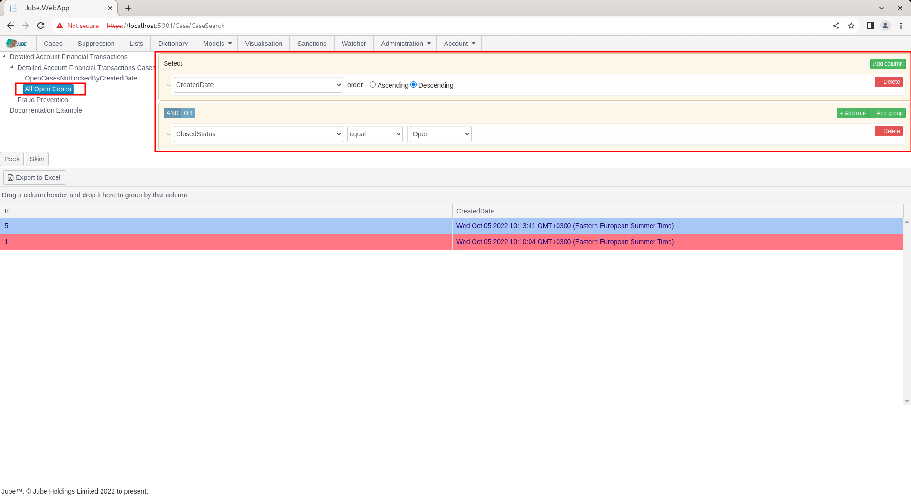
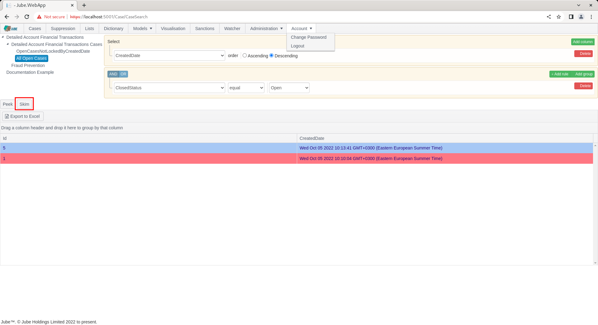
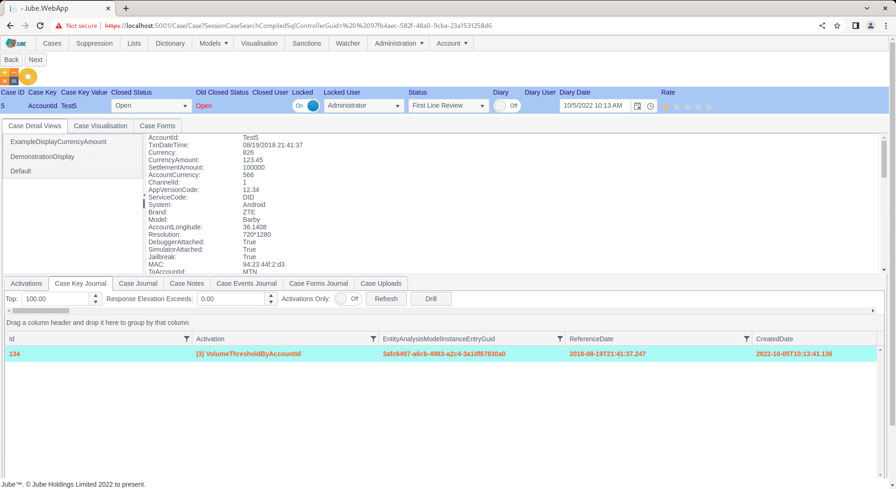
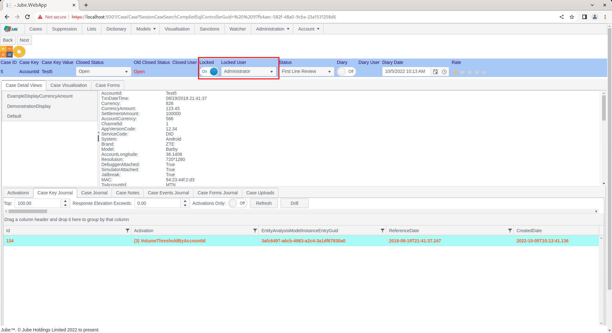
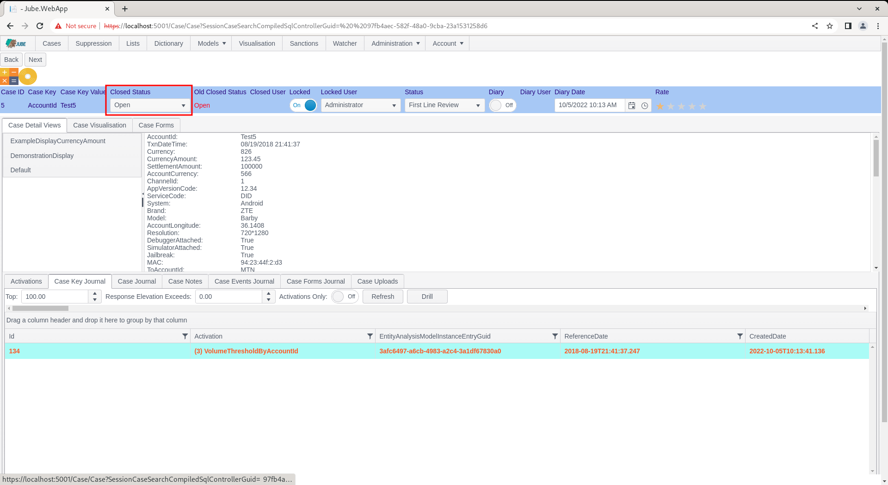
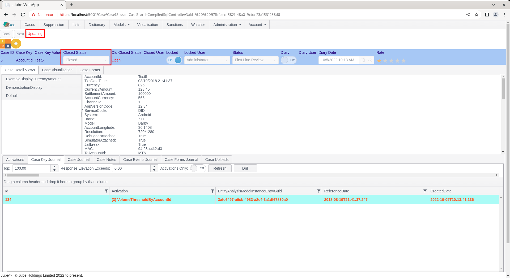
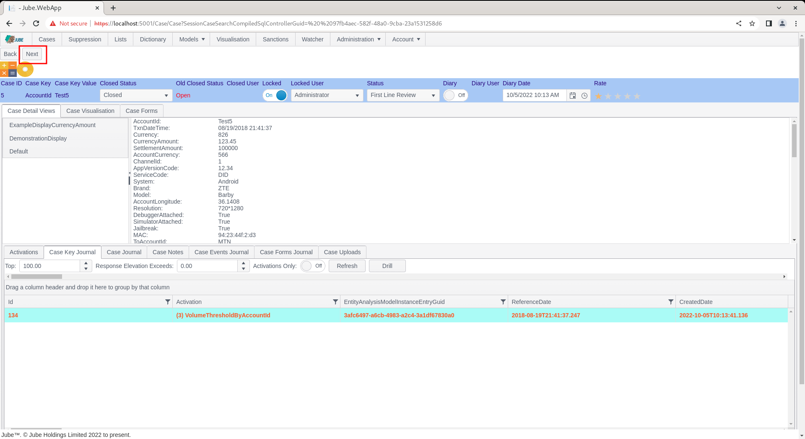
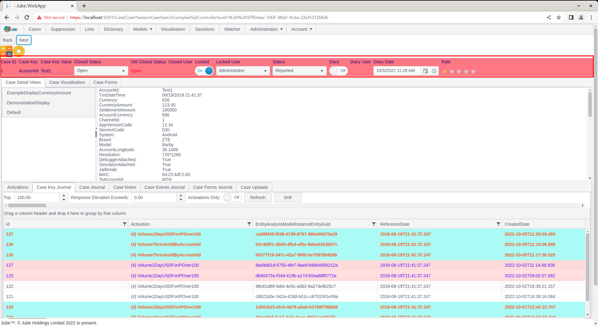

# Working Skim, Lock and Next

In practical life case management is intended for use by several users, and it is plausible that several user may try
and take the case at exactly the same moment, thus causing duplication of work when users collide in the same case. For
multi-user case working it is advisable to use the Skim function rather than the Fetch function. The skim function will
automatically take the very first case qualifying for the Cases Workflow Filter, and open it in the case page,
automatically setting the locked status and locked user to establish case ownership.

To invoke the Skim and Lock functionality, start by navigating to the Case page, selecting the All Open filter created
elsewhere in this documentation:

<!-- TODO(screenshot): file=cases-workspace-case-filter-and-return-values.png route=/cases state="Cases page, Queue tab, All open filter selected in the rail; replaces the Razor-era CaseFilterAndReturnValues.png" -->

When a Case Workflow Preset Filter is set (or it is expanded upon via the Advanced Filter) the filter is saved to the
users session. The saving of the filter to the users session facilitates the functionality to move from case to case by
clicking the Next button in the Case page, without needing to return to the cases page).

Notice the Skim button:

<!-- TODO(screenshot): file=cases-workspace-location-of-skim-button.png route=/cases state="Cases page header with the Take next control; replaces the Razor-era LocationOfSkimButton.png" -->

By clicking the Skim button, the filter will be applied in the background and the very first case record will be grabbed
for presentation in the Case page:

<!-- TODO(screenshot): file=cases-workspace-skimmed-case.png route=/cases state="Case taken by Take next, lock chip showing the analyst; replaces the Razor-era SkimmedCase.png" -->

Upon the presentation of the case in the Skim process, the case is immediately set to a Locked status, alongside the
user having locked it:

<!-- TODO(screenshot): file=cases-workspace-locked-to-a-user-case.png route=/cases state="Case detail with Locked to the signed-in user; replaces the Razor-era LockedToAUserCase.png" -->

Note that the Case Key Value combination is AccountID = Test5.

It should be noted that the cases workflow filter is showing only cases that have a Closed Status of Open, henceforth,
if the Closed Status is changed to Closed, then it will no longer qualify for the cases workflow filter, nor Skim.

Closed Status is discussed in more detail later in the documentation, but for the purposes of this procedure, navigate
to the drop down titled Closed Status:

<!-- TODO(screenshot): file=cases-workspace-location-of-closed-status.png route=/cases state="Case detail Decide tile, status dialog; replaces the Razor-era LocationOfClosedStatus.png" -->

Upon the Closed Status having been changed in the drop down, which will update the case record straight away, it should
not no longer be eligible for that case preset filter:

<!-- TODO(screenshot): file=cases-workspace-updating-case-to-closed.png route=/cases state="Case closed, back on the queue; replaces the Razor-era UpdatingCaseToClosed.png" -->

Notice that the Next button is available, which had not been available on Fetch:

<!-- TODO(screenshot): file=cases-workspace-location-of-next-button-in-case.png route=/cases state="Take next after closing; replaces the Razor-era LocationOfNextButtonInCase.png" -->

Click the Next button to run the cases workflow preset filter in the background and evaluate the next first matching
case, fetching and immediately locking it:

<!-- TODO(screenshot): file=cases-workspace-new-case-skimmed.png route=/cases state="Next case taken in triage order; replaces the Razor-era NewCaseSkimmed.png" -->

Notice that the Case Key Value Combination has changed to AccountID = Test1, as the original case was updated to a
closed status, thus no longer matching the cases workflow preset filter.

Locked can be used in a case workflow preset filter for the purpose of avoiding all but the most immediate concurrency
on cases.

<!-- TODO(docs): this page was written for the Razor Case page (Skim and Next buttons, a filter saved to the session). The Vue Cases page replaced it: the shared Take next control takes the first open case in triage order that is free or already locked to the caller, locks it, records a Skim event and the look, and never takes a case another analyst holds. The Last search is restored from the browser, not the session. Rewrite the walk-through. -->
<!-- TODO(docs): state that two analysts pressing Take next at once never receive the same case (the lock is a single conditional update; the loser moves on to the next candidate). -->
<!-- TODO(docs): the list on the Cases page shows only the first 100 matches; the total is shown beside it. Confirm the owner wants no paging beyond 100. -->
<!-- TODO(screenshot): file=cases-workspace-take-next.png route=/cases state="Queue tab with the Take next control and the first-100-of-N counter" -->
