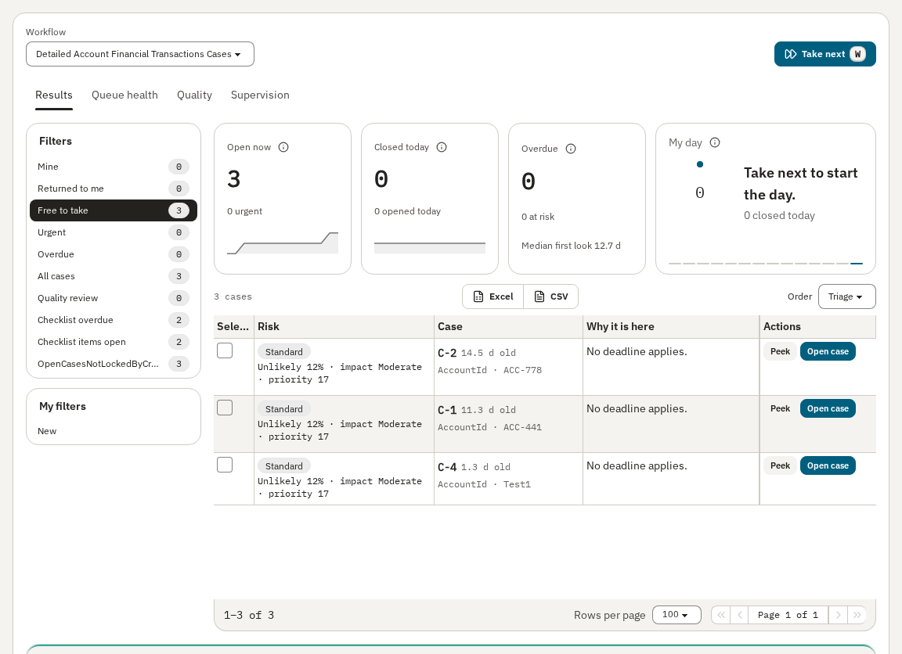
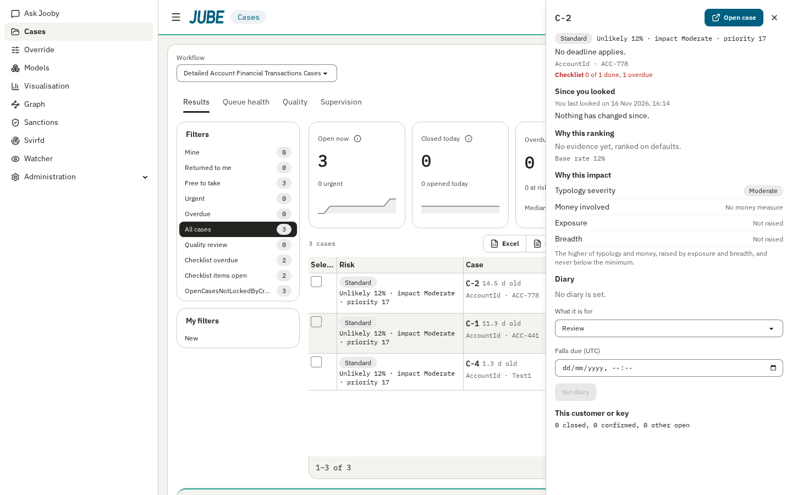

# Working Skim, Lock and Next

In practical life case management is intended for use by several users, and it is plausible that several users may try and take the case at exactly the same moment, thus causing duplication of work when users collide in the same case. For multi-user case working it is advisable to take cases from the top of the queue rather than selecting them individually. The function that does so was known in earlier versions as Skim, and is now presented as Take next: it automatically takes the very first case qualifying for the queue in view, and opens it in the case page, automatically setting the locked status and locked user to establish case ownership.

This page is the orientation for the Cases page, which is to say the queue, and describes Take next, the lock that it places, and Next case. The remainder of the Cases page is described in [Working the Cases Page](../WorkingCaseQueueAndTabs/index.html).

## Where it lives

Navigate through the menu to Cases. The Cases page presents, at the top, the Workflow to be worked (only the Case Workflows available to the role of the user are offered) and the Take next control, then a set of tabs:

| Tab          | Description                                                                                                                                                                                 |
|--------------|---------------------------------------------------------------------------------------------------------------------------------------------------------------------------------------------|
| Results      | The queue, described in this page. A role granted permission 70, Approve Case Suppressions, is also presented with the model override requests awaiting approval, beneath the queue.       |
| Queue health | Analytics of the queue: ageing, flow, bottlenecks, service levels and rhythm.                                                                                                               |
| Quality      | Analytics of the quality of cases: rule effort and precision, whether the ranking works, calibration and the [quality review sample](../WorkingQualityReviewSamples/index.html).           |
| Supervision  | Shown only to a role granted permission 18, Read Write Case Workflow. See [Working Case Supervision](../WorkingCaseSupervision/index.html).                                                |

The Workflow, the filter, the order and the tab are held in the address in the browser, such that a queue can be linked to, and those last used are restored from the browser upon returning to the page.

SHOT id=case-management-skim-lock-next-queue
     route=/cases
     steps=click:Free to take
     frame=page
     state=the Cases page on the Results tab with the Free to take view selected in the rail, the Workflow selector and Take next above the tabs, the pulse panel, the count of cases and a list of free cases in triage order
     conveys=the queue is a filter chosen in the rail and a list in triage order, from the top of which Take next takes a case
     alt=The Cases page with the Workflow selector and Take next at the top, the rail of filters with counts on the left, the pulse panel and the list of cases free to take

## The queue

The Results tab is arranged as a rail of filters on the left, with a pulse panel and the list of cases alongside.

### Filters

The rail decides which cases are listed, and each entry shows a count of the cases matching. There are three kinds of filter:

| Kind             | Description                                                                                                                                                                                                                                                              |
|------------------|--------------------------------------------------------------------------------------------------------------------------------------------------------------------------------------------------------------------------------------------------------------------------|
| Built in         | Under Filters: Mine, Returned to me, Free to take, Urgent, Overdue, All cases, Quality review, Checklist overdue and Checklist items open. All cases is the default. Each returns only cases having a Closed Status of Open or Suspend Open.                             |
| Workflow filters | Also under Filters, beneath the built in filters: the [Case Workflow Filters](../CreatingCaseWorkflowFilter/index.html) configured for the workflow and granted to the role of the user.                                                                                |
| My filters       | Filters created by the user from the Cases page with New, which presents an editor taking a Name, a filter built in the same manner as a Case Workflow Filter, and Share with role, which is Private to me unless a role is selected. A filter belonging to the user can be changed thereafter with Edit this filter, or deleted, upon which it is removed for the user and for anyone it is shared with. |

It should be noted that the built in filters return only cases that have a Closed Status of Open or Suspend Open, henceforth, if the Closed Status is changed to Closed, then the case will no longer qualify for the filter, nor for Take next. Closed Status is discussed in more detail in [Working Closed, Diary Date and Suspend](../WorkingClosedDiarySuspend/index.html).

### The pulse

Above the list, the pulse panel summarises the queues the user can see: the number of cases Open now, with those that are urgent, the number Closed today, with those opened today, the number Overdue, with those at risk and the median time to first look, and My day, being the cases closed today by the user against their own daily goal.

### The list

The list is headed by a count of the cases matching the filter. The first 100 cases matching are listed, and where there are more the count reads First 100 of, followed by the total. There is no paging beyond the first 100, henceforth a case further down is reached by working the queue from the top, by changing the Order, or by narrowing the filter. Where the filter matches nothing, the list states No cases in this view, and where it cannot be read, The cases could not be loaded.

| Column         | Description                                                                                                                                             |
|----------------|---------------------------------------------------------------------------------------------------------------------------------------------------------|
| Select case    | Ticks the case for Close or Reassign in bulk. See [Working Lock, Allocation and Unlock](../WorkingLockAllocationUnlock/index.html).                    |
| Risk           | The lane, the likelihood, the impact and the priority of the case, or Not yet assessed.                                                                 |
| Case           | The Case Id, the Case Key Value and the age of the case.                                                                                                |
| Why it is here | The foremost reason the case is ranked as it is, with Returned where the case has come back to the user, and QA sample where picked for quality review. |
| Value          | The value at stake, where one has been established for the case.                                                                                        |
| Due            | The deadline of the case and its state, and any checklist items open or overdue.                                                                        |
| Status         | The Cases Workflow Status, and whether the case is Held by you, Held by another user, or Free to take.                                                  |
| Actions        | Peek and Open case.                                                                                                                                     |

The Order control sorts the list as Triage (the default), Highest priority, Oldest first, Due soonest, Highest value, Most likely first or Newest first. The list can be exported to CSV or Excel, in which case the first 5,000 cases matching the filter are exported rather than only those listed.

### Peek

Peek presents a summary of the case beside the list without leaving the queue: what has changed since the user last looked, why the case is ranked as it is, the time spent in each status, the risk history, the diary, the history of the Case Key Value and the most recent notes. A peek is recorded in the events of the case as Peeked, and does not lock the case. Open case, on the row or in the peek, opens the case page, again without locking, as described in [Navigating Case Record](../WorkingNavigatingCaseRecord/index.html).

SHOT id=case-management-skim-lock-next-peek
     route=/cases
     steps=click:All cases, click:Peek
     frame=viewport
     state=the Cases page with the All cases filter chosen and the Peek of the first case, C-2, open over the right of the list, headed by the case and Open case, and showing its ranking line, its key, the state of its checklist, Since you looked, Why this ranking, Why this impact, the Diary with its boxes and This customer or key
     conveys=a Peek sets a summary of the case beside the list, so that the queue is skimmed without a case being opened or locked
     alt=The Cases page with the Peek of case C-2 open over the right of the list of cases, summarising the case with its key, what has changed since it was last looked at, why it is ranked as it is, its diary and the history of its key

## Take next

By clicking Take next, or pressing the W key, the filter in view is applied in the background and the very first case is taken for presentation in the case page. The behaviour, which is enforced by the server, is as follows:

* The case taken is the first, in triage order, that is open and either not locked or already locked to the user. A case that another analyst holds is never taken. Triage order is used whichever Order has been chosen for the list.
* The case is immediately set to a Locked status, alongside the user having locked it, which assigns the case to that user. See [Working Lock, Allocation and Unlock](../WorkingLockAllocationUnlock/index.html).
* The lock is taken as a single conditional update, which succeeds only if the case is still free at that instant. It follows that two analysts pressing Take next at once never receive the same case, as the one arriving second moves on to the next candidate.
* A Skimmed event is recorded against the case, as is the fact that the user has now looked at it. See [Working Case Event Journal](../WorkingCaseEventJournal/index.html).

Where no case qualifies, the page states Nothing left to take in this queue, beside the control, and the queue remains in view. Where the request fails, it states The next case could not be taken.

The Take next control carries the letter W as a reminder of its key. The key acts only while the Cases page is in view and a Workflow is chosen, it is ignored while typing in a box or a selection and while Ctrl, Alt or the command key is held, and neither the key nor the control acts again while a case is already being taken. Take next is disabled until a Workflow has been chosen.

By way of illustration, on the demonstration Case Workflow with All cases selected, an analyst pressing W is taken to whichever of the two open demonstration cases, on ACC-441 and ACC-778, stands first in triage order, and finds it Held by you. The closed case on ACC-915 is never taken. A second analyst pressing W a moment later is taken to the other case, and a third is told Nothing left to take in this queue.

Upon the presentation of the case, the header of the case page shows the lock as Held by, followed by the user, and the Decide pane shows Held by you.

## Next case

The case page has a Next case control in its header, which had not been available in earlier versions unless the case had been skimmed, and is now available however the case was reached. Next case performs Take next for the Workflow of the case in view and the filter last used on the Cases page, fetching and immediately locking the next first matching case, without needing to return to the Cases page.

As the case in view is usually held by the user, and a case already locked to the user qualifies for Take next, the case must first be updated such that it no longer matches. Supposing the case in view has the Case Key Value combination AccountID = Test5, then upon the case being closed (or released) from the Decide pane it no longer qualifies, and Next case presents the next case of the queue, for example AccountID = Test1.

The lock can be used in a filter for the purpose of avoiding all but the most immediate concurrency on cases, Free to take being the built in filter for this purpose.

## Permissions and security

The Cases page, Take next and Next case require permission 1, Read Write Case. The queue is further limited to the Case Workflows and Cases Workflow Statuses granted to the role of the user, such that a case in a status not granted to the role is neither listed nor taken. The Supervision tab requires permission 18, Read Write Case Workflow, and the approvals presented beneath the queue require permission 70, Approve Case Suppressions.
