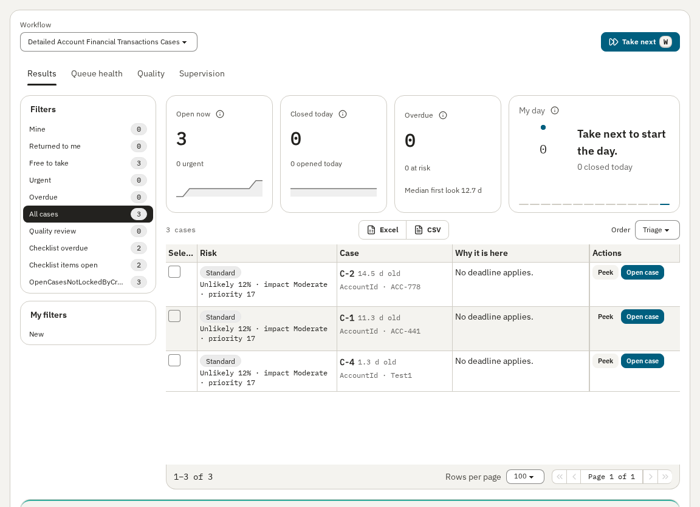

# Working Typed Diaries

A diary on an open case states that something is due by a date. A typed diary also states what it is for, and that decides how the case is ranked: a regulatory clock or a held payment cannot wait behind everything else, it follows that such a case is lifted to the front of the queue until the diary is cleared.

The diary of an open case is not to be confused with the diary of a suspended case, described in [Working Closed, Diary and Suspend](../WorkingClosedDiarySuspend/index.html), which decides when the suspended case reopens.

## Where it lives

The diary of a case is presented, set, changed and cleared in two places, both showing the same Diary section:

* On the Cases page, in the Results tab, Peek on a case presents the summary of the case, of which the Diary section is a part.
* On the case page, the Diary tile in the Decide pane, under Actions, opens a lightbox titled Diary.

SHOT id=case-typed-diary-lightbox
     route=/cases
     steps=open-row:Regulatory deadline, open-decide-tile:Diary
     frame=dialog
     state=the Diary lightbox on an open demonstration case holding a Regulatory deadline diary, showing the line stating the type, the date and the time remaining, with What it is for set to Regulatory deadline and Falls due (UTC) carrying the date
     conveys=a diary carries a type as well as a date, and is maintained from the Decide pane without leaving the case
     alt=The Diary lightbox on a case showing a regulatory deadline diary with its due date and time remaining, and the selections for what the diary is for and when it falls due

## Fields

| Value           | Description                                                                                                     | Example             |
|-----------------|-----------------------------------------------------------------------------------------------------------------|---------------------|
| What it is for  | The type of the diary, being one of Review, Customer response, Regulatory deadline or Payment hold.             | Regulatory deadline |
| Falls due (UTC) | The date and time at which the diary falls due. The date is entered and shown in UTC, and not in the local time of the browser. | 2026-12-01 17:00    |

Set diary commits a new diary, Update diary commits a change to the diary in place, and Clear diary removes it. Where a diary is set, the section states its type, its date and the time remaining, and where none is set it states No diary is set.

Where no diary is set, What it is for begins at Review and Falls due (UTC) is empty, and Set diary remains disabled until a date and time have been entered. Where a diary is set, the two fields carry its type and date, the button reads Update diary, and Clear diary is offered beside it. Clear diary acts at once without asking for confirmation. A diary saved is confirmed by the message Diary saved, and one cleared by Diary cleared, upon which the Due column and the lane of the case on the Cases page follow at the next ranking.

The line describing a diary reads, for example, "Regulatory deadline · 1 Dec 2026 17:00 (in 14.2 d)", and once the date has passed, "(2.5 h overdue)", the time being given in minutes below an hour, in hours below a day and in days thereafter.

On a case that is not open, the fields are replaced by the sentence Only an open case can carry a diary. A suspended case uses its diary to decide when it reopens. The Diary tile is offered on the case page once the summary of the case has been read.

The diary is a property of the case and not of the analyst. Anyone able to see the case sees its diary, and there is no private diary for each user.

## Types

The type decides the lane in which the case is ranked:

| Type                | What it is for                                                 | Ranking lane                                                                |
|---------------------|----------------------------------------------------------------|-----------------------------------------------------------------------------|
| Review              | An ordinary reminder to look at the case again.                | Deadline near within the deadline window, otherwise unchanged.              |
| Customer response   | The date by which the customer is due to answer.               | The same as Review, with the reason naming the customer response.           |
| Regulatory deadline | A mandatory clock, such as a filing deadline.                  | Mandatory, however far away the date is.                                    |
| Payment hold        | A payment that has been held and is decided at the diary date. | Live money, ahead of the Mandatory lane.                                    |

A diary whose date has passed keeps the case in its lane and marks the deadline as breached, so an overdue regulatory clock or hold stays at the front. A case having a breached deadline can be moved on by an escalation rule using the Deadline overdue trigger, as described in [Creating Automatic Escalation](../CreatingAutomaticEscalation/index.html).

The Due column on the Cases page shows the type beside the countdown for a Regulatory deadline, Payment hold or Customer response.

SHOT id=case-typed-diary-due-column
     route=/cases
     steps=none
     frame=page
     state=the Results tab of the Cases page with, at the head of the list, a case in the Live money lane showing Payment hold beside its countdown in the Due column and a case in the Mandatory lane showing Regulatory deadline, above ordinary Standard cases
     conveys=the type of a diary lifts the case in the queue, and the Due column states why
     alt=The Cases page listing a case with a payment hold diary and a case with a regulatory deadline diary at the head of the queue, each showing its diary type and countdown in the Due column



## Validation

A diary is validated in the server, and the request is refused where:

* The case is not open. A suspended case already uses its diary to decide when it reopens, so a typed diary cannot be placed on one, and a closed case cannot carry one. The Diary section states as much in place of the fields.
* The case is not visible to the user.
* The case is locked to someone else.
* The type is not one of the four.
* The date is more than a year in the past, or more than ten years ahead. A date in the past is permitted so that a deadline already missed can be logged.
* Clear diary is requested where no diary is set.

Setting or clearing a diary is a single conditional update. It follows that the request is refused with a conflict where another analyst locked the case, or the case ceased to be open, after it was read.

Setting the same type and date again changes nothing and records nothing.

The messages returned, each shown on the page, are as follows:

| Circumstance                                      | Message                                                                                               |
|---------------------------------------------------|-------------------------------------------------------------------------------------------------------|
| The case is not open                              | Only an open case can carry a typed diary. A suspended case uses its diary to decide when it reopens. |
| The case is not visible, or does not exist        | The case could not be found.                                                                          |
| The case is held by another user                  | The case is locked to another user.                                                                   |
| The type is not one of the four                   | The diary type must be review, customer response, regulatory deadline or payment hold.                |
| No date is given                                  | The date the diary falls due is required.                                                             |
| The date is outside the permitted range           | The diary date must be within the last year or the next ten years.                                    |
| Clear diary where no diary is set                 | The case has no diary to clear.                                                                       |
| The case changed after it was read                | The case changed while the request was made. Check it and try again.                                  |
| The user lacks the permission                     | You do not have permission to work cases.                                                             |

It is not necessary to hold the case to set its diary, only that nobody else holds it.

## A worked example

Suppose the demonstration case on AccountId ACC-441, in First Line Review, concerns a customer who has been asked to explain a payment, and that the customer has until Friday at 17:00 to answer. The analyst opens the Diary tile, chooses Customer response, enters the date and selects Set diary. The case keeps its lane for the present, and as Friday comes within the deadline window it moves to the Deadline near lane, with the Due column reading Customer response beside the countdown. Were the matter instead a filing that must be made by Friday, the analyst would choose Regulatory deadline, upon which the case moves to the Mandatory lane at once, however many days remain, and stays there, marked as breached, should Friday pass without the diary being cleared. Upon the customer answering, Clear diary removes the diary and the case returns to the lane its evidence gives it.

## Ranking

The ranking of the case is recomputed within one sweep of the case risk worker, and the new assessment is recorded with the trigger Diary.

## The journal

The following are written to the Events of the case:

| Event              | Recorded when                                                                                             |
|--------------------|-----------------------------------------------------------------------------------------------------------|
| Diary entry        | A diary is set, or its type changes. After holds the type, and Before the old type where there was one.   |
| Diary date changed | The date changes. Before and After hold the old and the new date.                                         |
| Diary cleared      | The diary is cleared. Before holds the type that was cleared.                                             |

## Diary expiry on open cases

The expiry automation described in [Working Closed, Diary and Suspend](../WorkingClosedDiarySuspend/index.html) moves a suspended case back to Open, or on to Closed, when its diary date passes. It takes no notice of cases that are already open. Were it otherwise, an Expired by process event would be written on every pass for every open case holding a typed diary past its date, filling the Events of every such case.

## Case Diary agent tools

[Ask Jooby](../../../AskJooby/index.html) can set and clear a diary through the same operations, as the `CaseDiarySet` and `CaseDiaryClear` tools, with a confirmation required before either is carried out. They are held by the Case Lookup and Notes specialist and take the Id of the case.

## Example

The API underlying the Diary section is as follows:

```http
POST /api/CaseDiary/Set
POST /api/CaseDiary/Clear
```

A diary is set with the case, the type (1 for Review, 2 for Customer response, 3 for Regulatory deadline and 4 for Payment hold) and the date in UTC:

```json
{
  "caseId": 1041,
  "diaryTypeId": 3,
  "dueDate": "2026-12-01T17:00:00.000Z"
}
```

A diary is cleared with the case alone:

```json
{
  "caseId": 1041
}
```

## Permissions and security

Setting, changing and clearing a diary requires permission 1, Read Write Case. The case must be visible to the user, which is to say that a role of the user is granted the Case Workflow and the status the case is in, and the case must not be locked to someone else.

The user having set the diary is recorded against the case, and each change is written to the Events of the case as tabulated above.
