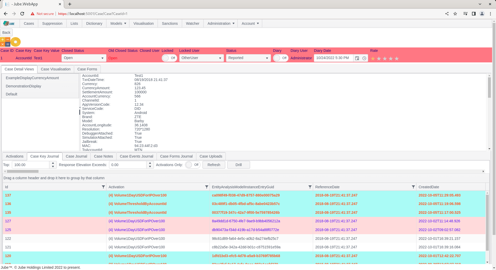
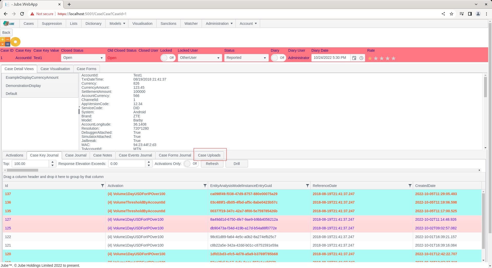
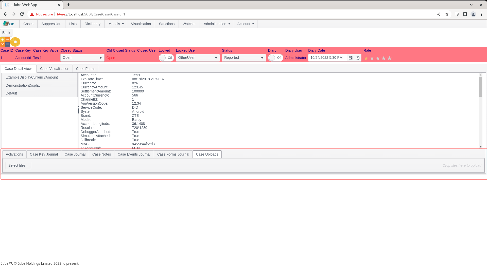
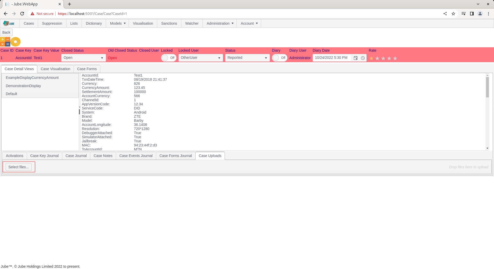
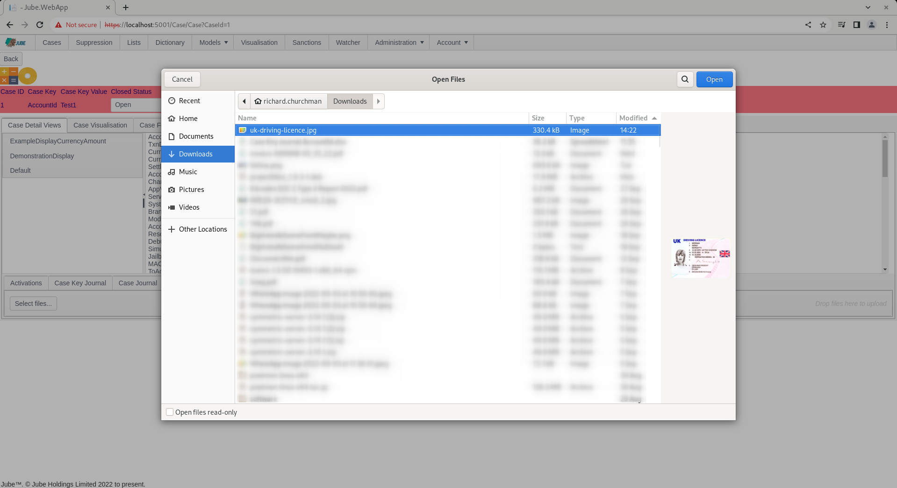
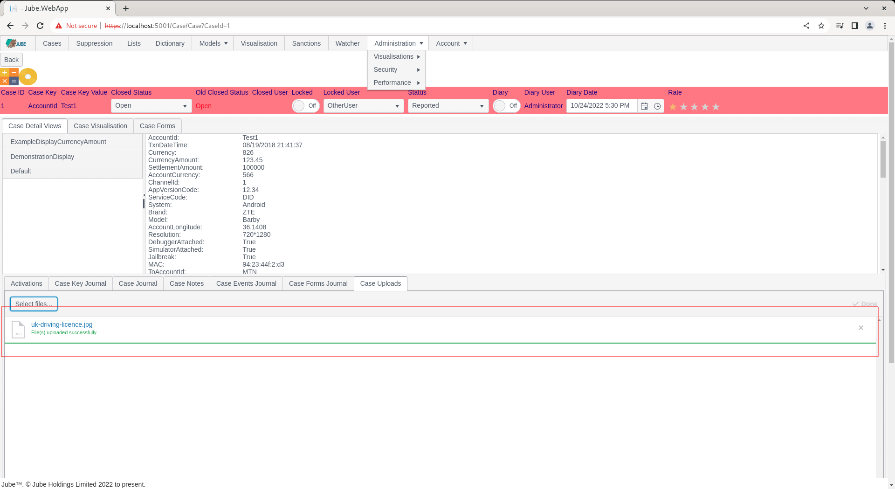
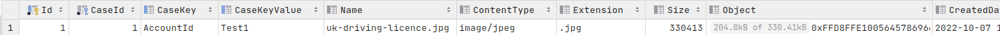
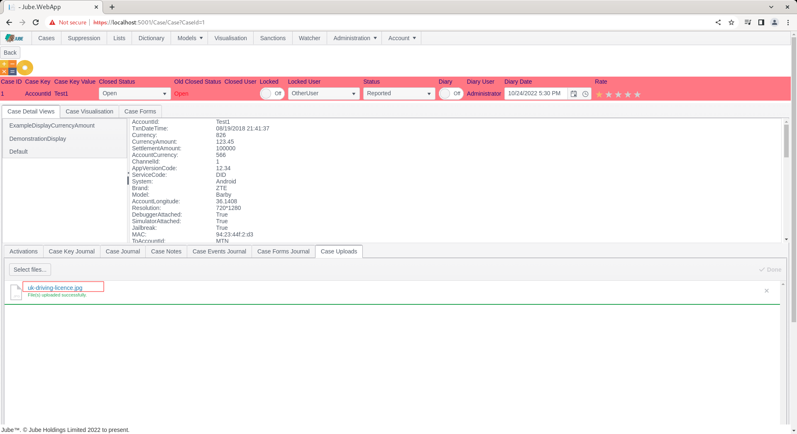
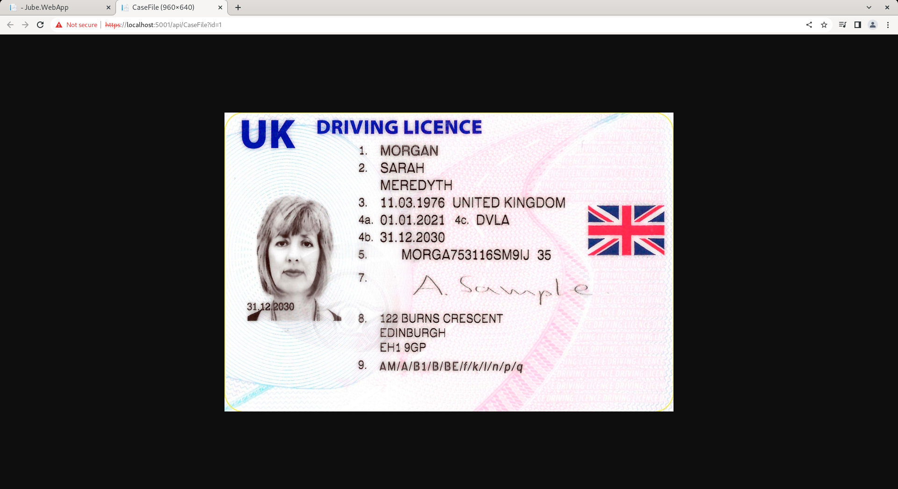

# Working Uploading and Recalling Files

It is possible to upload files to a Case Key Value combination, with these files being centrally stored in the database.

Navigate to a case record via either Fetch or Skim:



Notice the Case Uploads tab:



Click on the Case Uploads tab:



In the case upload tab there exists a file upload pane, which will accept a dragged and dropped file, or the
specification of a file location by clicking on the Select Files button:



In this example, click on the Select Files button, the Select Files dialogue box will appear:




Use the Select Files dialogue box to navigate to, and select a file, in this case an image:



The file will be uploaded and available in the database (not the file system):

```sql
select * from "CaseFile"
```



The file list is all files rolling up to the Case Key Value combination. To reference or retrieve an uploaded file, note
firstly that the file name is a link:



Click the link:



The file will open up in a new browser tab is the content type is supported, else downloaded.

## Files in the Vue case page (case-record review)

<!-- TODO(docs): everything above this heading describes the Razor Case Uploads tab, which no longer exists; rewrite the walkthrough around the Decide column Note and Research dialogs, where files are attached, and the Notes and research section, where they are listed and downloaded -->

<!-- TODO(screenshot): file=case-record-attach-files.png route=/cases/:caseId state="Add a note dialog open with the Attach files input showing two selected files" -->


<!-- TODO(screenshot): file=case-record-note-with-files.png route=/cases/:caseId state="Notes and research section, one note with two attached files, size, type, author and download buttons" -->


What the server enforces, whatever the browser does:

* A file is attached to a note the caller wrote on that case, or to research the caller recorded on that case, never
  both. With neither, a note titled `Uploaded Document` is created to carry it. Only the first non-empty file of an
  upload is stored.
* The maximum size is 25 MB. The limit is checked on the real size of the upload, not on a value the client
  sends. <!-- TODO(docs): confirm 25 MB is the intended product limit and whether it should be a setting -->
* The stored name is the last path segment only, with control characters, path separators, `<`, `>`, `"`, `|`, `:`, `*`,
  `?`, bidirectional override and isolate characters (U+202A to U+202E, U+2066 to U+2069, U+200E, U+200F, U+061C), zero
  width and byte order mark characters removed, leading dots and trailing dots or spaces trimmed and the length capped
  at 255. A name that is empty afterwards becomes `file`.
* The content type the client declares is stored only when it is a well formed `type/subtype`; anything else is stored
  as `application/octet-stream`. It is a label, not proof: the server works out the real type from the first bytes of
  the file.
* Two allow-lists decide what is accepted, both settings (see the environment variables page).
  `CaseFileAllowedExtensions` is checked against the extension of the stored name and `CaseFileAllowedContentTypes`
  against the type sniffed from the bytes. The defaults accept documents, spreadsheets, presentations, text and data
  files, images, archives, email formats and common audio and video; they refuse executables (including by their MZ, ELF
  and Mach-O headers), scripts, HTML, PHP and SVG both by extension and by content, so a file named `report.pdf` that is
  really an executable is refused, and so is a `.txt` that starts like HTML. A refusal is a 400 with error code
  `FileTypeNotAllowed` or `FileContentNotAllowed`, nothing is stored and no note is created; the message is localised.
  Setting a list to `*` accepts
  anything. <!-- TODO(docs): confirm the default lists with the owner, and decide whether text that merely contains the word script in its first 2 KB should really be refused -->
* Malware scanning: implement `Jube.Service.Repository.CaseFile.Interfaces.ICaseFileScanner` (one method,
  `ScanAsync(CaseFileScanRequest, CancellationToken)` returning `CaseFileScanResult.Passed` or
  `CaseFileScanResult.Rejected(reason)`) and register it in the dependency injection container of Jube.App; the upload
  endpoint resolves it per request and falls back to `NoOpCaseFileScanner`, which accepts everything. The request
  carries the stored name, the declared and sniffed types, the bytes, the tenant and the user. The scan runs after the
  type check and before anything is written. A rejection is a 400 `FileRejectedByScanner`; a scanner that throws fails
  closed as 400 `FileScanUnavailable` and is
  logged. <!-- TODO(docs): no scanner implementation ships, so by default no virus scan happens; state this plainly in the user guide and decide whether to ship a ClamAV adapter -->
* Download needs the Case Management permission and a case the caller's roles can see (workflow and status roles), in
  the caller's tenant. A file attached to a note whose action the caller's roles do not hold is treated as not found,
  the same as in the notes list. A file that does not exist, belongs to another tenant, sits on a case the caller cannot
  see or on a note the caller cannot see all return the same 403.
* Downloads send `X-Content-Type-Options: nosniff` and `Content-Security-Policy: sandbox; default-src 'none'`. Only PDF,
  PNG, JPEG, GIF, WebP and plain text open in the browser; every other type, including SVG and HTML, is served as
  `application/octet-stream` with a download file name.
* Removing a file is a soft delete and is audited. It is allowed for the user who uploaded it, for the user who holds
  the case, and for a holder of the Case Supervision permission (18). On a case locked to another user only a supervisor
  may remove a file; everyone else gets a 409 `CaseLocked`, and a user who is neither the uploader nor the holder gets a
  403.
* Uploading a file to a case that is locked to another user is refused with a 409 `CaseLocked`; an unlocked case is open
  to everyone with access, and the holder of the lock may always add
  files. <!-- TODO(docs): verify the lock wording with the owner, assignment is the lock -->
* The upload, the removal, and the note and research creation endpoints require the antiforgery token for cookie
  sessions, as every other mutation does.
