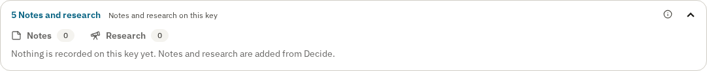

# Working Uploading and Recalling Files

It is possible to upload files to a Case Key Value combination, with these files being centrally stored in the database, rather than in the file system. A file is always kept with a note, or with a research record, as the evidence for it, and as notes and research roll up to the Case Key Value combination, so too do the files.

## Where it lives

Navigate to a case record from the Cases page, as described in [Navigating Case Record](../WorkingNavigatingCaseRecord/index.html). The Case Uploads tab of earlier versions, with its file upload pane, no longer exists. Files are instead attached, and recalled, in the following places:

| Purpose   | Where                                                                                                                                                                                                                         |
|-----------|-------------------------------------------------------------------------------------------------------------------------------------------------------------------------------------------------------------------------------|
| Attaching | In the Decide pane, the Note tile opens the Add a note lightbox and the Research tile opens the Add research lightbox, each of which has Attach files, accepting one or more files to be kept with that note or that research. |
| Recalling | In the section of the case page titled Notes and research, where the files are listed beneath the note or the research to which they belong.                                                                                  |

Every file uploaded in earlier versions, which is to say directly to the case, was moved under a note titled `Migrated Document`, and is recalled in the same manner.

SHOT id=case-management-uploading-recalling-files-note-with-files
     route=/cases
     steps=open-demo-case, click:Hide the sections, click:Hide the decide panel, open-section:Notes and research
     frame=section:Notes and research
     state=the Notes and research section showing one note with two attached files beneath its text, each file stating its name, size, content type, the user who uploaded it and the date, with a download control
     conveys=files are evidence kept with a note, and are recalled from the note they belong to
     alt=A note in the Notes and research section with two attached files listed beneath it, each showing its name, size, type, uploader and date, and a download control



## Behaviour

Upon a note being added with files chosen, the note is saved first and each file is then uploaded and attached to it, and the same is so for research. If a file cannot be attached, the note or research stays, and a message states how many files could not be attached.

The file is stored in the database (not the file system), in the table CaseFile:

```sql
select * from "CaseFile"
```

The file list is all files rolling up to the Case Key Value combination, presented under the notes and research to which they belong. Each file is listed with its name, its size in kilobytes, its content type, the user who uploaded it and the date and time of upload. To retrieve an uploaded file, the download control alongside the file is clicked, upon which the file is saved by the browser under its name.

Attach files, in either lightbox, is described there as "Optional. Each file is kept with this note as evidence." or, for research, "Optional. Each file is kept with this research as evidence.", and more than one file may be chosen at once. Nothing is uploaded until Add note or Add research is selected. Where every file is accepted the message is Note added, or Research added, and where some were refused it reads, for example, Note added, but 1 file(s) could not be attached, the reason for an individual file not being stated on the page. It follows that the manner of finding out why a file was refused is to attach it alone and to read the refusals tabulated under Validation against it.

In the list, a size is rounded to the nearest kilobyte and is never shown as less than 1 KB, and the download control is announced as Download followed by the name of the file. A note or research record having no files shows no list at all. Where a download is refused the message of the server is shown.

The case page does not offer a control with which to remove a file. Removal is available through the API as `DELETE /api/CaseFile/{id}`, and to Ask Jooby as the operation CaseFileRemove, subject to the rules below.

## Validation

The following is enforced by the server, whatever the browser does:

* A file is attached to a note the caller wrote on that case, or to research the caller recorded on that case, never both. With neither, a note titled `Uploaded Document` is created to carry it. Only the first non-empty file of an upload is stored, henceforth the case page uploads each file chosen as an upload of its own.
* The maximum size is 25 MB. The limit is checked on the real size of the upload, not on a value the client sends.
* The stored name is the last path segment only, with control characters, path separators, `<`, `>`, `"`, `|`, `:`, `*`, `?`, bidirectional override and isolate characters (U+202A to U+202E, U+2066 to U+2069, U+200E, U+200F, U+061C), zero width and byte order mark characters removed, leading dots and trailing dots or spaces trimmed and the length capped at 255. A name that is empty afterwards becomes `file`.
* The content type the client declares is stored only when it is a well formed `type/subtype`, and anything else is stored as `application/octet-stream`. It is a label, not proof, as the server works out the real type from the first bytes of the file.
* Two allow-lists decide what is accepted, both being [Environment Variables](../../../Concepts/EnvironmentVariables/index.html). `CaseFileAllowedExtensions` is checked against the extension of the stored name and `CaseFileAllowedContentTypes` against the type sniffed from the bytes. The defaults accept documents, spreadsheets, presentations, text and data files, images, archives, email formats and common audio and video. They refuse executables (including by their MZ, ELF and Mach-O headers), scripts, HTML, PHP and SVG both by extension and by content, so a file named `report.pdf` that is really an executable is refused, and so is a `.txt` that starts like HTML. A refusal is a 400 with error code `FileTypeNotAllowed` or `FileContentNotAllowed`, nothing is stored and no note is created, and the message is localised. Setting a list to `*` accepts anything.
* Uploading a file to a case that is locked to another user is refused with a 409 `CaseLocked`. As assignment is the lock, an unlocked case is open to everyone with access, and the holder of the lock may always add files.

The messages that accompany the refusals are as follows:

| Circumstance                                         | Message                                                                                       |
|------------------------------------------------------|-----------------------------------------------------------------------------------------------|
| The file is larger than 25 MB                        | The file is larger than the maximum permitted size.                                           |
| The extension is not on the allow-list               | Files with this extension are not accepted as case evidence.                                  |
| The content is not of a type on the allow-list       | The content of this file is not of a type accepted as case evidence.                          |
| A scanner rejected the file                          | The file was rejected by the malware scan.                                                    |
| A scanner failed                                     | The file could not be scanned, so it was not accepted.                                        |
| Both a note and research were named                  | A file belongs to a note or to research, never both.                                          |
| The case is held by another user                     | The case is locked by another user.                                                           |
| The file, or its case, cannot be seen                | The file or its Case was not found.                                                           |
| Removal by a user not entitled                       | Only the user who uploaded this file, the user who holds the case or a supervisor can remove it. |

The default allow-lists are as follows:

| Environment Variable        | Default                                                                                                                                                                                                                                                                              |
|-----------------------------|--------------------------------------------------------------------------------------------------------------------------------------------------------------------------------------------------------------------------------------------------------------------------------------|
| CaseFileAllowedExtensions   | `pdf,doc,docx,xls,xlsx,ppt,pptx,odt,ods,odp,rtf,txt,csv,tsv,json,xml,md,log,png,jpg,jpeg,gif,webp,bmp,tif,tiff,heic,zip,7z,gz,tgz,tar,eml,msg,mbox,mp3,wav,mp4,mov`                                                                                                              |
| CaseFileAllowedContentTypes | `application/pdf,image/png,image/jpeg,image/gif,image/webp,image/bmp,image/tiff,application/zip,application/x-ole-storage,application/x-7z-compressed,application/gzip,application/x-tar,application/rtf,audio/mpeg,audio/wav,video/mp4,text/plain`                               |

## Malware scanning

No scanner implementation ships with Jube, which is to say that by default an uploaded file is not scanned for viruses, and the protection is that of the allow-lists alone. A scanner is added by implementing `Jube.Service.Repository.CaseFile.Interfaces.ICaseFileScanner` (one method, `ScanAsync(CaseFileScanRequest, CancellationToken)` returning `CaseFileScanResult.Passed` or `CaseFileScanResult.Rejected(reason)`) and registering it in the dependency injection container of Jube.App. The upload endpoint resolves it per request and falls back to `NoOpCaseFileScanner`, which accepts everything.

The request carries the stored name, the declared and sniffed types, the bytes, the tenant and the user. The scan runs after the type check and before anything is written. A rejection is a 400 `FileRejectedByScanner`, and a scanner that throws fails closed as 400 `FileScanUnavailable` and is logged.

## Permissions and security

Uploading, listing and downloading files require permission 1, Read Write Case. Beyond the permission, the following applies:

* Download needs a case the roles of the caller can see (the workflow and status roles), in the tenant of the caller. A file attached to a note whose action the roles of the caller do not hold is treated as not found, the same as in the notes list. A file that does not exist, belongs to another tenant, sits on a case the caller cannot see or on a note the caller cannot see all return the same 403.
* Downloads send `X-Content-Type-Options: nosniff` and `Content-Security-Policy: sandbox; default-src 'none'`. Only PDF, PNG, JPEG, GIF, WebP and plain text are served such that a browser would open them, and every other type, including SVG and HTML, is served as `application/octet-stream` with a download file name.
* Removing a file is a soft delete and is audited. It is allowed for the user who uploaded it, for the user who holds the case, and for a holder of permission 18, Read Write Case Workflow, being the permission of supervision. On a case locked to another user only a supervisor may remove a file, everyone else being refused with a 409 `CaseLocked`, and a user who is neither the uploader nor the holder is refused with a 403.
* The upload, the removal, and the note and research creation endpoints require the antiforgery token for cookie sessions, as every other mutation does.
