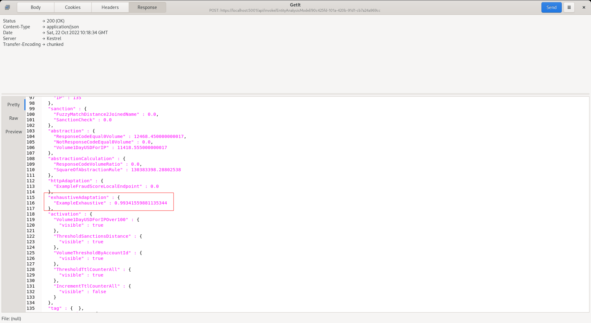

🚀 Get to pre-production in weeks, not months, with private [training](https://www.jube.io/jube-training) direct from
Jube's developer — real sovereignty, zero vendor lock-in.

# Exhaustive Adaptation Recall

Upon models having been promoted during Exhaustive training, they will be available for recall as part of model
invocation.

Given the evolutionary nature of Exhaustive model training, and indeed retraining, explicit synchronisation is not
required.

Proceed to post the example JSON
to [https://localhost:5001/api/invoke/EntityAnalysisModel/90c425fd-101a-420b-91d1-cb7a24a969cc](https://localhost:5001/api/invoke/EntityAnalysisModel/90c425fd-101a-420b-91d1-cb7a24a969cc):

Notice that the score has been returned for use in Activation Rules in the Adaptation entity.

It might be observed that many of the elements used in model training do not have corresponding values in the model
configuration. When matching variables with the model, in the event that the variable cannot be identified by its
processing type (e.g. Abstraction) and name, it will fall back to the mean value having been created by statistics. Once
a model is deployed it is advisable to lock all of the elements for which the model depends as falling back to the
average will change model performance given how sensitive Neural Networks tend to be.

## Calibrated probabilities

A model promoted after calibration was introduced returns a calibrated probability, not the raw network output. At
promotion, Platt scaling is fitted on the validation split and stored with the promoted model, together with the
deployment base rate (see Base Rate in the training configuration), so a score of 0.004 means about a 0.4% chance of a
positive case at that base rate. The same value is returned by the HTTP recall (rounded to four decimals), by the
Exhaustive Adaptation in the invocation payload and by the simulation sliders.

Rules that compare the score against a fixed value such as 0.5 will see different values for a newly promoted model: at
a low base rate few cases reach 0.5. Review Activation Rule thresholds after retraining, or use the minimum-risk
threshold on the results page threshold sweep, which supports costs. Models promoted before calibration was introduced
have no stored calibrator, keep returning raw scores and show "Not calibrated (promoted before calibration was
introduced)" on the results page until they are retrained. Calibration is skipped, with the reason recorded, when the
model has a hard output activation function, the validation split has a single class or fewer than 20 of either class,
or the scores are constant.
