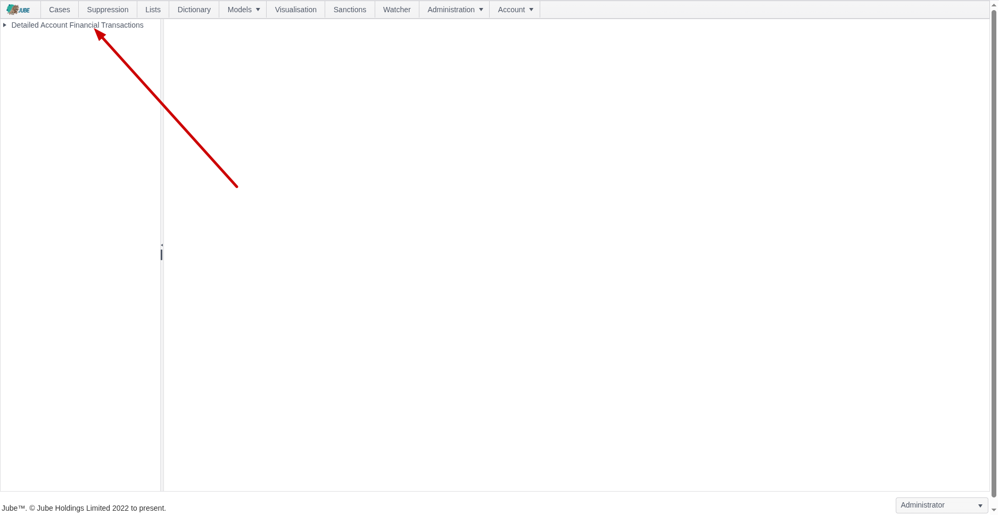
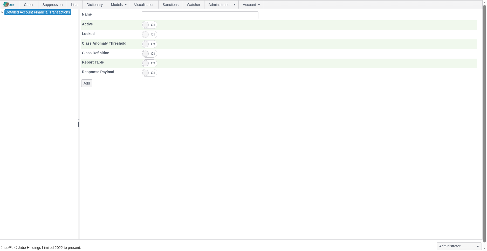
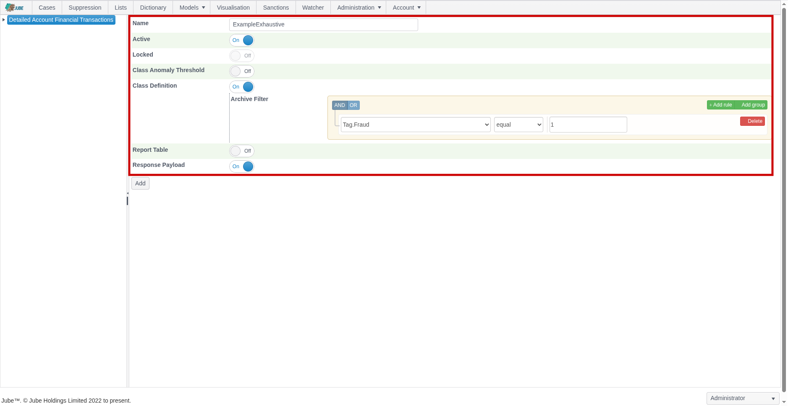
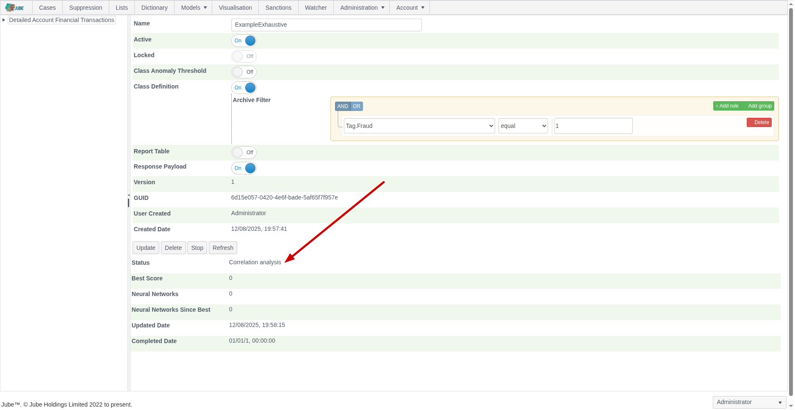
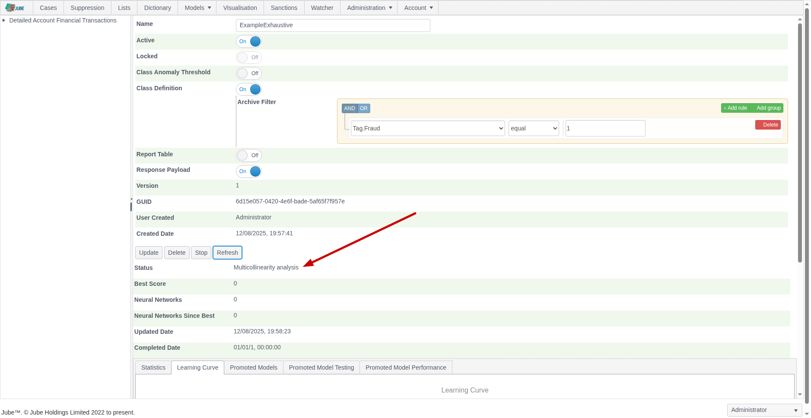
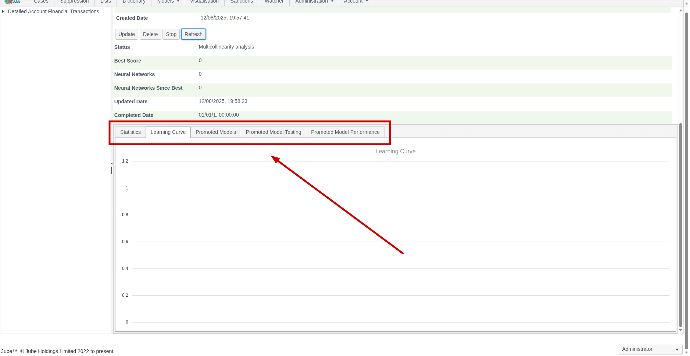
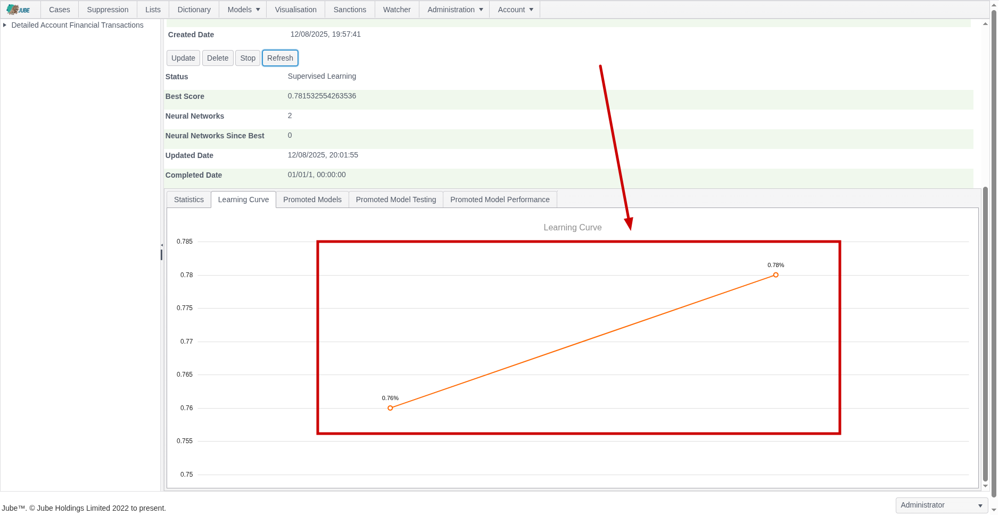
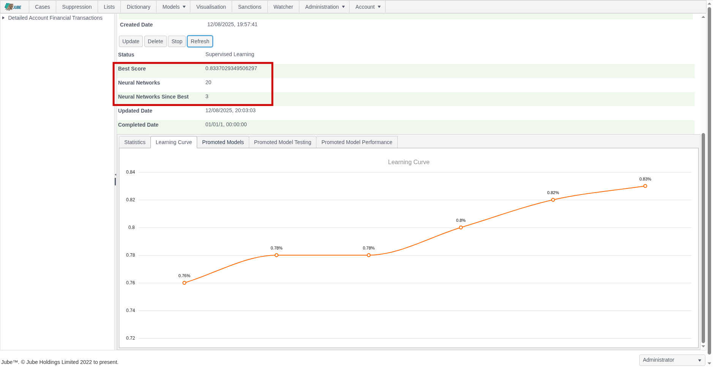
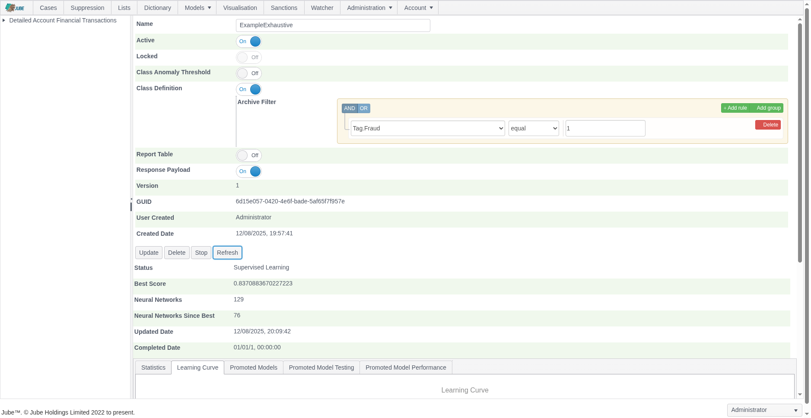

🚀 Get to pre-production in weeks, not months, with private [training](https://www.jube.io/jube-training) direct from
Jube's developer — real sovereignty, zero vendor lock-in.

# Exhaustive Adaptation Training Configuration

Exhaustive training is controlled by several Environment Variables, however the defaults are adequate in most use cases.
Exhaustive models are otherwise given some basic training parameters which specify if Anomaly detection is to be used
and the extent to which other class data is to be enriched into the anomlous classifications.

The output of Exhaustive training will always be a Neural Network having been trained by the Supervised Learning
Levenberg Marquardt back propagation algorithm. As introduced beforehand, while there does exist a One Class Support
Vector Machine for the purpose of anomaly detection, this is not directly recalled, rather it is used to derive class
for supervised learning.

Keep in mind that processing of data in Jube will have created large amounts of data in the Archive database table and
this data will be targeted for machine learning training.

Training data comes from one of three sources, chosen per Exhaustive Adaptation on the Exhaustive options page under
Training Data:

* Archive (the default): the real processed transactions in the Archive database table.
* Demonstration dataset: a built-in sample dataset for testing and demonstration. Its rows are loaded once per model
  into the MockArchive database table using the same JSON structure as the Archive, storing the first column as a Tag by
  the same name and the rest of the columns as Abstraction Rules. Choosing it requires no configuration beyond the
  choice itself.
* Uploaded dataset: a CSV file uploaded by the user and confirmed with a column mapping (which column is the dependent
  variable, which values count as the positive class, and the processing type of every other column).

The former UseMockDataExhaustive Environment Variable has been removed. A deployment that set it to True to obtain the
demonstration dataset now selects Demonstration dataset on each Exhaustive Adaptation instead; existing Exhaustive
Adaptations are migrated to Archive, so until one selects Demonstration dataset it no longer trains on the demo rows.
The documentation as follows assumes that the demonstration dataset is being used.

Before a model can be recalled it must be trained. To configure an Exhaustive model for training navigate Models >>
Machine Learning >> Exhaustive Adaptation:

Click on the model to create an Exhaustive Adaptation which will expose an empty page for the model configuration
parameters:

The page accepts the following parameters:

| Value                                       | Description                                                                                                                                                                                                                                                                                                                                                                                                                                                                                                                                                                                                                    | Example                          |
|---------------------------------------------|--------------------------------------------------------------------------------------------------------------------------------------------------------------------------------------------------------------------------------------------------------------------------------------------------------------------------------------------------------------------------------------------------------------------------------------------------------------------------------------------------------------------------------------------------------------------------------------------------------------------------------|----------------------------------|
| Class Anomaly Threshold                     | A switch to indicate that a One Class Support Vector Machine Anomaly Detection Model should be trained for the purpose of deriving a class for supervised Learning.                                                                                                                                                                                                                                                                                                                                                                                                                                                            | True                             |
| Class Anomaly Threshold:Anomaly Probability | The One Class Support Vector Machine will be recalled to return a probability that the example fits the overall pattern of the data sample.  The threshold is the amount whereby examples are classified as positive in the event that their are less than a certain probability.                                                                                                                                                                                                                                                                                                                                              | 2%                               |
| Class Anomaly Threshold:Anomaly Algorithm   | The algorithm that labels the positive class. The default, One Class Support Vector Machine with Gaussian kernel, is the original behaviour. The alternatives are Isolation Forest, Histogram Based Outlier Score, Mahalanobis Distance, Robust Mahalanobis Distance, Principal Component Analysis, Gaussian Mixture, k Nearest Neighbour Distance, Local Outlier Factor, Marginal Likelihood, Feature Bagging Ensemble, Consensus Ensemble and Automatic, which evaluates a fixed set of candidates and records the choice. See the Exhaustive Anomaly Study for evidence on which algorithm suits which number of variables. | One Class Support Vector Machine |
| Class Anomaly Threshold:Variable Reduction  | What is removed before the anomaly algorithm fits: nothing (None), or Standard, which drops constant, near constant and mostly missing variables, exact duplicates and highly correlated groups (one representative is kept) and applies robust scaling, optionally followed by principal components. The default is None for the One Class Support Vector Machine and Standard for every other algorithm. Reduction applies only to the anomaly step: the supervised search always sees every variable.                                                                                                                       | Default for the algorithm        |
| Class Anomaly Threshold:Advanced Parameters | Optional JSON of algorithm parameters, reduction options and automatic evaluation options. Unknown properties are rejected.                                                                                                                                                                                                                                                                                                                                                                                                                                                                                                    | Empty                            |
| Base Rate                                   | Optional. The fraction of real cases that are positive in deployment, greater than 0 and less than 1 (for example 0.02 for 2% fraud). Recalled scores are calibrated probabilities at this rate. When left empty the rate is measured from the population (the count of Archive or dataset records matching the Class Definition, or the flagged fraction when the class comes from anomaly detection) and recorded with its source on the promoted model. Set it when you know the deployment rate and the training sample is not representative of it.                                                                       | Empty                            |
| Class Definition                            | A switch to indicate that the class should be defined by a filter of records in the archive table whereby a match on the filter will return positive class.                                                                                                                                                                                                                                                                                                                                                                                                                                                                    | True                             |
| Class Definition: Archive Filter            | The filter to apply to the Archive table to define positive class. The filter will also be used to negate the sample of negative class.                                                                                                                                                                                                                                                                                                                                                                                                                                                                                        | Tag Fraud = 1                    |

Class Anomaly Threshold: Anomaly Probability must be between 0 and 1 (a percentage such as 2% is entered as 0.02) for
the One Class Support Vector Machine. For every other algorithm it is the contamination fraction, above 0 and at most
0.5: the highest scoring fraction of the sample is labelled positive class, and the number of rows flagged is recorded.

Every anomaly run records a report (algorithm, parameters, variables kept and dropped with the reason, score summary,
threshold applied and, for Automatic, every candidate's evaluation). A one line summary is shown in the training status
and the full report is returned by the instance endpoint as AnomalyReportJson. The time allowed for the Automatic
evaluation is set by the ExhaustiveAnomalyAutoBudgetSeconds Environment Variable. When Class Definition is switched on,
the Archive Filter is required -- an Exhaustive Adaptation cannot be saved with Class Definition enabled and no filter
defined.

An Exhaustive Adaptation can only be edited while it is still in status Awaiting Server -- once the background engine
has picked it up for training it becomes read-only for the remainder of its lifecycle.

Complete the parameters to training a model based confirmed fraud via Tag, as follows:

Scroll down and click Add to not only create a version of the Exhaustive model but instruct the training of the model by
the background thread. The default status will by "Awaiting Server" with the background thread updating the following
status as progress:

* Awaiting Server.
* Fetching Data.
* Calculating Statistics.
* Normalising Data.
* Training Anomaly Model.
* Recalling Anomaly Model for Class Data.
* Getting Filter Class Data from Archive.
* Data Class Symmetry Sampling.
* Performing Class Correlation Analysis.
* Performing All Variable Multi-collinearity Analysis.
* Training Neural Networks and Performing Evolution.
* Stopped as expected after training.

The Refresh button exists to update the page. Click the Refresh button to observe the most recent training status:

After the model has been picked up for training it can no longer be updated.

Upon status Training Neural Networks and Performing Evolution having been reached, the model tabs will be exposed:

The page will not automatically refresh as the training process takes some time and the page requests are extensive.
Clicking the Refresh button will allow for monitoring of exploration:

During evolution, the number of attempted Neural Network topologies is recorded, alongside the best score and the number
of topologies since best (being the last topology having been promoted):

Training can take several hours or days depending on dataset size. The training will terminate at the point there have
been more than a certain number of topologies tried since best (which is a setting available in the Environment
Variables) else will continue to evolve better scores for simpler topology, being plotted as a learning curve:

Each promoted model is available for detailed inspection.

Notice the availability of a Guid which can be used for direct recall of the model via HTTP:

