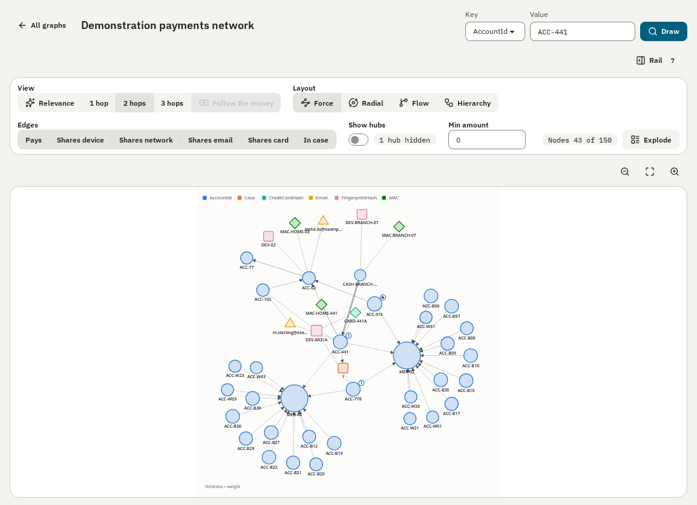
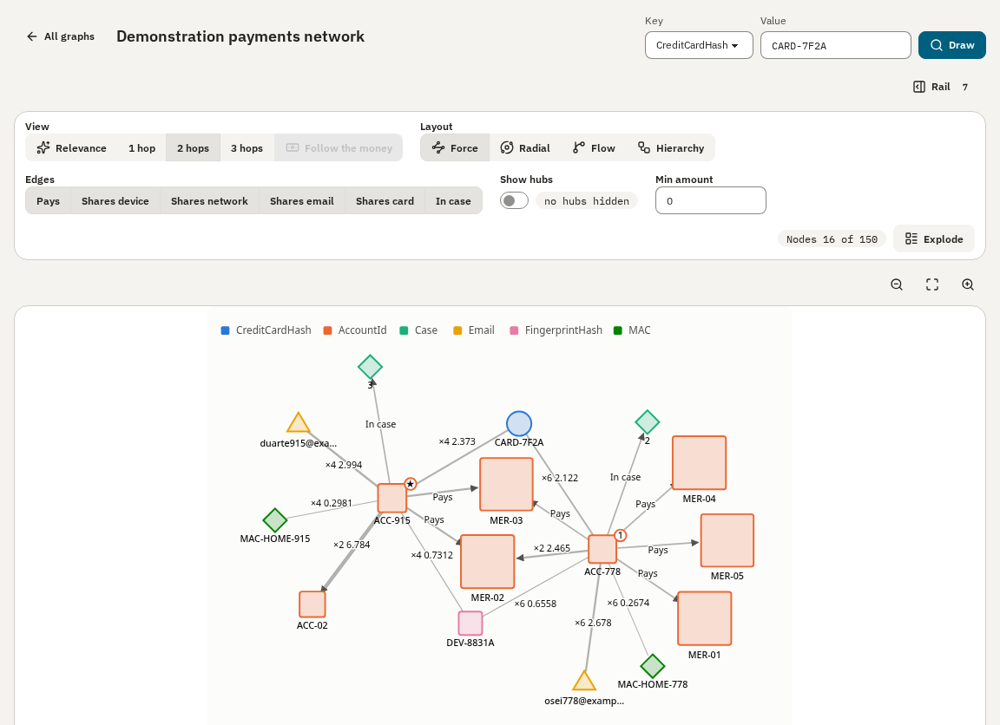

# Graph Concepts

This page explains what a graph is in Jube and introduces every term used by the pages that follow. Nothing here requires prior knowledge of network analysis. The terms are introduced one at a time, each building on the last, and one example is carried through the whole page: the demonstration network seeded on a clean installation, such that each statement can be followed on screen.

The question in the mind of the reader throughout should be the one an investigator holds: given this one account, what is it connected to, how strongly, and does any of it matter?

## The terms at a glance

The table that follows is for reference. Each term is explained in its own section further down, in this order.

| Term              | Meaning in one sentence                                                                                                                         |
|-------------------|-------------------------------------------------------------------------------------------------------------------------------------------------|
| Graph             | A set of things and the links between them, derived from stored transactions.                                                                   |
| Node              | One thing: an account, a device, an email address, a card. It is a key and a value, such as AccountId ACC-441.                                  |
| Edge              | One link between two nodes, such as a payment from one account to another, or an account having used a device.                                  |
| Edge definition   | The rule, set by an administrator, saying which two fields of a transaction make an edge. It is also called an edge kind in the explorer.       |
| Seed              | The node an exploration starts from.                                                                                                            |
| Hop               | One step along one edge. A node two hops away is reached through one node in between.                                                           |
| Neighbourhood     | Everything within a chosen number of hops of the seed.                                                                                          |
| Window            | The period of time considered. A link is shown only where a transaction behind it fell within the window.                                       |
| Hub               | A node linked to so many others that the link means nothing, such as a public wifi address.                                                     |
| Weight            | A number stating how strong an edge is, made of a prior, a specificity, a count and an amount, with old events counting for less.               |
| Half-life         | The number of days after which an event behind an edge counts for half.                                                                         |
| Kind prior        | How much a kind of edge is trusted before anything else is known, from 0 to 1.                                                                  |
| Hard link         | A link through an identifier taken as proof of the same controller, such as a card, as opposed to a soft link, such as a device.                |
| Specificity       | How exclusive a shared identifier is: near 1 where one account uses it, falling as more accounts share it.                                       |
| Lane              | One row of Explode: one counterpart of a node, with everything that links the two.                                                               |
| Cluster           | A stack standing for several nodes that are not drawn one by one, the picture having reached the most nodes it will draw.                        |
| Relevance         | A view that ranks the neighbourhood by how interesting each node is to the seed, each node being given an interest between 0 and 1.             |
| Path              | A route from one node to another along edges.                                                                                                   |
| Follow the money  | Tracing payments onward (or backward) in order of time, each step carrying a comparable amount.                                                 |
| Tranche           | One step of money found when following the money.                                                                                               |
| Motif, or pattern | A recognisable shape of payments, such as fan-in or a cycle, found by the background jobs.                                                      |
| Community         | A group of nodes more densely linked to each other than to the remainder of the network.                                                        |
| Confirmed         | A key whose case was closed in a status carrying the outcome Confirmed, which is to say a true positive.                                        |
| Explode           | The same neighbourhood shown as a list of rows (lanes) in place of a picture.                                                                   |
| Time strip        | A small chart beneath the network showing when the transactions behind it happened, used to narrow the window and to replay the links in order. |

## The demonstration network

A clean installation holds a registry named Demonstration payments network. In the description that follows, the base is the moment ten days before the installation was migrated, and everything is placed relative to it.

The cast is as follows:

| Who or what                 | Role in the story                                                                                                                                                    |
|-----------------------------|----------------------------------------------------------------------------------------------------------------------------------------------------------------------|
| ACC-441                     | The subject. An open case exists on this account, in the status First Line Review. Besides the payment of the story it has made eleven small card purchases at the five merchants, nine of them in the three days before the installation and from Cairo, Giza, Alexandria, London and Dubai. |
| DEV-8831A                   | A device (a fingerprint) used by four accounts: ACC-441, ACC-102, ACC-778 and ACC-915.                                                                               |
| DEV-LON-01, DEV-DXB-01      | Two further devices, used by ACC-441 alone, for its purchases in London and Dubai.                                                                                   |
| ACC-102                     | Uses the same device and the same email address as ACC-441, and pays the same beneficiary 53 seconds before ACC-441 does.                                            |
| ACC-778                     | Uses the same device, and shares the card CARD-7F2A with ACC-915. An open case exists on it, in Supervisor Review.                                                   |
| ACC-915                     | Uses the same device, and paid ACC-02 twice (5,200 and 5,250) some ten days before ACC-441 did. Its case is closed in the status Fraudulent, which carries the outcome Confirmed. It is the known bad actor of the story. |
| CASH-BRANCH-07              | A branch from which eleven cash deposits, each of between 3,967 and 4,870, were paid into ACC-441 over the nine days to the base.                                    |
| ACC-02                      | The first beneficiary. It receives 9,800 from ACC-102 and 9,500 from ACC-441 at ten and a quarter hours after the base, having earlier received the two payments from ACC-915. |
| ACC-77                      | Receives 9,200 and 9,700 from ACC-02 within the hour, and pays 18,500 onward two hours later.                                                                        |
| ACC-88                      | Receives the 18,500 and, the following day, pays 18,200 to EXCH-CRYPTO-01.                                                                                           |
| EXCH-CRYPTO-01              | An exchange, where the money leaves.                                                                                                                                 |
| ACC-300, ACC-301 to ACC-305, ACC-310 | A scatter-gather: ACC-300 pays 1,900 to each of five accounts within 45 minutes, and each forwards 1,850 to ACC-310 within about three hours.               |
| ACC-400, ACC-401, ACC-402   | A cycle: 5,000 from ACC-400 to ACC-401, 4,900 on to ACC-402, and 4,800 back to ACC-400, all within seven hours.                                                      |
| MAC-PUBLIC-WIFI-CAFE-01     | The network address of a public wifi, seen on transactions of 59 different accounts, among them ACC-441 once, 22 days before the installation.                       |
| ACC-B01 to ACC-B40, ACC-W01 to ACC-W45, MER-01 to MER-05 | Ordinary customers and cafe visitors paying five merchants, as the background against which the above stands out.                       |

TODO(verify): the figures and outcomes given for the demonstration network on this page and the three that follow (what is one, two and three hops from ACC-441, the hub, the paths, the tranches, the patterns detected) were worked out from the seed migration and the code, and have not been observed on a running installation. Confirm each on a clean installation and correct any that differ.

### What to expect of it on screen

Three matters of timing decide what is seen of the demonstration network, and it is as well to know them before following the examples:

* **It is dated from the day of installation.** Every transaction is placed relative to the moment the installation was migrated, the oldest some three months before it and the story itself between 36 days and a few hours before it. The explorer opens on the last 30 days, hence the earliest purchases of ACC-915 and many of the ordinary customers lie outside the window from the first day, and as the installation ages the remainder follows: the visit of ACC-441 to the public wifi leaves the window about a week after installation, and the payments from ACC-441 through ACC-02 to the exchange about three weeks after it. On an installation older than that, set the Default window days of the graph, in [Graph Registry](../GraphRegistry/index.html), to a figure that reaches back to the day of installation, upon which the examples can be followed as written.
* **It is built after the first start.** The network is not seeded as nodes and edges. It is seeded as transactions, from which the background jobs build the network in the first minutes after the application is first started. Until the build has run ACC-441 is not yet a node, and drawing it reads AccountId ACC-441 is not a node in this graph yet.
* **Hubs are worked out hourly.** The first calculation of hubs is made one minute after the start, and the next an hour later. Where the build had not finished within that first minute, the public wifi address is not yet a hub for the first hour: it is drawn as an ordinary node, ACC-441 appears joined through it to dozens of strangers, and the explorer reads no hubs hidden. This is the best demonstration there is of why hubs exist, and it corrects itself at the next cycle.

## Nodes

A node is one thing in the network. It is no more than a key and a value: the key says what kind of thing it is (AccountId, FingerprintHash, Email), and the value says which one (ACC-441, DEV-8831A). Two transactions carrying the same value for the same key refer to the same node, which is the whole basis upon which the network joins together.

In the demonstration network the kinds of node are AccountId (accounts, including beneficiaries, merchants and the exchange), FingerprintHash (devices), MAC (network addresses), Email and CreditCardHash (cards). There is also a node of the key Case for each case, linked to the key of that case, which is added automatically and need not be configured.

A node is not typed in by anyone. It comes into being the first time a stored transaction carries its value in a field named by an edge definition.

## Edges

An edge is a link between two nodes, and there are two reasons for two nodes to be linked:

* **A payment between them.** ACC-441 paid ACC-02, hence there is an edge from ACC-441 to ACC-02. The edge has a direction and carries an amount.
* **A shared attribute.** ACC-441 used the device DEV-8831A, hence there is an edge between ACC-441 and DEV-8831A. ACC-778 used the same device, hence there is an edge between ACC-778 and DEV-8831A. It follows that ACC-441 and ACC-778 are connected through the device, although neither ever paid the other.

Keep in mind the second case, as it is the one most often misread. Two accounts sharing a device are not joined by a line drawn between the two accounts. Each is joined to the device, and the device sits between them as a node of its own. The device can therefore be selected, counted (it is shared by four accounts) and judged in its own right.

An edge is not one transaction. It is the sum of every transaction that links the same two nodes in the same way: ACC-441 has three transactions on DEV-8831A, and there is one edge between them with a count of three. Each transaction behind an edge is kept, such that an edge can always be opened to the transactions that are its evidence.

### Edge definitions and edge kinds

An edge definition is the instruction, given once by an administrator, from which edges are derived. It names two fields of the transaction: wherever a stored transaction carries a value in both, an edge is made between the two nodes. The demonstration network has five:

| Edge definition | Kind          | From field | To field        | Reads as                                              |
|-----------------|---------------|------------|-----------------|-------------------------------------------------------|
| Pays            | Money flow    | AccountId  | ToAccountId     | The account paid the beneficiary account an amount.   |
| Shares device   | Identity link | AccountId  | FingerprintHash | The account used the device.                          |
| Shares network  | Identity link | AccountId  | MAC             | The account used the network address.                 |
| Shares email    | Identity link | AccountId  | Email           | The account gave the email address.                   |
| Shares card     | Identity link | AccountId  | CreditCardHash  | The account used the card.                            |

Every edge definition is of one kind, and the kind decides how the edge behaves:

| Kind          | Direction  | Carries an amount | Meaning                                                                                                              |
|---------------|------------|-------------------|----------------------------------------------------------------------------------------------------------------------|
| Identity link | None       | No                | The from node shares the to identifier, such as a device, an address or a card.                                      |
| Money flow    | From to to | Yes               | The from node paid the to node.                                                                                      |
| Ownership     | From to to | No                | The from node owns or directs the to node, such as a director and a company.                                         |
| Resolution    | None       | No                | Reserved for [Entity Resolution](../../../Concepts/EntityResolution/index.html). It is never configured, and no edge of this kind is written at present: a confirmed match is recorded against the two nodes and draws no line between them. |
| Case          | From to to | No                | The edge named In case, joining a key to its case. It is added to every graph automatically and is never configured. |

The kinds differ in less than the table might suggest, and it is worth being exact about what a kind changes:

* **Money flow is the only kind that carries an amount.** It follows that only Money flow edges are taken when following the money and when searching for patterns, and only they are subject to Min amount.
* **Identity link is the only kind drawn without an arrow.** On the canvas every other kind, which is to say Money flow, Ownership and Case, is drawn with an arrow from the from node to the to node.
* **Ownership is otherwise treated exactly as an identity link.** It carries no amount, it is weighted in the same manner, and it is followed in the same manner. Nothing in the product walks an Ownership edge differently, and the Hierarchy layout is not reserved for it. The kind exists so that a relationship that has a direction (this person directs that company) is drawn with one.
* **Direction does not restrict the walk.** A neighbourhood and a path follow every kind of edge in both directions: the neighbourhood of ACC-02 holds the accounts that paid it as well as the account it paid. Only following the money respects the direction of a payment.

One detail of Pays deserves attention. The beneficiary is carried in the field ToAccountId, yet the paying account is carried in AccountId. Were nothing done, ACC-02 the beneficiary and ACC-02 the payer would be two different nodes, and the chain from ACC-441 through ACC-02 to ACC-77 would be broken in the middle. The definition therefore states that the to value is to be filed under the node key AccountId, which is the purpose of the To node key described in [Graph Registry](../GraphRegistry/index.html).

## Seed, hops and the neighbourhood

An exploration always starts from one node, the seed. On a case the seed is the key of the case. On the Graph page it is whatever key and value the user enters.

A hop is one step along one edge. From the seed ACC-441:

* **One hop** reaches what ACC-441 touches directly: the device DEV-8831A and the two devices used abroad, its email address and its card, its home network address and the five addresses it used while travelling, the beneficiary ACC-02, the five merchants, the branch CASH-BRANCH-07 that paid cash in, and its case. That is nineteen nodes, the public wifi address being a twentieth that is left out as a hub.
* **Two hops** reaches what those touch: through the device, the accounts ACC-102, ACC-778 and ACC-915; through ACC-02, the next account ACC-77, and also ACC-102 and ACC-915, which paid ACC-02 as well; through the merchants, other customers of the same merchants.
* **Three hops** reaches one step further: ACC-88, and the card that ACC-778 and ACC-915 share.

The neighbourhood is everything within the chosen number of hops, which may be one, two or three, and is two unless the graph is configured otherwise. Three is the most that can be asked for, as each further hop multiplies the number of nodes, and a picture of several hundred nodes answers no question. It follows that EXCH-CRYPTO-01, being four hops from ACC-441, is not in any neighbourhood of ACC-441, and is reached instead by expanding a node, by a path, or by following the money, each of which is described below.

A neighbourhood is also bounded in three further ways, each of which exists to keep the picture readable:

| Bound            | Value          | Meaning                                                                                                                                                         |
|------------------|----------------|-----------------------------------------------------------------------------------------------------------------------------------------------------------------|
| Fan-out          | 25             | From any one node, at most the 25 strongest edges in each direction are followed. A merchant with a thousand customers contributes its 25 strongest links only. |
| Render cap       | 150 at most    | The most nodes drawn. Nodes beyond the cap are gathered into clusters, each a single stacked shape with a count, and are listed in full in Explode.             |
| Window           | 30 days        | Only edges that were in use during the window are followed, which is to say those whose first transaction is not after the end of the window and whose last is not before its start. The figure is the default of the graph, and can be changed for the graph and narrowed on screen. |

There is a fourth bound of a more technical nature: one neighbourhood gathers at most 20,000 routes from the seed. A dense network can reach that figure at three hops, in which event whatever lies beyond it is left out without a message, and a smaller number of hops gives the more trustworthy picture.

SHOT id=graph-concepts-neighbourhood
     route=/graph/6f1a3c2e-9b7d-4e2a-8c3f-2d9e1b7a5c41?gk=AccountId&gq=ACC-441
     steps=wait-for:Legend
     frame=page
     state=the Graph page for the Demonstration payments network seeded on AccountId ACC-441 at two hops in the Force layout, showing the device DEV-8831A between ACC-441 and three other accounts, the payment to ACC-02 and onward to ACC-77, the toolbar reading one hub hidden, the time strip and the legend
     conveys=a neighbourhood is the seed, the things it touches and the things those touch, with shared attributes drawn as nodes of their own
     alt=The network around account ACC-441 at two hops, with a device node joined to four accounts, arrows for payments to a beneficiary and onward, a time strip beneath and a legend of shapes and edge kinds

## Hubs

Consider the public wifi of a cafe. In the demonstration network its address, MAC-PUBLIC-WIFI-CAFE-01, appears on the transactions of 59 accounts, and ACC-441 used it once. Were it treated like any other shared attribute, ACC-441 would be two hops from 58 strangers, and every one of them two hops from every other. The same is true of a large merchant or a payroll account: everyone pays the supermarket, and that tells nothing about anyone.

A node of this sort is a hub: a node with so many links that a link through it carries no meaning. A hub must not be allowed to join everyone to everyone, and the rule that prevents it is as follows:

* **A hub is still a node.** It is drawn, as a hexagon bearing the number of its neighbours, where it is asked for.
* **A hub is not walked through.** When the neighbourhood is gathered, an edge leading to a hub is not followed, unless Show hubs is switched on. The explorer states how many hubs next to the seed were left out, as in 1 hub hidden.
* **A hub is left out of the background analysis.** Patterns are not detected through hubs, money is not followed through them, and paths avoid them unless Show hubs is on.

### The hub threshold

Whether a node is a hub is decided per edge definition by counting the distinct from nodes linked to one to node (the number of different accounts on one wifi address, for example) and comparing the count with a threshold:

* Where the edge definition gives a Hub threshold, a node with more than that number is a hub.
* Where it does not, the threshold is worked out automatically as the 99.9th percentile of that count across all to nodes of the definition, and never less than 50 (the `GraphHubMinimumDegree` Environment Variable). In plain words, a node is a hub when it is linked to more others than 999 in every 1,000 nodes of its kind, and to more than 50.

The reason for the automatic threshold is that the right number differs for every kind of identifier and every tenant: four accounts on one device is suspicious, whereas four hundred on one wifi address is a cafe. The reason for the floor of 50 is that on a small network the busiest node would otherwise always be a hub.

For the demonstration network the arithmetic runs as follows. Shares network has some fifty network addresses, every one of them used by a single account except the public wifi, which is used by 59. The 99.9th percentile of those counts falls a little beneath 59, at about 57, which is above the floor of 50, hence the threshold is 57 and the wifi address, at 59, is a hub. The five merchants are each paid by some forty five accounts, which is beneath the floor of 50, hence none of them is a hub, and the other customers of the merchants remain in the neighbourhood of ACC-441.

Hubs are worked out by a background job once an hour by default (`WaitGraphHubs`). It follows that on a new installation, and after the Hub threshold of a definition is changed, up to an hour may pass before a node is marked or unmarked.

A user holding the permission to do so may also overrule the calculation for one node, setting it to Always a hub or Never a hub, as described in [Exploring a Graph](../ExploringAGraph/index.html).

### The hub policy

Each graph carries a Hub policy, being Hidden or Collapsed, which states the intention for how hubs are presented by default. See the note against the field in [Graph Registry](../GraphRegistry/index.html).

## Weight: how strong a link is

Not all links deserve equal attention. A payment of 9,500 yesterday is a stronger connection than one login from the same cafe two months ago. Each edge therefore carries a weight, a single number where higher means stronger. The weight is used in four places: where a node has more than 25 edges it is the 25 heaviest that are followed, paths are ranked by it, the Relevance view spreads interest along it, and on the canvas a heavier edge is drawn as a thicker line.

The weight is the product of four parts, each of which answers a plain question:

| Part              | Question it answers                              | How it is set                                                                                                                                                  |
|-------------------|--------------------------------------------------|----------------------------------------------------------------------------------------------------------------------------------------------------------------|
| Kind prior        | How much is this kind of link trusted at all?    | Set on the edge definition, from 0 to 1.                                                                                                                       |
| Specificity       | How exclusive is the thing shared?               | For every kind but Money flow, 1 divided by the natural logarithm of 2 plus the number of from nodes sharing the identifier. A money edge is not reduced.      |
| Count             | How often did it happen?                         | 1 plus the natural logarithm of 1 plus the number of events, each event reduced by its age.                                                                    |
| Amount            | How much money was involved?                     | For money flow only. 1 plus the sum, over the events, of the logarithm of 1 plus the amount divided by a reference amount, each event reduced by its age.      |

The weight carries a fifth multiplier, a confidence, which is reserved for edges of the Resolution kind. It is 1 for every edge that is built, and may be disregarded.

A weight has no unit and no upper limit, and it is not a probability. It is read only by comparison with other weights: an identity link seldom exceeds 1, as its prior and its specificity are both fractions, whereas a payment of a large sum readily reaches 3 or 4. The logarithms are there so that the hundredth login adds far less than the second, and a payment of a million does not outweigh everything else a thousandfold.

The weight is brought up to date at two moments: when a new transaction is added to the edge, and at each cycle of the hubs job, hourly by default, which is when a changed Kind prior and the Specificity are applied. Until the hubs job has run for the first time the Specificity of every edge is taken as 1.

### Kind prior

The kind prior is the judgement of the administrator as to how much one kind of link says about two parties being connected, before anything is known of the particular case. The demonstration network uses the values suggested by the form itself:

| Edge definition | Kind prior | Reasoning                                                                             |
|-----------------|------------|---------------------------------------------------------------------------------------|
| Shares email    | 1.0        | An email address is given deliberately, and is seldom shared by strangers.            |
| Shares card     | 1.0        | A card is a hard identifier.                                                          |
| Pays            | 0.7        | A payment is a real relationship, although people pay many parties they barely know.  |
| Shares device   | 0.4        | A device is suggestive, yet families and shops share devices.                         |
| Shares network  | 0.1        | A network address is weak evidence, shared by households, offices and cafes.          |

### Specificity

Specificity lowers the weight of an identity link as the identifier is shared more widely, for the same reason that hubs are excluded, only gradually in place of all at once:

| Accounts sharing the identifier | Specificity |
|---------------------------------|-------------|
| 1                               | 0.91        |
| 2                               | 0.72        |
| 4                               | 0.56        |
| 6                               | 0.48        |
| 59                              | 0.24        |

The device DEV-8831A, shared by four accounts, has a specificity of 0.56. An identity link whose specificity is below 0.5, which is to say an identifier shared by six or more, is drawn as a dashed line and is described in the legend as a Soft link. The dashed line is thus a warning to the eye that the identifier is widely shared and the link correspondingly weak. It has nothing to do with the Hard switch described under Hard and soft links below, the word soft being used in two senses.

### Half-life, and why old links fade

A device shared last week says more than a device shared two years ago, as devices are sold, addresses are reassigned and relationships end. Each edge definition therefore carries a Half-life days, and each event behind an edge counts for less the older it is: an event one half-life old counts as half an event, an event two half-lives old as a quarter, and so on.

The point from which age is measured must be understood exactly, as it is not the present. The age of an event is measured from the most recent event on the same edge. The latest event on an edge therefore always counts in full, however long ago it took place, and the earlier events on that edge count for less according to how long before the latest they fell.

With the half-life of 180 days used for Shares device, a login 180 days before the latest counts as 0.5 of a login. With the half-life of 90 days used for Pays, a payment 90 days before the latest counts as half a payment, and its amount as half.

Two consequences follow, and both are commonly misread:

* **Fading compares the events of one edge with each other.** An account that used a device thirty times a year ago and once last week has, at a half-life of 180 days, an edge that counts for some eight uses in place of thirty one, each of the thirty counting for a quarter. An account that used a device once, a year ago, and never again, has an edge that counts for one use in full.
* **An edge that has fallen silent does not grow weaker with the passing of time.** Its weight stays where its last transaction left it. What removes an old relationship from the picture is not fading but the window, described below, and what removes it from storage is retention.

The half-life is applied as each transaction is added to an edge. Changing the Half-life days of an edge definition therefore governs the transactions added from that point onwards, and the weights already worked out are not recalculated.

The form suggests 90 days for money flow and 180 days for identity links, the reasoning being that a payment relationship goes cold sooner than the sharing of a physical device. The cards and email addresses of the demonstration network use 365 days, as they change least.

Fading acts on the weight. Quite separately, the window removes from view any edge with no transaction within the window, and transactions older than the `GraphRetentionDays` Environment Variable (365 days by default) are not built into the network at all.

### A worked comparison

Take two edges of ACC-441:

* **ACC-441 to DEV-8831A (Shares device).** Kind prior 0.4, specificity 0.56, nine transactions made on the device within three weeks, which fading reduces only slightly to the equivalent of 8.8 (a count part of 1 plus the logarithm of 9.8, or about 3.3), and no amount. The weight is about 0.4 × 0.56 × 3.3, or 0.7.
* **ACC-441 to ACC-02 (Pays).** Kind prior 0.7, no reduction for specificity, one payment (a count part of 1 plus the logarithm of 2, or 1.7), and an amount of 9,500 against the reference amount of 1,000 (an amount part of 1 plus the logarithm of 10.5, or about 3.4). The weight is about 0.7 × 1.7 × 3.4, or 4.

The single payment is some five times the stronger link than nine uses of a shared device, which accords with intuition. The reference amount is the `GraphReferenceAmount` Environment Variable, 1000 by default, and should be set to a typical transaction amount in the currency of the tenant, as it decides what counts as a large payment.

## Hard and soft links

An identity link is either hard or soft, according to the Hard switch of its edge definition:

* **A soft link** (a device, a network address, a postal address) suggests a connection. It remains a weighted edge, and nothing more follows from it.
* **A hard link** (a national identity number, a card, a bank account, a telephone number) is taken as evidence that the two parties are controlled by the same person. Two nodes of the same kind joined to one hard identifier are put forward by [Entity Resolution](../../../Concepts/EntityResolution/index.html) as candidates for being one and the same entity.

The Hard switch is read by Entity Resolution and by nothing else. It does not alter the weight of an edge, the manner in which it is drawn, whether it is followed, or the calculation of hubs, paths, patterns or communities. It follows that where Entity Resolution is switched off, as it is by default, setting Hard has no visible effect whatsoever, and that the strength of a hard identifier in the picture is expressed through its Kind prior and not through the switch.

In the demonstration network Shares email and Shares card are hard. ACC-441 and ACC-102 give the same email address, and ACC-778 and ACC-915 use the same card, and each pair would therefore be proposed as a match were entity resolution switched on (it is off by default).

SHOT id=graph-concepts-shared-card
     route=/graph/6f1a3c2e-9b7d-4e2a-8c3f-2d9e1b7a5c41?gk=CreditCardHash&gq=CARD-7F2A
     steps=wait-for:Legend
     frame=page
     state=the Graph explorer drawn from the card CARD-7F2A of the demonstration network as its seed, the card at the centre joined to the accounts that use it, ACC-778 and ACC-915 among them, with their own neighbours beyond and the legend naming the kinds of node
     conveys=a shared identifier sits between the accounts that give it, which is what makes it a link between them
     alt=The Graph explorer drawn around the card CARD-7F2A, which is joined to the accounts ACC-778 and ACC-915, with the neighbours of those accounts around them and a legend of node kinds

## Confirmed, and distance to confirmed

The single most useful fact about a node is whether anything near it is already known to be bad. A key is confirmed where a case on that key was closed in a status carrying the outcome Confirmed, which is set on the Cases Workflow Status. In the demonstration network the case on ACC-915 is closed as Fraudulent, which carries that outcome, hence ACC-915 is confirmed, and is marked with a star.

A background job then works out, for every node, the number of hops to the nearest confirmed node, looking no further than four hops (`GraphDistanceCap`). This is shown against a node as Hops to confirmed, and is read as follows:

| Hops to confirmed | Reading                                                                                                     |
|-------------------|-------------------------------------------------------------------------------------------------------------|
| 0                 | The node is itself confirmed.                                                                               |
| 1                 | Directly linked to a confirmed node. DEV-8831A is one hop from ACC-915, and warrants immediate attention.   |
| 2                 | One node between. ACC-441 is two hops from ACC-915, through the device. Worth an explanation.               |
| 3 or 4            | Distant. Of interest only together with other evidence.                                                     |
| Not shown         | Nothing confirmed within four hops.                                                                         |

Distances do not pass through hubs or restricted edges. The same calculation is made for [Tags](../../Models/Tags/index.html): a node shows each tag found on a transaction or case nearby, with the number of hops to it.

## Relevance

A neighbourhood of two hops around ACC-441 holds dozens of nodes, most of them other customers of the same two merchants. The Relevance view puts them in order of how much they are likely to matter, by giving every node an interest between 0 and 1.

The interest is worked out as follows. The seed has an interest of 1. Every other node is then given seven tenths of the average interest of its own neighbours, the average being taken by weight such that a heavy edge counts for more than a light one, and the calculation is repeated five times so that interest spreads outwards from the seed hop by hop.

The simplest cases show how it reads. A node joined to the seed and to nothing else has an interest of 0.7. In a plain chain of equally weighted links leading away from the seed, the first node settles at about 0.46 and the second at about 0.32, the first being pulled down by the second, from which it can be seen that interest falls away quickly with distance. A node with many neighbours, of which the seed is but one, has far less again, as the uninteresting neighbours pull its average down: this is how a merchant with dozens of customers, and those customers in turn, sink to the bottom without any rule naming them.

On top of what arrives by spreading, a node is adjusted for what is known about it, the result never exceeding 1:

| Fact about the node                           | Adjustment |
|-----------------------------------------------|------------|
| A case on it was closed as confirmed          | + 0.4      |
| It is one hop from a confirmed node           | + 0.2      |
| It is a hub                                   | − 0.3      |

The interest is read as follows: a node at 0.6 or above is picked out on the canvas as one of the most relevant, nodes are kept up to the render cap in order of interest (in place of nearest first), and Explode lists them in the same order. A node whose interest comes to less than 0.05 is given no figure at all and is ranked after every node that has one. In the demonstration network ACC-915 and DEV-8831A rise to the top, and the merchants' other customers fall away.

Relevance does not change which nodes are gathered, which remains everything within the hops last chosen. It changes their order, and thereby which of them are drawn where the render cap is exceeded.

## Paths

A path is a route from one node to another along edges. Asking for the paths between two nodes answers the question of how, exactly, two parties are connected, and is the means of reaching a node beyond three hops.

From ACC-441 to EXCH-CRYPTO-01 there is a path of four hops: ACC-441, ACC-02, ACC-77, ACC-88, EXCH-CRYPTO-01. Up to five paths are returned, of at most four hops each, the shortest first and, among paths of equal length, the heaviest first. The weight of a path is the product of the weights of its edges. Each is stated as a sentence giving the number of hops, the two ends and the weight of the path, to three decimal places.

The weight of a path serves one purpose only, which is to put paths of the same number of hops in order. As a payment commonly weighs more than 1 and an identity link less than 1, a path made of payments has a large weight (the path above, of four payments, weighs in the hundreds) and a path through shared devices a small one, and neither figure means anything alone.

Two properties of the search should be kept in mind. A path follows edges in either direction, hence it shows a connection and not necessarily a movement of money, which is the business of following the money below. And at each node along the way only the 30 heaviest edges in each direction are considered, hence a path through a very lightly weighted link of a busy node may not be found.

## Following the money

A path shows that a route exists. It does not show that money travelled along it. Follow the money traces actual payments in order of time, and each step must satisfy two conditions:

* **It happens after the step before, and soon.** The next payment must leave within the Hop window of the previous one arriving, 72 hours by default.
* **It carries a comparable amount.** The next payment must be between the previous amount less the Tolerance and the previous amount plus a quarter of the Tolerance. With the default Tolerance of 0.2, a payment of 9,500 is followed by payments of between 7,600 and 9,975. The band is wider below than above for the reason that money in transit is commonly reduced by a fee or a cut, and seldom grows.

Each payment so found is a tranche, and a node that money both entered and left along the trace is marked Pass-through. The trace runs forward (where did the money go) or backward (where did it come from), to a depth of four steps, and takes only Money flow edges.

The first step is a special case, as there is no previous amount to compare with: it is simply the payments made by the node within the window, the ten earliest of them where there are more than ten. The comparison of amounts begins at the second step.

Following the money forward from ACC-441 gives as the first step the ten earliest of its twelve payments in the window, nine of them purchases at merchants and the third of them the 9,500 to ACC-02. The merchants pay nobody, hence those nine lead nowhere. The second step is the 9,200 and the 9,700 from ACC-02 to ACC-77, each of which followed the 9,500 within 72 hours and lies between 7,600 and 9,975, and ACC-02 is marked Pass-through. There the trace stops, and the reason is instructive: ACC-77 consolidated the two receipts into one payment of 18,500, which is not comparable with either. The trace is continued by selecting ACC-77 and following the money from there, which gives 18,500 to ACC-88 and then 18,200 to EXCH-CRYPTO-01, with ACC-88 marked Pass-through.

## Motifs, or patterns

A motif is a small shape of payments that recurs in fraud and money laundering. Background jobs search the payments of the last 30 days (`GraphPatternWindowDays`) for each shape, and record each instance found as a pattern, with the node it is anchored on, its members, its score and the transactions that form it. Patterns take Money flow edges only, and do not pass through hubs or restricted edges.

| Pattern, as shown    | Shape                                                                                                                          | Found where                                                                                                                  | Score                                  |
|----------------------|--------------------------------------------------------------------------------------------------------------------------------|------------------------------------------------------------------------------------------------------------------------------|----------------------------------------|
| FanOut               | One account pays many.                                                                                                         | One node pays 5 or more distinct nodes within 1 day.                                                                         | The number of distinct counterparts.   |
| FanIn                | Many accounts pay one.                                                                                                         | One node is paid by 5 or more distinct nodes within 1 day.                                                                   | The number of distinct counterparts.   |
| GatherScatter        | Money gathered into one account and scattered out again.                                                                       | One node is paid by 2 or more and pays 2 or more within 1 day.                                                               | Sources plus destinations.             |
| ScatterGather        | Money split through several intermediaries and brought back together elsewhere.                                                | A source pays 2 or more intermediaries, each paying the same sink within 6 hours of receiving.                               | The number of intermediaries.          |
| TemporalCycle        | Money that returns to where it began.                                                                                          | A chain of payments in order of time, of at most 6 steps and within 1 day, ending at its first node.                         | The number of steps.                   |
| PassThrough          | An account that forwards nearly all it receives, quickly.                                                                      | At least 3 payments, between 80% and 100% of money in paid out, and a median time held of 24 hours or less.                  | The proportion paid out.               |
| SmurfTypeOne         | Several sources through one middle account to several targets.                                                                 | 2 or more sources and 2 or more targets around one node within 7 days, of between 3 and 20 accounts in all.                  | The number of accounts.                |
| SmurfTypeTwo         | One source through several middle accounts to one target.                                                                      | 2 or more middle accounts between one source and one target within 7 days, of between 3 and 20 accounts in all.              | The number of accounts.                |
| StructuringWindow    | Repeated payments in, each just beneath a reporting threshold.                                                                 | 3 or more payments into one node within 7 days, each of at least nine tenths of the threshold and less than the threshold.   | The number of payments.                |
| DenseBlock           | A group of accounts paying one another far more than is usual.                                                                 | The single densest group in the payments of the tenant, where it has 4 or more nodes and a density of at least 1.5.          | The density.                           |

For every pattern a higher score is a larger or tighter instance of the shape. A score is comparable only between patterns of the same kind.

The density of a DenseBlock needs a word of explanation, as it is not a plain count. Every payment made between two members of the group counts towards it, a payment to an account that few others pay counting for more (0.56 where the receiving account is paid by one account only) than a payment to an account that many pay (0.42 where it is paid by six, and less thereafter), such that a popular merchant does not make a dense group of its customers. The density is the total so reached divided by the number of accounts in the group. A density of 1.5 therefore means, in round terms, three or more payments within the group for every account in it, and a higher figure means a tighter knot. Only the one densest group of the tenant is considered at each cycle, and where that group has fewer than four accounts, as when one account pays another a great many times, no DenseBlock is recorded at all.

The demonstration network is arranged to give rise to the following, among others:

* **ScatterGather anchored on ACC-300**, through the five intermediaries to ACC-310. The same payments are also a FanOut on ACC-300, a FanIn on ACC-310 and a SmurfTypeTwo on ACC-300, which is usual: one event commonly satisfies several shapes.
* **TemporalCycle anchored on ACC-400**, of three steps.
* **PassThrough anchored on ACC-77**, which paid out 18,500 of the 18,900 it received, giving a score of 0.98.

These are found from the payments of the last 30 days. The scatter-gather took place 16 days before the installation and the cycle 14 days before it, hence an installation that is first started more than a fortnight after it was migrated will not find them.

The eleven cash deposits into ACC-441 illustrate the importance of the threshold. The threshold for StructuringWindow is the `GraphPatternStructuringThreshold` Environment Variable, 10000 by default, hence the band searched is 9,000 up to, but not including, 10,000. The deposits are of between 3,967 and 4,870, which is to say beneath a threshold of 5,000, and are not found with the default. It follows that on a clean installation no StructuringWindow pattern is listed, the story of the case notwithstanding. Setting the Environment Variable to 5000 and restarting moves the band to 4,500 up to 5,000, into which four of the deposits fall (4,579, 4,676, 4,773 and 4,870, made on four successive days), and the pattern is then found on ACC-441 with a score of 4, for as long as those deposits remain within the last 30 days. The threshold should be set to the reporting threshold of the jurisdiction in the currency of the tenant.

A pattern is in one of four states. It is New when found, and a user holding the permission to do so may mark it Seen, may Dismiss it, or may attach it to a case, upon which it is Cased.

## Communities

A community is a group of nodes that are linked to one another more densely than to the remainder of the network, found by a background job across the whole network of the tenant. Where a neighbourhood is everything near one seed, a community is a natural cluster wherever it lies.

A group of fewer than three nodes is not recorded as a community, and a node belongs to one community at most. Communities are found afresh at each cycle and numbered afresh, hence the number of a community is a handle for the moment and not a lasting name. Hubs and restricted edges take no part.

Each community is given its size, the number of closed cases among its members, the number of those confirmed, and a ratio comparing its confirmed rate with that of the tenant as a whole. The ratio is worked out in three steps:

1. A closed case counts where it was closed in a status carrying an outcome, be it Confirmed or Not confirmed. A case closed in a status whose outcome is Not an outcome is left out, as nothing was learnt from it.
2. The confirmed rate of a community is the number of its counted cases that were Confirmed divided by the number counted. The confirmed rate of the tenant is the same division over every counted case on a node of the network.
3. The ratio is the rate of the community divided by the rate of the tenant.

By way of example, suppose that across the tenant 10 of 100 counted cases were confirmed, a rate of 10%, and that within one community 3 of 10 were, a rate of 30%. The community is shown as 3.0×: a member of it has, on the record so far, three times the usual likelihood of being fraudulent.

The ratio is the figure to read: a community shown as 3.0× has three times the confirmed rate of the tenant, and an unexplained member of such a community deserves attention; a ratio near 1.0× is unremarkable; a ratio beneath 1.0× marks a community whose cases have mostly proved innocent; and no ratio is shown where the community has no closed cases to judge by. The ratio rests on few cases in a small community and should be read together with the counts beside it, 1 confirmed of 1 closed being far weaker evidence than 12 of 15.

The demonstration network makes the point by its own limitation. It holds a single closed case, that on ACC-915, which was confirmed. The rate of the tenant is therefore 1 of 1, the community holding ACC-915 is likewise 1 of 1, and that community is shown as 1.0×, every other community showing no ratio. A ratio becomes informative only once a tenant has closed cases in number, some confirmed and some not.

## Explode

Explode shows the neighbourhood of one node as a table in place of a picture: one row, called a lane, for each counterpart, with the edge definitions that link it, the number of transactions, the total amount, the first and last dates and whether it is a hub. A lane opens to the transactions behind it.

It exists for three reasons. A table can be sorted and read precisely where a picture cannot. Explode lists everything, including the nodes gathered into clusters beyond the render cap. And it is the form of the network that can be worked wholly from the keyboard and read by a screen reader.

## The time strip

Beneath the network is the time strip, a small bar chart of when the transactions behind the edges on screen took place, across the window. It serves two purposes:

* **Narrowing the window.** The From and To sliders move the ends of the window, and the network is drawn again for the narrower period. In the demonstration network the deposits build over nine days and are followed by a burst of payments within three hours, and narrowing the window to that burst leaves the chain to ACC-77 standing alone.
* **Replaying the order of events.** The Cursor slider, or Play, moves a point in time across the strip. Every edge first seen after the cursor is hidden, together with any node thereby left unconnected, such that the network is seen to grow link by link in the order it was formed.

## How the network is built and kept up to date

The network is derived from stored transactions by background jobs, and it is as well to understand their timing, as it explains what is seen shortly after a change:

| Job                 | What it does                                                                                              | Runs every, by default        |
|---------------------|-----------------------------------------------------------------------------------------------------------|-------------------------------|
| Build               | Reads new transactions and makes the nodes, the edges and the event behind each.                          | 1 minute, and also as transactions arrive |
| Hubs                | Counts neighbours, marks hubs, works out the specificity and recalculates the weights. First run one minute after the start. | 1 hour                        |
| Communities         | Finds the communities.                                                                                    | 1 minute                      |
| Distance            | Works out the hops to confirmed and to each tag.                                                          | 1 minute                      |
| Patterns            | Detects the motifs.                                                                                       | 1 minute                      |
| Entity resolution   | Proposes matches. Off by default.                                                                         | 1 hour                        |
| Retention           | Removes the events older than the retention period.                                                       | 1 day                         |

The explorer states when the edges of a graph have not been built yet, and when the build last ran for the graph more than 24 hours ago, so that an out of date picture is never mistaken for a current one. The second of these is not shown where the build is running properly and there has simply been no transaction to take up, as the build records each cycle in which it ran.

The network of a tenant is one network. Nodes, hubs, communities and patterns belong to the tenant as a whole, and a graph, as configured in [Graph Registry](../GraphRegistry/index.html), is a chosen set of edge definitions through which that network is viewed.
