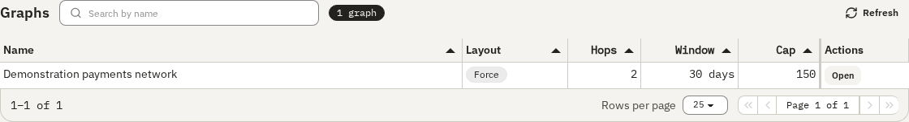
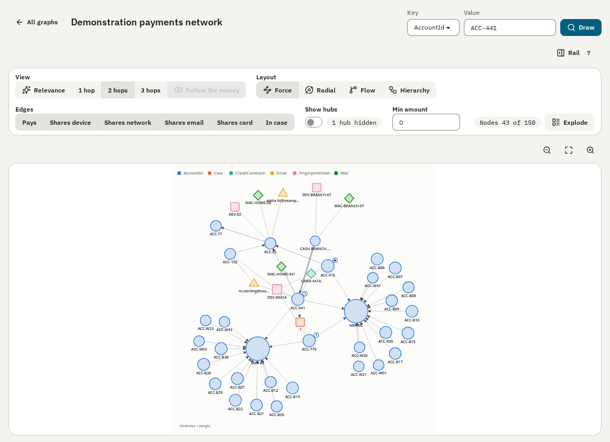
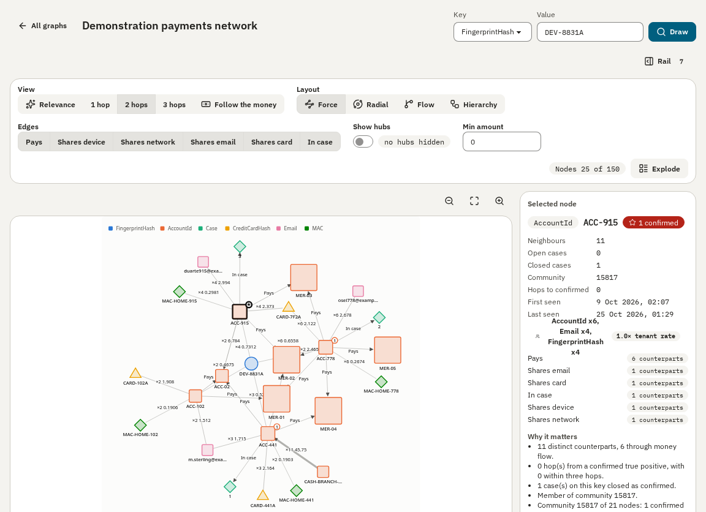
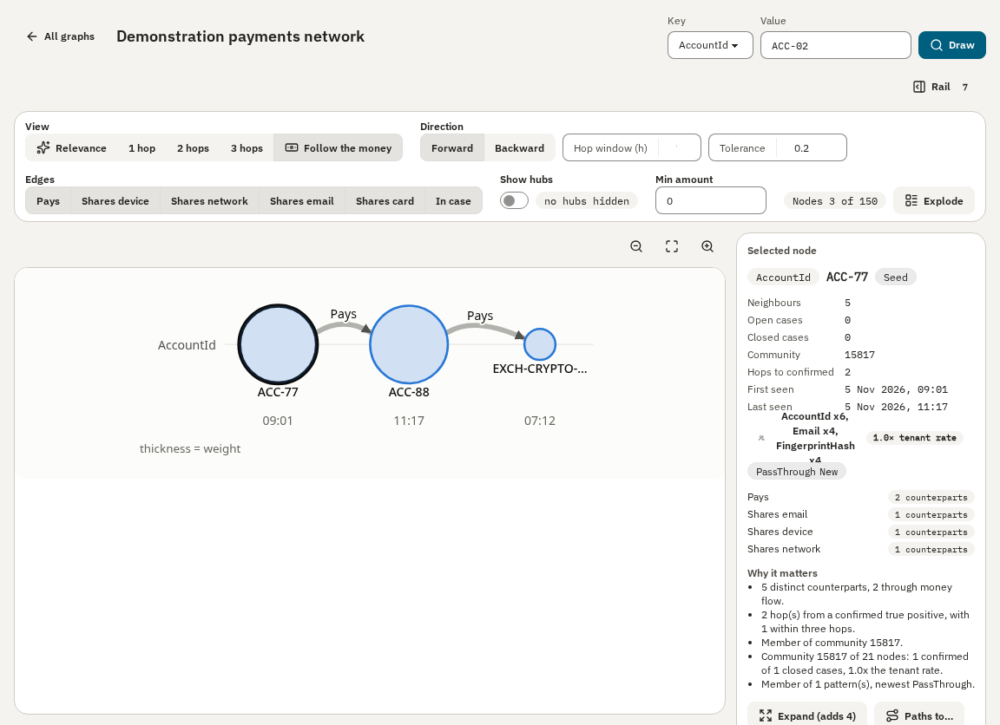
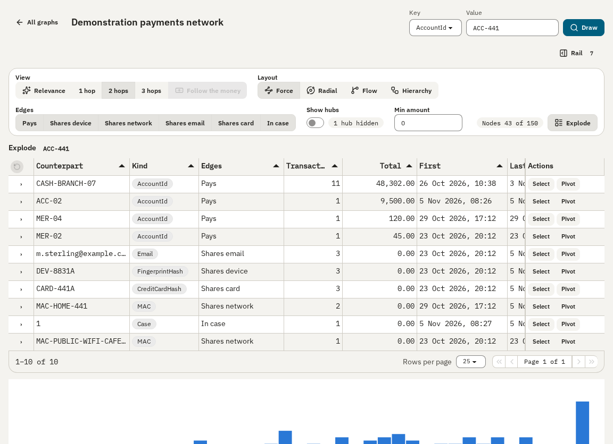

# Exploring a Graph

The Graph page is where a network is explored freely, starting from any key and value, without a case being involved. It serves the investigator who holds an identifier (an account from a tip-off, a device from another investigation) and wishes to know what it is connected to, and it serves the analyst looking across the whole tenant for patterns, communities and hubs that no single case would reveal.

The terms used on this page are introduced in [Graph Concepts](../Concepts/index.html), and the examples are from the demonstration network described there. The same explorer is presented on a case as the Network section, the differences being described in [Graph on a Case](../GraphOnACase/index.html).

## Where it lives

Navigate through the menu to Graph, which presents the directory of graphs at `/graph`. Opening a graph presents the explorer for that graph at `/graph/{guid}`, where the guid is that of the Graph Registry.

## The directory

The directory, under the heading Graphs, lists the graphs available to the user. A graph is listed where it is active, its Shown in is Directory, and a role of the user is granted on it, as described in [Graph Registry](../GraphRegistry/index.html).

| Element | Description                                                                                                                   |
|---------|-------------------------------------------------------------------------------------------------------------------------------|
| Search  | A box reading Search by name, which narrows the list to graphs whose name contains the text, without regard to case.          |
| Count   | The number of graphs shown, as in 1 graph.                                                                                    |
| Refresh | Reads the list again.                                                                                                         |
| Name    | The name of the graph.                                                                                                        |
| Layout  | The default layout: Force, Radial, Flow or Hierarchy.                                                                         |
| Hops    | The default hops.                                                                                                             |
| Window  | The default window, as in 30 days.                                                                                            |
| Cap     | The render cap.                                                                                                               |
| Open    | Opens the explorer for the graph.                                                                                             |

The graphs are in order of name, 25 to a page. The states of the directory are as follows:

| State                                         | What is shown                                              |
|-----------------------------------------------|------------------------------------------------------------|
| No graph is listed for the user               | No graphs are listed in the directory.                     |
| The search matches nothing                    | No graphs match.                                           |
| The user is refused                           | You do not have permission to view graphs.                 |
| The list cannot be read for any other reason  | The graphs could not be loaded. together with Try again.   |

On a clean installation the directory lists one graph, Demonstration payments network, for a user of the Administrator role.

SHOT id=graph-exploring-directory
     route=/graph
     steps=none
     frame=section:Graphs
     state=the directory of the Graph page under the heading Graphs, with the Search by name box, a count of 1 graph and Refresh, and one row, Demonstration payments network, with its layout of Force, 2 hops, a window of 30 days, a cap of 150 and Open
     conveys=the Graph page begins at a directory of the graphs the user may open, each row stating the defaults the explorer will start from
     alt=The Graphs directory listing one graph, Demonstration payments network, with its default layout, hops, window and render cap, and an Open action

## Drawing a network

At the head of the explorer are All graphs, which returns to the directory, the name of the graph, and the three controls that set the seed:

| Control | Description                                                                                                                                                                                             |
|---------|---------------------------------------------------------------------------------------------------------------------------------------------------------------------------------------------------------|
| Key     | The kind of node to start from, chosen from the node keys of the edges of the graph, in order of name, the first being selected. Where the edges cannot be read, a text box reading e.g. AccountId is presented instead. |
| Value   | The value to start from, typed exactly as it is stored. Leading and trailing spaces are removed.                                                                                                        |
| Draw    | Draws the network around the key and value. Nothing happens where either is empty.                                                                                                                      |

Until a seed is drawn the page reads Enter a key and value above to draw its network.

To follow the example, choose the Key AccountId, enter the Value ACC-441 and click Draw. The network of ACC-441 is drawn at the Default hops of the graph, which is two in the demonstration, in the default layout of the graph, over the default window of the graph, with hubs hidden.

Drawing a new seed starts afresh: the selection, the expanded nodes, the cursor of the time strip, any paths and any highlighted pattern or community are cleared. The view, the hops, the layout and the edge kinds chosen are kept.

For the demonstration network the Key list offers AccountId, CreditCardHash, Email, FingerprintHash and MAC, being the kinds of node of its five edges, and also Case, which arises from the In case edge added to every graph. Case, with the number of a case as the Value, draws the network around that case.

SHOT id=graph-exploring-canvas
     route=/graph/6f1a3c2e-9b7d-4e2a-8c3f-2d9e1b7a5c41?gk=AccountId&gq=ACC-441
     steps=wait-for:Legend
     frame=page
     state=the explorer for the Demonstration payments network seeded on AccountId ACC-441: the seed controls at the head, the toolbar with 2 hops and Force active and the hubs badge reading 1 hub hidden, the canvas with ACC-441 at the centre joined to DEV-8831A and through it to three accounts, the time strip with its sliders, and the legend
     conveys=the explorer is a toolbar, a canvas, a time strip and a legend, all answering to one seed
     alt=The Graph page showing the network around account ACC-441 with a toolbar of view, layout, edge and hub controls above the canvas, and a time strip and legend beneath

## Reading the canvas

The canvas is the picture of the neighbourhood. It is read by shape, by line and by badge:

| What is drawn                          | Meaning                                                                                                                                              |
|----------------------------------------|------------------------------------------------------------------------------------------------------------------------------------------------------|
| A circle                               | A node of the same kind as the seed.                                                                                                                 |
| A square, a diamond or a triangle      | A node of another kind. The shapes are given to the other kinds in order of name and are used again where there are more than three other kinds.    |
| The colour of a shape                  | The kind of node also. Each kind has a colour of its own, such that two kinds obliged to share a shape are still told apart.                         |
| A hexagon                              | A hub. Drawn only where Show hubs is on, or where the hub is itself the seed.                                                                        |
| A stack                                | A cluster: several nodes of one kind, reached through the same node, gathered together for being beyond the render cap. Joined by a dashed line, and labelled with the count and the kind, as in 12 AccountId. |
| A larger shape                         | A node with more neighbours across the whole network, the largest being two and a half times the smallest.                                           |
| A line with an arrow                   | A payment, an ownership or the link of a key to its case, in the direction of the arrow.                                                             |
| A line without an arrow                | An identity link, such as a shared device.                                                                                                           |
| A dashed line                          | A soft link: an identity link through an identifier shared by six or more. Also the line joining a cluster.                                          |
| A thicker line                         | A heavier edge. Thickness is relative to the heaviest edge in the picture and not absolute, hence the same edge may be drawn thinner once a heavier one comes into view. The picture is footed thickness = weight. |

#### Badges

A badge is a small rounded tab at the upper right of a node, and a node may bear several side by side, to a limit of four. They are always in the order given here, which is the means of telling one number from another:

| Badge              | Meaning                                                                                                                                  | How to read it                                                                                       |
|--------------------|------------------------------------------------------------------------------------------------------------------------------------------|------------------------------------------------------------------------------------------------------|
| ★                  | At least one case on the node was closed as confirmed. The star carries no number, however many such cases there are.                    | The node is a known bad actor. Anything joined to it deserves an explanation.                        |
| A number           | The number of open cases on the node that the user may see.                                                                              | The node is already under investigation, and Open case in the Selected node panel leads to the case. |
| A number on a hexagon | The number of neighbours of the hub. Where a hub also has open cases it bears two numbers, the open cases first and the neighbours second. | The larger, the less a link through the hub means.                                                |
| × and a number     | On a stack only: the number of nodes gathered into the cluster.                                                                          | Open Explode for the list.                                                                           |

A node with no badge has no confirmed case and no open case that the user may see, and is not a hub. The legend beneath the time strip shows Confirmed true positive as a star and Open case as a dashed circle. The dashed circle is the symbol of the legend only: on the canvas an open case is the number in a tab described above.

#### Labels and what the pointer shows

The label beneath a node is its value, shortened to 28 characters where longer and further where it would otherwise run into its neighbours.

A label is written on a line only where the picture holds 40 edges or fewer, as beyond that the labels would bury the picture. It follows that the labels are present at 1 hop from ACC-441 and absent at 2 hops, and that the line is then identified by resting the pointer on it, by the Edges buttons of the toolbar, or by selecting it. Where a label is written, it is the name of the edge definition for a link with a single transaction in the window, as in Pays, and for a link with several it is the count and the weight, as in ×9 0.73, being nine transactions and a weight of 0.73.

Resting the pointer on a node presents, in this order: its value; its kind; a line giving the kind again, degree and its number of neighbours, and where they apply hub, its hops from a confirmed case, its open cases and its confirmed cases; Edges in and out, being the lines drawn to and from it in this picture; First seen; and its badges. Resting the pointer on a line presents the two ends, joined by to where the line has an arrow and by and where it has none; Weight; the name of the edge definition; Events, where there is more than one transaction in the window; and First and Last, being the earliest and the latest transaction in the window. The dates so shown are in UTC.

For ACC-441 the shapes fall out as follows: accounts are circles, being of the kind of the seed; cases and devices are squares; cards and network addresses are diamonds; and email addresses are triangles, the kinds sharing a shape differing in colour.

TODO(verify): confirm on a running system the placing of the key of colours by kind within the picture.

Above the canvas, to the right, are Zoom out, Fit and Zoom in. The canvas is moved by dragging, and is fitted to the space each time it is drawn afresh. While a change is being fetched the previous picture remains, with a small spinner, such that the canvas does not flash empty between changes, and the nodes already on screen keep their positions where the layout allows.

### Selecting

* **A node** is selected by clicking it, or by moving to it with the keyboard and pressing Enter or Space. It is outlined, and the Selected node panel opens beside the canvas.
* **An edge** is selected by clicking its line. It is outlined. On a case, the Journal is narrowed to the transactions behind the edge.
* **Nothing** is selected by clicking an empty part of the canvas, or by pressing Escape.

Until a node is selected, the place of the panel reads Select a node on the canvas, or a lane in Explode, to see its facts.

## The toolbar

The toolbar is above the canvas. Every control other than Explode is disabled while the first picture is being fetched.

### View

| Control                    | Description                                                                                                                                                                                                                                          |
|----------------------------|------------------------------------------------------------------------------------------------------------------------------------------------------------------------------------------------------------------------------------------------------|
| Relevance                  | Ranks the neighbourhood by interest in place of nearness. The nodes kept within the render cap are the most relevant, those of an interest of 0.6 or more are outlined, and Explode is ordered by interest. The number of hops last chosen still applies. |
| 1 hop, 2 hops, 3 hops      | Gathers the neighbourhood to that many hops, nearest first. 2 hops is the view the explorer opens in.                                                                                                                                               |
| Follow the money           | Traces payments from the selected node, as described below. It is disabled until a node is selected, with the hint Select a node to follow its money.                                                                                               |

For ACC-441, 1 hop shows what the account touches directly; 2 hops adds ACC-102, ACC-778 and ACC-915 through the device and ACC-77 through ACC-02; 3 hops adds ACC-88; and Relevance brings the confirmed ACC-915 and the device to the fore.

### Layout

| Layout    | Arrangement                                                                           | Suited to                                          |
|-----------|---------------------------------------------------------------------------------------|----------------------------------------------------|
| Force     | Linked nodes are drawn together and unlinked nodes apart, such that clusters form.    | Seeing groups, and the general shape.              |
| Radial    | The seed at the centre and each hop in a ring around it.                              | Seeing how far each node is from the seed.         |
| Flow      | Left to right in the direction of the arrows.                                         | Chains of payments.                                |
| Hierarchy | Layers from top to bottom.                                                            | Ownership.                                         |

The canvas opens in the Default layout of the graph. A layout chosen on the toolbar is kept in the address. While following the money the layout controls are replaced by those of the flow, and the Flow layout is used unless another was chosen beforehand.

### Edges

One button for each active edge definition of the graph, all of which are on to begin with. Switching one off removes edges of that kind, and whatever was reachable only through them. Switching every one off is the same as switching every one on, as a network of no edges is nothing. An edge definition marked Restricted bears a padlock, and for a user of a role not granted on the graph it is disabled. Where any definition is Restricted, a badge reading Restricted states how many.

For ACC-441, switching off Pays leaves the ring of four accounts around the device DEV-8831A, and switching off all but Pays leaves the movement of money alone.

### Show hubs

A switch, off to begin with, beside a badge stating how many hubs next to the seed were left out, as in no hubs hidden, 1 hub hidden or 3 hubs hidden. Switching it on walks through hubs, drawing each as a hexagon, and the badge then reads no hubs hidden, nothing being left out. The count is of the hubs one hop from the seed only, under the Edges chosen and without regard to the window. A hub further out is left out likewise and is not counted, hence no hubs hidden does not mean that the neighbourhood is free of them, and the Hubs tab of the rail is the place to see them all. For ACC-441 the badge reads 1 hub hidden, being the public wifi address, and switching Show hubs on brings in the wifi address and, at two hops, up to 25 of the accounts that used it.

Show hubs is not kept in the address and is off again when the page is opened afresh.

### Min amount

A number, 0 to begin with. A Money flow edge is followed only where the total amount it carries is at least the figure, the total being that of every transaction ever built into the edge and not only of those within the window. The network is drawn again a moment after the figure is changed. It is not kept in the address.

Keep in mind that only a Money flow edge carries an amount, hence Min amount is applied to Money flow edges alone: identity links, ownership and case edges are followed whatever the figure. Where only the payments are of interest, Min amount is best used together with switching off the identity edges, as a means of asking where the large sums went.

### Nodes, Explode and Capture

| Control                 | Description                                                                                                                                                                              |
|-------------------------|------------------------------------------------------------------------------------------------------------------------------------------------------------------------------------------|
| Nodes {count} of {cap}  | The number of nodes drawn against the render cap of the graph, as in Nodes 64 of 150.                                                                                                    |
| Explode                 | Replaces the canvas with the lanes of the selected node, or of the seed where none is selected, as described below. Clicking it again restores the canvas.                               |
| Capture                 | Presented on a case only, as described in [Graph on a Case](../GraphOnACase/index.html).                                                                                                 |

## Messages above the canvas

| Message                                                                                         | Meaning                                                                                                                                                              |
|-------------------------------------------------------------------------------------------------|----------------------------------------------------------------------------------------------------------------------------------------------------------------------|
| The edges of this graph have not been built yet.                                                | The background build has not yet taken up a transaction for any edge of this graph, although the seed is a node of the network by virtue of another graph or of a case. What is drawn may be incomplete. |
| Edges were last built {when}.                                                                   | The build last ran for this graph more than 24 hours ago, at the date and time given, whether or not it found a transaction to take up. Transactions processed since may be missing, and the administrator should establish why the build is not running. On a system that is merely idle the build still runs each cycle, and the message is not shown. |
| {count} more nodes are collapsed into clusters; open Explode for the full list.                 | The neighbourhood is larger than the render cap. The nearest nodes are drawn and the remainder are in clusters.                                                      |
| {count} less relevant nodes are collapsed into clusters; open Explode for the full list.        | The same, in the Relevance view, where it is the least relevant that are in clusters.                                                                                |

## States in which nothing is drawn

| State                                                                                                                  | What is shown                                                   |
|------------------------------------------------------------------------------------------------------------------------|-----------------------------------------------------------------|
| The user holds neither permission 49 nor permission 1                                                                  | You do not have permission to view this graph.                  |
| The graph does not exist, is not active, or belongs to another tenant                                                  | This graph could not be found.                                  |
| The key and value entered are not a node of the network                                                                | {key} {value} is not a node in this graph yet.                  |
| The graph has no active edge                                                                                           | This graph has no active edges, so there is nothing to draw. together with Set up edges for a user holding permission 50. |
| The graph has active edges, none of which the user may see                                                             | {key} {value} is not a node in this graph yet.                  |
| The request is not valid, the server fails, or the server cannot be reached                                            | The network could not be drawn. together with Try again.        |

Where the value entered is stated not to be a node, the usual cause is one of the following: it was mistyped (the value is matched exactly, with regard to case), it has no transaction within the retention period, the field is not flagged Archive Key, or the build has yet to run, as in the first minutes after a new installation is started.

A seed that is a node yet has no link within the window is a different matter: it is drawn alone, as a single shape with no lines. As the window of the Graph page can be narrowed on screen and not lengthened, the remedy is a greater Default window days on the graph, set in [Graph Registry](../GraphRegistry/index.html). This is what is seen of the demonstration network on an installation some weeks old.

## The Selected node panel

Selecting a node opens the panel, titled Selected node, beside the canvas (beneath it on a narrow screen). While the facts are fetched the panel shows a placeholder, and where they cannot be fetched it reads The node could not be loaded.

### What the panel states

| Element             | Description                                                                                                                                                                              | How to read it                                                                                               |
|---------------------|------------------------------------------------------------------------------------------------------------------------------------------------------------------------------------------|--------------------------------------------------------------------------------------------------------------|
| Key and value       | The kind of the node and its value. For a case node it reads Case followed by the number of the case.                                                                                    |                                                                                                              |
| Seed                | A badge, where the node is the seed.                                                                                                                                                     |                                                                                                              |
| Hub                 | A badge, where the node is a hub.                                                                                                                                                        | Links through it mean little.                                                                                |
| {count} confirmed   | A badge with a star, where cases on the node were closed as confirmed.                                                                                                                   | Any figure is serious: the node is a known bad actor.                                                        |
| Neighbours          | The number of distinct nodes it is linked to, across the whole network of the tenant and not only what is drawn.                                                                         | Compare with what is typical of the kind. Four accounts on a device is many; four payees of an account is few. |
| Open cases          | The number of open cases on the node that the user is permitted to see.                                                                                                                  |                                                                                                              |
| Closed cases        | The number of closed cases on the node that the user is permitted to see.                                                                                                                |                                                                                                              |
| Interest            | Shown in the Relevance view. The interest of the node to the seed, from 0 to 1, to two decimal places.                                                                                   | 0.6 or more is among the most relevant. The seed is 1.                                                       |
| Community           | The number of the community the node belongs to.                                                                                                                                         |                                                                                                              |
| Hops to confirmed   | The number of hops to the nearest confirmed node, where there is one within four hops.                                                                                                   | 0 is confirmed itself, 1 is directly linked, 2 has one node between. The lower, the more pressing.           |
| Tags                | Each tag found nearby, as in Fraud · 2 hops, or Fraud · on this node, the nearest first.                                                                                                 |                                                                                                              |
| First seen          | The date and time of the earliest transaction carrying the node.                                                                                                                         | A node first seen days ago and already busy is worth noting.                                                 |
| Last seen           | The date and time of the latest transaction carrying the node.                                                                                                                           |                                                                                                              |
| Community button    | The label of the community, being its commonest kinds of node with their counts, and its ratio, as in 3.0× tenant rate.                                                                  | Above 1.0× the community has a higher confirmed rate than the tenant as a whole.                             |
| Pattern chips       | One chip for each pattern the node belongs to, with the kind and the state of the pattern, as in ScatterGather New.                                                                      |                                                                                                              |
| Edge definitions    | Each edge definition the node takes part in, with its number of counterparts, as in Shares device 4 counterparts.                                                                        |                                                                                                              |
| Why it matters      | Plain sentences drawn from the facts above.                                                                                                                                              | The sentences are the summary to quote in a note.                                                            |

The sentences under Why it matters are from the following, each given only where it applies:

* {key} {value} is a hub shared by {count} counterparts; traversal does not pass through it unless asked.
* {count} distinct counterparts, {count} through money flow.
* {count} hop(s) from a confirmed true positive, with {count} within three hops.
* {count} open case(s) on this key.
* {count} case(s) on this key closed as confirmed.
* Member of community {number}.
* Community {number} of {count} nodes: {count} confirmed of {count} closed cases, {ratio}x the tenant rate.
* Member of {count} pattern(s), newest {kind}.
* {count} hop(s) from a transaction or case tagged {tag}, with {count} within three hops.

For DEV-8831A in the demonstration network the panel states 4 Neighbours, Hops to confirmed 1, Shares device 4 counterparts, and among its sentences 4 distinct counterparts, 0 through money flow. and 1 hop(s) from a confirmed true positive, with 1 within three hops.

For ACC-441 itself the panel states 20 Neighbours (three devices, an email address, a card, seven network addresses including the public wifi, ACC-02, five merchants, the branch and its case), 1 Open cases, Hops to confirmed 2, and under Tags the tags of the cases nearby: Fraud · 1 hop and MoneyMule · 1 hop, being the tags of its own case, and ConfirmedFraud · 3 hops, being the tag of the case on ACC-915 reached through the device.

Three points of reading deserve care:

* **Neighbours is of the whole network.** It counts every distinct node the node is linked to, hubs and its own cases included, over all time and under every edge definition of the tenant. It is commonly larger than the number of lines drawn to the node, which are limited by the window, the Edges chosen, the hiding of hubs and the fan-out, and the difference between the two is what Expand offers to add.
* **The figures worked out in the background lag behind.** Neighbours and Hub are of the last cycle of the hubs job, hourly by default, and Community, Hops to confirmed and Tags are of the last cycle of their own jobs, each minute by default. A node first seen moments ago may therefore show 0 Neighbours and no Hops to confirmed while already being drawn with lines.
* **The sentence of a community with no ratio omits it.** Where the community has no closed cases, or the tenant has no rate against which to compare, the sentence ends at the count of closed cases, reading Community {number} of {count} nodes: {count} confirmed of {count} closed cases., and the community button likewise shows no ratio. The absence is not to be read as a community with a low rate of fraud.

SHOT id=graph-exploring-node-panel
     route=/graph/6f1a3c2e-9b7d-4e2a-8c3f-2d9e1b7a5c41?gk=FingerprintHash&gq=DEV-8831A
     steps=click:Explode, click:Select, click:Explode
     frame=page
     state=the explorer seeded on the device DEV-8831A with one of the four accounts that share it selected on the canvas and outlined, and the Selected node panel open beside the canvas showing the key and value, Neighbours, Open cases, Closed cases, Hops to confirmed, First seen, Last seen, the edge definitions with their counterparts, Why it matters and the row of actions
     conveys=selecting a node opens its facts beside the picture, with the reasons it matters in plain sentences and the actions that start from it
     alt=The network around device DEV-8831A with one account selected and a panel beside the canvas listing its neighbours, cases, hops to a confirmed case, first and last seen dates, reasons it matters and buttons to expand, find paths, follow the money and pivot

### What can be done from the panel

| Action                  | Description                                                                                                                                                                                                                                                              |
|-------------------------|--------------------------------------------------------------------------------------------------------------------------------------------------------------------------------------------------------------------------------------------------------------------------|
| Expand (adds {count})   | Adds the neighbourhood of the selected node to the picture, as though it were a further seed. The count is the number of neighbours of the node not already drawn. The button reads Expand (adds none) and is disabled where there is nothing to add, and reads Expanded once done. |
| Paths to…               | Finds the paths from the selected node to another, as described below.                                                                                                                                                                                                   |
| Follow the money        | Traces payments from the selected node, as described below.                                                                                                                                                                                                              |
| Explore from here       | On the Graph page, draws the network afresh with the selected node as the seed. Not offered for a case node.                                                                                                                                                             |
| Open case {id}          | Presented where the node is a case, or has a case that the user may see, being the latest open case or failing that the latest case. Opens that case.                                                                                                                   |
| The community button    | On the Graph page, draws the network afresh from the most central member of the community, with the members of the community outlined.                                                                                                                                   |
| A pattern chip          | Outlines the members of the pattern and the edges behind it. Clicking the chip again removes the outline.                                                                                                                                                                |

Expanding a hub asks first, under the heading Expand a hub?, with the text This node is a hub with {count} neighbours. Expanding it adds many nodes and may collapse others into clusters. and the choices Expand the hub and Keep it collapsed.

Up to 20 nodes can be expanded at once, and upon a further node being expanded the earliest is given up. For ACC-441 at two hops, selecting ACC-77 and expanding it brings in ACC-88, and expanding ACC-88 brings in EXCH-CRYPTO-01, which no number of hops from ACC-441 would reach.

### A selected cluster

Selecting a cluster presents, in place of the facts, {count} {key} nodes are collapsed behind the cap. together with List them in Explode, which opens Explode on the node through which the cluster was reached.

## Paths

Paths to… on the panel puts the explorer into picking: the button reads Pick the target…, the canvas is ringed and reads Pick the target on the canvas, and a Paths panel opens beneath the canvas reading Pick the target node on the canvas, or enter its key and value. The target is given in one of two ways:

* By clicking a node on the canvas.
* By entering its Key and Value in the Paths panel and clicking Find, which is the means of naming a node that is not drawn. Where there is no such node the panel reads No node has that key and value.

Cancel leaves picking. Once a target is given, the Paths panel shows the two ends and lists the paths:

| Element                         | Description                                                                                                         |
|---------------------------------|---------------------------------------------------------------------------------------------------------------------|
| All {count} paths               | Outlines every path on the canvas. It is the selection to begin with.                                               |
| {hops} hops, weight {weight}    | One path, with its sentence. Clicking it outlines that path alone.                                                  |
| Clear paths                     | Closes the panel and removes the outlines. Clicking Paths to… again does the same.                                  |

Up to 5 paths are returned, of at most 4 hops, the fewest hops first and then the greatest weight. Paths honour the Edges chosen and avoid hubs unless Show hubs is on. They are not limited to the window. Where there is none the panel reads No path within the hop limit., and where the search fails The paths could not be found.

The weight shown against a path is the product of the weights of its edges, to three decimal places. It has no meaning of its own and serves only to put paths of the same number of hops in order, the greater being the stronger connection. A path follows edges in either direction, hence it states that two nodes are connected and not that money passed from the one to the other.

To follow the example, select ACC-441, click Paths to…, enter the Key AccountId and the Value EXCH-CRYPTO-01 and click Find. One path of 4 hops is returned, through ACC-02, ACC-77 and ACC-88, with a weight in the hundreds, as each of its four edges is a payment of several thousands.

A path is outlined only where its nodes and edges are drawn. A path running beyond the neighbourhood on screen is listed in the panel in full, and its further nodes are brought onto the canvas by expanding the nodes along it.

## Following the money

Follow the money, on the toolbar or on the panel, traces payments from the selected node. The canvas is drawn afresh as the nodes the money reached, the toolbar gains the controls of the flow in place of the layouts, and a panel beneath the canvas lists the tranches.

| Control          | Description                                                                                                                                                              | Default | Limits                    |
|------------------|--------------------------------------------------------------------------------------------------------------------------------------------------------------------------|---------|---------------------------|
| Forward          | Where the money went: payments made by the node, then by those it paid, and so on.                                                                                       | On      |                           |
| Backward         | Where the money came from: payments received by the node, then by those that paid it.                                                                                    |         |                           |
| Hop window (h)   | The number of hours within which the next payment must follow the last.                                                                                                  | 72      | 1 to 720, whole hours     |
| Tolerance        | How far the next amount may differ from the last. The next amount must be between the last less this proportion and the last plus a quarter of this proportion.          | 0.2     | 0 to 0.9, in steps of 0.05 |

The trace runs to 4 steps, takes at most 10 payments onward from any one node at each step (the earliest 10 when forward, the latest 10 when backward), returns at most 2,000 tranches, takes Money flow edges only, honours the Edges chosen and the window, and never passes through a hub, whether or not Show hubs is on. The first step is not held to the Tolerance, as there is no previous amount: it is every payment made by the node within the window (or received, when backward).

The panel is headed Money forward from the seed or Money back to the seed, with the number of tranches, and lists each tranche as follows:

| Element               | Description                                                                                                                      |
|-----------------------|----------------------------------------------------------------------------------------------------------------------------------|
| Hop {depth}           | The step of the trace. Clicking it outlines the tranches of that step on the canvas, and clicking it again removes the outline.  |
| The node              | The value of the node the money reached.                                                                                         |
| Pass-through          | A badge, where money both arrived at and left the node along the trace.                                                          |
| The amount            | The amount of the payment.                                                                                                       |
| The date and time     | When the payment took place.                                                                                                     |
| {count} transactions  | The number of transactions along the route from the start to this tranche.                                                       |
| Show in journal       | On a case, narrows the Journal to those transactions. On the Graph page there is no journal, and it is not presented.            |

Beneath the list a sentence summarises the trace, in the manner of 5 tranche(s) reach 4 node(s) within 2 hop(s); 1 node(s) pass the money straight through. Where nothing is found the panel reads No tranches matched within the hop window., and where the trace fails The money could not be traced. Leave flow view returns to the neighbourhood at the hops last chosen, as does choosing a number of hops or Relevance.

To follow the example, select ACC-441 and click Follow the money. Hop 1 lists ten tranches, being the ten earliest of the twelve payments of ACC-441 in the window: nine purchases at the merchants MER-01 to MER-05, and 9,500 to ACC-02. Hop 2 lists 9,200 and 9,700 to ACC-77, and ACC-02 is marked Pass-through. The panel is headed 12 tranches, and the sentence beneath reads 12 tranche(s) reach 7 node(s) within 2 hop(s); 1 node(s) pass the money straight through. The nine purchases are not noise to be regretted: the first step shows everything the account paid, and it is the second step, where the amounts must agree, that picks the thread out of them. The trace stops at ACC-77, for the reason that ACC-77 paid on a single sum of 18,500, which is not comparable with either receipt. Select ACC-77 and click Follow the money again: Hop 1 is 18,500 to ACC-88, Hop 2 is 18,200 to EXCH-CRYPTO-01, and ACC-88 is marked Pass-through. Click Backward with ACC-77 selected, and the trace returns through ACC-02 to ACC-441 and ACC-102. The two earlier payments of ACC-915 into ACC-02 are not among them, being neither within 72 hours nor of a comparable amount, which shows the two conditions at work.

Keep in mind therefore that following the money traces one sum as it moves. It does not follow a sum that is split into much smaller parts, nor several sums consolidated into one, both of which are instead the business of the patterns.

SHOT id=graph-exploring-flow
     route=/graph/6f1a3c2e-9b7d-4e2a-8c3f-2d9e1b7a5c41?gk=AccountId&gq=ACC-02
     steps=click:Explode, click:Select, click:Explode, click:Follow the money
     frame=page
     state=the explorer seeded on ACC-02 with ACC-77 selected and Follow the money active: the toolbar showing Forward, Backward, Hop window (h) of 72 and Tolerance of 0.2, the canvas drawn left to right from ACC-77 to ACC-88 to EXCH-CRYPTO-01, and the panel Money forward from the seed listing Hop 1 of 18,500 to ACC-88 marked Pass-through and Hop 2 of 18,200 to EXCH-CRYPTO-01
     conveys=following the money redraws the canvas as a chain in order of time and lists each tranche with its amount, its time and the transactions behind it
     alt=The Graph page in the follow the money view, with a left to right chain of three accounts on the canvas and beneath it a list of two tranches giving the hop, the account, the amount, the time and a button to show the transactions in the journal

## Explode

Explode on the toolbar replaces the canvas with a table headed Explode and the value of the node it describes, being the selected node, or the seed where no node is selected. Each row is a lane, which is to say one counterpart of the node, one hop away.

| Column       | Description                                                                                                      |
|--------------|------------------------------------------------------------------------------------------------------------------|
| Counterpart  | The value of the counterpart.                                                                                    |
| Kind         | The kind of node the counterpart is.                                                                             |
| Edges        | The names of the edge definitions linking the two.                                                               |
| Transactions | The number of transactions behind those edges, over the whole life of the edges and not only within the window.  |
| Total        | The total amount behind those edges, likewise over their whole life, which is zero for identity links.           |
| First        | The date and time of the earliest transaction ever built into those edges.                                       |
| Last         | The date and time of the latest.                                                                                 |
| Interest     | Shown where any lane has an interest, which is to say in the Relevance view.                                     |
| Nearest tag  | Shown where any lane has a tag nearby, as in Fraud · 2 hops.                                                     |
| Hub          | Hub where the counterpart is a hub, and No otherwise.                                                            |
| Actions      | Select, which selects the counterpart, and Pivot, which draws the network afresh with the counterpart as seed.   |

The lanes are in order of Total, greatest first, and then of Transactions, or in order of Interest in the Relevance view. They are shown 25 to a page, to a limit of 200 lanes. Explode honours the Edges chosen and the window. It lists hubs as lanes whether or not Show hubs is on, as a hub is a fact about the node even where it is not walked through, and it is not subject to the render cap. Where there are none the table reads No counterparts in this window., and where they cannot be read The lanes could not be listed.

Select in a lane selects that counterpart, such that the panel shows its facts and the table then describes it in turn. It follows that the whole network can be walked lane by lane without the canvas, which is the means by which the explorer is used from the keyboard and with a screen reader.

Expanding a row presents the transactions behind the lane, under the count {count} transactions behind this lane, with the columns Archive id, Occurred and Amount. Up to 200 transactions are read for each edge of the lane, and 500 for the lane. Where there are none in the window the row reads No transactions behind this lane in the window.

A lane is listed where its edges were in use during the window, yet the figures in it are of the whole life of those edges, as stated above. The transactions presented upon expanding the row, by contrast, are those within the window, hence the count in the row and the number of transactions beneath it may properly differ.

For ACC-441 the first lane is CASH-BRANCH-07, with 11 transactions and a total of 48,302, followed by ACC-02 with 9,500 and then the merchants, MER-05 with 2,430 and MER-02 with 2,310 foremost. The identity links follow with a Total of zero, the email address and the card at 12 transactions each first among them, and the device DEV-8831A at 9. The public wifi address is listed, marked Hub, for as long as the one visit to it remains within the window.

SHOT id=graph-exploring-explode
     route=/graph/6f1a3c2e-9b7d-4e2a-8c3f-2d9e1b7a5c41?gk=AccountId&gq=ACC-441&gd=1
     steps=wait-for:Counterpart
     frame=page
     state=the explorer seeded on ACC-441 with Explode on: the table headed Explode ACC-441 listing the lanes CASH-BRANCH-07, ACC-02, the merchants, DEV-8831A, the email address, the card and the network addresses, with the columns Counterpart, Kind, Edges, Transactions, Total, First, Last and Hub, the public wifi address marked Hub, and Select and Pivot in each row
     conveys=Explode is the same neighbourhood as a table that can be read precisely and worked from the keyboard
     alt=The Graph page with the canvas replaced by a table of the counterparts of account ACC-441, giving for each its kind, the edges linking it, the number of transactions, the total amount, the first and last dates and whether it is a hub

## The time strip

Beneath the canvas is the time strip: a bar chart, of 40 bars across the window, of when the transactions behind the edges on screen took place, to a limit of 20,000 transactions. A tall bar is a busy period.

| Control       | Description                                                                                                                                                                                                             |
|---------------|-------------------------------------------------------------------------------------------------------------------------------------------------------------------------------------------------------------------------|
| From          | A slider that moves the start of the window, one bar at a time. The network is drawn again a moment after it comes to rest.                                                                                             |
| To            | A slider that moves the end of the window likewise. The two cannot cross.                                                                                                                                               |
| Reset window  | Restores the default window of the graph, ending at the present.                                                                                                                                                        |
| Play          | Moves the cursor forward one bar every seven tenths of a second, from the start or from where it stands, and reads Pause while doing so. Upon reaching the end it stops and the cursor is cleared.                      |
| Cursor        | A slider that sets a point in time. Every edge first seen after that point is hidden, as is every node thereby left without an edge, the seed excepted. The date and time of the cursor is shown beside the slider.     |
| Clear cursor  | Shown while a cursor is set. Removes it, restoring every edge.                                                                                                                                                          |

Narrowing the window asks the server for the network of the narrower period, hence the nodes, the bars and the counts all change. The cursor, by contrast, hides what is already drawn and asks the server for nothing, which is why it can be played. Narrowing the window clears the cursor.

Where the reduced motion setting of the operating system is on, Play is disabled and the strip reads Playback is off because reduced motion is on., the Cursor slider remaining available. Where the strip cannot be drawn it reads The time strip could not be drawn.

The window of the Graph page is not kept in the address, and is the default window of the graph each time the page is opened.

To follow the example, with ACC-441 drawn at two hops, click Play. The deposits from CASH-BRANCH-07 and the logins appear first, and towards the end, within a single bar, the payments to ACC-02 and onward to ACC-77.

## The legend

Beneath the time strip the legend states what the shapes and lines mean: a shape for each kind of node drawn, being the circle for the kind of the seed and the square, the diamond and the triangle for the other kinds in order of name, as on the canvas, Hub, Cluster, Confirmed true positive, Open case, Soft link, Money or ownership, and Tagged, with hops to the nearest tagged transaction or case. It then lists each edge definition of the graph with its kind (Identity, Money, Ownership, Resolution or Case), and Restricted where it applies.

## The rail

The rail is the part of the Graph page concerned with the network of the tenant as a whole, in place of one seed. On a very wide screen it is beside the explorer. Otherwise it is opened with the Rail button above the explorer, which bears the number of patterns, and is closed with Escape or by clicking outside it. It has four tabs, the second of which is open to begin with.

Patterns, communities and hubs belong to the tenant and are the same whichever graph is open. Explorations belong to the graph.

### Explorations

An exploration is a saved view: a name under which the present state of the explorer is kept, to be returned to later.

| Element          | Description                                                                                                                                              |
|------------------|----------------------------------------------------------------------------------------------------------------------------------------------------------|
| Name this view   | The name, of up to 80 characters. Disabled until a seed is drawn.                                                                                        |
| Save             | Saves the exploration, confirming with Exploration saved. Saving under a name already used on the same graph replaces that exploration.                  |
| An exploration   | Clicking the name restores the view.                                                                                                                     |
| Delete {name}    | Removes the exploration, at once and without confirmation.                                                                                               |

An exploration holds what is kept in the address, as listed under What is kept in the address below. It does not hold the window, Show hubs or Min amount. Explorations are private to the user who saved them, are listed in order of name, and where there are none the tab reads No saved explorations for this graph. An exploration records where to look and not what was seen: restoring it draws the network as it now stands, under the permissions of the user.

### Patterns

The patterns found by the background jobs, to a limit of 50, the most recently detected first and, among those, the highest score first.

| Element             | Description                                                                                                                                                                       |
|---------------------|-----------------------------------------------------------------------------------------------------------------------------------------------------------------------------------|
| The state filter    | All states, New, Seen, Dismissed or Cased. All states to begin with.                                                                                                              |
| A pattern           | Its kind, its state, the value of the node it is anchored on, score {score} and {count} members, with a sentence beneath giving the kind, the anchor, the members, the score and the period. |
| Clicking a pattern  | Draws the network afresh with the anchor of the pattern as the seed and selected, and the members and edges of the pattern outlined.                                              |
| Mark seen           | Offered for a New pattern. Records that it has been looked at.                                                                                                                    |
| Dismiss             | Offered unless the pattern is Dismissed or Cased. Records that it is of no interest.                                                                                              |
| Attach to case      | Offered unless the pattern is Cased. Attaches the pattern to an existing case.                                                                                                    |
| Case {id}           | A badge, where the pattern is attached to a case.                                                                                                                                 |

Mark seen, Dismiss and Attach to case are presented only to a user holding permission 51, and each asks first:

* Mark seen and Dismiss ask under Decide this pattern?, with Mark {name} as seen? or Dismiss {name}? It leaves the new list., and the choices Confirm and Keep it.
* Attach to case asks under Attach to a case, with Enter the case id that {name} belongs to., a Case id, and the choices Attach and Cancel. The case must be one the user may open, failing which the decision is refused with The case was not found or is not open to you. Attach to case does not create a case.

Upon a decision the rail confirms with Pattern updated. Where there are none the tab reads No patterns detected., and where they cannot be read Patterns could not be loaded.

In the demonstration network the tab lists, among others, ScatterGather, FanOut and SmurfTypeTwo anchored on ACC-300, FanIn anchored on ACC-310, TemporalCycle anchored on ACC-400 and PassThrough anchored on ACC-77. Clicking the ScatterGather draws ACC-300 with its five intermediaries and ACC-310 outlined. No StructuringWindow is listed for the cash deposits into ACC-441, for the reason given under Motifs, or patterns in [Graph Concepts](../Concepts/index.html), where the meaning of each kind and of its score is also set out. The score is comparable only between patterns of one kind: a FanOut of score 5 pays five accounts, whereas a PassThrough of score 0.98 passed on 98% of what it received.

### Communities

The communities of the tenant, to a limit of 50, those with the most confirmed cases first and then the largest, each with its number, its label (the commonest kinds of node among its members, with counts), {count} members and, where it has closed cases, its ratio to the confirmed rate of the tenant, as in 3.0×. Clicking a community draws the network afresh from its most central member, with up to 50 of its members outlined. Where there are none the tab reads No communities computed yet., and where they cannot be read Communities could not be loaded.

The label is written as the kind and the count, as in AccountId x12, FingerprintHash x9, MAC x8, for the three commonest kinds. The ratio is read as described under Communities in [Graph Concepts](../Concepts/index.html): 3.0× is three times the confirmed rate of the tenant, 1.0× is the same as the tenant, and no ratio means no closed case to judge by. The number of a community changes each time the communities are found afresh, each minute by default, hence a community is to be recognised by its members and not by its number, and a link holding a community outlined does not outlast the cycle.

In the demonstration network a single community shows a ratio, of 1.0×, being that which holds ACC-915, the one closed case of the tenant.

### Hubs

The nodes marked as hubs, together with every node that carries a Hub override whether or not it is a hub at present, to a limit of 500, those with the most neighbours first, each with its kind, its value and {count} neighbours. Where there are none the tab reads No hubs detected., and where they cannot be read Hubs could not be loaded. In the demonstration network the tab lists one hub, MAC-PUBLIC-WIFI-CAFE-01 of the kind MAC with 59 neighbours, once the hubs job has run upon the built network, and reads No hubs detected. before then.

A user holding permission 51 is also presented, against each hub, with the Hub override:

| Choice       | Meaning                                                                                 |
|--------------|-----------------------------------------------------------------------------------------|
| Automatic    | The node is a hub or not as the calculation decides.                                    |
| Never a hub  | The node is not to be treated as a hub, whatever its number of neighbours.              |
| Always a hub | The node is to be treated as a hub, whatever its number of neighbours.                  |

Changing it asks first, under Change the hub override?, with This changes how traversal treats {value} for everyone in the tenant. and the choices Change it and Keep it, and confirms with Hub override saved. The node is changed at once, and the edges leading to it at the next cycle of the hubs job, hourly by default, from which point the neighbourhoods drawn reflect it.

Never a hub is for a node that looks like a hub and is in truth of interest, such as a device shared by sixty accounts that turns out to be a mule farm. Always a hub is for a node beneath the threshold that is known to mean nothing, such as the address of a small branch.

A node set to Never a hub remains in the list, with its override shown, such that it can be set back to Automatic. Upon being set back to Automatic it leaves the list where it is not a hub at that moment, and returns to it at the next cycle of the hubs job where the calculation finds it to be one. The tab holds no control by which a node that is neither a hub nor overridden can be set to Always a hub.

## What is kept in the address

The state of the explorer is kept in the address of the page, such that a view can be bookmarked, sent to a colleague as a link, or returned to with the back button. A colleague opening the link is shown the network as their own permissions allow.

| Key  | Holds                                                                    | Left out when             |
|------|--------------------------------------------------------------------------|---------------------------|
| `gk` | The key of the seed.                                                     |                           |
| `gq` | The value of the seed.                                                   |                           |
| `gv` | The view: `r` for Relevance, `f` for Follow the money.                   | The view is by hops.      |
| `gh` | The number of hops.                                                      | It is 2.                  |
| `gl` | The layout, 1 to 4.                                                      | The default of the graph. |
| `ge` | The edge definitions switched on, to a limit of 32.                      | All are on.               |
| `gx` | The nodes expanded, to a limit of 20.                                    | None.                     |
| `gn` | The selected node.                                                       | None.                     |
| `gf` | The node the money is followed from, and the direction.                  | Not following.            |
| `gw` | The Hop window in hours.                                                 | It is 72.                 |
| `go` | The Tolerance.                                                           | It is 0.2.                |
| `ga` | The transaction the money is followed from, on a case.                   | None.                     |
| `gy` | The target of the paths.                                                 | None.                     |
| `gp` | The pattern outlined.                                                    | None.                     |
| `gc` | The community outlined.                                                  | None.                     |
| `gt` | The cursor of the time strip.                                            | None.                     |
| `gd` | Explode, as `1`.                                                         | Off.                      |

Not kept in the address, and hence not restored by a link or an exploration: the window, Show hubs, Min amount, the selected edge, the path or the tranche picked out in a list, the tab of the rail and the state filter of the patterns.

## Limits

| Limit                                                            | Value                   |
|------------------------------------------------------------------|-------------------------|
| Hops                                                             | 1 to 3                  |
| Edges followed from any one node, in each direction              | 25, the heaviest        |
| Nodes drawn                                                      | The render cap of the graph, 150 at most |
| Rows gathered for one neighbourhood                              | 20,000                  |
| Nodes expanded at once                                           | 20                      |
| Transactions listed against one edge of the picture              | 50, the latest          |
| Paths returned, and their length                                 | 5 paths of at most 4 hops |
| Steps when following the money                                   | 4                       |
| Payments taken onward from one node when following the money     | 10                      |
| Tranches returned                                                | 2,000                   |
| Lanes in Explode                                                 | 200                     |
| Transactions shown for a lane                                    | 500                     |
| Bars in the time strip, and transactions counted                 | 40 bars, 20,000 transactions |
| Patterns and communities listed in the rail                      | 50 of each              |
| Hubs listed in the rail                                          | 500                     |
| Length of the name of an exploration                             | 80 characters           |
| Time allowed for any one request                                 | 30 seconds              |

## Permissions and security

| Permission                                         | What it allows                                                                                                                                                                                         |
|----------------------------------------------------|--------------------------------------------------------------------------------------------------------------------------------------------------------------------------------------------------------|
| 49, View Graph                                     | Presents the Graph menu item, and allows everything on this page that only reads: drawing, selecting, expanding, paths, following the money, Explode, the time strip and the lists of the rail. It also allows the saving and deleting of the explorations of the user. |
| 1, Read Write Case                                 | Allows the same reading as 49, such that the Network section of a case works for a case analyst who does not hold 49. It does not present the Graph menu item.                                         |
| 51, Resolve Graph Entities and Patterns            | Presents Mark seen, Dismiss, Attach to case and the Hub override. Without it they are not shown, and the server refuses the request with 403.                                                            |
| 50, Author Graph                                   | Allows the configuration described in [Graph Registry](../GraphRegistry/index.html).                                                                                                                  |

A user holding neither 49 nor 1 is refused by the server with 403, and an unauthenticated request receives 401. What a permitted user sees is further limited as follows:

* **By tenant.** Every node, edge, pattern, community and hub is of the tenant of the user.
* **By role, for Restricted edges.** A Restricted edge definition is shown only to a user of a role granted on the graph, and is otherwise absent from everything, as described in [Graph Registry](../GraphRegistry/index.html).
* **By case access.** The Open cases, Closed cases and confirmed figures of a node, and Open case, count only the cases the user could open, which is to say those where a role of the user is allowed on both the Case Workflow and the status of the case. A case node is likewise shown only to a user who could open that case, and is otherwise absent, with its edges, from the neighbourhood, Explode, paths and the trace of money.

The figures worked out in the background (Neighbours, Community, Hops to confirmed, the sizes of communities and the members of patterns) are of the tenant as a whole and are not reduced for the user, having been worked out from unrestricted edges only.

Each reading of a network is recorded in the audit log with the user and the tenant.
