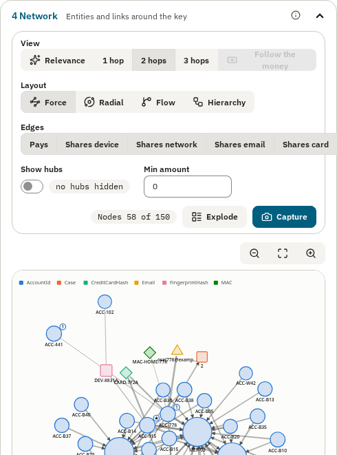
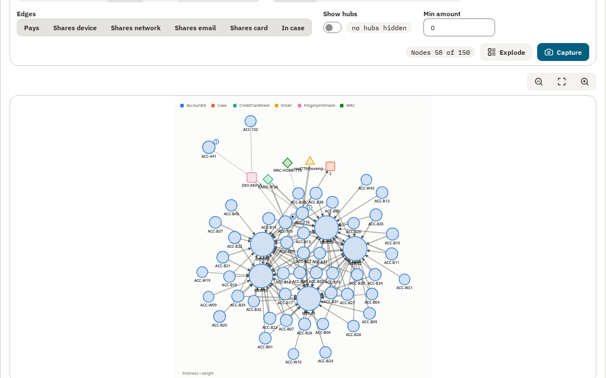

# Graph on a Case

A case is raised on one key, such as an account, and the first question of the analyst is whether that key stands alone. The Network section of the case page answers it without the analyst leaving the case: it draws the network around the key of the case, shows what nearby is already known to be bad, and works hand in hand with the Journal, such that a link on the picture can be opened to the transactions that are its evidence, and the picture can be kept on the case as a record of what was seen.

The Network section is the same explorer as the Graph page, and everything said of the toolbar, the canvas, the Selected node panel, paths, following the money, Explode, the time strip and the legend in [Exploring a Graph](../ExploringAGraph/index.html) holds here. This page describes only what differs on a case. The terms are introduced in [Graph Concepts](../Concepts/index.html).

## Where it lives

Navigate to a case record from the Cases page. The network is the section of the case page titled Network, described there as Entities and links around the key, placed after the Journal and before Notes and research. It is open by default, and is listed with the other sections in the index of the case page.

The section is presented only where both of the following hold, and is otherwise absent altogether, from the page and from the index alike:

* The Case Workflow of the case has Enable graph on and a Graph registry chosen, as described in [Graph Registry](../GraphRegistry/index.html).
* The case has a key.

On a clean installation, the case on ACC-441 in the first Case Workflow of the default model presents the section, drawing the demonstration network.

SHOT id=graph-on-case-network-section
     route=/cases
     steps=open-demo-case, scroll-to:Network
     frame=section:Network
     state=the Network section of the demonstration case on AccountId ACC-441: the toolbar with 2 hops active and the Capture button, the canvas with ACC-441 joined to the device DEV-8831A and through it to ACC-102, ACC-778 and the confirmed ACC-915, the payment to ACC-02 and onward to ACC-77, the time strip and the legend
     conveys=the network around the key of the case is drawn within the case itself, with Capture to keep the picture as evidence
     alt=The Network section of a case showing the accounts, device and payments linked to the account the case is about, with a toolbar that includes a Capture button, a time strip and a legend

## What differs from the Graph page

| On the Graph page                                              | On a case                                                                                                                                             |
|----------------------------------------------------------------|-------------------------------------------------------------------------------------------------------------------------------------------------------|
| The seed is entered as a Key and a Value.                      | The seed is the Case Key and Case Key Value of the case, and cannot be changed. There are no seed controls.                                           |
| The window is that of the graph, and belongs to the page.      | The window is that of the Journal, and the two move together.                                                                                         |
| Selecting an edge outlines it.                                 | Selecting an edge also narrows the Journal to the transactions behind it.                                                                             |
| Explore from here draws the network afresh from the node.      | Pivot journal turns the Journal to the history of the node. The network remains seeded on the case.                                                   |
| The community button draws afresh from the community.          | The community button outlines the members of the community within the network of the case.                                                            |
| There is a rail of explorations, patterns, communities, hubs.  | There is no rail. The patterns and the community of a node are reached through the Selected node panel.                                               |
| There is no Capture.                                           | Capture is on the toolbar and on the Selected node panel.                                                                                             |
| Follow the money starts from the selected node.                | Follow the money starts from the selected node and, where a transaction is selected in the Journal, from that transaction.                            |

## Reading the network of a case

The reading of a network is a matter of working outward from the key of the case, and the demonstration case on ACC-441 serves as the example. The section opens at 2 hops, hubs hidden.

1. **What does the key touch?** At the centre is ACC-441, a circle. Directly joined to it are the device DEV-8831A and two devices used abroad, an email address, a card, several network addresses, the beneficiary ACC-02, the five merchants at which it made purchases, the branch CASH-BRANCH-07 and the case itself. At 2 hops the picture is busy with the other customers of the merchants, and choosing 1 hop first gives the plain answer to this question, with the name of each link written on its line.
2. **What is shared?** The device DEV-8831A is joined to three further accounts. Selecting the device shows 4 Neighbours in the panel: a device used by four accounts. The two devices used abroad are joined to ACC-441 alone, and are of no further interest here.
3. **Is anything nearby known to be bad?** ACC-915 bears a star in a small tab at its upper right, a case on it having been closed as confirmed. Selecting ACC-441 shows Hops to confirmed 2, which is to say that one node, the device, stands between the account and a confirmed fraud. ACC-778 bears the number 1 in a tab, being its one open case, as does ACC-441 itself, and Open case on the panel of ACC-778 opens that case.
4. **Which of all this matters?** Relevance on the toolbar outlines the nodes of most interest, bringing ACC-915 and the device to the fore and letting the customers of the merchants fall away.
5. **Where did the money go?** An arrow runs from ACC-441 to ACC-02 and onward to ACC-77. Selecting ACC-441 and clicking Follow the money lists the tranches: its purchases and the 9,500 at Hop 1, and the 9,200 and 9,700 paid on by ACC-02 at Hop 2.
6. **What is the evidence?** Clicking the line between ACC-441 and ACC-02 narrows the Journal to the payment of 9,500.
7. **Keep it.** Capture stores the picture on the case.

The badge on the toolbar reads 1 hub hidden, being the public wifi address that ACC-441 once used. It is left out for the reason that it would otherwise join ACC-441 to 58 unrelated accounts.

As the section is drawn over the window of the Journal, 90 days unless changed, the whole of the demonstration is within view on a case for some weeks longer than it is on the Graph page, which opens on 30 days.

SHOT id=graph-on-case-network-full-width
     route=/cases
     steps=open-demo-case, click:Hide the sections, click:Hide the decide panel, open-section:4 Network, scroll-to:Show hubs
     frame=section:4 Network
     state=the Network section of a demonstration case with the key panel and the Decide pane hidden, such that the section takes the width of the page, scrolled to the foot of its toolbar, showing the Edges choices, Show hubs, Min amount, the count of nodes drawn, Explode and Capture, and beneath them the canvas with the neighbourhood of the key of the case at 2 hops and its legend of node kinds
     conveys=with the panes hidden the network of a case is given the whole width of the page, which is how a busy neighbourhood is best read
     alt=The Network section of a case at the full width of the page, showing the foot of the toolbar with the edge choices, the node count, Explode and Capture above a canvas drawing the neighbourhood of the key of the case

## The window shared with the Journal

The Network section has no window of its own. It is drawn over the Window of the [Case Key Journal](../../CaseManagement/WorkingCaseKeyJournal/index.html), being the last 7, 30, 90 or 365 days, which is 90 days unless changed. It follows that the network and the Journal always describe the same period, and that the Default window days of the graph does not apply on a case.

Changing the Window of the Journal draws the network again for that period. In the other direction, the From and To sliders of the time strip change the Window of the Journal, with one limitation to keep in mind: the Journal offers four fixed periods ending at the present, hence the span chosen on the strip is taken to the nearest of 7, 30, 90 and 365 days. Where the nearest is the period already in use, nothing changes. Reset window likewise takes the Journal to the period nearest the Default window days of the graph.

Changing the window from the time strip clears the transaction selected in the Journal and the cursor of the strip. The Cursor and Play behave as on the Graph page, hiding what is drawn without changing the window.

## Selection shared with the Journal

The network and the Journal answer to each other in both directions.

### From the Journal to the network

Opening a transaction in the Journal outlines, on the network, every edge that the transaction lies behind. Opening the payment of 9,500 outlines the Pays edge from ACC-441 to ACC-02, and also the Shares device, Shares network, Shares email and Shares card edges of ACC-441, as the one transaction carried the device, the home network address, the email address and the card as well. This is a useful reminder that one transaction commonly lies behind several edges.

An edge holds the latest 50 of its transactions within the window for this purpose. A transaction older than the latest 50 on a busy edge is therefore not outlined.

### From the network to the Journal

Clicking an edge narrows the Journal to the transactions behind that edge, and moves the page to the Journal. The Journal then states Showing {count} transactions picked on the network., and Show every transaction beside it restores the Journal to its scope. The narrowing is of the transactions listed, in the manner of a filter, and is kept in the address, such that the link to the case carries it.

The same narrowing is made by Show in journal against a tranche when following the money, which narrows the Journal to the transactions along the route to that tranche.

The limits are 50 transactions for one edge, being its latest within the window, and 500 in all.

### Pivot journal

Pivot journal on the Selected node panel, and Pivot in a lane of Explode, turn the Journal to the history of that node in place of the history of the key of the case, and move the page to the Journal, which offers a control to return to the key of the case. Pivoting to the key of the case itself returns likewise. It serves the question that follows naturally from the picture: having seen that ACC-102 shares the device, what has ACC-102 been doing?

The pivot is made on the key and value of the node, and the Journal reads the history through the Archive Key of that name. A device, an email address or a card can therefore be pivoted to as well as an account, the Journal then showing every transaction made with it.

TODO(verify): confirm on a running system what the Journal shows upon a pivot to a node filed under a node key that differs from its field, such as a beneficiary filed under AccountId by the To node key, and to a case node, whose key Case is not an Archive Key. The pivot passes the node key and value as they stand.

### Explode on a case

Expanding a lane of Explode on a case presents the transactions behind the lane with the columns of the Journal for the Case Workflow, to a limit of 12 columns, in place of the plain Archive id, Occurred and Amount of the Graph page. The fields are those the roles of the user may see.

## Following the money from a transaction

On a case, Follow the money takes account of the transaction open in the Journal. Where one is open, the trace starts at the moment of that transaction in place of the start of the window: the first step is that payment together with any other made by the selected node within the Hop window after it (or received within the Hop window before it, when backward), and each further step must be comparable in amount with the step before, as usual. Where none is open, the trace starts from every payment of the selected node within the window, as on the Graph page.

This is the means of asking the precise question of a case: this payment of 9,500, where did it go?

## Opening another case

Open case {id} on the Selected node panel opens the case in question at its own Network section, such that an investigation can pass from case to case along the links. Nothing happens where the case is the one already open.

## Capture

A network changes as transactions arrive, hubs are recalculated and cases are closed. What an analyst saw on the day a decision was made cannot therefore be recovered by drawing the network again later. Capture exists to freeze it.

Capture, on the toolbar and on the Selected node panel, stores what is presently drawn on the case. The button reads Capturing while it is being stored, and the page then confirms with Captured {nodes} nodes and {edges} edges to the case. What is stored is as follows:

| Stored                    | Description                                                                                                                                                                                                             |
|---------------------------|-------------------------------------------------------------------------------------------------------------------------------------------------------------------------------------------------------------------------|
| A note                    | A note of the kind Document, reading Network capture: {nodes} nodes and {edges} edges between {date} and {date}., the dates being those of the window.                                                                  |
| The picture               | A file named `network-capture-{case id}-{date and time}.svg`, being the canvas exactly as drawn, attached to the note.                                                                                                  |
| The definition            | A file named `network-capture-{case id}-{date and time}.json`, attached to the note, holding the seed, the request that drew the picture, the layout, the position of every node, the window, every node, every edge with the transactions behind it, the user and the date and time of capture. |
| A hash                    | The SHA-256 hash of the picture, stored against the picture and written into the definition, by which it can later be shown that the picture is unaltered.                                                              |

The capture is of the view in use: the hops, the edges chosen, Show hubs, Min amount, the expanded nodes and, when following the money, the trace. Outlines, the cursor of the time strip and Explode are not part of the picture. The note and its files are thereafter found with the other notes and files of the case, as described in [Uploading and Recalling Files](../../CaseManagement/WorkingUploadingRecallingFiles/index.html).

A capture is refused where:

| Reason                                                    | Message                                         |
|-----------------------------------------------------------|-------------------------------------------------|
| The case cannot be found, or is not one the user may open | The case was not found or is not open to you.   |
| The case is locked to another user                        | The case is locked to another user.             |
| The user does not hold permission 1                       | The request is refused with 403.                |

## States of the section

| State                                                                                           | What is shown                                                   |
|-------------------------------------------------------------------------------------------------|-----------------------------------------------------------------|
| The workflow has no graph, or the case has no key                                               | The section is absent.                                          |
| The network is being fetched for the first time                                                 | A placeholder in place of the canvas.                           |
| The key of the case is not a node of the network                                                | {key} {value} is not a node in this graph yet.                  |
| The key of the case is a node yet has no link within the window                                 | The key drawn alone, as a single shape with no lines. A longer Window on the Journal brings the links back. |
| The graph the workflow points at is not active, or has been deleted                             | This graph could not be found.                                  |
| The user is refused                                                                             | You do not have permission to view this graph.                  |
| The server fails or cannot be reached                                                           | The network could not be drawn. together with Try again.        |
| The build has not run for the graph in the last 24 hours                                        | Edges were last built {when}. above the canvas. Transactions processed since may be missing from the picture. |
| The neighbourhood is larger than the render cap                                                 | {count} more nodes are collapsed into clusters; open Explode for the full list. |

The key of a case is not a node where no stored transaction carries it in a field named by an edge of the graph. The usual causes are that the Case Key of the workflow is not a key of the graph, that the field is not flagged Archive Key, or that the transaction which raised the case has yet to be taken up by the build, which follows within a minute by default.

## What is kept in the address

The state of the Network section is kept in the address of the case alongside that of the Journal, under the same keys as on the Graph page (the view, the hops, the layout, the edges, the expanded and selected nodes, the trace of money, the paths, the pattern or community outlined, the cursor and Explode), the seed excepted, as it is the key of the case. The window, the open transaction and the narrowing of the Journal are kept under the keys of the Journal. A link to the case therefore restores the network as it was left.

As on the Graph page, Show hubs and Min amount are not kept.

## Elsewhere on the case page

The network is drawn upon in three further places on a case, each described on its own page:

* **What the rules saw.** The detail of a transaction in the [Case Key Journal](../../CaseManagement/WorkingCaseKeyJournal/index.html) has a group named Graph, holding the facts recalled from the network at the moment the transaction was processed, as configured in [Graph Recall](../../Models/GraphRecall/index.html). Where the Network section shows the network as it is now, that group shows what was known then.
* **Similar cases.** A case is marked Linked in [Similar Cases](../../CaseManagement/WorkingSimilarCases/index.html) where its key sits in the same community of the network as the key of the case in hand.
* **Case Workflow Displays.** The facts recalled from the network are available to the templates of a [Case Workflow Display](../../CaseManagement/CreatingCaseWorkflowDisplay/index.html) under `Graph`.

Matches proposed by Entity Resolution are not decided on the case page. They are listed and decided under Administration, Entity resolution, as described in [Entity Resolution](../../../Concepts/EntityResolution/index.html).

## Permissions and security

The Network section requires permission 1, Read Write Case, which a user on the case page already holds, and permission 49, View Graph, is not required in addition. Capture requires permission 1.

What is drawn is limited exactly as on the Graph page: to the tenant of the user; to the edge definitions that are not Restricted, unless a role of the user is granted on the graph; and, for the cases shown against a node and the case nodes themselves, to the cases the user could open. It follows that two analysts looking at the same case may properly be shown different networks.

A role need not be granted on the graph for its users to see the Network section. The grant decides only the listing of the graph in the directory of the Graph page and the showing of Restricted edges.
