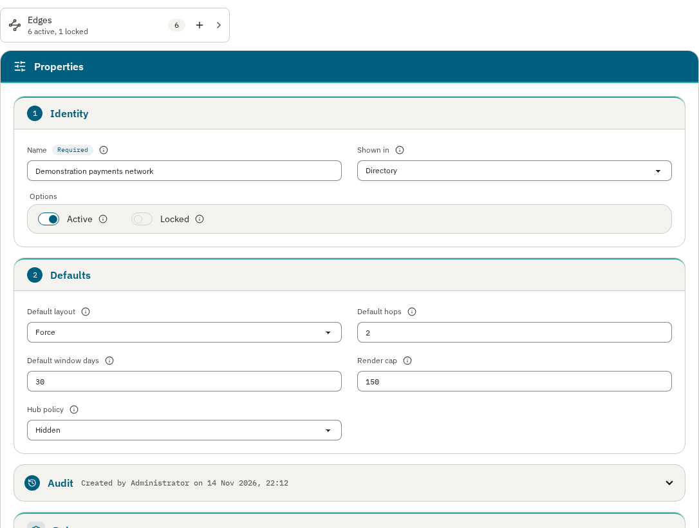
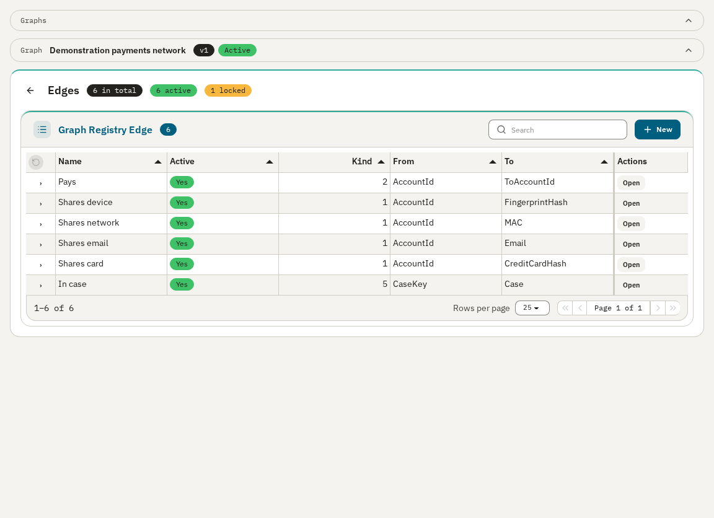
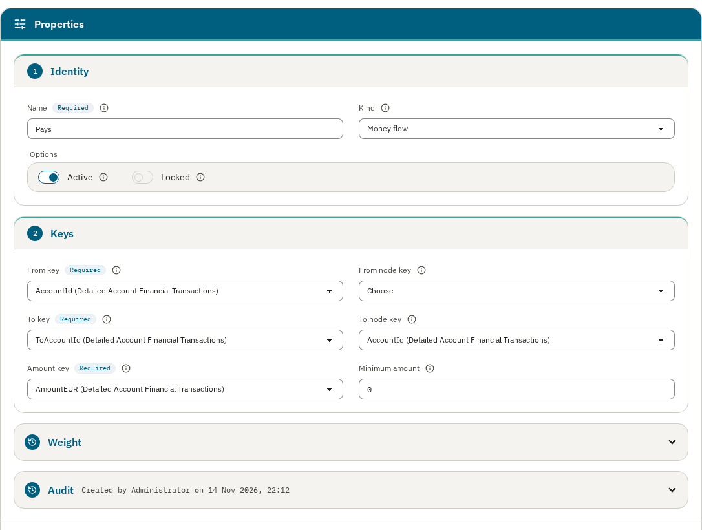

# Graph Registry

A Graph Registry is the configuration of one graph: its name, how it opens, who may see it, and the edge definitions from which its links are derived. Nothing is drawn, and nothing is built, until at least one active Graph Registry with at least one active edge exists.

The terms used on this page (node, edge, hop, hub, half-life, kind prior, hard link) are introduced in [Graph Concepts](../Concepts/index.html), which should be read first.

The question the administrator is answering is as follows: which fields of the transactions identify the things of interest, and which pairs of those fields mean that two things are connected? It is a matter of naming fields, as the values are already stored with every transaction.

## Where it lives

Navigate through the menu to Administration, then Graph setup, which presents the page at `/administration/graphs`. The page lists the graphs of the tenant under the heading Graphs, with the columns Name and Active. Opening a graph presents its form, its Roles, and beneath it the list of its Edges, each of which opens to a form of its own. Creating, changing and deleting a graph or an edge follows the common manner described in [Child Objects](../../../Navigation/ChildObjects/index.html).

A Graph Registry and its edges are not subject to approval. A change is saved at once and is taken up by the background jobs at their next cycle, as described under Taking effect below.

SHOT id=graph-registry-record
     route=/administration/graphs
     steps=open-row:Demonstration payments network
     frame=record
     state=the Demonstration payments network opened on the Graph setup page, showing the Identity group with Name, Active, Locked and Shown in, the Defaults group with the default layout, hops, window days, render cap and hub policy, the Roles, and the Edges list with Pays, Shares device, Shares network, Shares email, Shares card and In case
     conveys=a graph is a name, a handful of defaults, the roles that may see it and a list of edge definitions
     alt=A Graph Registry record with its identity and default fields, its roles and a list of six edge definitions with their kind and their from and to keys

## The Archive Key requirement

The network is built from the Archive Keys of the transactions, which is to say from the fields of a model's Request XPath that carry the Archive Key switch, in the Behaviour group of the [Request XPath](../../Models/RequestXPath/index.html). It is the same switch upon which the [Case Key Journal](../../CaseManagement/WorkingCaseKeyJournal/index.html) relies, and for the same reason: an Archive Key is stored in an index of its own alongside each transaction, such that the transactions carrying a given value can be found without reading every transaction.

It follows that every field named by an edge, being the From key, the To key and, for money flow, the Amount key, must be flagged Archive Key on each model whose transactions are to feed the graph:

* The lists from which the keys are chosen show each field name followed by the models on which it is flagged, as in `AccountId (Detailed Account Financial Transactions)`. A field that exists on a model yet is not flagged on any is shown as `(not flagged Archive Key)`, and choosing it yields no edges.
* Where a field is flagged on one model and not on another, only the transactions of the first feed the graph through it.
* An edge is made only where one transaction carries a value for both the From key and the To key. A transaction lacking either makes no edge, and is not an error.
* Flagging a field takes effect for transactions processed from that point onwards. Transactions stored beforehand carry no entry for the field and do not feed the graph through it.

For the demonstration network the fields AccountId, ToAccountId, FingerprintHash, MAC, Email, CreditCardHash and AmountEUR of the default model are flagged Archive Key.

The names are those of the Request XPath, hence an edge spans models naturally: where two models each have a field named AccountId flagged Archive Key, the transactions of both feed the same nodes.

## Graph fields

| Value               | Description                                                                                                                                                                                                                                                                   | Default   | Limits                           | Example                        |
|---------------------|-------------------------------------------------------------------------------------------------------------------------------------------------------------------------------------------------------------------------------------------------------------------------------|-----------|----------------------------------|--------------------------------|
| Name                | The name of the graph, as shown in the directory of the Graph page and at the head of the explorer.                                                                                                                                                                           |           | Required, 256 characters, unique within the tenant without regard to case | Demonstration payments network |
| Active              | Whether the edges of the graph are built by the background jobs, and whether the graph can be shown in the directory or on a case. Active is off for a new graph and must be switched on.                                                                                     | Off       |                                  | True                           |
| Locked              | Whether the graph is protected from change and from deletion.                                                                                                                                                                                                                 | Off       |                                  | False                          |
| Shown in            | Where the graph is offered. Directory lists the graph on the Graph page for the roles granted to it. Case keeps it out of the directory, for a graph intended only as the Network section of cases. The edges are built either way, and a Case Workflow may point at a graph of either setting. | Directory | Directory or Case                | Directory                      |
| Default layout      | The layout the canvas opens with: Force, which lets clusters form of their own accord; Radial, which arranges the neighbourhood in rings by hop around the seed; Flow, for the tracing of money from left to right; or Hierarchy, for ownership.                              | Force     | One of the four                  | Force                          |
| Default hops        | How many hops from the seed the neighbourhood is gathered to when no number is asked for, which is how the explorer opens until a hop count is chosen on its toolbar.                                                                                                                                                                       | 2         | 1 to 3                           | 2                              |
| Default window days | The number of days, counted back from the present, that the explorer opens with. Only edges with a transaction in the window are followed.                                                                                                                                    | 30        | 1 to 3650                        | 30                             |
| Render cap          | The most nodes drawn on the canvas before the remainder are gathered into clusters. A lower figure gives a cleaner picture and a higher one a fuller picture.                                                                                                                 | 150       | 10 to 150                        | 150                            |
| Hub policy          | The intended treatment of hubs: Hidden, with a count, or Collapsed into a single node that can be expanded.                                                                                                                                                                   | Hidden    | Hidden or Collapsed              | Hidden                         |

The Audit group, collapsed by default, shows the Created date, Created user, Updated user, Updated date and Version, none of which can be changed.

TODO(verify): the explorer does not read Hub policy. Hubs are hidden with a count unless Show hubs is switched on, whichever policy is saved, and Collapsed has no effect of its own. Owner to decide whether Hub policy is to be honoured by the explorer or removed from the form.

### Why the limits are what they are

Default hops is limited to 3 as each hop multiplies the number of nodes, and beyond three hops nearly everything is connected to nearly everything. Render cap is limited to 150 as a picture of more nodes than this cannot be read, the remainder being available in full through Explode. The Default window days of 30 reflects the period over which most fraud and layering plays out, and a longer window should be chosen where slow patterns, such as dormant mule accounts, are of interest.

## Roles

The Roles of a graph are the roles granted to it, and a grant does two things:

* It lists the graph in the directory of the Graph page for users of the role, where Shown in is Directory.
* It reveals the Restricted edges of the graph to users of the role.

A grant is not required to open a graph. A user holding a permission to view graphs, and who has the address of a graph or a case that points at it, may open it without a grant, and is shown everything except its Restricted edges. A graph with no roles granted is therefore absent from the directory for everyone.

The demonstration network is granted to the Administrator role.

## Edge fields

An edge, more exactly an edge definition, states one kind of link. It is created in the Edges list of an open graph, which shows for each edge the columns Name, Active, Kind, From and To, the last two being the From key and the To key.

SHOT id=graph-registry-edges-list
     route=/administration/graphs
     steps=open-row:Demonstration payments network, open-hub:Edges
     frame=page
     state=the Demonstration payments network with its Edges list open, the heading carrying the badges 6 in total, 6 active and 1 locked, and the list showing the six edge definitions, Pays, Shares device, Shares network, Shares email, Shares card and In case, with the columns Name, Active, Kind, From and To, and an Open action
     conveys=a graph is defined by a short list of edge definitions, each naming a kind of link and the two keys it joins
     alt=The Edges list of the Demonstration payments network showing six edge definitions, Pays, Shares device, Shares network, Shares email, Shares card and In case, each on a row with its Active state, Kind, From key and To key

The form is in four groups: Identity, Keys, Weight and Audit. A newcomer need complete only Identity and Keys, as the defaults of Weight give a network that can be drawn and explored, and are refined once it is seen which nodes prove to be hubs and which links prove to be weak.

### Identity

| Value  | Description                                                                                                                                                                                                 | Default       | Limits                                                                   | Example       |
|--------|-------------------------------------------------------------------------------------------------------------------------------------------------------------------------------------------------------------|---------------|--------------------------------------------------------------------------|---------------|
| Name   | The name of the kind of edge, as shown on the edge, in the Edges filter of the explorer and in the legend. A short verb phrase reads best.                                                                  |               | Required, 256 characters, unique within the graph without regard to case | Shares device |
| Active | Whether edges of this kind are built and shown. On for a new edge.                                                                                                                                          | On            |                                                                          | True          |
| Locked | Whether the edge is protected from change and from deletion.                                                                                                                                                | Off           |                                                                          | False         |
| Kind   | Identity link, where the from node shares the to identifier and the link has no direction; Money flow, where the from node pays the to node and the link carries an amount; or Ownership, where the from node owns or directs the to node. | Identity link | One of the three                                                         | Identity link |

The choice of Kind comes to two questions. Does the link carry an amount that is to be followed and searched for patterns? Then it is Money flow, and only Money flow is taken when following the money and by the patterns. Otherwise, does the link have a direction worth drawing? Then it is Ownership, which is drawn with an arrow and is in every other respect treated as an Identity link. Otherwise it is Identity link. The Kind should be settled before the edge is made active, as the edges already built keep the kind they were built with.

### Keys

| Value          | Description                                                                                                                                                                                                                                                                                              | Default | Limits                                                     | Example     |
|----------------|----------------------------------------------------------------------------------------------------------------------------------------------------------------------------------------------------------------------------------------------------------------------------------------------------------|---------|------------------------------------------------------------|-------------|
| From key       | The Archive Key whose value is the from node, usually the account or customer.                                                                                                                                                                                                                           |         | Required, 128 characters                                   | AccountId   |
| From node key  | The kind of node the from value is filed under. Left empty, it is the From key itself.                                                                                                                                                                                                                   | Empty   | 128 characters                                             |             |
| To key         | The Archive Key whose value is the to node, such as a device, an address or a beneficiary account.                                                                                                                                                                                                       |         | Required, 128 characters, and must differ from the From key without regard to case | ToAccountId |
| To node key    | The kind of node the to value is filed under. Left empty, it is the To key itself.                                                                                                                                                                                                                       | Empty   | 128 characters                                             | AccountId   |
| Amount key     | Presented, and required, where Kind is Money flow. The Archive Key holding the amount of the transaction, which must be a numeric field.                                                                                                                                                                 |         | 128 characters                                             | AmountEUR   |
| Minimum amount | Presented where Kind is Money flow. A transaction of less than this amount does not make an edge. Zero keeps everything.                                                                                                                                                                                 | 0       | Zero or more                                               | 0           |

The two node keys exist for the case where two differently named fields hold the same kind of thing. A payment is the plain example: the payer is in AccountId and the beneficiary in ToAccountId, yet both are accounts. Setting To node key to AccountId files the beneficiary as an AccountId node, such that an account receiving money and the same account paying money onward are one node, and a chain of payments connects. Without it, the chain is broken at every beneficiary.

### Weight

The Weight group is collapsed by default, as its defaults serve to begin with.

| Value          | Description                                                                                                                                                                                                                                                                               | Default | Limits         | Example |
|----------------|-------------------------------------------------------------------------------------------------------------------------------------------------------------------------------------------------------------------------------------------------------------------------------------------|---------|----------------|---------|
| Half life days | The number of days after which an event behind the edge counts for half in the weight of the edge, the days being counted back from the latest event on the same edge and not from the present. 90 suits money flow and 180 suits identity links. A change governs the transactions added thereafter.     | 90      | 1 to 3650      | 180     |
| Kind prior     | How much this kind of link is trusted, from 0 to 1: 1 for a hard identifier such as a national identity number, about 0.7 for payments, 0.4 for a shared device and 0.1 for a shared network address.                                                                                    | 1       | 0 to 1         | 0.4     |
| Hub threshold  | The number of distinct from nodes above which a to node is a hub, and is thereafter not walked through unless asked. Left empty, the threshold is worked out automatically as the 99.9th percentile across the to nodes of the edge, and never less than 50, recalculated hourly.          | Empty   | 2 or more      | 20      |
| Hard           | Whether the link is hard evidence of the same controller (a national identity number, a card, a bank account, a telephone number), in which case two nodes sharing the identifier are proposed as one entity by Entity Resolution. Off, it is a soft link that stays a weighted edge. The switch is read by Entity Resolution alone and changes nothing in the weight or the drawing of the edge.    | Off     |                | False   |
| Restricted     | Whether edges of this kind are shown only to the roles granted on the graph.                                                                                                                                                                                                              | Off     |                | False   |

The three fields that shape the picture are read as follows. Half life days and Kind prior act only upon the weight, which is to say upon which edges are followed first where a node has more than 25, upon the order of paths and of Relevance, and upon the thickness of the line: neither removes an edge. Hub threshold, by contrast, removes whole regions of the network from the walk, and is the field to reach for where a picture is crowded with strangers joined through one busy node. Hard is of consequence only where [Entity Resolution](../../../Concepts/EntityResolution/index.html) is switched on, and is otherwise without effect.

A Kind prior of 0 gives every edge of the kind a weight of nothing: the edge is still built and still drawn, yet it is the last to be followed and adds nothing to a path.

### Restricted edges

Restricted is for links that not every analyst should see, such as those derived from a sensitive identifier. For a user of a role not granted on the graph, Restricted edges are left out of the neighbourhood, of Explode, of paths, of following the money and of the facts of a node, and are shown in the Edges filter of the explorer with a padlock and cannot be switched on.

So that nothing can be inferred by such a user, everything worked out in the background (the number of neighbours of a node, hubs, communities, patterns and the distance to confirmed) is worked out from unrestricted edges only. The consequence for the administrator is that a node linked only through Restricted edges shows no neighbours, belongs to no community and is never a hub.

### The In case edge

Every active graph is given an edge named In case, of the kind Case, the first time the build runs after the graph is made active. It joins the key of each case to a node for the case itself, such that cases appear in the network. It is created locked, need not be configured, and is not among the kinds that can be chosen for a new edge.

SHOT id=graph-registry-edge-record
     route=/administration/graphs
     steps=open-row:Demonstration payments network, open-hub:Edges, open-first-row
     frame=record
     state=the Pays edge definition of the Demonstration payments network opened at its Properties form, showing the Identity group with the name and a Kind of Money flow, the Keys group with a From key of AccountId, a To key of ToAccountId, an Amount key of AmountEUR and a Minimum amount of 0, and the Weight and Audit groups collapsed beneath
     conveys=an edge definition is a small record, naming the link, the two keys it joins and how its weight is arrived at
     alt=The Properties form of the Pays edge definition showing its Identity group with a Kind of Money flow, its Keys group with the From key AccountId, the To key ToAccountId and the Amount key AmountEUR, and the collapsed Weight and Audit groups

## Validation

A graph is validated in the server upon saving, and is refused with the message given where:

| Rule                                                              | Message                                              |
|-------------------------------------------------------------------|------------------------------------------------------|
| The Name is empty.                                                | The name is required.                                |
| The Name is longer than 256 characters.                           | The name must be at most 256 characters.             |
| Another graph of the tenant has the Name, without regard to case. | A graph registry with this name already exists.      |
| Shown in is neither Directory nor Case.                           | Shown in must be Directory or Case.                  |
| Default layout is not one of the four.                            | The default layout is not recognised.                |
| Default hops is not between 1 and 3.                              | Default hops must be between 1 and 3.                |
| Default window days is not between 1 and 3650.                    | The default window must be between 1 and 3650 days.  |
| Render cap is not between 10 and 150.                             | The render cap must be between 10 and 150 nodes.     |
| Hub policy is neither Hidden nor Collapsed.                       | The hub policy is not recognised.                    |

An edge is validated likewise:

| Rule                                                               | Message                                                         |
|--------------------------------------------------------------------|-----------------------------------------------------------------|
| The graph it belongs to cannot be found.                           | The parent graph registry was not found.                        |
| The Name is empty.                                                 | The name is required.                                           |
| The Name is longer than 256 characters.                            | The name must be at most 256 characters.                        |
| Another edge of the graph has the Name, without regard to case.    | An edge with this name already exists in the registry.          |
| Kind is not Identity link, Money flow or Ownership.                | The edge kind must be Identity link, Money flow or Ownership.   |
| From key is empty.                                                 | The from key is required.                                       |
| To key is empty.                                                   | The to key is required.                                         |
| From key and To key are the same, without regard to case.          | The from key and the to key must differ.                        |
| Any of the five keys is longer than 128 characters.                | A key must be at most 128 characters.                           |
| Kind is Money flow and Amount key is empty.                        | An amount key is required for money flow.                       |
| Half life days is not between 1 and 3650.                          | The half-life must be between 1 and 3650 days.                  |
| Kind prior is not between 0 and 1.                                 | The kind prior must be between 0 and 1.                         |
| Hub threshold is given and is less than 2.                         | The hub threshold must be at least 2 when set.                  |
| Minimum amount is less than zero.                                  | The minimum amount cannot be negative.                          |

The validation does not check that a key is flagged Archive Key, as a key may properly be configured before the field is flagged. The lists of keys state it instead, as described above.

## Example

The demonstration network is configured as follows, and serves as a pattern for a payments graph:

| Name           | Kind          | From key  | To key          | To node key | Amount key | Half life days | Kind prior | Hard |
|----------------|---------------|-----------|-----------------|-------------|------------|----------------|------------|------|
| Pays           | Money flow    | AccountId | ToAccountId     | AccountId   | AmountEUR  | 90             | 0.7        | Off  |
| Shares device  | Identity link | AccountId | FingerprintHash |             |            | 180            | 0.4        | Off  |
| Shares network | Identity link | AccountId | MAC             |             |            | 180            | 0.1        | Off  |
| Shares email   | Identity link | AccountId | Email           |             |            | 365            | 1.0        | On   |
| Shares card    | Identity link | AccountId | CreditCardHash  |             |            | 365            | 1.0        | On   |

The graph itself is Active, Shown in Directory, with the Default layout Force, Default hops 2, Default window days 30, Render cap 150 and Hub policy Hidden. No Hub threshold is given on any edge, hence all five rely upon the automatic threshold, by which the public wifi address MAC-PUBLIC-WIFI-CAFE-01, used by 59 accounts, is a hub.

Two things can be tried on this configuration to see the effect of a setting. Setting the Hub threshold of Pays to 20 makes hubs of the five merchants at the next hourly cycle, upon which the other customers of those merchants leave the neighbourhood of ACC-441. Emptying the To node key of Pays, on a copy of the graph, shows the chain from ACC-441 to ACC-77 broken at ACC-02.

## Taking effect

| Change                                              | Takes effect                                                                                                                                                                             |
|-----------------------------------------------------|------------------------------------------------------------------------------------------------------------------------------------------------------------------------------------------|
| A graph or an edge is made active                   | At the next build, within a minute by default (`WaitGraphBuild`). A new edge starts reading from the beginning of the retention period (`GraphRetentionDays`, 365 days by default), 5,000 Archive Key entries at a time and up to 200 such batches in a cycle, subject to what is said under Changing an edge after it has been built below. |
| Half life days is changed                           | For the transactions added to an edge from then onwards.                                                                                                                                 |
| A new transaction is processed                      | Within seconds, as transactions are passed to the build as they arrive, and in any event at the next build.                                                                              |
| Kind prior or Hub threshold is changed              | At the next cycle of the hubs job, hourly by default (`WaitGraphHubs`), which recalculates the weights and the hubs.                                                                     |
| Restricted is changed                               | At the next cycle of the hubs job for edges already built.                                                                                                                               |
| An edge is deleted or made inactive                 | The edge is no longer followed or shown from that moment. What was already derived remains stored until removed by retention.                                                            |
| A graph is made inactive or deleted                 | The graph can no longer be opened, the explorer stating that the graph could not be found.                                                                                               |

The build requires an index on the Archive Keys, which is created in the background by the first start after the feature is installed. Until that index is complete nothing is built, and no key entered in the explorer is yet a node of the network. The build, the index and each of the other jobs can be switched off by Environment Variables (`EnableGraphBuild`, `EnableGraphArchiveKeyIndex`, `EnableGraphHubs`, `EnableGraphCommunities`, `EnableGraphDistance`, `EnableGraphPatterns` and `EnableGraphRetention`), all of which are True by default.

### Changing an edge after it has been built

The build remembers, for each edge definition, how far through the stored transactions it has read, and it never reads a transaction twice. A change to an edge definition therefore governs the transactions processed from that moment onwards, and what was derived beforehand is left as it stands. The consequences, field by field, are as follows:

| Changed                                             | What happens to the links already built                                                                                         | What happens thereafter                                              |
|-----------------------------------------------------|---------------------------------------------------------------------------------------------------------------------------------|----------------------------------------------------------------------|
| From key, To key, From node key or To node key      | They remain, joined to the nodes of the old keys, and continue to be drawn under the name of the edge.                          | New transactions make links under the new keys. The edge is then a mixture of the two, with nothing on screen to tell them apart. |
| Amount key or Minimum amount                        | They keep the amounts they were built with, and links made beneath a raised Minimum amount remain.                              | New transactions use the new key and the new minimum.                |
| Kind                                                | They keep the kind they were built with, hence a link built as an Identity link is not followed as money.                       | Links between pairs of nodes not yet linked take the new kind.       |
| Half life days                                      | Their weights are not worked out again.                                                                                         | The new figure is applied as each transaction is added.              |
| Kind prior, Hub threshold, Restricted               | They are brought into line at the next cycle of the hubs job.                                                                   | The new value applies.                                               |
| Name                                                | They are shown under the new name at once.                                                                                      |                                                                      |

It follows that where the keys, the amount or the kind of an edge are to be changed, the edge should not be edited. A new edge should be created and the old one made inactive, such that the picture is never a mixture of two definitions.

A new edge is likewise not certain to take up the whole history. Where it is added to a tenant whose other edges have already been built, the transactions from which those edges were derived are passed over, and the new edge is built from the transactions processed from then onwards, together with any earlier transaction that made no link under another edge. The edges of the demonstration network were created together and are unaffected.

TODO(verify): GraphBuildJob.ApplyAsync drops every candidate link whose transaction already has a link event of any edge definition, the check being on the transaction and its key version and not on the definition. A new edge definition, or one whose keys are changed, therefore gets no history for transactions already taken up by another definition of the tenant, which contradicts the intent of starting a new definition from the beginning of the retention period. Owner to confirm whether the check is to include the definition.

## Pointing a Case Workflow at a graph

A graph is shown on a case where the Case Workflow of the case points at it. In the Case Workflow, as described in [Creating Case Workflows](../../CaseManagement/CreatingCaseWorkflows/index.html), the group Graph carries two fields:

| Value          | Description                                                                                                                                 | Default |
|----------------|---------------------------------------------------------------------------------------------------------------------------------------------|---------|
| Enable graph   | Whether cases of the workflow present a Network section, being the graph of the chosen Graph Registry seeded by the key of the case.        | Off     |
| Graph registry | Presented, and required, where Enable graph is on. The Graph Registry whose network is shown, chosen from the graphs of the tenant by name. |         |

The seed of the network on a case is the Case Key and Case Key Value of the case. It follows that the Case Key of the workflow should be a key that is a node in the graph, most commonly the From key of its edges. For the demonstration network the cases are keyed on AccountId, which is the From key of all five edges. Where the key of a case is not a node of the graph, the Network section has nothing to draw, as described in [Graph on a Case](../GraphOnACase/index.html).

The first Case Workflow of the default model has Enable graph on and points at the demonstration network.

## Permissions and security

The Graph setup menu item, and the creating, changing and deleting of a graph, its edges and its roles, require permission 50, Author Graph. A user without it who reaches the page is shown You do not have permission to set up graphs. and the server refuses each request with 403. An unauthenticated request receives 401.

Reading a graph and the list of its edges, as the explorer does, requires any of permission 49, View Graph, permission 50, Author Graph, or permission 1, Read Write Case. The lists of Archive Keys offered by the edge form require permission 50.

Graphs, edges and roles are scoped to the tenant of the user, and a graph of another tenant behaves as one that does not exist.
