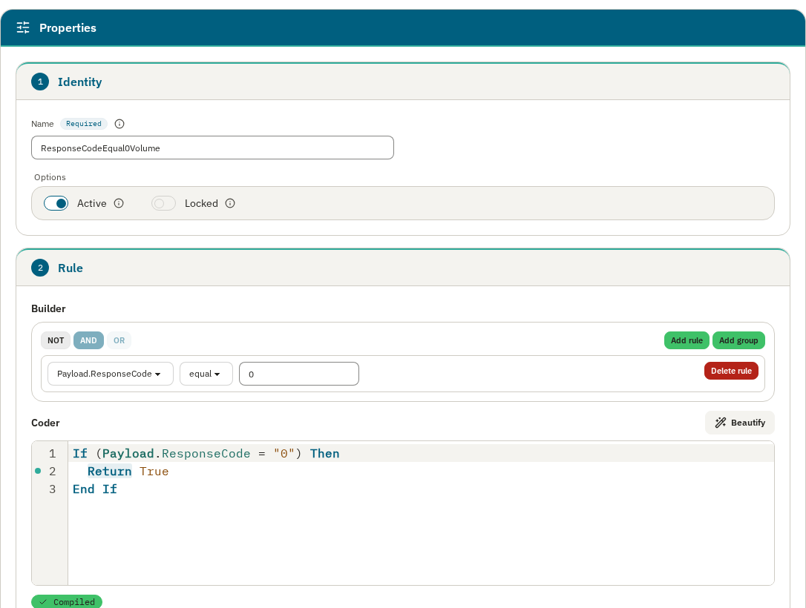
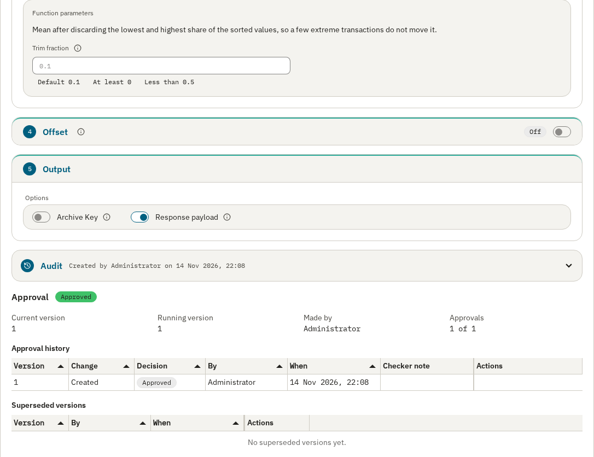

# Abstraction Rules

An Abstraction Rule answers a question about the past of whatever the transaction belongs to, at the moment the transaction arrives: how much has this account spent in the last day, how many times has this IP address been declined in the last hour, what was the amount of the last transaction on this device. The answer is always a single number, and that number is thereafter available to Activation Rules, such that a rule may read "the account has spent more than 5,000 in the last day" without itself having to count anything.

Abstraction Rules exist for the aggregation of data available in the cache database. The Abstraction Rule functionality is one of the most intrinsic processes in the model invocation, being responsible for the creation of aggregate statistics based on the contents of the cache of transaction or event data retained.

An Abstraction Rule is a VB.net code fragment that will be compiled by the engine. Abstraction Rules accept data and TTL Counter objects and test the code fragment for equality, returning a boolean flag to that effect. The transactions having matched are thereafter aggregated to a single value by a function, and that value is available for subsequent Activation Rules and crucially, as a variable for machine learning.

The abstraction rules are grouped together by their search keys, which has the effect of only a single key value pair type query being looked up against the cache, with compiled assemblies being executed for match against the in memory dataset.

A search key will be used as a predicate in retrieval of data for the subsequent execution of Abstraction Rules that roll up to that search key. For example, if a transaction is being processed through a model, if an account identifier is configured to be a search key, a selection of all records in the cache will be returned where that account identifier matches (put simply it will return all transactions for that customer account). Search Keys are defined in the Request XPath definition and there can be many search keys, thus cache database queries, per transaction being executed through the model. The process is different when a Search Key is defined to be retrieved from a cache, as these values are pre-calculated by the Search Key Cache thread.

In the case of PostgreSQL being used as the cache for Abstraction Rule processing, only the columns that have been identified as being required in the Abstraction Rules definition (in both rule text and its aggregation key) will be selected from the database, thus reducing casting and network IO. The columns required and the SQL to be pushed down to the cache are compiled during model synchronisation for use in real-time processing.

## How an Abstraction Rule arrives at its value

The terms used throughout this page are as follows:

| Term            | Meaning                                                                                                                                                                         |
|-----------------|---------------------------------------------------------------------------------------------------------------------------------------------------------------------------------|
| Cache           | The store of recent transactions kept by the model, where Enable cache is on for the model and Cache is on for the fields to be kept.                                           |
| Search key      | The field whose value decides which past transactions are fetched. With AccountId as the search key, the past transactions of the same account are fetched.                     |
| History         | The transactions fetched from the cache for the search key, with the transaction being processed added to them.                                                                 |
| Search window   | How far back in the history the rule is interested, being the Search value and Search interval counted back from the Reference Date of the transaction being processed.        |
| Match           | A transaction of the history, inside the search window, for which the rule returns True.                                                                                        |
| Offset          | An optional reduction of the matches by their position, for example to the last match alone.                                                                                    |
| Function        | The aggregation that turns the matches which remain into one number, such as Count or Sum.                                                                                      |
| Function key    | The field of each match that the function works upon, such as the amount for Sum.                                                                                               |
| Iteration order | Whether the history is taken oldest first (Ascending) or most recent first (Descending).                                                                                        |
| Cursor          | The position of the rule in its walk through the history, available to a rule written in the Coder.                                                                             |

The processing of one Abstraction Rule is always the same five steps, in this order:

1. **Fetch.** The history is fetched from the cache for the value of the search key in the transaction being processed, and the transaction being processed is added to it.
2. **Window.** Transactions older than the search window are set aside.
3. **Match.** The rule is tested against each transaction remaining, in Iteration order, and those for which it returns True are the matches.
4. **Offset.** Where Offset is on, the matches are reduced by position.
5. **Aggregate.** The function is applied to the matches which remain, returning the value.

To make this concrete, the nine demonstration transactions of the account ACC-441 are taken as the history, as they would be held in the cache had they been processed through the model in turn. Their amounts, in the field AmountEUR and in the order in which they took place, are as follows:

| Transaction | When, from the first       | City       | AmountEUR |
|-------------|----------------------------|------------|-----------|
| DEMO-TRV-01 | 0 hours                    | Cairo      | 42        |
| DEMO-TRV-02 | 3 hours                    | Giza       | 18        |
| DEMO-TRV-03 | 9 hours                    | Alexandria | 65        |
| DEMO-TRV-04 | 1 day 2 hours              | Cairo      | 120       |
| DEMO-TRV-05 | 1 day 2 hours 40 minutes   | London     | 980       |
| DEMO-TRV-06 | 1 day 3 hours 5 minutes    | London     | 1450      |
| DEMO-TRV-07 | 1 day 9 hours              | Cairo      | 30        |
| DEMO-TRV-08 | 2 days 1 hour              | Dubai      | 2200      |
| DEMO-TRV-09 | 2 days 7 hours             | Cairo      | 55        |

Suppose DEMO-TRV-09 is the transaction being processed, AccountId is the search key, and the search key keeps at least three days of history. The value returned then depends upon the configuration, building from the simple case to the full one:

| Configuration                                                                                   | What happens                                                                                                   | Value |
|-------------------------------------------------------------------------------------------------|----------------------------------------------------------------------------------------------------------------|-------|
| Rule matches everything (AmountEUR greater 0), window of 3 Days, function Count.                | All nine transactions are inside the window and all match.                                                     | 9     |
| The same, with function Sum and function key AmountEUR.                                         | The nine amounts are added together.                                                                           | 4960  |
| The same, with the window shortened to 1 Days.                                                  | Only DEMO-TRV-07, 08 and 09 took place within the day before DEMO-TRV-09, so 30, 2200 and 55 are summed.        | 2285  |
| Window of 3 Days, rule AmountEUR greater 500, function Count.                                   | DEMO-TRV-05, 06 and 08 match.                                                                                  | 3     |
| The same, with function Sum and function key AmountEUR.                                         | 980, 1450 and 2200 are summed.                                                                                 | 4630  |
| The same, with Offset on, Offset type Last and Offset value 0.                                  | Of the three matches only the last, DEMO-TRV-08, is kept.                                                      | 2200  |
| The same, with Offset type Take last and Offset value 2.                                        | The two most recent matches, DEMO-TRV-06 and 08, are kept, and 1450 and 2200 are summed.                       | 3650  |
| Rule matches everything, function Max and function key AmountEUR, window of 3 Days.             | The largest amount in the window.                                                                              | 2200  |
| Search switched off, rule AmountEUR greater 500.                                                | Nothing is fetched. The rule is tested against DEMO-TRV-09 alone, whose amount is 55, so it does not match.    | 0     |

It can be seen that the rule decides which transactions count, the window decides how far back to look, the Offset decides which of the matches to keep, and the function decides what to make of them. The remainder of this page describes each of these in full.

## Where it lives

Navigate through the menu to Models, open the model, then the Abstraction Rules hub card. Creating, changing, approving and deleting an Abstraction Rule follows the common manner described in [Child Objects](../../../Navigation/ChildObjects/index.html).

An Abstraction Rule that searches relies upon a Search Key, which is not created in this page. A field is made a Search Key by opening the [Request XPath](../RequestXPath/index.html) for the field from the Request XPath hub card of the same model, and switching on Search key in the Search Key group of its form. It follows that the Request XPath need be saved, and approved, before the field can be relied upon by an Abstraction Rule.

SHOT id=models-abstraction-rules-record
     route=/models
     steps=open-default-model, open-hub:Abstraction Rules, open-first-row
     frame=record
     state=an Abstraction Rule of the default model opened, with the Rule group showing a condition in the Builder and the Search and Aggregation group showing the search key, the search value and interval, the iteration order and the function
     conveys=an Abstraction Rule is a rule to match transactions, set above the search that fetches them and the function that aggregates them
     alt=An Abstraction Rule opened beneath its model, showing the rule Builder with one condition and the Search and Aggregation group with the search key, interval, iteration order and function



## The rule

The rule is written in the Builder or the Coder, as described in [Rule and Code Builder](../../../Navigation/RuleBuilderAndCoder/index.html), and whichever surface is selected is the one required.

In the Builder, each condition is a field, an operator and its values. The operator drop-down lists every operator that suits the type of the field, under headings: Basic (the usual comparisons of the builder) first, then groups such as Text: validation, Text: model lists, Number: thresholds and limits, Date: calendar and Compare to another field, each in alphabetical order. Every test in the [Rule Pipeline Reference](../../../RuleTaxonomy/RulePipelineReference.html) is there, for example Is valid IBAN, In list, Starts with any in list, Is just below any threshold, Ratio of: above, Within hours of and Is weekend. Once an operator is chosen, the builder shows one box per value it takes, named after the value, and a number or date value can also name a field, for example `TTLCounter.PerAccount`. The full list of operators, and the rule text each produces, is in [Rule and Code Builder](../../../Navigation/RuleBuilderAndCoder/index.html#builder-operators). The same operators are offered in every rule builder, which is to say Gateway, Abstraction, Activation and Reprocessing rules, and the backtest filters.

The Builder and Coder expose the following collections:

| Value | Description |
|-------|-------------|
| Payload | The fields created in the Request XPath page, Inline Function and Inline Script (if registered). |
| TTL Counters | The TTL Counters and their current incremented values. |

## Fields

The form is arranged in the groups Identity, Rule, Search and Aggregation, Offset (collapsed), Output and Audit (collapsed). The fields of the Search and Aggregation and Offset groups are presented only where Search is on, and those of Offset only where Offset is on.

| Value | Description | Example |
|-------|-------------|---------|
| Name | The name of the Abstraction Rule, by which rules refer to it as `Abstraction.Name`. | Volume1DayUSDForIP |
| Active | Whether the Abstraction Rule is taken up by the engine. Active is off for a new Abstraction Rule and must be switched on. | True |
| Locked | Whether the Abstraction Rule is protected from change. | False |
| Search | The Search directs whether the rule is to be executed on a list of records having been returned from the Cache or only upon the transaction currently being processed through the model. False would imply that the scope of the Abstraction Rule is only the current transaction being processed and if it matches, then a 1 will be returned, otherwise 0 (keeping in mind that Exhaustive or Machine Learning will seek to weight it, hence the numeric values). If Search is selected, it would imply that a retrieval from the Cache Database need take place and the Abstraction Rule is going to be tested against each transaction returned. Search is on for a new Abstraction Rule. | True |
| Search key | The Search Key is the basis for several distinct data retrievals to be made of the Cache Database. For example, if a Search Key is specified to be an IP, then it would imply that a fetch is going to be made of the Cache Database for all transactions matching on the IP of the current transaction in process, thereafter applying the Abstraction Rule on each of the records to test for a match. | IP |
| Search value | Taken together with the Search interval, the length of time to reach back from the Reference Date. | 1 |
| Search interval | The Search Interval is the time threshold reaching back from the Reference Date for the transaction being processed, whereby only transactions exceeding this threshold are eligible for matching, and is one of Seconds, Minutes, Hours or Days. For example, if a Search Interval is configured for 1 Day (taking the Search Interval and Search Value together) then this would imply that only records greater than the Reference Date minus One Day are eligible for matching. It is worthy of note that the Search Interval and Search Value are not used in the recall from the Cache Database, and everything matching on the key up to the fetch limit will be returned. | Days |
| Iteration order | The order in which the history is presented to the rule, to the Offset and to the function, being Ascending or Descending, as described under Iteration order below. | Ascending |
| Search function type | The process of aggregating the matches is different from the process of testing and matching the Abstraction Rule itself. The process of aggregation takes place after all matching has taken place and the transaction matches for the rule have been set aside. The Search function type is the aggregation to perform, as described under Functions and Function catalogue and parameters below. For example, if a Sum function is specified, then the function will look to add up records using the Search function key field (e.g. Transaction Amount). | Sum |
| Search function key | The Search function key is available only on certain functions and represents the field inside the transaction that is to be used for aggregation. For example, if the Sum function is specified and the Search function key is specified as the Transaction Amount, the aggregation will seek to create a Sum for all of the Transaction Amounts having matched. It is not presented for Count or Cursor result. | AmountUSD |
| Function parameters | One input for each static parameter of the selected function, with its default and allowed range. Where the function takes none, this is stated. | trimFraction 0.1 |
| Offset | Whether the matches are reduced to a subset before aggregation. All data matching on a Search Key is retrieved from the cache, and the Offset helps to select data from a subset of these records, which can be helpful if analysis need be done only on the last x records, for example. In most cases it will be off. | False |
| Offset type | The manner of the reduction, being First, Last, Skip first or Take last, as described under Offset below. | Skip first |
| Offset value | The number of matches the Offset type works upon, for example the last x number of records returned from the cache. | 1 |
| Archive Key | Whether the value is promoted for the purposes of reporting, as described in [Report Table](../../../Navigation/ReportTable/index.html). | False |
| Response payload | Whether the value is returned in the response to the transaction, as described in [Response Payload](../../../Navigation/ResponsePayload/index.html). | True |

A new Abstraction Rule is presented with Search on, a Search value of 1, a Search interval of Hours, Iteration order as Ascending, Search function type as Count, Offset off (with an Offset type of First and an Offset value of 0 upon it being switched on), and Active, Archive Key and Response payload off. It follows that the value of a new Abstraction Rule is not returned in the response until Response payload is switched on, which is to be kept in mind when testing a rule by its response.

Search key and Search function key are each chosen from a list of the fields of the model, in alphabetical order, being the active Request XPath of Data type String, Float and IP, together with the values returned by the active Inline Scripts and Inline Functions of the model. A Request XPath of Data type Integer is not offered, as the engine reads a Search key as text and a Search function key as a Float, and an Integer would be read as empty or as zero; a whole number that is to be aggregated is therefore declared as a Float. The Search key list is not restricted to the fields for which Search key has been switched on, and it is for the author to choose a field that has: where a field that is not a Search Key is chosen, there is no history to fetch, and the rule aggregates next to nothing. Search function key is not presented, and is not required, where the Search function type is Count or Cursor result.

Under the heading Function parameters, each parameter of the selected function is presented as a numeric input, or as a switch for a true or false parameter, with an information button giving its description, a badge stating its default (as Default 0.1, Default on or Default off) and a badge for each limit (as At least, More than, At most or Less than, followed by the limit). An input left empty takes the default, which is shown in its place. A function whose result depends upon the order of the matches carries the badge Follows iteration order, and a function without parameters states This function takes no parameters.

## Offset

The first step of abstraction aggregation is to further filter the matches by their position (keeping in mind that the processing order will be ascending or earliest first, unless Iteration order is set otherwise). The Skip and Fetch feature, which is configured in the Offset group, allows only a subsection of the matched records to be returned (e.g. only the last record or only the first record) to the array for which a function will be targeted. The Offset types are as follows:

| Offset type | Description | Skip | Fetch |
|-------------|-------------|------|-------|
| None (Offset is off) | Performs no reduction of the list of matches and aggregation will be performed across all events that have matched the rule. | Nothing | All matches |
| First | A single match counted from the start (earliest) of the matches, the Offset value being the number of matches passed over beforehand, such that an Offset value of 0 is the first match. | The matches specified in the Offset value. | One match |
| Last | A single match counted from the end (most recent) of the matches, the Offset value being the number of matches passed over from the end, such that an Offset value of 0 is the last match. | All matches with the exception of one plus the Offset value. | One match |
| Skip first | All matches will be considered with the exception of the first (earliest) matches, where the number of the oldest matches to exclude is the Offset value. | The matches specified in the Offset value. | All matches with the exception of the Offset value. |
| Take last | Only the most recent (last or latest) matches will be considered, where the number of the newest matches to keep is the Offset value. | All matches with the exception of the Offset value. | The matches specified in the Offset value. |

TODO(verify): the page formerly described Take Last as considering all matches except the most recent, which contradicted its own Skip and Fetch columns. The description above follows the engine (ResolveSkipAndFetch skips all but the Offset value and fetches the Offset value). Owner to confirm the engine has the intended behaviour.

## Functions

With a final list of matches having been achieved, potentially having been reduced by offsetting, the function will be performed, returning a single value. The model abstraction has many different types of calculation that can be performed against abstraction rule matches. The following table details the original aggregations and describes their processing logic:

| Value | Description |
|-------|-------------|
| Count | The number of matches in the Abstraction Rule matches collection. An array for the purposes of aggregation of a specific double value is not required. |
| Distinct count | The distinct count iterates through each transaction having matched and adds the value specified to be distinct to a collection, however, before adding it to the collection the collection is checked to ensure that the value does not already exist. After each matching transaction is iterated through, the count of the newly created collection is returned. |
| Sum | Using an array of float values which has been created based upon a prescribed field available to the matches, the sum total of the array of float values. |
| Average | Using an array of float values which has been created based upon a prescribed field available to the matches, the Mean of the array of float values. |
| Median | Using an array of float values which has been created based upon a prescribed field available to the matches, the Median or statistical Midpoint in the array of float values. |
| Kurtosis | Using an array of float values which has been created based upon a prescribed field available to the matches, Kurtosis or the sharpness of the peak of distribution of the array of float values. |
| Skew | Using an array of float values which has been created based upon a prescribed field available to the matches, Skewness which is the extent to which there is lean \ tendency towards smaller or larger values in the array of float values. |
| Standard deviation | Using an array of float values which has been created based upon a prescribed field available to the matches, Standard Deviation or measure of spread of the array of float values. |
| Mode | Using an array of float values which has been created based upon a prescribed field available to the matches, the most commonly observed value in the array of float values. |
| Same count | The Same Count is intended to interrogate the matches to identify the number of transactions that have the same field value as that currently being processed. Each match is iterated through and the value of the prescribed field is tested against that in the history, in the event it is the same, a counter will be incremented. Upon the conclusion of the iteration, the counter is returned as the value. |
| Actual value | Keeping in mind that the matches may have been reduced by skip, fetch and offset values, this function will return the actual value of a field \ data at a specific position. For example, this function would allow the identification of the value of the 3rd transaction in a customer history. |
| Max | The largest value observed in the offset matches taking a field value name for comparison. |
| Min | The smallest value observed in the offset matches taking a field value name for comparison. |
| Since | Taking the Interval Type, the number of that interval between the most recent event and the first event observed in the matches. The current date for reference is taken to be the most recent value observed in the matches. The comparison is made against the earliest date observed. The value returned depends upon the Interval Type specified in the function: Seconds, Minutes, Hours and Days. |

Further functions are described under Function catalogue and parameters and under Returning a value the rule computes itself.

## Iteration order

The history for a Search Key is always fetched as the most recent transactions up to the fetch limit. Iteration order decides the order in which that history, with the transaction being processed added to it, is then presented:

| Value | Description |
|-------|-------------|
| Ascending | Oldest first, the default and the behaviour of every rule created before this setting existed. The transaction being processed is last. |
| Descending | Most recent first. The transaction being processed is first. |

Taking the three matches of the worked scenario, being DEMO-TRV-05 (980), DEMO-TRV-06 (1450) and DEMO-TRV-08 (2200), Ascending presents them as 980, 1450, 2200 and Descending as 2200, 1450, 980. Sum returns 4630 in either order, since addition does not depend upon sequence, whereas Offset type First with an Offset value of 0 keeps 980 under Ascending and 2200 under Descending.

The order is one sequence from start to finish, which is to say that it is the order the rule is tested in, the order the Offset reduction works on and the order the function receives its values in. Under Descending, Offset First keeps the most recent match, Offset Last keeps the oldest, and Actual value returns the oldest match kept. A rule that does not use the cursor matches exactly the same transactions in either order, only their sequence changes.

## The rule cursor

An ordinary rule is asked one question of each transaction, does this transaction count, and it cannot know whether it is looking at the first transaction of the history or the fifth. The cursor is what tells it. It is needed only for questions about position or sequence, such as the third transaction, the first five declines, or how many transactions it took to reach a total, and a rule that merely filters has no need of it.

An Abstraction Rule with Search enabled is tested once for each transaction in the history, in Iteration order, and this passage through the history is henceforth called the walk. In the Coder, the rule can see where it is in that walk through `Cursor`, and can steer the walk with the Visual Basic loop statements `Continue For` and `Exit For`. The rule still answers for each transaction by setting `Matched` or by `Return True` and `Return False`, exactly as before.

| Word | Description |
|------|-------------|
| `Cursor.Position` | One-based position of the transaction being tested. 1 is the first transaction in Iteration order. |
| `Cursor.Index` | Zero-based position of the transaction being tested; always one less than `Cursor.Position`. |
| `Cursor.Size` | How many transactions the cursor will walk: the history inside the rule's search window, including the transaction being processed. |
| `Cursor.Matches` | How many transactions this rule has accepted so far in the walk. |
| `Cursor.IsFirst` | True on the first transaction of the walk. |
| `Cursor.IsLast` | True on the last transaction of the walk. |
| `Cursor.IsCurrent` | True when the transaction being tested is the one being processed now, rather than one from the history. |
| `Cursor.Result` | A number the rule can set and read as the walk proceeds. The Cursor result function returns its final value as the abstraction value. |
| `Continue For` | Finishes with this transaction and moves to the next. The transaction is accepted if `Matched` was already set to True. |
| `Exit For` | Finishes with this transaction and ends the walk; no further transactions are tested. The transaction is accepted if `Matched` was already set to True. |

A rule that uses the cursor is tested only against the transactions inside its own search window, so `Cursor.Position` and `Cursor.Size` describe that window and not the whole fetch. The rule cannot open loops of its own: `For`, `While`, `Do` and `GoTo` are refused, as are `Exit` and `Continue` in any other form. The cursor words are refused in Gateway Rules, Activation Rules, Abstraction Calculations and Inline Functions, and they are not offered in the Builder. In the Coder they are offered by the completion list, alongside a group of Patterns for the more common uses: The Nth record, The first N matching records, Running total until a limit, Skip the transaction being processed and Return a value the rule computes.

To aggregate the third and fifth transaction in the window, with the Search function type set to Sum on the amount:

```vb
Matched = Cursor.Position = 3 OR Cursor.Position = 5
If Cursor.Position >= 5 Then Exit For
```

In the worked scenario, with a window of 3 Days and Iteration order as Ascending, the walk is over nine transactions, such that `Cursor.Size` is 9 throughout, `Cursor.Position` is 1 at DEMO-TRV-01 and 9 at DEMO-TRV-09, and `Cursor.IsCurrent` is True only at DEMO-TRV-09. The rule accepts DEMO-TRV-03 (65) and DEMO-TRV-05 (980), ends the walk at the fifth transaction without testing the remaining four, and Sum on AmountEUR returns 1045.

Upon setting Iteration order to Descending, the same rule aggregates the third and fifth most recent transaction, which in the worked scenario are DEMO-TRV-07 (30) and DEMO-TRV-05 (980), returning 1010. To aggregate the third and fifth declined transaction instead, the declines are counted as the walk proceeds in a [rule variable](#rule-variables):

```vb
Static declines As Integer
If Payload.ResponseCode <> "05" Then Continue For
declines += 1
Matched = declines = 3 OR declines = 5
If declines >= 5 Then Exit For
```

To find how many of the most recent transactions it took to move 10,000, Iteration order is set to Descending and the Search function type to Count:

```vb
Static total As Double
total += Payload.Amount
Matched = True
If total >= 10000 Then Exit For
```

Were the limit 3,000 and the amount field AmountEUR, the worked scenario would proceed as follows: the walk starts at DEMO-TRV-09 with a total of 55, reaches 2255 at DEMO-TRV-08 and 2285 at DEMO-TRV-07, and passes the limit at DEMO-TRV-06 with 3735, whereupon the walk ends. Four transactions were accepted, and Count returns 4.

## Rule variables

An Abstraction Rule written in the Coder can declare variables of its own, with the two Visual Basic words for the two lifetimes a rule needs:

| Declaration | Lifetime |
|-------------|----------|
| `Dim name As Type` | The transaction being tested. The variable starts afresh for the next transaction. |
| `Static name As Type` | The walk. The variable keeps its value from one transaction to the next, and starts afresh for every walk. It is never shared between two walks or two transactions being processed. |

The type is one of `Double`, `Integer`, `String`, `Boolean` and `DateTime`, and a variable starts at zero, empty text, False or the earliest date. A `Dim` may be given a starting value from any expression the rule could otherwise write, which is worked out each time the line is reached. A `Static` may be given a literal starting value of its own type, being a number, text in double quotes, or True or False.

```vb
Dim doubled As Double = Payload.Amount * 2
Static limit As Double = 10000
Static previous As String = ""
Matched = doubled > limit AND previous <> Payload.Country
previous = Payload.Country
```

A variable is read, assigned and has methods called on it in the manner of a field: `total += Payload.Amount`, `previous <> Payload.Country`, `doubled.Round(2)`. To accept a transaction whose country differs from the one before it:

```vb
Static previous As String = ""
Matched = previous <> "" AND previous <> Payload.Country
previous = Payload.Country
```

The rules for a declaration are deliberately narrow, because a declared name is a word the rule author has chosen rather than one the installation has allowed:

- A declaration is a line of its own, anywhere in the rule. A variable is in reach of the whole rule wherever it is declared, and a name can be declared once.
- A name is letters and digits starting with a letter, at most 64 characters, and a rule may declare 32 variables. A Visual Basic reserved word, and a name the rule wrapper uses itself such as `Cursor`, `Matched` or `Data`, is refused.
- A declared name can never follow a dot, and can never stand where a type or another name is expected. `Cursor.total` is refused however `total` was declared, so declaring a name does not make any member of any object reachable.
- A declared name hides anything else of the same name for the whole rule, so a variable called `File` is that variable and never the framework type.
- Variables are for Abstraction Rules. `Dim` and `Static` are refused in Gateway Rules, Activation Rules, Abstraction Calculations and Inline Functions, and they are not offered in the Builder.

A rule that declares a `Static` variable depends on the walk in the same way as a rule that uses the cursor, in that it is tested only against the transactions inside its own search window. A rule that declares only `Dim` variables does not depend on the walk and is treated as it always was. Where an Abstraction Rule has no Search Key it is tested against the transaction being processed alone, and a `Static` variable then behaves as a `Dim`.

An installation that had already added `Dim`, `Static` and its own variable names to the allowed words keeps exactly the behaviour it had: a rule that was accepted before this feature existed is compiled as it always was, and only a rule that would otherwise have been refused is read as a declaration described here.

## Returning a value the rule computes itself

The Search function type Cursor result returns whatever number the rule left in `Cursor.Result` when the walk ended, instead of aggregating a field. It needs no Search function key and ignores the Offset reduction, and which transactions the rule accepted does not affect it. The value starts at zero for each walk. To return half of every amount in the window, weighted and summed in one pass:

```vb
Cursor.Result = Cursor.Result + Payload.Amount * 0.5
```

A rule that assigns `Cursor.Result` does not also have to set `Matched`.

## Function catalogue and parameters

In addition to the functions described above, the following functions aggregate the Search function key over the final list of matches. Some take static parameters. The form shows, under Function parameters, one input for each parameter of the selected function, with its default and allowed range, and marks a function as Follows iteration order where that is the case. Over the API the parameters are the `searchFunctionParameters` map of parameter name to number, for example `{"trimFraction": 0.1}`, where a true or false parameter is given as 1 or 0. A parameter left out takes its default, and the map can be left empty to take every default. A function that cannot be computed for the matches it is given, for example a z-score over fewer than three values, returns zero. As with the functions above, a match that does not carry the Search function key contributes zero.

SHOT id=models-abstraction-rules-function-parameters
     route=/models
     steps=open-default-model, open-hub:Abstraction Rules, open-first-row, select:Search function type=Trimmed mean, scroll-to:Function parameters
     frame=record
     state=the Search and Aggregation group of an Abstraction Rule with Trimmed mean selected as the function, showing the Function parameters panel with the trimFraction input, its default and its range
     conveys=a function from the catalogue brings its own parameters to the form, each with a default and an allowed range
     alt=The Search and Aggregation group of an Abstraction Rule with the Trimmed mean function selected and the Function parameters panel showing the trim fraction with its default and range



| Value | Id | Description | Parameters | Follows iteration order |
|-------|----|-------------|------------|-------------------------|
| Geometric mean | 17 | Geometric mean: the nth root of the product of the values. Suits ratios and growth rates. Every value must be greater than zero, otherwise the result is zero. | None | No |
| Harmonic mean | 18 | Harmonic mean: the count divided by the sum of reciprocals. Suits rates. Every value must be greater than zero, otherwise the result is zero. | None | No |
| Trimmed mean | 19 | Mean after discarding the lowest and highest share of the sorted values, so a few extreme transactions do not move it. | `trimFraction` (default 0.1): Share discarded from each tail, from 0 up to but not including 0.5. | No |
| Winsorised mean | 20 | Mean after replacing the lowest and highest share of the sorted values with the nearest retained value, limiting extremes while keeping the count. | `winsorFraction` (default 0.05): Share replaced in each tail, from 0 up to but not including 0.5. | No |
| Exponentially weighted mean | 21 | Exponentially weighted mean in iteration order: the last value has weight 1 and each earlier value counts for less by a constant factor, so under Ascending the most recent transactions dominate. | `alpha` (default 0.3): Smoothing factor, greater than 0 and at most 1. Higher values weight the latest records more heavily. | Yes |
| Root mean square | 22 | Root mean square: the square root of the mean of the squared values. A magnitude measure that gives large values more weight than the plain mean. | None | No |
| Variance | 23 | Variance: the average squared distance from the mean. | `unbiased` (default true): True uses the sample estimator (divides by count minus one) and needs at least two values; false uses the population estimator. | No |
| Range | 24 | Range: the largest value minus the smallest value. | None | No |
| Interquartile range | 25 | Interquartile range: the 75th percentile minus the 25th percentile, the spread of the middle half of the values. | None | No |
| Percentile | 26 | Percentile by linear interpolation between the two nearest sorted values, the spreadsheet PERCENTILE.INC convention. | `percentile` (default 95): Percentile to return, from 0 to 100. 50 is the median. | No |
| Median absolute deviation | 27 | Median absolute deviation: the median distance from the median, a spread measure that extreme values barely move. | `scaleToNormal` (default true): True multiplies by 1.4826 so the result is comparable to a standard deviation for normally distributed data. | No |
| Mean absolute deviation | 28 | Mean absolute deviation: the average distance from the centre of the values. | `aroundMedian` (default false): True measures distance from the median; false measures distance from the mean. | No |
| Coefficient of variation | 29 | Coefficient of variation: the standard deviation divided by the absolute mean, a unit-free measure of how erratic the values are. | `unbiased` (default true): True uses the sample estimator (divides by count minus one) and needs at least two values; false uses the population estimator. | No |
| Entropy | 30 | Shannon entropy, in bits, of how often each distinct value occurs. Zero when every value is the same, higher the more evenly the values are spread across distinct amounts. | None | No |
| Gini coefficient | 31 | Gini coefficient: 0 when every value is equal, approaching 1 when one value accounts for nearly the whole total. Values must not be negative, otherwise the result is zero. | None | No |
| Nth value | 32 | The value at a given position in iteration order. Zero when there are fewer values than the position asks for. | `position` (default 1): One-based position in iteration order. 1 is the first value. | Yes |
| First to last change | 33 | The last value minus the first value in iteration order: the net movement across the matched records. | None | Yes |
| Largest step | 34 | The largest absolute difference between two consecutive values in iteration order: the biggest single jump from one record to the next. | None | Yes |
| Count above | 35 | How many values are strictly above the threshold. | `threshold` (default 0): The value to compare against. A value equal to the threshold is not counted. | No |
| Count below | 36 | How many values are strictly below the threshold. | `threshold` (default 0): The value to compare against. A value equal to the threshold is not counted. | No |
| Share above | 37 | The share of values, from 0 to 1, that are strictly above the threshold. | `threshold` (default 0): The value to compare against. A value equal to the threshold is not counted. | No |
| Sum above | 38 | The sum of only those values that are strictly above the threshold. | `threshold` (default 0): The value to compare against. A value equal to the threshold is not counted. | No |
| Longest run above | 39 | The longest run of consecutive values, in iteration order, that are all strictly above the threshold. | `threshold` (default 0): The value to compare against. A value equal to the threshold is not counted. | Yes |
| Last value z-score | 40 | How many standard deviations the last value in iteration order sits from the mean of the values before it. Under Ascending the last value is the current transaction, so this scores it against its own history. Needs at least three values. | None | Yes |
| Last value modified z-score | 41 | Robust score of the last value in iteration order against the values before it, using their median and median absolute deviation, so earlier extremes do not hide a new one. Needs at least three values. | None | Yes |
| Last value percentile rank | 42 | The percentage, from 0 to 100, of the values before the last one in iteration order that are less than or equal to it. 100 means the last value is the largest seen. | None | Yes |
| Last value to mean ratio | 43 | The last value in iteration order divided by the mean of the values before it. 3 means the last value is three times the earlier average. | None | Yes |
| Trend slope | 44 | Least-squares slope of the values against their position in iteration order: the average change from one record to the next. Positive means the values are rising. | None | Yes |
| Autocorrelation | 45 | Autocorrelation of the values with themselves a number of records earlier in iteration order, from -1 to 1. Values near 1 mean a repeating or persistent pattern. | `lag` (default 1): How many records back to compare each value with. 1 compares each value with the one before it. | Yes |

Functions marked as following iteration order read the values in sequence, so their result changes with Iteration order and with the Offset reduction. Under Ascending the last value is the transaction being processed, which is what the Last value functions score against the history before it.

## The search window

The window an abstraction rule aggregates over ends at the Reference Date of the transaction being processed and reaches back by the Search interval and Search value. The Search Key's own TTL Interval, set in the Search Key group of the Request XPath, can shorten it: the window starts at the later of the rule's interval and the search key's TTL, counted back from the Reference Date. The engine does this silently, so a rule counting over the last 30 days on a search key whose history is kept for 7 days counts over 7 days. A search key with no TTL set keeps no history for the window, which collapses to the Reference Date itself. [Model Integrity](../ModelIntegrity/index.html) reports both cases.

The history is fetched from the cache for the search key's value before the window is applied, up to the lower of the model's Cache Fetch Limit and the search key's Fetch Limit. When that limit is reached, older transactions that fall inside the window are not considered. The transaction being processed is added to the fetched history before the rule is tested, so it counts towards its own aggregation. A search key retrieved from a cache (Search Key: Cache) does not fetch history for each transaction, and the value calculated in the background by the Search Key Cache thread is used.

## Validation

An Abstraction Rule is validated in the server, and is rejected where:

* The Name is empty, longer than 256 characters, or already in use by another Abstraction Rule of the Model, without regard to case.
* The rule script of the surface selected, whether Builder or Coder, is empty, is longer than 65,536 characters, or does not compile, in which case it is refused with the positions of the errors.
* Search is on and no Search key is given, or the Search interval is not one of Seconds, Minutes, Hours or Days, or the Search value is below zero or beyond the limit for the interval, being 2,000,000,000 seconds, 52,560,000 minutes, 876,000 hours or 36,500 days.
* Search is on and the Search function type is not a recognised function, or a Search function key is not given for a function other than Count or Cursor result.
* Search is on and Iteration order is neither Ascending nor Descending.
* Search and Offset are on and the Offset type is not one of First, Last, Skip first or Take last, or the Offset value is not between 0 and 1,000,000.
* The Function parameters name a parameter that the selected function does not have, or give a value that is not a number inside the range of that parameter (1 or 0 for a true or false parameter). Parameters given to a function that takes none are refused, as are more than 16 parameters or a parameter name longer than 64 characters.
* The Model does not exist in the tenant of the caller, or has been deleted.

Each failure is written beneath the field it relates to and counted in the summary at the head of the form, as described in [Child Objects](../../../Navigation/ChildObjects/index.html), with the messages as follows:

| Field                | Message                                                                                         |
|----------------------|-------------------------------------------------------------------------------------------------|
| Name                 | A name is required. The name must be 256 characters or fewer. This name already exists.         |
| Rule (Builder)       | A rule script is required. The rule script must be 65536 characters or fewer. A rule builder definition is required. The rule builder definition must be valid JSON of no more than 1 MB. |
| Rule (Coder)         | A Coder rule script is required. The Coder rule script must be 65536 characters or fewer.       |
| Search key           | A search key is required when Search is enabled.                                                |
| Search value         | The search value must be zero or more and within the limit for the chosen interval.             |
| Search interval      | The search interval must be Seconds, Minutes, Hours or Days.                                    |
| Iteration order      | The iteration order must be Ascending or Descending.                                            |
| Search function type | The function type is not recognised.                                                            |
| Search function key  | A function key is required for this function type.                                              |
| Function parameters  | The function parameters are not valid for the selected function., followed by the particular reason. |
| Offset type          | The offset type must be First, Last, Skip First or Take Last.                                   |
| Offset value         | The offset value must be between 0 and 1,000,000.                                               |

An Abstraction Rule that is used elsewhere in the model, for example by being named in the text of an Activation Rule or an Abstraction Calculation, cannot be deleted while it is so used, as described under Deleting an entity that is in use in [Child Objects](../../../Navigation/ChildObjects/index.html).

## Example

In this example the total amount transacted from an IP address in the last day is to be aggregated. Firstly IP need be a Search Key, which is achieved by switching on Search key for the IP [Request XPath](../RequestXPath/index.html) of the model, as described under Where it lives.

With a Search Key being available for IP, an Abstraction Rule is created with a rule to match on everything, as AmountUSD is greater than 0:

| Value | Example |
|-------|---------|
| Name | Volume1DayUSDForIP |
| Active | True |
| Rule (Builder) | Payload.AmountUSD, greater, 0 |
| Search | True |
| Search key | IP |
| Search value | 1 |
| Search interval | Days |
| Search function type | Sum |
| Search function key | AmountUSD |
| Offset | False |
| Archive Key | False |
| Response payload | True |

Upon the Abstraction Rule being approved, and taken up by the engine at its next cycle, repeating the HTTP POST to the endpoint [https://localhost:5001/api/invoke/EntityAnalysisModel/90c425fd-101a-420b-91d1-cb7a24a969cc](https://localhost:5001/api/invoke/EntityAnalysisModel/90c425fd-101a-420b-91d1-cb7a24a969cc) returns the value in the abstraction element of the response, alongside the Abstraction Rules already present in the model:

```json
"abstraction": {
  "ResponseCodeEqual0Volume": 11110.500000000009,
  "NotResponseCodeEqual0Volume": 0.0,
  "Volume1DayUSDForIP": 10174.950000000013
}
```

It can be seen that the sum of all events in the last day has been aggregated, and this will increase on each event. This value is available for subsequent Activation Rules, as `Abstraction.Volume1DayUSDForIP`, and crucially, as a variable for machine learning.

The default model of a clean installation carries, beside ResponseCodeEqual0Volume and NotResponseCodeEqual0Volume, twenty Abstraction Rules that supply the variables of the Exhaustive Adaptation FraudScore, each of which is described under The inputs of FraudScore on a clean installation in [Recall](../../ExhaustiveAdaptation/Recall/index.html). Between them they are examples of a rule confined to the transaction being processed, Search being off, of Count, Sum, Distinct count and Same count over a window, of Offset type Last, and of Cursor result. Their Response payload is off, which is why they are absent from the abstraction element above.

## Permissions and security

Reading and writing Abstraction Rules requires permission 13, Read Write Abstraction Rule. A user without it receives 403, and an unauthenticated request receives 401. Every mutation also needs the antiforgery token for cookie sessions. Abstraction Rules are scoped to the tenant of the caller through the parent Model, henceforth an Abstraction Rule of another tenant behaves as one that does not exist.

Rule scripts are user supplied code. Builder and Coder scripts are translated and compiled against an allow-list of tokens, and names and constructs outside it are refused when the rule is saved and again when the engine loads it. Scripts are limited to 65,536 characters and a fixed nesting depth. The simulation runner executes a rule with a timeout, whereas in real-time processing no timeout is applied to an individual rule, keeping in mind that a rule cannot open loops of its own.
