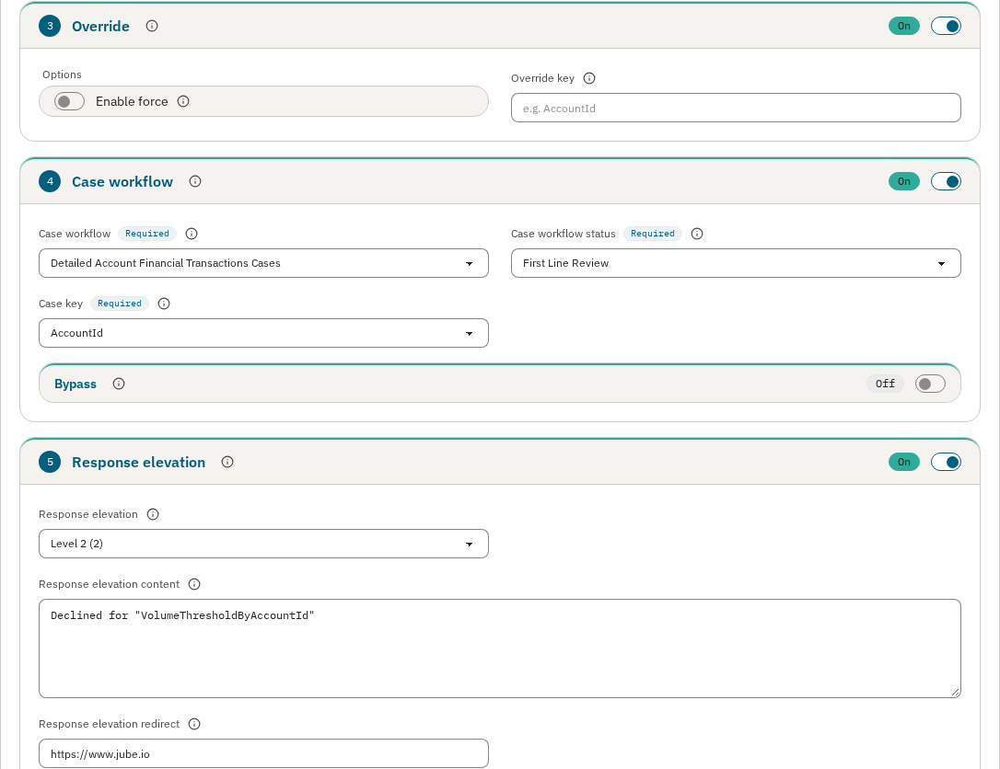
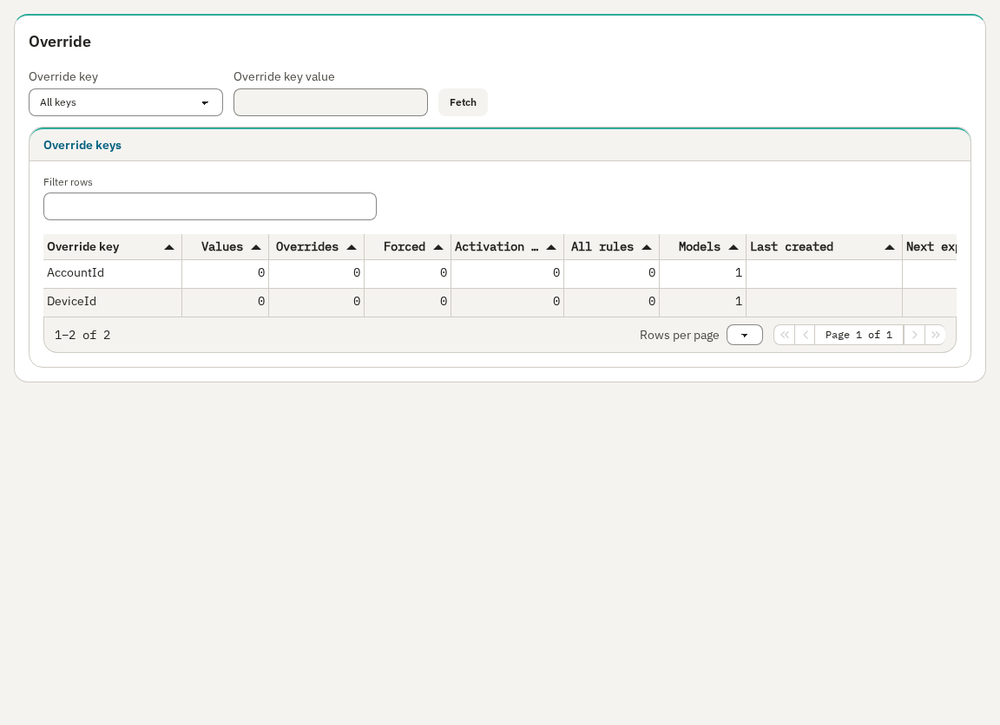

# Activation Rules Override

In the previous procedure the Response Elevation was set as the result of an Activation Rule matching. Response Elevations are commonly used to initiate the decline of a transaction in real time.

Consider the scenario where a customer has been declined in real time for foreign transactions, yet it transpires upon investigation that the customer is on holiday. In such a circumstance, it would be desirable to suppress any actions as the result of an Activation Rule match, for that account.

An override exists for this purpose. An override is held against the value of a payload element (the Override Key Value of an Override Key, for example the IP 8.8.8.8), and either suppresses the consequences of Activation Rules matching for that value, or forces an Activation Rule to be treated as having matched for that value. An override is global to the key and value on the models and rules chosen, which is to say that it applies to every transaction carrying that value, for as long as the override stands.

## Overrides at a glance

An override answers one of two opposite questions for a single value, such as one account, one card or one IP address. The first is: the rules are right in general, yet wrong for this customer, so how are they to be left alone? The second is: the rules would not catch this value, yet it is known to be bad, so how is it to be caught every time? The terms used in this page are as follows:

| Term               | Meaning                                                                                                                                                      |
|--------------------|--------------------------------------------------------------------------------------------------------------------------------------------------------------|
| Override Key       | A field of the model that overrides may be held against, such as AccountId or IP. A field becomes an Override Key by Enable override on its Request XPath.   |
| Override Key Value | One value of that field, such as the account ACC-441. An override is always held against one value.                                                          |
| Suppress           | The rule still matches for the value, yet its consequences (the Response Elevation, the Case, the Notification, the Activation Watcher) are withheld.        |
| Force              | The rule is treated as having matched for the value without being evaluated, such that its consequences follow every time.                                    |
| Scope              | How much the override reaches: every eligible Activation Rule of a model (the model level), or one named Activation Rule.                                    |
| Delete expiry date | An optional date and time at which the override removes itself.                                                                                              |
| Approval           | The agreement of a second person, which a Force override needs before it has any effect and a Suppress override does not.                                    |

The two kinds differ in every respect that matters, and the differences are deliberate, a Force being the larger claim:

|                                        | Suppress                                               | Force                                                              |
|----------------------------------------|--------------------------------------------------------|--------------------------------------------------------------------|
| What it does                           | Withholds the consequences of a match.                 | Brings about the consequences without a match.                     |
| Typical use                            | A customer verified as genuine, a known false positive. | A blacklist of values known to be bad.                             |
| Scope available on this page           | The model level, or one named Activation Rule.         | One named Activation Rule only.                                    |
| What the Activation Rule must allow    | Enable override.                                       | Enable override and Enable force.                                  |
| Permission to make it                  | 2, Read Write Suppression.                             | 2, Read Write Suppression, and 62, Apply Force Override.           |
| When it takes effect                   | At once.                                               | Only upon approval by a second person holding 44, Allow Approval.  |
| Where both reach the same rule         | Gives way.                                             | Takes precedence.                                                  |

To carry one scenario through the page, take the demonstration account ACC-441, which made a purchase in London forty minutes after one in Cairo, and suppose that an Activation Rule named ImpossibleTravel raises a Response Elevation for such a pattern, with Enable override on and AccountId as its Override key. Upon the customer being verified as travelling, an analyst chooses AccountId as the Override key, types ACC-441 as the Override key value, clicks Fetch, expands the model, and switches on the override against ImpossibleTravel alone, leaving the Kind as Suppress and setting a Delete expiry date a fortnight hence. From that moment, and for a fortnight, transactions of ACC-441 continue to match ImpossibleTravel, which is recorded, yet no Response Elevation is raised and no case is created by that rule, while every other rule continues to act upon the account and every other account continues to be acted upon by ImpossibleTravel. Had the switch been set at the model level instead, every Activation Rule of the model admitting the override would have been suppressed for ACC-441, which is the broader and less cautious choice. Conversely, were the account found to be a mule, an Activation Rule carrying the consequences wanted, with Enable force on, would be switched on for ACC-441 with the Kind as Force, and it would read Awaiting approval and do nothing until a second person approved it.

## Where it lives

Override is an item in the main menu, at `/override`, for the purposes of delegating this otherwise administrative function to customer service orientated roles. It is presented to a user having permission 2, Read Write Suppression.

The page is arranged as a story in three steps, each added beneath the last, with a trail (Override keys, then the key, then the value) to return to an earlier step:

| Step | Shows |
|------|-------|
| Override keys | A summary of every Override Key, as described under The Override Key summary below. |
| Values held | Every value held against the Override Key selected, as described under Listing every value held against an Override Key below. |
| Models | For one Override Key Value, every model offering the key, each with a switch for the override, and each expanding to its Activation Rules. |

Above the steps, a selector presents an Override key drop down (All keys, or one of the keys), an Override key value box, which is available once a key has been chosen, and a Fetch button. Choosing a key and a value, then Fetch, goes straight to the Models step for that one value. Leaving the value blank lists the values held against the key.

The address in the browser follows the story, taking the form `/override?key=IP&value=8.8.8.8`, such that an override can be linked to directly.

The Override key value box cannot be typed into while the Override key reads All keys, and a value typed is trimmed of the spaces before and after it upon Fetch. Choosing All keys and Fetch returns to the Override keys step. The heading of the key step states what is held against the key, as the number of values, the number of overrides and, where there are any, the number forced (for example 3 values, 5 overrides, one forced).

The states in which the page and its steps may be found are as follows:

| State                                                    | What is presented                                                                             |
|----------------------------------------------------------|-----------------------------------------------------------------------------------------------|
| The permissions of the user are being fetched.           | A placeholder.                                                                                |
| The permissions of the user could not be fetched.        | Your permissions could not be loaded, so overrides cannot be shown.                           |
| The user does not hold permission 2.                     | You do not have permission to manage overrides.                                               |
| The user holds permission 2 and not permission 62.       | The page, beneath the notice Force overrides are not offered because you do not hold the Apply Force Override permission. |
| No field of any model is an Override Key.                | No Request XPath on any Model has Enable Override switched on.                                |
| Nothing is held against the Override Key selected.       | There are no values held against this override key.                                           |
| No model offers the Override Key selected.               | No models offer this override key.                                                            |
| No Activation Rule of the model admits the Override Key. | No activation rules on this model accept this override key.                                   |
| A step could not be fetched, or a change failed.         | The override could not be loaded or changed.                                                  |
| A change is refused for want of permission (403).        | You do not have permission to do that. Applying a Force override needs the Apply Force Override permission, which is separate from the ordinary override permission. |
| A change is being carried out.                           | Updating…                                                                                     |

The message for a change that failed or was refused is written above the steps and remains until the next change succeeds, the switch concerned returning to the state held in the server.

SHOT id=models-override-models-step
     route=/override?key=IP&value=8.8.8.8
     steps=expand-first-row
     frame=page
     state=the Override page at the Models step for the key IP and the value 8.8.8.8, with the default model switched on as a Suppress override with a Delete expiry date, and the row expanded to show its Activation rule overrides, one of which is a Force awaiting approval
     conveys=an override is a switch against a model for one key value, with the Activation Rules of the model beneath it for finer control
     alt=The Override page showing the selector, the trail, a model switched on for the value 8.8.8.8 and the expanded grid of Activation Rules each with a switch, a Kind and a Delete expiry date

Two matters of configuration precede the use of the page, and neither is implied by the other:

* The payload element must be offered as an Override Key, by switching on Enable override in the Behaviour group of its [Request XPath](../RequestXPath/index.html). Upon that change being approved, the element is listed among the Override keys.
* The Activation Rule must admit being overridden, by Enable override in the Override group of the [Activation Rule](../BasicActivationRules/index.html), as described under Which Activation Rules may be overridden below.

Overrides (as Lists and Dictionary) do not require an explicit synchronisation, rather they will be synchronised in the engine as a matter of routine.

### Suppression from a case

An override can also be requested from a case, without visiting this page. In the Decide pane of the case page, Model override opens a lightbox in which the key (the case key, or another override enabled key), the value, the models and rules, the kind and a required expiry are chosen, alongside a reason and the transactions of the case given as evidence. An override requested in this manner is a request that a second person, having permission 70, Approve Case Suppressions, must approve before anything reaches the engine, whereas this page remains a direct, permissioned control. The case page lists such overrides alongside those set on the Override page or elsewhere.

## The Models step

The Models step lists every model for which the Override Key is eligible, with the following columns:

| Column | Description |
|--------|-------------|
| Override | A switch indicating that all Activation Rules belonging to the model, that admit the override, are suppressed for the value. |
| Kind | The Override Kind. At the model level it is shown as text and is Suppress. |
| Delete expiry date | The date and time at which the override lapses, if any, as described below. |
| Model | The name of the model. |
| Approval | For a Force override, the state of its approval. |
| Actions | For a Force override, Review, which opens its approval. |

A change is made the moment the switch is toggled, there being no save button, and the page reads Updating… while it is carried out.

### Delete Expiry Date

The Delete expiry date picker is disabled unless the override is currently switched on for the row, becoming immediately available the moment the switch is toggled on, and immediately locked again, and cleared, the moment the switch is toggled off. Setting a Delete Expiry Date has exactly the same effect as manually toggling the switch off once that date and time is reached: it does not require an explicit synchronisation or any further manual intervention. Leaving Delete Expiry Date blank, which is the default the moment an override is switched on, means the override never expires and must be removed manually by toggling the switch off.

The date and time entered must be in the future. An attempt to set a value in the past is rejected immediately in the browser, reverting the picker to its previous value and displaying the message "Delete expiry date must be later than the current date and time." on the page, without the invalid value ever being sent to the server. The same Delete expiry date column, with the same behaviour, is available for an override scoped to a specific Activation Rule, described further below.

Over the API, creating an override with a Delete Expiry Date stores it, and updating with an Id that matches no visible row is returned as not found rather than creating a new row.

Every change made to an override record, whether removed by toggling the switch off or by a Delete Expiry Date being reached, is recorded to an audit history, in the same manner as other versioned objects in Jube.

### Overriding a specific Activation Rule

It is also possible to specify just a specific Activation Rule for the override. Expanding the row of a model exposes the Activation Rules rolling up to that model, under the label Activation rule overrides, with the columns Override, Kind, Delete expiry date, Activation rule, Approval and Actions.

The override process works in the same manner as at the model level, with a toggle switch that is immediately synchronised, but the override will be targeted to a rule name and not encompass the whole model processing of the transaction or event. As at the model level, a Delete Expiry Date can optionally be set once the switch is toggled on for the Activation Rule, behaving identically: an automatic, unattended un-suppression at the date and time specified, requiring no further synchronisation.

The grid lists only the rules that the selected Override Key may override, and where there are none it reads "No activation rules on this model accept this override key."

## What an override suppresses

Upon an override of kind Suppress being in place for a value, the Activation Rule is still evaluated and still matches, which is to be expected, but the following actions are suppressed:

* Response Elevations.
* Notifications.
* Case Creation.
* Activation Watcher.

TTL Counter increments will not be suppressed.

A model level override (one naming no Activation Rule) reaches only the Activation Rules that admit it, being those with Enable override on, and an Override key that is empty or equal to the key that matched.

## Override Kind

Every override, whether held at the model level or against a named Activation Rule, carries an Override Kind:

| Kind | Description |
|------|-------------|
| Suppress | The default, and the behaviour described thus far. The Activation Rule is still evaluated and still matches, and it is the consequences of the match that are muted: Response Elevations, Notifications, Case Creation and the Activation Watcher. TTL Counter increments are not suppressed. |
| Force | The Activation Rule is treated as matched for this value without the rule being evaluated at all, so its consequences fire. This is the shape of a blacklist: the value is known bad, and the Response Elevation, Case and Notification of the rule are to be raised for it regardless of what the logic of the rule itself would have concluded. A Force override also bypasses the Activation Sample of the Activation Rule, since an explicit operator override should not be sampled away. |

The Override Kind is exposed as a drop down next to the toggle switch on the Activation Rule grid only, and like the Delete expiry date picker it is enabled only while the override is switched on for that row. The model level grid shows the Kind as read-only text and is fixed at Suppress: an override held against every Activation Rule in a model may only mute, never force, because forcing every rule in a model for a value is rarely intended and too easily set by accident. To force, the override is bound to the specific Activation Rule that carries the behaviour required.

Applying a Force override requires the separate permission 62, Apply Force Override, which is granted to the Administrator role only on upgrade and must be granted explicitly to any other role. Holding the ordinary suppression permission allows an operator to mute a rule but not to make one fire. The two are deliberately separated, because forcing an activation raises response elevations, creates cases and sends notifications, whereas suppression only withholds them. The permission is enforced on create, on update and on any change of Override Kind, and likewise on extending, shortening or clearing the Delete Expiry Date of a Force override, whereas a Suppress override needs only the ordinary permission. A user without it is told that "Force overrides are not offered because you do not hold the Apply Force Override permission." The permission is not enough on its own, as the Force override must also be approved, as described under Approval of Force overrides below.

Where the same Activation Rule is reached by more than one override, for example a Suppress against the card and a Force against the user id, or a model level Suppress alongside a Force for one named rule, Force takes precedence. A value that some other override has marked as known bad is not quietly muted by an unrelated suppression.

Global guards continue to apply to a forced Activation Rule: the Response Elevation frequency limit, and the reprocessing guard for a rule that does not have Enable reprocessing set, each still mute the consequences. Force governs whether the rule is treated as matched, and it does not exempt the rule from those limits.

## Approval of Force overrides

A Force override is a live change that can make rules fire, so it is held to the same maker and checker rule as every other live change, as described in [Maker Checker](../../../Concepts/MakerChecker/index.html). A Force override takes no effect until a second person with the approval permission approves it. This applies to Force overrides held against a named Activation Rule and to Force overrides held at the model level. Suppress overrides are not affected: they take effect immediately, and are never listed for approval.

| Action | Behaviour |
|--------|-----------|
| Making a Force override | Switching on a Force override, or changing a Suppress override to Force, still needs the Apply Force Override permission. It creates a pending change. Until it is approved the override is shown on the Override page as Awaiting approval and has no effect on scoring. A pending or rejected Force override never changes a decision. |
| Changing a Force override | Extending, shortening or clearing the Delete Expiry Date of an approved Force override is a new version that needs its own approval. The last approved version, with its own expiry, stays in force until the new version is approved. The person who made the edit becomes the maker of the new version and cannot approve it. |
| Removing a Force override | Switching off an approved Force override is itself a pending change, and the approved version stays in force until the removal is approved. The Override page keeps listing the override, switched on, as Deletion awaiting approval (or Deletion rejected once a checker has refused it), and its switch, Kind and Delete expiry date are disabled until the removal is approved or retracted. The pending removal is shown in the model and rule grids only, in that the Values held list and the counts of the Override Key summary omit it. |
| Switching a Suppress override to Force | On an Activation Rule, this withholds the override altogether until the Force is approved, because the Suppress it replaced is no longer the version that is live. |
| Switching a Force override to Suppress | Takes effect at once. It reduces what the override can do, so it needs no approval. |
| Approving | Approval needs permission 44, Allow Approval, the same permission that approves every other kind. The maker of the version, which for an edit is the person who made the edit and for a removal is the person who removed it, cannot approve or reject it. A landlord user is exempt from that rule, as everywhere else. A tenant that requires more than one approval needs that many distinct approvers. |
| Rejecting, resubmitting and retracting | A rejected Force override can be resubmitted unchanged, which needs the Apply Force Override permission again, or retracted, which restores the last approved version. Both accept an optional note. |

Each Force row on the Override page has an Approval column and a Review button, which opens the same approval panel used on every other page, titled Approval of Force override followed by the name, with the version history and the approve, reject, resubmit and retract actions. Where Force overrides are awaiting approval, the number is stated above the grid. Pending Force overrides are also listed among the pending approvals, under Force override and Force rule override.

SHOT id=models-override-force-approval
     route=/override?key=IP&value=8.8.8.8
     steps=expand-first-row, click:Review
     frame=page
     state=the Models step with an expanded model whose Activation rule overrides include a Force row marked Awaiting approval, and the approval panel for that Force override open as a checker
     conveys=a Force override waits for a second person, and is reviewed in the same approval panel as every other change
     alt=The Override page with a Force override against an Activation Rule marked Awaiting approval and its approval panel open showing the version history

Existing Force overrides are approved on upgrade by system approvers (the Administrator user and numbered variants such as Administrator2), so they keep applying after the upgrade whatever ApprovalsRequired is set to, up to the larger of five and the value of the setting at the moment the migration runs. If ApprovalsRequired is later raised above that number, existing Force overrides stop applying until enough approvers have approved them again.

A Force override created from a Case, by approving a Case suppression request, is created in the name of the maker of that request and is itself a Force override: it needs the approval described here as well as the Case approval. The same person can give both approvals, in that the checker of the Case request is by definition not the maker, so, holding Allow Approval as well as the Case approval permission, they may also approve the override that the request of the maker created.

TODO(verify): owner to decide whether approving a Case suppression request that targets a Force should also count as the approval of the resulting Force override, and whether the same person may approve both. As built they may, and two approval steps are still needed.

## Which Activation Rules may be overridden

The override surface is opt in at both ends, and neither end is implied by the other.

On the Request XPath, Enable override determines whether that element is offered as an Override Key at all. It is a model wide switch: it says that this payload element is a thing operators may look values up by, and it governs the search rather than any particular rule.

SHOT id=models-override-activation-rule-group
     route=/models
     steps=open-default-model, open-hub:Activation Rules, open-row:VolumeThresholdByAccountId, scroll-to:Override
     frame=record
     state=the VolumeThresholdByAccountId Activation Rule of the default model scrolled to the Override group of its form, the group switched on, with Enable force switched off and the Override key left empty, and the Case workflow and Response elevation groups of the rule beneath
     conveys=whether a rule may be overridden, whether it may be forced, and by which key, is set in the Override group of the Activation Rule itself
     alt=The Override group of an Activation Rule record, switched on, with Enable force switched off and an empty Override key, above the Case workflow and Response elevation groups of the form



On the Activation Rule, three fields govern what may be done to that rule:

| Value | Description |
|-------|-------------|
| Enable override | The rule may be overridden at all. A rule without it is never suppressed and never forced, whatever overrides exist against the values on the payload, including a model level all activation rules override. It is off by default, so a rule is not drawn into the override surface merely by existing. |
| Enable force | The rule may additionally be forced, not merely suppressed. It is enabled only where Enable override is on, and is off by default. A rule that may be muted is not thereby a rule that may be made to fire: the second is the far larger claim, and is stated separately. |
| Override key | The single Request XPath whose values may override this rule. Left empty, any override enabled key may override it. Set, only overrides held against that key apply, and an override held against any other key is ignored for this rule. |

The Override key is deliberately one key and not a list. A rule that would need to answer to two different keys is two rules, and saying so forces the rules to be labelled for what they actually do. If a policy appears to need an OR across keys, that is the signal to split it, not to widen the binding.

All three are enforced by the engine at evaluation time as well as by the editor at write time, so an override that was admissible when it was created stops applying the moment the opt in of the rule is withdrawn. Withdrawing Enable override on a rule therefore disarms every override against it without any of them needing to be found and deleted, and the same is true of Enable force for forcing specifically: turning it off leaves any Suppress overrides in place and stops the Force ones.

The Activation Rule grid on the Override page lists only the rules that the selected Override Key may override, and offers Force in the Kind drop down only for rules that have Enable force set. Where a rule already carries a Force override and Enable force has since been withdrawn, the Kind continues to read Force so that what is stored is shown honestly, but the engine no longer acts on it.

## More than one Override Key on a Model

A Model may have several Request XPath elements with Enable override switched on, for example a card fingerprint, a user id and a project code. Each of those keys is checked independently against the payload, and the results are combined, not replaced:

* A transaction is suppressed at the model level if any override key present in the payload carries an all activation rules override of kind Suppress for its value. It does not matter which key, nor in what order the keys are checked. A suppressed card is still suppressed when the user id on the same transaction has no override of its own.
* Where several keys each name specific Activation Rules, the resulting set of overridden rules is the union across every key. A card override naming Rule A and Rule B, together with a user override naming Rule B and Rule C, leaves Rules A, B and C overridden.

## The Override Key summary

The page opens on a summary of every Request XPath that has Enable override switched on anywhere in the tenant, one row per key, whether or not anything is currently held against it, 20 to a page, with a box to filter by key. Where there are none, it reads "No Request XPath on any Model has Enable Override switched on." Each row reports:

| Column | Description |
|--------|-------------|
| Override key | The name of the Request XPath element. |
| Values | How many distinct values are currently overridden on that key. |
| Overrides | How many live bindings there are in total, counting a model level binding and each named Activation Rule binding once each. |
| Forced | How many of those bindings force their Activation Rule rather than suppress it, which is the number worth watching, since forcing raises response elevations and creates cases. |
| Activation rules | How many distinct Activation Rules are bound on that key. |
| All rules | How many bindings are the model level all activation rules kind rather than a named rule. |
| Models | How many Models offer the key, a key being enabled per Request XPath and the same element commonly appearing on several Models. |
| Last created and Next expiry | When the key was last used, and the soonest an override on it will lapse of its own accord. |

Open on a key drills into the list of values held against it, which is the same view that a Fetch with the Override key value left blank produces. Filling in a value and pressing Fetch goes straight to the Models step for that one value.

SHOT id=models-override-key-summary
     route=/override
     steps=none
     frame=page
     state=the Override page as first opened, showing the selector and the Override keys summary with several keys, at least one of which has values, overrides and a forced count
     conveys=the page opens on what is overridden across the tenant, key by key, before any value is looked up
     alt=The Override page opened on the Override keys summary, listing each key with its counts of values, overrides, forced, activation rules and models



## Listing every value held against an Override Key

The Fetch button looks up one exact Override Key Value at a time. Leaving the Override key value blank and clicking Fetch, or opening a key from the summary above, instead lists every value currently held against the selected Override Key across the tenant, with the Model it belongs to, the Kind, the user who created it (Created by), when (Created) and its Delete expiry date. Values held only against named Activation Rules are listed alongside those held at the model level, since the rule level is where most overrides now live, and a value is listed once per Model however many of its rules are bound, reporting Force where any of those bindings forces. This is intended for monitoring what is overridden on a key rather than testing values one by one. Open on a row fills in the Override key value and moves to the Models step for it. The values are listed 20 to a page, with a box to filter by value, and the listing fetches at most 250 values for the key. The Models step has neither a filter nor a pager, every model offering the key being listed.

The summary itself is available on the API as `GET /api/GetEntityAnalysisModelOverrideQuery/Keys`, which takes no parameters and is scoped to the tenant of the caller. The value listing is available as `GET /api/GetEntityAnalysisModelOverrideQuery/Values?overrideKey=...`, which takes an optional `limit` clamped to between 1 and 1000 and defaulting to 250.

## Building a blacklist

A blacklist is a live Activation Rule plus Force overrides against its Override Key.

1. Create an Activation Rule carrying the behaviour a blacklisted value is to receive, being its Response Elevation and its Case Workflow, with any Notification carried by the Response Elevation Range. Give it a name that says so, for example Blacklist Card.
2. Give the rule an expression that matches nothing of its own accord. A rule whose expression returns false never activates for ordinary traffic, which is exactly what is wanted: the rule is a carrier of consequences and not a detector.
3. Set Enable override and Enable force on the rule, and set its Override key to the Request XPath the blacklist is keyed by.
4. Add a Force override for each blacklisted value on the Override page, against that rule.

Each value in the blacklist then activates the rule and receives its consequences, and nothing else does. The list is edited by operators through the override surface, live and without synchronisation, while the behaviour of the list stays where behaviour belongs, in a rule. Removing a value from the blacklist is removing its override, and emptying the blacklist entirely leaves the rule dormant rather than leaving a rule behind that has to be remembered.

The rule remains an ordinary Activation Rule throughout. It appears in the Model, it can be edited, it is versioned, and deleting it deletes the blacklist behaviour with it: deletion is honoured by the override surface and not worked around by it. A Model may carry several such rules keyed by different Request XPaths, and a rule that is both a real detector and forceable for known bad values is equally valid, as Force short circuits the evaluation for the bound values.

## Recording that an Activation was forced

A forced Activation is distinguishable after the event, because a forced Activation is not evidence of anything the Model detected.

* The Activation element written into the Archive payload carries a Forced flag alongside the name and visibility of the rule, so any Case, export or query reading the payload can tell an Activation the Model reached from one an operator asserted. No Archive column was added, and the flag lives in the payload JSON where the Activation element already is.
* The Activation Rule carries a Forced Activation Counter separately from its Activation Counter, with the same separation carried into the counter history. The Activation Counter continues to count every Activation, forced or otherwise, so existing reporting is unchanged, and the forced count says how much of that total was asserted rather than detected. A rule whose Activation Counter is entirely forced is doing no detecting at all, which is worth knowing about a rule that was meant to detect.

## Validation

* The Override Key Value, and the Override Key itself, are each limited to 256 characters.
* The Activation Rule name is likewise limited to 256 characters, and must reference an Activation Rule that currently exists on the Model being overridden and that has been opted in to the override surface, as described in Which Activation Rules may be overridden above. An Activation Rule that has been deleted from the Model cannot be overridden: deletion is final for the override surface, and an override naming a rule that no longer exists has no effect.
* The Delete Expiry Date must be in the future.

## Example

To help illustrate, the HTTP POST to the endpoint [https://localhost:5001/api/invoke/EntityAnalysisModel/90c425fd-101a-420b-91d1-cb7a24a969cc](https://localhost:5001/api/invoke/EntityAnalysisModel/90c425fd-101a-420b-91d1-cb7a24a969cc) is repeated, noting that the IP in the JSON transaction message is "8.8.8.8":

```json
"IP": "8.8.8.8"
```

It can be seen in the response that there is a Response Elevation being returned, which would be inferred as a transaction decline:

```json
"responseElevation": {
  "value": 9.0
}
```

To enable the IP for Override matching, Enable override is switched on for the IP Request XPath of the model, and for the Activation Rule raising the Response Elevation, and both changes approved. On the Override page, IP is then offered in the Override key drop down, which holds the distinct list of all Request XPath elements designated for override. It follows that the override value must be the IP for which suppression is required: IP is chosen as the Override key, 8.8.8.8 is typed as the Override key value, and Fetch returns all models for which IP is eligible, each with a switch to indicate the override status for the IP 8.8.8.8.

To suppress for the IP value 8.8.8.8, it is a simple matter of toggling the switch next to the model name, to indicate that all Activation Rules belonging to the model should be suppressed. Repeating the HTTP POST, it can be seen that the Activation Rule has still matched, yet the Response Elevation is zero, as it has been suppressed, and will no longer drive a decline (being a Response Elevation value other than zero):

```json
"responseElevation": {
  "value": 0.0
}
```

To remove the override, the switch is toggled off after having fetched the IP of 8.8.8.8 once more. To validate removal of suppression, the HTTP POST is repeated, and it can be seen that the Response Elevation is now active, given that the override has now been removed:

```json
"responseElevation": {
  "value": 9.0
}
```

## Permissions and security

| Permission | Allows |
|------------|--------|
| 2, Read Write Suppression | Presents the Override menu item, and allows Suppress overrides to be read, made, changed and removed. |
| 62, Apply Force Override | In addition to permission 2, allows a Force override to be made, changed or removed, subject to approval by a second person. |
| 44, Allow Approval | Allows a Force override made by another user to be approved or rejected. |
| 70, Approve Case Suppressions | Allows a suppression requested from a case to be approved. |

A user without permission 2 is told "You do not have permission to manage overrides." Overrides are scoped to the tenant of the caller.
