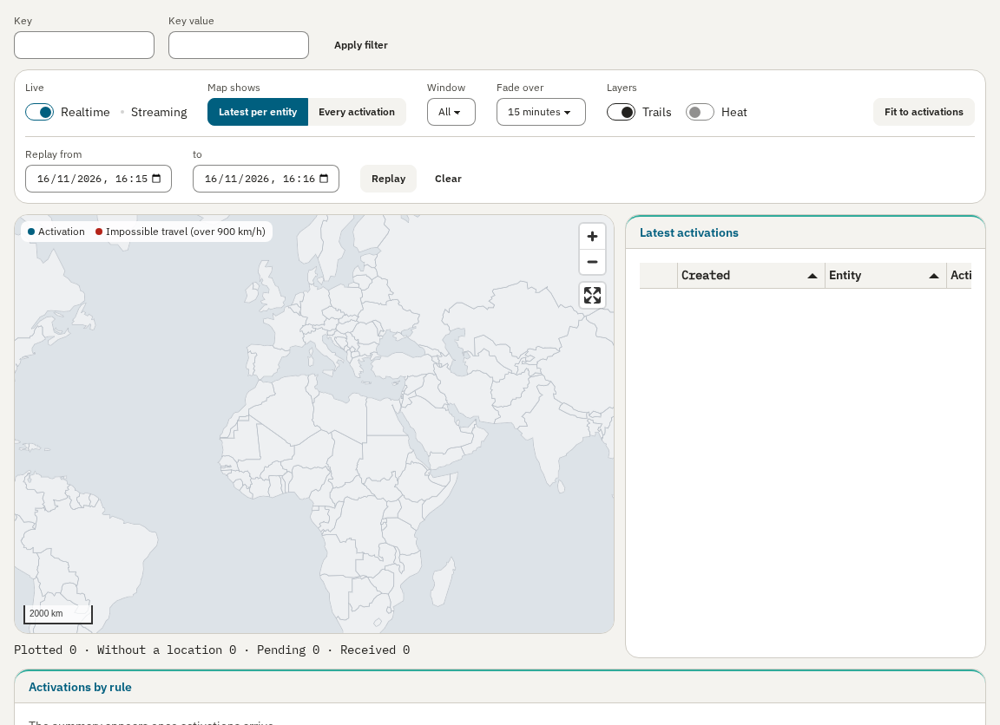
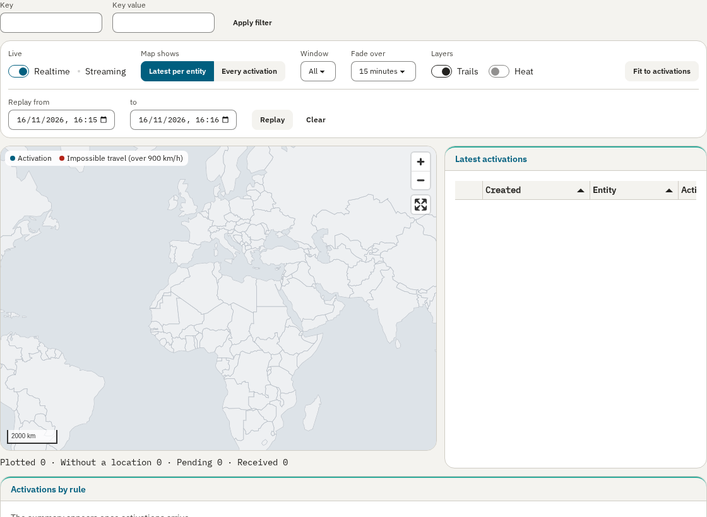
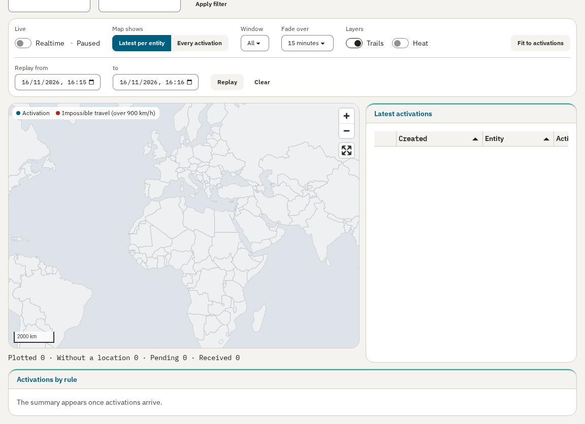

# Activation Watcher

The purpose of the Activation Watcher is to provide a real time ticker of Response Elevations, subject to the Activation Rule having been set to send messages to the Activation Watcher. The Activation Watcher draws the activations on a map and in a feed, with a stream of events keeping it live and a Replay reading the entries that have been stored.

There are several mechanisms that stop the Activation Watcher being flooded with data and causing the system to become unresponsive. It follows that the Activation Watcher should be viewed to be a sample of activity for a period of time, rather than a system of record or alert. The Activation Watcher will only tick through alerts as they happen when the page is connected.

## Where it lives

The Activation Watcher is a main menu item, Watcher, at `/watcher`, presented to a user having permission 30, View Watcher.

The page is arranged, from top to bottom, as a box to watch one entity, the controls, the map with its legend and counts, the feed titled Latest activations, and a summary titled Activations by rule.

SHOT id=models-activation-watcher-page
     route=/watcher
     steps=click:Replay
     frame=page
     state=the Watcher page after a replay over a wide date range, with the controls, the map plotting activations across several cities in their activation colours, the legend and counts, and the first rows of the Latest activations feed
     conveys=the Watcher is a map and a feed of the same activations, under one set of controls
     alt=The Watcher page showing the controls, a world map with coloured activation pins and the Latest activations feed beneath



## Sending activations to the Watcher

An activation reaches the Watcher only where three things are in place:

* The model has Enable activation watcher switched on, in the Activation Watcher group of the Properties form of the model. The same group holds the rolling period (Max activation watcher interval and Max activation watcher value), the Max activation watcher threshold, being the number of activations streamed within that period before further activations are withheld, and the Activation watcher sample, being the proportion of activations randomly sampled. These exist so not to flood the Activation Watcher in high throughput implementations.
* The [Activation Rule](../BasicActivationRules/index.html) has Enable response elevation and Send to activation watcher switched on, in its Response Elevation group. Switching on Send to activation watcher presents the further options as follows, each of which is then required:

| Value | Description | Example |
|-------|-------------|---------|
| Response elevation key | The identifier value to accompany the message to the Activation Watcher, henceforth the entity. | AccountId |
| Response elevation fore color | The fore colour that will be included in the Activation Watcher for the entry tick. | #0000FF |
| Response elevation back color | The back colour that will be included in the Activation Watcher for the entry tick, and with which the activation is plotted on the map. | #FF0000 |

* The engine is permitted to stream, by the StreamingActivationWatcher Environment Variable, which is True by default.

The plotting of activation rule matches on the map relies on a Latitude and Longitude having been specified in the Request XPath or the Inline Script attributes, which is to say elements of Data Type Latitude and Longitude respectively. In the example transaction the Latitude and Longitude are passed in the JSON transaction message:

```json
"AccountLongitude": "36.1408",
"AccountLatitude": "5.3536"
```

An activation arriving without a location, or with a location of [0,0] (just off Central Africa), is not plotted, and is counted as Without a location beneath the map, while still being listed in the feed.

There will be nothing of note in the JSON response payload as a consequence of an activation having been sent to the Watcher.

## Controls

| Value | Description |
|-------|-------------|
| Realtime | Whether activations are plotted as they arrive, rather than relying solely on Replay. The state of the stream is shown alongside as Streaming, Connecting, Closed or Paused. |
| Map shows | Latest per entity plots an entity (the key defined in the Activation Rule) the once, at its most recent activation, so not to over-plot the map. Every activation plots each activation. |
| Window | Limits what is shown to the Last minute, Last 5 minutes, Last 15 minutes or Last hour, or All. |
| Fade over | Fades an activation over 1 minute, 5 minutes, 15 minutes or 1 hour, or No fade. |
| Trails | Joins the activations of an entity in date order. |
| Heat | Shows the density of activations. |
| Fit to activations | Moves the map to the activations plotted. |
| Replay from, to | The date range for a Replay, with Replay to begin it and Clear to empty the map and feed. |

Watch one entity, above the controls, takes a Key and a Key value, with Apply filter and Clear filter. Activations not matching the filter are dimmed on the map rather than removed.

The page opens with Realtime on, Map shows as Latest per entity, Window as All, Fade over as 15 minutes, Trails on and Heat off, and with no filter and no replay range. Whatever is altered from these is held in the address, as `key`, `value`, `live`, `mode`, `window`, `fade`, `trails`, `heat`, `from` and `to`, such that a view of the Watcher can be linked to and survives a reload, for example `/watcher?key=AccountId&value=ACC-441&mode=all`. A replay range is held only where both its start and its end have been given. Nothing is retained beyond the address, and the activations themselves are gone from the page upon a reload unless replayed.

The state of the stream, shown beside Realtime, is read as follows:

| State      | Meaning                                                                                                                         |
|------------|---------------------------------------------------------------------------------------------------------------------------------|
| Streaming  | The page is connected and activations will be plotted as they happen.                                                           |
| Connecting | The connection is being made, or is being made again after having been lost, the page retrying after 5 seconds and thereafter at lengthening intervals of up to 60 seconds. |
| Paused     | Realtime has been switched off. Activations taking place meanwhile are not shown, and are not caught up with upon Realtime being switched on again. |
| Closed     | The server has ended the stream, for example upon the permission having been withdrawn.                                         |

It follows that an empty map under Streaming means that nothing has activated while the page has been open, whereas an empty map under any other state says nothing about activity at all.

The states in which the page may otherwise be found are as follows:

| Circumstance                                              | What is presented                                                                |
|-----------------------------------------------------------|----------------------------------------------------------------------------------|
| No activation has arrived or been replayed.               | The feed reads No activations yet., and the summary reads The summary appears once activations arrive. |
| The replay could not be fetched.                          | The replay could not be loaded.                                                  |
| The browser cannot draw the map.                          | The map could not start in this browser. The feed and summary below still work.  |
| The page could not be opened.                             | The watcher could not be opened. Refresh the page to try again.                  |
| The user does not hold permission 30.                     | You do not have permission to see the activation watcher.                        |

Keep in mind that where the map is set to plot an entity the once, only the feed and the summary will show real activation frequencies.

## The map

Each activation is plotted in its Activation colour. Where two successive activations of the same entity are at least 50 kilometres apart and would require travel at over 900 km/h, the leg between them is drawn as Impossible travel, and the number of impossible journeys is stated beneath the map, alongside the counts of activations Plotted, Without a location, Pending and Received.

Selecting an activation on the map presents its entity, Activation Rule and Response Elevation, the distance and speed of travel from the activation before it, and two actions: Replay this entity's journey, and Follow this entity, which reduces the map to that entity until Show all is clicked.

SHOT id=models-activation-watcher-impossible-travel
     route=/watcher
     steps=click:Replay, toggle:Trails=on
     frame=section:Activation map
     state=the Watcher map with Trails on, and an entity whose activations in two distant cities are joined by a leg picked out as impossible travel
     conveys=the map joins the activations of an entity and picks out travel that could not have happened
     alt=The Watcher map with trails joining the activations of one entity across two cities, the leg between them marked as impossible travel



### The map makes no remote requests by default

The map is drawn by a bundled library with a bundled world outline (country borders, Natural Earth public domain data also used by the SVG charts). Out of the box the page requests no tiles, fonts, styles or sprites from any other host, so the address of the viewer and the coordinates being viewed never leave the deployment. Cluster counts are not labelled in this mode because no font is bundled, and clusters are sized by count instead.

A deployment that wants a street-level base map can opt in, knowing the privacy cost: the tile host sees the IP address of the viewer and the area being viewed, and with a hosted style the neighbourhoods of the activations. Both steps are needed, on purpose:

1. Build the single page application with `VITE_JUBE_MAP_STYLE_LIGHT` and `VITE_JUBE_MAP_STYLE_DARK` set to https style URLs (a value that is not https is ignored).
2. Add the tile host to `img-src` and `connect-src` of the `Content-Security-Policy` row in the `HttpResponseHeader` table. The stock policy names no remote host, so without this the browser blocks the request and the page falls back to the bundled outline.

TODO(verify): owner to decide how deployers are to set the build-time variables VITE_JUBE_MAP_STYLE_LIGHT and VITE_JUBE_MAP_STYLE_DARK for the container image, and whether a runtime setting is preferred.

## The feed and the summary

The feed, Latest activations, lists each activation as it arrives, with the following columns:

| Column | Description |
|--------|-------------|
| Activation colour | A swatch in the colour of the Activation Rule. |
| Created | The date and time of the activation. |
| Entity | The key and key value accompanying the activation. |
| Activation rule | The Activation Rule having matched. |
| Elevation | The Response Elevation. |
| Range | The name of the Response Elevation Range inside which the Response Elevation falls. |
| Response | The Response elevation content. |
| Actions | Locate, which moves the map to the activation. |

The feed holds the ten most recent activations only, the newest first, an older activation leaving the feed as a newer one arrives, whereas the map and the summary continue to reflect everything received.

Activations by rule summarises the activations received by Activation Rule, and appears once activations arrive.

The counts beneath the map are read as follows. Received is the number of activations that have reached the page, by stream or by replay. Pending is the number received yet not drawn, activations being drawn in batches so that a burst does not make the page unresponsive, and it returns to 0 as the page catches up. Plotted is the number drawn upon the map, which under Latest per entity is the number of distinct entities and not the number of activations. Without a location is the number that could not be placed. Where Received is far greater than Plotted with Map shows as Every activation, the difference is ordinarily to be found in Without a location, which points to the Latitude and Longitude fields of the model not being supplied.

The demonstration transactions of the account ACC-441 illustrate the impossible travel leg: a purchase in London forty minutes after one in Cairo, the two being some 3,500 kilometres apart, would require travel at over 5,000 km/h, which is far beyond the 900 km/h allowed, and the leg between the two would be drawn as Impossible travel were both to activate a rule sending to the Watcher with AccountId as its Response elevation key.

## Replay

The Replay functionality of the Activation Watcher, but only if the engines have been configured to store Activation Watcher entries in the database (the ActivationWatcherAllowPersist Environment Variable, True by default), will query and replay these entries through the Activation Watcher as if they were being sent in real-time.

Activation Watcher replay is for a given date range, for a maximum of the most recent 10,000 records within it, as if they were streaming in real-time. It should not be used to drive workflow, rather be considered a sample.

Before clicking the Replay button, it is recommended to switch off Realtime, as this will eliminate confusion between real time data and replay data.

SHOT id=models-activation-watcher-replay-feed
     route=/watcher
     steps=toggle:Realtime=off, click:Replay, scroll-to:Latest activations
     frame=page
     state=the Watcher page with Realtime off after a replay, scrolled to the Latest activations feed with its coloured rows and the Activations by rule summary beneath
     conveys=the feed and the summary show the true frequency of activations, whatever the map is set to plot
     alt=The Latest activations feed of the Watcher listing replayed activations with their entity, rule, elevation and colour, above the Activations by rule summary



## The stream

The live feed is a Server-Sent Events stream at `GET /api/Watcher/Stream`. It requires a signed-in user whose tenant resolves and who holds permission 30, checked before any stream header is sent (403 otherwise). The stream is bound to the tenant of the caller on connect: the endpoint takes no tenant, group or id from the client, so there is nothing to tamper with, and a message published for one tenant is only ever handed to the connections of that tenant. Every 60 seconds the permission and tenant are checked again, and a connection whose user lost the permission or now resolves to another tenant is closed with a final `revoked` event. Sign-out, a revoked session, an expired absolute session lifetime and a deactivated tenant close it on the next sweep of the session sweeper.

The limits are as follows:

| Limit | Value |
|-------|-------|
| Open streams per user | 10, with 429 returned beyond that, and the page retrying with a back-off from 5 to 60 seconds |
| Queued messages per connection | 256, with the oldest dropped for a slow client |
| Size of a message | 64 KiB, beyond which the message is dropped |
| Undrawn activations kept by the page | 20,000 |
| Records returned by a replay | 10,000 |

## Permissions and security

Viewing the Watcher, the stream and the replay requires permission 30, View Watcher. A user without it is told "You do not have permission to see the activation watcher."

What is streamed is the whole activation row: the key and key value (for example an account or card number from the transaction), the latitude and longitude taken from the transaction, the rule name, the response elevation and its content and colours. Permission 30 should therefore be treated as access to those values.

TODO(verify): owner to decide whether key values should be masked in the Watcher for users without a case permission.
