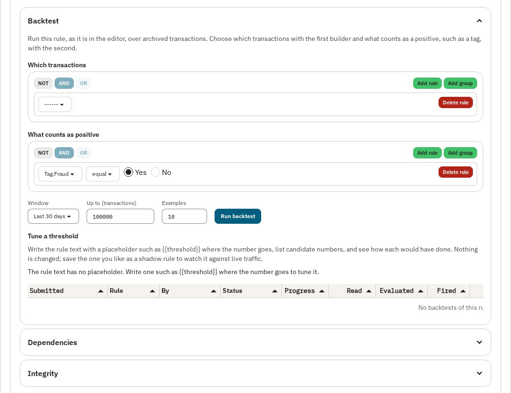
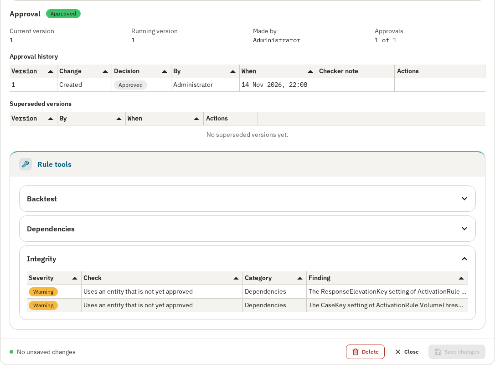

# Backtest

A backtest runs an Activation Rule, as it is in the editor (saved or not), over archived transactions and shows how it would have done, which is to say how often it would have fired, and how often it would have been right. It exists so that a rule can be judged against history before it is approved and allowed to act on live traffic.

## What a backtest measures

A rule can be wrong in two ways: it may fire upon a transaction that was perfectly genuine, which costs a customer a declined payment and an analyst a wasted review, or it may stay silent upon a transaction that was fraud, which costs the loss itself. A backtest counts both, and to do so it must be told two things: the rule, and what the right answer was for each transaction. The right answer is ordinarily a Tag, such as ConfirmedFraud, which has been placed upon archived transactions after the event, as described in [Tags](../Tags/index.html). The terms are as follows:

| Term                | Meaning                                                                                               |
|---------------------|-------------------------------------------------------------------------------------------------------|
| Evaluated           | An archived transaction that was read, kept by the Which transactions filter, and tested.            |
| Fired               | The rule returned True for the transaction.                                                           |
| Positive            | The transaction is one the rule ought to have caught, by the test given as What counts as positive.  |
| True positive, TP   | Fired, and positive. The rule was right to fire.                                                      |
| False positive, FP  | Fired, and not positive. A false alarm.                                                               |
| False negative, FN  | Did not fire, and positive. A miss.                                                                   |
| True negative, TN   | Did not fire, and not positive. The rule was right to stay silent.                                    |

Every evaluated transaction falls into exactly one of the four, and the four together are the confusion matrix. To take a worked example, suppose a rule matching where AmountEUR is greater than 500 is backtested over the last 30 days with ConfirmedFraud as what counts as positive, and that 10,000 transactions are evaluated, of which 200 carry the tag. Suppose the rule fires upon 300 transactions, of which 120 carry the tag. The result would read as follows:

| Figure        | Value  | How it is arrived at                              | How to read it                                                                  |
|---------------|--------|---------------------------------------------------|---------------------------------------------------------------------------------|
| TP            | 120    | Fired and tagged.                                 | The frauds caught.                                                              |
| FP            | 180    | The 300 fired, less the 120 tagged.               | The false alarms.                                                               |
| FN            | 80     | The 200 tagged, less the 120 caught.              | The frauds missed.                                                              |
| TN            | 9,620  | The remainder.                                    | The genuine transactions left alone.                                            |
| Precision     | 40%    | 120 of the 300 fired.                             | Of every ten alerts, four are fraud. Low precision wastes the time of analysts. |
| Recall        | 60%    | 120 of the 200 tagged.                            | Six frauds in ten are caught. Low recall lets fraud through.                    |
| F1            | 48%    | The balance of the two above.                     | A single figure by which two variants of a rule may be compared.                |
| Specificity   | 98.2%  | 9,620 of the 9,800 not tagged.                    | The share of genuine transactions not disturbed.                                |
| Fired rate    | 3%     | 300 of the 10,000 evaluated.                      | The volume of alerts the rule would raise.                                      |
| Positive rate | 2%     | 200 of the 10,000 evaluated.                      | How common the thing being looked for is. A rule firing at random would have a precision of about this figure. |

There is no figure that is good in the abstract. Precision and recall pull against one another, a stricter rule raising the first and lowering the second, and which is to be preferred depends upon the consequence of the rule: a rule that declines a payment wants high precision, since a false alarm falls upon a customer, whereas a rule that merely opens a case for review may accept a lower precision for the sake of recall. What the backtest allows is for the choice to be made upon numbers. A precision that is no better than the Positive rate means the rule is not distinguishing fraud at all, and a Fired rate that the review team could not absorb means the rule is not practical however well it scores.

The Backtest is the first of three sections, the Rule tools, presented with an Activation Rule. The remaining two, Dependencies and Integrity, are described towards the end of this page.

## Where it lives

Navigate through the menu to Models, open the model, then the Activation Rules hub card, and open the Activation Rule, as described in [Basic Activation Rules](../BasicActivationRules/index.html). Under the form are three sections, Backtest, Dependencies and Integrity, each of which opens when clicked, and each of which is shown only to users with the permission it needs. A user having none of them is told "You do not have permission to use any of the rule tools."

The Rule tools are presented for Activation Rules only.

## Running a backtest

The Backtest section takes the following:

| Value | Description | Example |
|-------|-------------|---------|
| Which transactions | The same query builder as the reprocessing page. Left empty, every transaction is used. | Payload.AmountUSD greater 100 |
| What counts as positive | A second query builder with the tags of the model (`Tag.Fraud` and so on) as well as every value an Activation Rule can see. The first tag is chosen by default. | Tag.Fraud equal True |
| Window | The Last 7 days, Last 30 days, Last 90 days, Last 12 months or All archived transactions. | Last 30 days |
| Up to (transactions) | How many transactions to read at most. | 100000 |
| Examples | How many examples of each outcome to keep. | 10 |

The section opens with the Window as Last 30 days, Up to (transactions) as 100000 and Examples as 10, and with the explanation Run this rule, as it is in the editor, over archived transactions. Choose which transactions with the first builder and what counts as positive, such as a tag, with the second. An Up to (transactions) that is cleared or not above zero is taken as 100000, and an Examples that is cleared or not above zero keeps no examples. Nothing of the two builders, the window or the limits is retained upon the section being left.

Run backtest submits it, upon which the page reads "Submitted. The backtest runs in the background and the list updates as it goes." Should the fields for the two builders not be fetched the section reads The backtest fields could not be loaded., and should the submission fail for a reason the server does not give, The backtest could not be submitted. While any backtest of the rule is Pending, Running or Cancelling, the table is read again every three seconds, and it ceases to be once all have concluded. Before any backtest of the rule has been run the table reads No backtests of this rule yet.

The backtest runs in the background on the backtest threads of the engine, so it can read hundreds of thousands of transactions or more. The table titled Backtests of this rule updates as it goes, with the progress and a Stop button, and has the columns Submitted, Rule, By, Status, Progress, Read, Evaluated, Fired, TP, FP, FN, TN, Precision, Recall, Window and Actions. A backtest instance with rule text that differs from the editor is marked as Edited since, rather than As submitted.

SHOT id=models-backtest-form
     route=/models
     steps=open-default-model, open-hub:Activation Rules, open-first-row, open-section:Backtest, scroll-to:Backtest
     frame=record
     state=the Backtest section of an Activation Rule open, showing the Which transactions and What counts as positive builders, the Window, the limit and examples, and beneath them the Backtests of this rule table with one Running row showing progress and one Succeeded row
     conveys=a backtest is defined by which transactions to read and what counts as positive, and runs in the background as one of a list
     alt=The Backtest section beneath an Activation Rule with two query builders, the window and limits, and a table of backtests showing a running row with progress and a succeeded row with its counts

## The result

Show on a backtest presents its results under the table:

| Section | Description |
|---------|-------------|
| From archive to firing | How many transactions were read, kept by the filter, fired on and positive. |
| Confusion matrix | True positives, false positives, false negatives and true negatives, shaded by their share. |
| Rates | Precision, Recall, F1, Specificity, Fired rate and Positive rate. |
| Tags on the evaluated transactions | The tags carried by the transactions evaluated. |
| Examples | Examples of each outcome: True positives, False positives, False negatives and Errors. |

Selecting an example explains the transaction, stating whether the filter kept it, whether the rule fired, whether it is positive, and the values the rule read, which answers "why did it fire?" and "why did it miss?".

The result is headed Backtest followed by its number, and Show against a backtest that has not succeeded states its status in place of a result, as This backtest is Failed for example. Above the charts, the result carries a notice for each of the following that applies, each of which qualifies how far the figures may be relied upon:

| Notice                                             | Meaning                                                                                                                         |
|----------------------------------------------------|---------------------------------------------------------------------------------------------------------------------------------|
| Limit reached, older transactions not read.        | Up to (transactions) was reached before the window was exhausted, such that the figures describe the most recent transactions only. |
| Stopped early, followed by the reason.             | The backtest was stopped, by Stop or by the rule exceeding its time limit, and the figures describe what was read until then.  |
| A number of rule errors.                           | The rule raised an error upon that many transactions, each counted as not fired. Examples are kept under Errors.              |
| A number of filter errors.                         | The Which transactions filter raised an error upon that many transactions, which were left out.                               |

Where no transaction was evaluated the result reads No transactions were evaluated, so there is nothing to chart beyond the funnel. Widen the window or relax the filter. Precision is shown as n/a where the rule never fired, and Recall as n/a where no transaction was positive, there being nothing to divide by. In the Confusion matrix the depth of the shading of a cell follows its share of the transactions evaluated, such that the eye is drawn to where the transactions fell, which for a rare event is ordinarily the true negatives. Should the result not be fetched it reads The result could not be loaded., and an example that cannot be explained reads The transaction could not be explained.

The counts are exact numbers, whereas the rates shown are worked out from them on the page, as follows:

| Rate | Description |
|------|-------------|
| Precision | Of the transactions it fired on, the share that were positive. |
| Recall | Of the positive transactions, the share it fired on. |
| F1 | The balance of precision and recall. |
| Specificity | Of the transactions that were not positive, the share it left alone. |
| Fired rate | The share of evaluated transactions it fired on. |
| Positive rate | The share of evaluated transactions that were positive. |

SHOT id=models-backtest-result
     route=/models
     steps=open-default-model, open-hub:Activation Rules, open-first-row, open-section:Backtest, scroll-to:Backtest, click:Show
     frame=record
     state=the result of a Succeeded backtest, showing the From archive to firing funnel, the shaded Confusion matrix, the Rates and the Examples
     conveys=the result reads from how many transactions were read down to why a single transaction fired or was missed
     alt=The result of a backtest showing a funnel from transactions read to fired, a shaded confusion matrix, the rates, and the examples

## What a backtest reads, and what it leaves alone

Nothing is changed by a backtest. The archive and its tags are only read, and the rule is run as it is in the editor, without being saved. The only thing written is the record of the backtest itself: its status, progress and result.

The archive is read through the report connection. When `ReportConnectionString` is set, the archived transactions and their tags are read through it, so a read replica can carry the load, keeping in mind that a replica that lags will not yet show the newest transactions. Checking the rule and reading the lists and fields of the model use the main connection. Without `ReportConnectionString`, everything is read through the main connection.

The cache is not used. Every value comes from the archived transaction and lists come from the database, so nothing is read from or written to the cache.

## How the counts are worked out

1. The archive is read a page at a time (`BacktestPageSize`, 5,000 by default), newest first by reference date. Only one page is held in memory, so the memory of a backtest does not grow with the number of transactions it reads, and a later page costs no more to read than the first.
2. The filter is run on each transaction exactly as a reprocessing rule is. A transaction on which the filter raises an error is left out, and counted as a filter error.
3. The rule is run exactly as the engine would run it, with every value as it was when the transaction was invoked: payload, TTL counters, abstractions, sanctions, calculations, adaptations and earlier activation rules. Lists are read as they are now, not as they were. A rule that raises an error is counted as not fired, as the engine treats it, and the error is kept as an example.
4. What counts as positive is tested against the values of the transaction and its tags. Tags are `True` or `False`. Comparisons are exact, and a field with no value never matches. Because this test is not written as rule text, it cannot use the operators that take a model list or another field, and its values must be written out rather than naming a field.

## When a backtest is refused

The rule, the filter and what counts as positive are all checked, and the rule compiled, before anything runs. If any of them is not valid, each problem is reported against the part it is in, and nothing runs:

| Code | Meaning |
|------|---------|
| `RuleTextRequired` | There is no rule text to backtest ("A rule to backtest is required."). |
| `RuleTypeInvalid` | The rule is not a gateway, activation or reprocessing rule. |
| `RangeInvalid` | The start of the window is later than its end. |
| `RuleScriptInvalid` | The rule text, or the filter, does not parse or compile. The message gives the line and position. |
| `FieldUnknown`, `OperatorInvalid`, `ValueInvalid` and the like | A condition in the filter or in what counts as positive names a field that is not available, or an operator or value that does not suit the field. |

A builder left with an incomplete rule is refused in the page beforehand, with "A builder has an incomplete rule. Finish or remove it."

## Tuning a threshold from outcomes

A backtest answers "how does this rule do?", whereas tuning answers "which threshold does best?". The rule text is written with a placeholder where the number goes, for example `If (Payload.Amount > {{threshold}}) Then`, the class is set to a confirmed outcome (a tag such as `Tag.Fraud = True`, which closed cases write back), and up to twelve candidate numbers are given. The sweep runs the same backtest once for each candidate, in turn, and returns for each the four confusion matrix cells together with precision (the share of firings that were positive) and recall (the share of positives that fired). Precision is empty when the rule never fired and recall is empty when there were no positives.

The Backtest section has a part titled Tune a threshold under the filter and positive-class builders. When the rule text contains a placeholder such as `{{threshold}}` it shows the placeholder, takes up to twelve comma-separated numbers as Candidate values, runs the sweep over the chosen window upon Run the sweep, and shows the Value, Fired, Precision, Recall and the four matrix cells of each candidate. Where the rule text has no placeholder, this is stated.

To continue the worked example, the rule would be written in the Coder as `If (Payload.AmountEUR > {{threshold}}) Then`, with the Candidate values given as 250, 500, 1000, 2000, and the sweep might return the following:

| Value | Fired | Precision | Recall | True positives | False positives | False negatives | True negatives |
|-------|-------|-----------|--------|----------------|-----------------|-----------------|----------------|
| 250   | 900   | 17.8%     | 80%    | 160            | 740             | 40              | 9,060          |
| 500   | 300   | 40%       | 60%    | 120            | 180             | 80              | 9,620          |
| 1000  | 120   | 66.7%     | 40%    | 80             | 40              | 120             | 9,760          |
| 2000  | 30    | 83.3%     | 12.5%  | 25             | 5               | 175             | 9,795          |

Read from the top, each step up in the threshold trades frauds caught for false alarms avoided. Moving from 500 to 1000 loses 40 frauds and spares 140 false alarms, and moving on to 2000 loses a further 55 frauds to spare only 35. It can be seen that the returns diminish, and the threshold to choose is the one beyond which the frauds given up are no longer worth the alarms avoided, which is a judgement of the institution and not of the sweep. A row is then taken forward with Save as shadow rule.

The messages of the part are as follows: The rule text has no placeholder. Write one such as {{threshold}} where the number goes to tune it. where there is none, The sweep could not be run. where it fails, and upon Save as shadow rule either a confirmation naming the rule saved and stating that It starts without effect and needs approval before the engine loads it., or The shadow rule could not be saved.

Nothing is stored and nothing is changed, in that the rule on the model is untouched. To act on a result, the chosen variant is saved as a new Activation Rule marked Shadow (see Shadow Mode in [Basic Activation Rules](../BasicActivationRules/index.html)), watched against live traffic, and promoted through approval. Save as shadow rule on a row calls `POST /api/EntityAnalysisModelActivationRule/SaveShadowVariant`, which creates a new Activation Rule named `<rule> shadow <value>` as a hand-written (Coder) rule with the number filled in and the Shadow switch on, copying the other settings from the rule in hand. Like any new rule it has no effect until a checker approves it, and a shadow rule has none even then, being promoted by switching Shadow off through approval. A rule built in the Builder is copied as hand-written text, because the sweep works on text.

At most two sweeps run at once for a tenant, and a further request is refused with a busy message until one finishes. The sweep replaces one placeholder with plain numbers only, which is to say that sweeping several thresholds together is not available. AskJooby can run the sweep through the same permission (61) and propose a variant, but it cannot apply one.

## Backtest instances

A backtest runs on the backtest threads of whichever engine node claims it first, so any number of threads and nodes share the queue. Tenants are served in turn, and `BacktestMaxConcurrentRunsPerTenant` limits how many of the backtests of one tenant run at once. While a backtest runs, it sends a heartbeat on a timer, a quarter of `BacktestStaleInterval`/`BacktestStaleIntervalValue` and at most every 10 seconds, however long a page takes. Each heartbeat records progress and checks for a stop.

| Status | Meaning |
|--------|---------|
| Pending | Waiting for a backtest thread. Stop cancels it at once. |
| Running | Being run. Stop stops it after the current page. |
| Succeeded | Finished, and its results can be shown. |
| Failed | Could not run, ran longer than `BacktestMaxRunInterval`/`BacktestMaxRunIntervalValue`, or stopped reporting progress for longer than `BacktestStaleInterval`/`BacktestStaleIntervalValue`, for example because its engine stopped. |
| Cancelling | A stop was requested and the instance is finishing its current page. |
| Cancelled | Stopped, or its engine shut down while it ran. |

A failed or cancelled backtest is never started again automatically, and must be run again. The statuses are shown in the language of the user interface.

## Limits

How much a backtest may read, and the backtest threads, are set by Environment Variables (see [Environment Variables](../../../Concepts/EnvironmentVariables/index.html)):

| Environment Variable | Description | Default |
|----------------------|-------------|---------|
| EnableBacktest | Whether the engine starts the backtest threads. | True |
| BacktestThreads | The number of backtest threads. | 1 |
| BacktestMaxRows | The most transactions a submitted backtest reads. | 1000000 |
| BacktestPageSize | The number of transactions read in a page. | 5000 |
| BacktestMaxRunInterval, BacktestMaxRunIntervalValue | The longest a backtest may run before it is failed. | s, 3600 |
| BacktestStaleInterval, BacktestStaleIntervalValue | The longest a backtest may go without reporting progress before it is failed. | s, 120 |
| BacktestMaxConcurrentRunsPerTenant | How many of the backtests of a tenant run at once. | 1 |
| BacktestMaxPendingPerModel | How many backtests of a model may be Pending, Running or Cancelling at once. | 5 |
| BacktestMaxPendingPerTenant | How many backtests of a tenant may be Pending, Running or Cancelling at once. | 20 |
| BacktestOnlineMaxRows | The most transactions an immediate backtest (used by the agent tools) reads. | 10000 |
| BacktestOnlineMaxSeconds | The number of seconds after which an immediate backtest stops. | 60 |

A submit beyond the pending limits is refused with the message `PendingLimitModel` or `PendingLimitTenant`, in the language of the request, and nothing is stored, such that one must be stopped or allowed to finish.

The refusal messages for the window, the rule type, the missing rule text, the unknown transaction and an over-large immediate limit are translated into the language of the request, whereas messages from the rule compiler are English.

## Dependencies

The Dependencies section shows what the saved rule uses, with any name that does not exist highlighted as Does not exist, and what uses it, directly or through other entities. A use through another entity is shown with the entity it passes through: for example, when a TTL counter counts on the field `AccountId` and an activation rule tests that counter, the activation rule depends on `AccountId` through the TTL counter. A rule not yet saved reads "Save the rule to see what it uses and what uses it." The same model-wide picture is on the Dependencies tab of [Model Integrity](../ModelIntegrity/index.html), and it is also what stops an entity from being deleted while something still uses it (see [Child Objects](../../../Navigation/ChildObjects/index.html#deleting-an-entity-that-is-in-use)).

## Integrity

The Integrity section shows the [Model Integrity](../ModelIntegrity/index.html) findings about this rule, such as a rule the engine could not compile or has not loaded, or "No findings for this rule."

SHOT id=models-backtest-rule-tools-integrity
     route=/models
     steps=open-default-model, open-hub:Activation Rules, open-row:VolumeThresholdByAccountId, open-section:Integrity, scroll-to:Rule tools
     frame=record
     state=the VolumeThresholdByAccountId Activation Rule of the default model scrolled to its Rule tools beneath the Approval section, with the Backtest and Dependencies sections collapsed and the Integrity section open, showing two findings of Warning severity in the Dependencies category, each reading Uses an entity that is not yet approved
     conveys=the Rule tools keep Backtest beside Dependencies and Integrity, so that the findings about a rule are read where the rule is tested
     alt=The Rule tools of an Activation Rule beneath its Approval section, with Backtest and Dependencies collapsed and the Integrity section open on two warnings, each that the rule uses an entity that is not yet approved

The three sections read and submit through `/api/EntityAnalysisModelBacktest`, `/api/EntityAnalysisModelDependency` and `/api/EntityAnalysisModelIntegrity`, which call the same services the agent tools use and apply the same permissions.

## Permissions and security

| Section | Permission |
|---------|------------|
| Backtest, including Stop, the examples and the explaining of a transaction | 61, Run Backtest |
| Dependencies | Any one of the permissions to read and write rules of the model: 8, 10, 13, 14, 16, 17, 25 or 26 |
| Integrity | 60, View Model Integrity |

A user without permission 61 is told "You do not have permission to run backtests."

A backtest only ever reads the archive of a model in the tenant of the caller, and the instance, the result and the Stop request are looked up by tenant. A model, instance or archived transaction of another tenant behaves as if it did not exist (404).

The rule text is checked as the engine checks it. The rule, the filter and the explain request are compiled with the same allowed words as a saved rule (the rule script token list), so a rule the engine would refuse to load cannot be backtested, and the compiled rule then runs in the same sandbox, with a time limit of five seconds per transaction. A rule that exceeds it stops the backtest, with the reason recorded.

The examples show an entry key and a reference date, and the explaining of a transaction shows the values the rule read from the archived transaction, henceforth it needs the same permission as the backtest.
