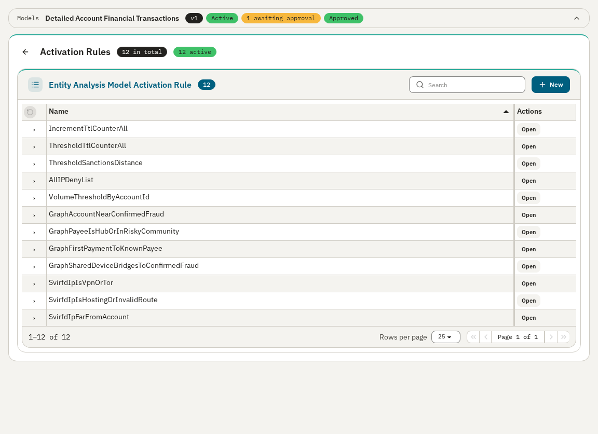
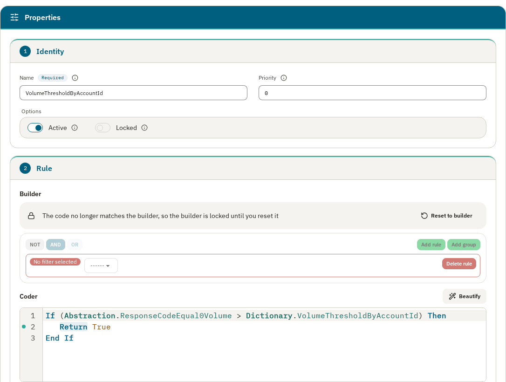

# Basic Activation Rules

Hitherto all processing has served to create an abundance of data surrounding the processing of an event or transaction through the model, yet no tangible action has been taken. For example, in a transaction fraud prevention platform the requirement might be to decline a transaction if volume exceeds a certain threshold.

Activation Rules exist to take that action. An Activation Rule is a VB.net code fragment that will be compiled into the engine. Activation Rules accept the collection data objects created thus far and test the code fragment for equality, returning a boolean flag to that effect, and upon a match the consequences configured for the rule (a Response Elevation, a Case, the incrementing of a TTL Counter) follow.

## Where it lives

Navigate through the menu to Models, open the model, then the Activation Rules hub card. Creating, changing, approving and deleting an Activation Rule follows the common manner described in [Child Objects](../../../Navigation/ChildObjects/index.html).

SHOT id=models-basic-activation-rules-list
     route=/models
     steps=open-default-model, open-hub:Activation Rules
     frame=page
     state=the default model with the Activation Rules hub open, the heading counting the rules in total and those active, and the list beneath showing the twelve Activation Rules of the model by name, one to a row, each with an Open action
     conveys=the Activation Rules of a model are kept as a list under the model, from which any one rule is opened
     alt=The Activation Rules list of the default model, headed by badges counting the rules in total and those active, with the twelve rules listed by name one to a row



Beneath the rule itself, an Activation Rule carries a panel titled Rule tools, offering Backtest (see [Backtest](../Backtest/index.html)), Dependencies and Integrity (see [Model Integrity](../ModelIntegrity/index.html)) for the rule in hand.

SHOT id=models-basic-activation-rules-record
     route=/models
     steps=open-default-model, open-hub:Activation Rules, open-row:VolumeThresholdByAccountId
     frame=record
     state=an Activation Rule of the default model opened, showing the Identity group with its Priority, the Rule group with a condition in the Builder, and the Override, Case Workflow and Response Elevation groups beneath
     conveys=an Activation Rule is a rule to match, followed by groups for each consequence of a match
     alt=An Activation Rule opened beneath its model, showing the rule Builder with one condition and the groups for Override, Case Workflow and Response Elevation



## The rule

The rule is written in the Builder or the Coder, as described in [Rule and Code Builder](../../../Navigation/RuleBuilderAndCoder/index.html). The Rule and Code Constructor comprises the following data objects:

| Value | Description |
|-------|-------------|
| Payload | The fields created in the Request XPath page, Inline Function and Inline Script (if registered). |
| TTL Counters | The TTL Counters and their current incremented values. |
| Abstraction | The fields created in the Abstraction Rules page. |
| Adaptation | The Adaptations created in the Adaptations page, Http Adaptations or Exhaustive Adaptations. |
| Abstraction Calculation | The Abstraction Calculations created in the Abstraction Calculations page. |
| Sanctions | The Sanctions match distance for the multi part string evaluated in real time, documented later in this document. |
| Dictionary | The lookups against the dictionary KVP. |
| Activation | For the purpose of Activation Rule Chaining, a Priority field specifies the ordering of Activation Rule evaluations. Activations makes Activation Rule match dispositions available to downstream Activation Rule evaluation given immediate availability in the invocation context. |

## Fields

The form is arranged in the groups Identity, Rule, Override, Case Workflow, Response Elevation, TTL Counter (collapsed), Output and Sampling, Activity (collapsed) and Audit (collapsed). Fields that are subject to a switch are presented only where that switch is on.

| Value | Description | Example |
|-------|-------------|---------|
| Name | The name of the Activation Rule, by which it appears in the response payload and by which later Activation Rules refer to it. | Volume1DayUSDForIPOver100 |
| Active | Whether the Activation Rule is taken up by the engine. Active is off for a new Activation Rule and must be switched on. | True |
| Locked | Whether the Activation Rule is protected from change. | False |
| Priority | The order of evaluation for Activation Rules for the purpose of Activation Rule Chaining given the availability of Activation Rule Match in the invocation context, and as set out above. | 0 |
| Enable override | A flag indicating whether this rule may be overridden at all. A rule without it is never suppressed and never forced, whatever overrides exist against the payload. See [Activation Rules Override](../ActivationRulesOverride/index.html). | False |
| Enable force | Subject to Enable override being set, a flag indicating whether this rule may additionally be forced rather than only suppressed. Forcing treats the rule as matched without evaluating it, so its consequences fire. | False |
| Override key | Subject to Enable override being set, the single Request XPath whose values may override this rule. Left empty, any override enabled key may override it. A rule that would need to answer to two keys is two rules. | Empty |
| Cases | A flag that indicates if a Case is to be created as a consequence of this Activation Rule matching. | True |
| Case workflow | Subject to Cases being enabled, the Case Workflow that the new case will be assigned to. | Fraud Management |
| Case workflow status | Subject to Cases being enabled, the Case Workflow Status, rolling up to the Case Workflow, that the new case will be assigned to. | First Line Defence |
| Case key | The case key and case key value to be used in creating the case, for example, Account ID. | AccountId |
| Enable bypass | Subject to Cases being enabled, a flag that indicates if a sample of the cases created is to be set to a Bypass Suspend status rather than progressing normally. | False |
| Bypass suspend sample | The percentage of activations to be set to a Bypass Suspend status on case creation. | 0% (all cases) |
| Bypass suspend interval | The interval type for the purposes of setting the date that any case creation should move from Suspend Bypass to Closed, being Minutes, Hours, Days or Months. | Hours |
| Bypass suspend value | The interval value for the purposes of setting the date that any case creation as Suspend Bypass should move to closed. | 1 |
| Enable response elevation | A flag to indicate that the Response Elevation value should be raised, alongside other outbound communication messages. | True |
| Response elevation | The upwardly moving numeric value to be reported in the response payload such that a consolidated response (transaction decline) can be inferred. It is picked by the name of an active [Response Elevation Range](../ResponseElevationRanges/index.html) of the model, inside which it must fall, otherwise the elevation is not sent out. | 9 |
| Response elevation content | A free text string to provide content detailing the Activation Rule. For example, this might be the error message to be served to the customer in an online fraud prevention implementation. | There has been an error. Please contact customer services. |
| Response elevation redirect | A url to redirect the user or advertising exchange to on this Activation Rule having matched. | https://www.jube.io |
| Send to activation watcher | A flag that indicates if this Activation Rule match should tick out a message to the [Activation Watcher](../ActivationWatcher/index.html). This flag is used in conjunction with a model configuration that specifies a sample to be taken so not to flood the Activation Watcher in high throughput implementations. | True |
| Response elevation key | The identifier value to accompany the message to the Activation Watcher. | AccountId |
| Response elevation fore color | The fore colour to send to the Activation Watcher and response payload, selected via a colour picker, returning hex. | #0000FF |
| Response elevation back color | The back colour to send to the Activation Watcher and response payload, selected via a colour picker, returning hex. | #FF0000 |
| Increment TTL counter | A flag indicating that TTL Counter incrementation should occur. See [TTL Counter Activation Rule Incrementation](../TTLCounterActivationRuleIncrementation/index.html). | True |
| Model | The model containing the TTL Counter to increment. | Non Monetary Events |
| TTL counter | The TTL Counter to be incremented as configured for the model selected. | Count Of Cross Border |
| Activation sample | A percentage value, between 0 and 1, detailing the sample that should be allowed for Activation. The sample will only be taken in the event that the Rule returns as true. For example, if the Activation Sample is set to 20%, it would imply that only 20% of the matching transactions will be persisted to the database. It is extremely useful where there is a large volume of transactions or events, yet it is not practical for each transaction or event to be reviewed, hence a representative sample of the large universe is adequate. | 20% |
| Visible | A flag to indicate if the occurrence of the rule match is to be displayed in the Case Management system. In some cases, especially when incrementing TTL Counters, it is not required that the activation be visible. Visible is on for a new Activation Rule. | False |
| Shadow | A flag that runs the Activation Rule in shadow mode: it is evaluated and every match is recorded, but a match has no effect. See Shadow Mode below. | False |
| Enable reprocessing | A flag to indicate if this Activation Rule should be subject and visible to a reprocessing job. | False |
| Archive Key | Whether every match of the Activation Rule is promoted for the purposes of reporting, as described in [Report Table](../../../Navigation/ReportTable/index.html). | False |
| Response payload | Whether a match on the Activation Rule is returned in the response to the transaction, as described in [Response Payload](../../../Navigation/ResponsePayload/index.html). | True |
| Evaluation counter | The number of transactions or events tested against the Activation Rule. Shown for information in the Activity group. | 1200 |
| Activation counter | The number of matches of the Activation Rule, with the Activation counter date being that of the most recent. Shown for information in the Activity group. | 14 |

A new Activation Rule is presented with a Priority of 0, an Activation sample of 100%, Visible on, and every other switch off, being Active, Enable override, Enable force, Cases, Enable response elevation, Increment TTL counter, Shadow, Enable reprocessing, Archive Key and Response payload. It follows that a rule created with nothing but its Name and its rule matches, once made Active and approved, yet has no consequence beyond being recorded, and is not named in the response until Response payload is switched on. Upon Enable bypass being switched on, the Bypass suspend sample starts at 0, the Bypass suspend interval at Hours and the Bypass suspend value at 0.

The fields subject to a switch behave in one of two ways. Those of the Case Workflow, Response Elevation and TTL Counter groups are not presented at all until their switch is on, the Response elevation key and the two colours requiring Send to activation watcher to be on in addition. Those of the Override group, being Enable force and Override key, are always presented, yet cannot be altered until Enable override is on. Case workflow status is chosen from the statuses of the Case workflow selected and is emptied upon the Case workflow being changed, and TTL counter likewise follows Model.

In reading the Activity group, the Evaluation counter is the number of times the rule has been tested and the Activation counter the number of times it has matched, such that the one divided by the other is the rate at which the rule fires. A rule whose Activation counter remains at 0 while its Evaluation counter climbs has never matched, and a rule whose Evaluation counter remains at 0 is not being run by the engine, which is to say that it is inactive, awaiting approval, or belongs to a model that is not receiving transactions.

The evaluation, activation and forced activation counters are owned by the server, which is to say that a save from the form or through the API never changes them.

Two fields formerly in this form are no longer present:

* The Activation Rule Review Status, whereby only the Approved By Review status allowed the rule to be activated, has been retired alongside its permission. The purpose it served, "Maker Checker", is now accomplished for every child object by approval, as described in [Maker Checker](../../../Concepts/MakerChecker/index.html), in that a rule can be constructed, yet is not taken up by the engine until approved by a second user.
* The Notification fields have been removed from the Activation Rule, and are configured on a Response Elevation Range instead, as described in [Activation Rule Notifications](../ActivationRuleNotifications/index.html).

## Validation

An Activation Rule is validated in the server, and is rejected where:

* The Name is empty, longer than 256 characters, or already in use by another Activation Rule of the Model, without regard to case.
* The rule script of the surface selected, whether Builder or Coder, is empty, is longer than 65,536 characters, or does not compile.
* The Priority is negative, returning "The priority cannot be negative."
* Cases is on and a Case workflow, a Case workflow status or a Case key is not given, or the Case key is longer than 512 characters.
* Cases is on and the Case workflow status does not belong to a Case Workflow of the same Model, returning "The Case Workflow Status was not found in a Case Workflow of the selected Model."
* Enable bypass is on and the Bypass suspend sample is not between 0 and 1, the Bypass suspend interval is not one of Minutes, Hours, Days or Months, or the Bypass suspend value is negative.
* Enable response elevation is on and the Response elevation is negative, or does not fall inside an active range, returning "The response elevation must fall inside an active Response Elevation Range of the Model."
* The Response elevation content is longer than 65,536 characters, or the Response elevation redirect is longer than 512 characters.
* Send to activation watcher is on and the Response elevation key is not given, or the fore or back colour is not given or is not a valid colour.
* Increment TTL counter is on and a Model or a TTL counter is not given, or the TTL Counter does not exist in the Model selected, in the same tenant, returning "The TTL Counter to increment was not found in the selected Model."
* The Activation sample is not between 0 and 1.
* The Model does not exist in the tenant of the caller, or has been deleted.

Each failure is written beneath the field it relates to and counted in the summary at the head of the form, as described in [Child Objects](../../../Navigation/ChildObjects/index.html), with the messages as follows:

| Field                         | Message                                                                                             |
|-------------------------------|-----------------------------------------------------------------------------------------------------|
| Name                          | A name is required. The name must be 256 characters or fewer. This name already exists.             |
| Rule (Builder)                | A rule script is required. The rule script must be 65536 characters or fewer. A rule builder definition is required. The rule builder definition must be valid JSON of no more than 1 MB. |
| Rule (Coder)                  | A Coder rule script is required. The Coder rule script must be 65536 characters or fewer.           |
| Priority                      | The priority cannot be negative.                                                                    |
| Case workflow                 | A Case Workflow is required when Cases is enabled.                                                  |
| Case workflow status          | A Case Workflow Status is required when Cases is enabled. The Case Workflow Status was not found in a Case Workflow of the selected Model. |
| Case key                      | A Case Key is required when Cases is enabled. The Case Key must be 512 characters or fewer.         |
| Bypass suspend sample         | The bypass suspend sample must be between 0 and 1.                                                  |
| Bypass suspend interval       | The bypass suspend interval must be Minutes, Hours, Days or Months.                                 |
| Bypass suspend value          | The bypass suspend value cannot be negative.                                                        |
| Response elevation            | The response elevation cannot be negative. The response elevation must fall inside an active Response Elevation Range of the Model. |
| Response elevation content    | The response elevation content must be 65536 characters or fewer.                                   |
| Response elevation redirect   | The response elevation redirect must be 512 characters or fewer.                                    |
| Response elevation key        | A response elevation key is required when sending to the Activation Watcher.                        |
| Response elevation fore color | A fore colour is required when sending to the Activation Watcher. The fore colour must be a hex value, for example #0000FF. |
| Response elevation back color | A back colour is required when sending to the Activation Watcher. The back colour must be a hex value, for example #FF0000. |
| Model                         | A Model is required when Increment TTL Counter is enabled.                                          |
| TTL counter                   | A TTL Counter is required when Increment TTL Counter is enabled. The TTL Counter to increment was not found in the selected Model. |
| Activation sample             | The activation sample must be between 0 and 1.                                                      |

An Activation Rule cannot be moved to another Model by an edit, as the Model of an existing rule is kept whatever is submitted. An Activation Rule that a later Activation Rule names in its text, through `Activation`, cannot be deleted while it is so used, as described under Deleting an entity that is in use in [Child Objects](../../../Navigation/ChildObjects/index.html).

## Example

In the following example, a very simple Activation Rule will be created that will not drive Case Creation, Notifications or Response Elevation or TTL Counters, and will have only a reference in the response payload JSON.

Taking the above parameters partially, a rule is created that seeks to target the Abstraction Rule Volume1DayUSDForIP to be over 100:

| Value | Example |
|-------|---------|
| Name | Volume1DayUSDForIPOver100 |
| Active | True |
| Rule (Builder) | Abstraction.Volume1DayUSDForIP, greater, 100 |
| Enable override | True |
| Cases | False |
| Enable response elevation | False |
| Increment TTL counter | False |
| Activation sample | 100% |
| Visible | True |
| Enable reprocessing | True |
| Archive Key | False |
| Response payload | True |

Upon the Activation Rule being approved, and taken up by the engine at its next cycle, repeating the HTTP POST to the endpoint [https://localhost:5001/api/invoke/EntityAnalysisModel/90c425fd-101a-420b-91d1-cb7a24a969cc](https://localhost:5001/api/invoke/EntityAnalysisModel/90c425fd-101a-420b-91d1-cb7a24a969cc) returns the activation element of the response as follows:

```json
"activation": {
  "IncrementTtlCounterAll": {
    "visible": false
  },
  "ThresholdTtlCounterAll": {
    "visible": true
  },
  "ThresholdSanctionsDistance": {
    "visible": true
  },
  "VolumeThresholdByAccountId": {
    "visible": true
  },
  "Volume1DayUSDForIPOver100": {
    "visible": true
  }
}
```

It can be seen from the response JSON that an Activation entry has been created, showing the rule to have matched. Activations will only be added in the event that there is a match, whereas most of the other abstractions that take place in model invocation will always return a value. Notice that the visible flag next to the Activation Rule entry follows the Visible flag of the rule: the IncrementTtlCounterAll rule of the default model has Visible off, hence visible is false, and that activation will not be displayed in the Case Key Journal of the Case Management pages (the event will, but the activation not).

## Shadow Mode

A new or retuned Activation Rule can be run against live traffic without consequence by setting Shadow. The rule is evaluated for every transaction exactly as a live rule would be, and each match is recorded in the archived payload under `shadowActivation`, but a match has none of the effects of a live match:

* No Response Elevation, hold, Notification or webhook.
* No Case is created.
* No TTL Counter is incremented and nothing is sent to the Activation Watcher.
* The rule does not appear under `activation` in the response payload, does not count towards the activation count, never becomes the prevailing rule and cannot be chained into by later rules that test `Activation`.
* No Archive Key is written for it.

A shadow match is shown in the [Case Key Journal](../../CaseManagement/WorkingCaseKeyJournal/index.html) marked as Shadow, beside Forced, on the Rules lens, the activation cards and the What fired drawer. Overrides (suppress or force) are not applied to the recorded matches of a shadow rule.

To promote the rule, Shadow is switched off and the change approved in the usual way, such that the rule is live from the next synchronisation. To retire it, the rule is deactivated.

The archive already holds everything needed to judge a shadow rule. For example, the matches per day of a shadow rule named `HighAmount`, and how many belonged to a case key whose case was confirmed, can be read with the AskJooby SQL tool or the Visualisation registry from the Archive table using `"Json" -> 'shadowActivation' ? 'HighAmount'` as the predicate and the case key of the model as the join to the Case table. There is at present no report page for shadow rules, henceforth the report is a query.

## Permissions and security

Reading and writing Activation Rules requires permission 17, Read Write Activation Rule. A user without it receives 403, and an unauthenticated request receives 401. Every mutation also needs the antiforgery token for cookie sessions. Activation Rules are scoped to the tenant of the caller through the parent Model.

Permission 41, which formerly governed the Activation Rule Review Status under the name Allow Approved By Review, is retired and has no effect, and is named Retired - no effect (the Activation Rule Review Status is retired).
