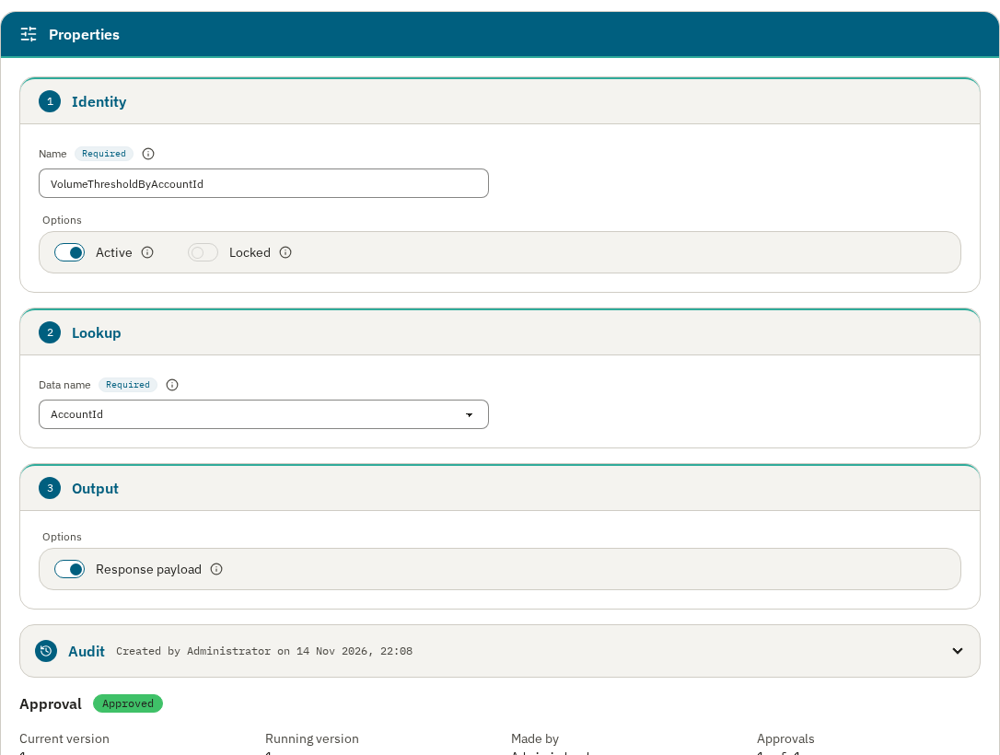
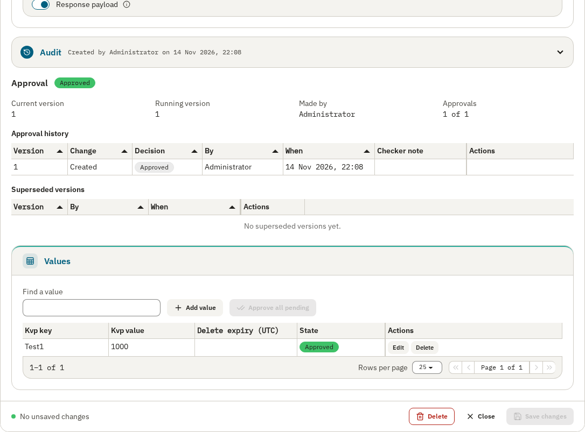

# Dictionary

Dictionary is similar to List functionality, except, rather than allow only exist matching on a string value, they pair a key from the payload in model invocation, and return a value. Dictionary is a good way to enrich payload data with small amounts of external data without relying on Inline scripts or complex integrations.

The main advantage of Dictionary is that they can be added from the user interface one by one, or in bulk from a CSV text file through the API, which affords the end user the ability to create these lookups without any technical intervention (it can also be added via the database table).

## Where it lives

Navigate through the menu to Models, open the model, then the Dictionary hub card. Creating, changing, approving and deleting a Dictionary follows the common manner described in [Child Objects](../../../Navigation/ChildObjects/index.html).

Dictionary is no longer an item in the main menu. As with [Lists](../Lists/index.html), the delegating of this otherwise administrative function to customer service orientated roles is retained by permission instead: a role granted only permission 4, Read Write Dictionary, is presented with the Models menu item and can maintain Dictionaries.

## Behaviour

Dictionary are populated during model synchronisation and stored in the memory of the engine, to afford extremely fast lookups in real-time. It follows that it is not especially well suited for very large datasets, but it should capably handle a few hundred thousand entries without any noticeable degradation in performance. It follows that the Dictionary are available for lookup by key in the memory of the application.

During processing, for each Dictionary of the model, the following process takes place:

* For the Dictionary, there will be a field name specified that will serve as the key for the lookup. The first step is to ensure that the data key name specified exists in the payload being processed. In the event that the data name is not available in the payload, an INFO message will be written to the logs while the value will be set as zero and added to a separate collection. For a key to be looked up in the dictionary the key value must be in the transaction or event (although it might have come from an Inline Script or Inline Function as well as the Payload).
* Having established that a value exists for the key, the value of that key is extracted from the payload in process.
* Using the key value extracted from the payload, the key value is used to lookup against a dictionary of all key values for this Dictionary. Firstly, the existence of the key inside the Dictionary is checked, where if the key does not exist, the value is evaluated as zero, else, the value for that key from the Dictionary values is returned.

There will always be a value added to the payload, even if it is zero in the case of a match not being made.

## Fields

| Value            | Description                                                                                                                                                                                 | Example     |
|------------------|---------------------------------------------------------------------------------------------------------------------------------------------------------------------------------------------|-------------|
| Name             | The name of the Dictionary, by which rules refer to it. Required, limited to 256 characters, and unique within the Model without regard to case.                                            | CreditLimit |
| Active           | Whether the Dictionary is available for lookup during model invocation. Active is off for a new Dictionary and must be switched on.                                                         | True        |
| Locked           | Whether the Dictionary is protected from change.                                                                                                                                            | False       |
| Data name        | The field from the data payload to pair to the Dictionary during model invocation, for the purpose of looking for a value from the key. Required, limited to 256 characters, and selected from the fields of the model. | AccountId   |
| Response payload | Whether the value looked up is returned in the Dictionary element of the response, as described in [Response Payload](../../../Navigation/ResponsePayload/index.html). Off by default.      | True        |

As rules refer to a Dictionary as `Dictionary.Name`, a name without spaces is advised.

SHOT id=models-dictionaries-record
     route=/models
     steps=open-default-model, open-hub:Dictionary, open-first-row
     frame=record
     state=the VolumeThresholdByAccountId Dictionary of the default model opened at its Properties form, showing the Identity group with the name and the Active and Locked switches, the Lookup group with the Data name, and the Output group with Response payload
     conveys=a Dictionary is a short record, a name, the payload field it is looked up by and whether the value is returned, the pairs being kept beneath it
     alt=The Properties form of a Dictionary record showing its Identity group with the name, its Lookup group with the Data name and its Output group with Response payload



## Key Value Pairs

The Key Value Pairs of a Dictionary are maintained in the Values panel, which is presented once the Dictionary has been created and is open.

SHOT id=models-dictionaries-values
     route=/models
     steps=open-default-model, open-hub:Dictionary, open-first-row, scroll-to:Values
     frame=record
     state=a Dictionary of the default model opened, with the Values panel showing several Key Value Pairs in differing states: approved, awaiting approval and one with a Delete expiry
     conveys=each key is paired with a numeric value in a grid beneath the Dictionary, and each pair carries its own approval state
     alt=A Dictionary opened beneath its model with the Values panel listing each key alongside its value, delete expiry, state, approvals and actions



The panel has a box to find a value, an Add value button, and Approve all pending. Pairs are shown 25 to a page, with the following columns:

| Column              | Description                                                                                                              |
|---------------------|--------------------------------------------------------------------------------------------------------------------------|
| Kvp key             | The Key, being the value that will be matched with the payload. Required, and limited to 256 characters.                 |
| Kvp value           | The Value, being a number, that will be returned for availability to further processing. Required, although zero is an accepted Value (it is not treated as an empty entry). |
| Delete expiry (UTC) | The date and time at which the pair expires, if any.                                                                     |
| State               | Approved, Awaiting approval, Deletion awaiting approval, Rejected or Deletion rejected.                                  |
| Approvals           | The approvals recorded against the number required.                                                                      |
| Made by             | The user having made the change.                                                                                         |
| Checker note        | The note given by the checker upon approving or rejecting.                                                               |
| Return note         | The note given by the maker upon resubmitting or retracting.                                                             |
| Actions             | Edit and Delete, and for the purposes of approval, Approve, Reject, Resubmit and Retract.                                |

Pairs are added and edited in the row itself, committing with Save or abandoning with Cancel. The updating and deletion of a Key Value Pair follows the same process as if it were a List Value: deleting seeks confirmation under the heading Delete this value?, and the pair thereafter stays listed as a pending deletion until a checker approves it. The controls of the panel, the notices they return and the states in which the panel may be found are those of the Values panel of a List, as described in [Lists](../Lists/index.html), the one difference being that Kvp value must be a number, failing which the head of the panel states that Kvp value must be a number and nothing is sent.

The clean installation carries the Dictionary VolumeThresholdByAccountId in the default model, keyed upon AccountId, by which the panel may be followed. It holds the pairs ACC-441 with 5000, ACC-02 with 20000, ACC-778 with 2500 and ACC-915 with 2500, each Approved, and CASH-BRANCH-07 with 50000, which is Awaiting approval. It follows that a transaction for the account ACC-441 is given `Dictionary.VolumeThresholdByAccountId` as 5000, that a transaction for an account not in the Dictionary is given 0, and that a transaction for CASH-BRANCH-07 is likewise given 0 until the pair has been approved by a second user. In reading the value, 0 is therefore to be taken as either a pair whose value is 0 or the absence of a pair, the two not being distinguishable in a rule.

### Delete Expiry Date

A Key Value Pair may optionally be given a Delete Expiry Date. It is entered in the local time of the browser and stored as UTC.

As with Lists, Delete Expiry Date has the same effect as deleting the Key Value Pair: once the date and time entered is reached, the pair is automatically excluded from lookups and from the grid, without an explicit delete ever being actioned. Leaving Delete Expiry Date blank, which is the default, means the pair never expires and will need to be removed manually if it is to stop being available. The date and time entered must be in the future.

### Validation

A Key Value Pair is validated in the server, and is rejected where:

* The Key is empty.
* The Key is longer than 256 characters.
* The Value is empty, or is not a number.
* The Delete Expiry Date is not in the future.
* The Key already exists in the Dictionary.

On rejection the reason is displayed above the grid, and the entry remains open for editing so that it can be corrected. The reasons given are: Please enter a key for this dictionary., The key must be 256 characters or fewer., Please enter a value for this dictionary., Delete Expiry Date must be greater than the current date and time., and This key already exists in the dictionary.

A Dictionary itself is validated upon Create and Save changes, the Name being refused with A name is required., The name must be 256 characters or fewer. or This name already exists., and the Data name with A data name is required. or The data name must be 256 characters or fewer. A new Dictionary is presented with Active and Response payload off. A Dictionary named in the text of a rule cannot be deleted while it is so used, as described under Deleting an entity that is in use in [Child Objects](../../../Navigation/ChildObjects/index.html).

A Key must be unique within its Dictionary. Matching is case-sensitive and exact, consistent with how the Dictionary is looked up at run time. A Key is still considered to exist, and so still blocks a duplicate, for as long as its own deletion is sitting with a checker awaiting approval, or was rejected and has not yet been retracted or resubmitted by the maker: in both cases the rule engine continues to treat the pair as live until the deletion is actually approved, so the same Key cannot be re-added in the meantime. Once a deletion is approved, the same Key may be added again like any other new entry.

## Approval and synchronisation

Like Lists, the Dictionary does not require explicit synchronisation, happening perpetually on every pass of model synchronisation (every ten seconds by default, as set by the ModelSynchronisationWait Environment Variable).

The engine takes up only what has been approved, as described in [Maker Checker](../../../Concepts/MakerChecker/index.html). It follows that the Dictionary and its Key Value Pairs will be available for model invocation almost straight away upon being approved, and not before, and that a pair whose deletion is awaiting approval continues to be looked up until the deletion is approved.

Approve all pending approves every pair awaiting approval in the Dictionary in one action, for a checker having many pairs to pass.

## Uploading Key Value Pairs

Key Value Pairs can be loaded in bulk from a CSV file through the API, by a multipart POST of the file to `/api/EntityAnalysisModelDictionaryCsvFileUpload/{dictionaryId}`.

TODO(verify): the Vue user interface has no control to upload a CSV file to a Dictionary (no component calls EntityAnalysisModelDictionaryCsvFileUpload), and the Download CSV Template link was removed with the Razor pages. Owner to decide whether the upload control is to be restored; this section then needs the name of the control.

There is no column header in the file. Each line follows the format Key,Value, optionally followed by a comma and a Delete Expiry Date. The Delete Expiry Date must be in .NET's round-trip ("O") format, which is enforced strictly, with no other date format accepted, to avoid the day/month ambiguity inherent in free-form date parsing of a text file. For example, a Key Value Pair with no expiry and one with a Delete Expiry Date:

```
Test1,123456.78
Test2,5000,2027-01-01T00:00:00.0000000Z
```

Where the Delete Expiry Date column is omitted or left blank on a new Key Value Pair, it never expires. Where an existing Key Value Pair is updated by the upload and the Delete Expiry Date column is omitted altogether (rather than present but blank), its existing Delete Expiry Date is left unchanged.

A line whose key is empty, longer than 256 characters or contains a control character, or whose Delete Expiry Date is not in that format, is logged and skipped, and the remaining lines are still imported, which is to say that the import is not atomic. The cells of the file are stored as data whatever they contain, including text that starts with `=`, `+`, `-` or `@`.

In the event of a conflict on the key the pair is updated, otherwise it is inserted, subject to the uniqueness and pending deletion rules described above. If the Key, Value and Delete Expiry Date (where the column is present) of an uploaded line all already match an existing entry exactly, nothing is written for that line and no new approval cycle is opened, so repeatedly uploading the same file is harmless. If the Key matches an entry that is still awaiting approval of its own deletion, or was rejected and has not yet been retracted or resubmitted by the maker, the line is skipped rather than inserted as a new entry, as the Key is still considered to exist until that deletion is actually approved.

## Example

A Dictionary arrangement is created to pair an AccountId (from the transaction payload) with a Credit Limit (stored in the Key Value Pair collection of the Dictionary). The Dictionary is named CreditLimit, with a Data name of AccountId, Response payload switched on, and a single Key Value Pair having a Key of Test1 and a Value of 123456.78.

Keeping in mind that explicit synchronisation is not required, and upon the Dictionary and the pair being approved, make an HTTP POST to the model with the example JSON, where the AccountId is Test1, as provided in `Http/Transaction.http`:

```http
POST https://localhost:5001/api/invoke/EntityAnalysisModel/90c425fd-101a-420b-91d1-cb7a24a969cc
Content-Type: application/json
X-API-KEY: <an API key>
```

The value is returned in the Dictionary element of the response, abbreviated here:

```json
{
  "EntityAnalysisModelInstanceEntryGuid": "...",
  "ResponseElevation": { },
  "Dictionary": {
    "CreditLimit": 123456.78
  }
}
```

TODO(verify): replace the abbreviated response above with one captured from a running system

Keep in mind that the AccountId in the POST body was of key Test1, and the value of 123456.78 has been returned by matching during processing. The value is henceforth available to rules as `Dictionary.CreditLimit`, as in the Coder:

```vb
If (Payload.CurrencyAmount > Dictionary.CreditLimit) Then
  Return True
End If
```

## Permissions and security

Reading and writing Dictionaries and Key Value Pairs, including the upload of a CSV file, requires permission 4, Read Write Dictionary. A user without it receives 403, and an unauthenticated request receives 401. Every mutation also needs the antiforgery token for cookie sessions.

Dictionaries and their Key Value Pairs are scoped to the tenant of the caller through the parent Model, such that a foreign Dictionary id behaves like a missing one. CSV cells are stored as data (formula and markup keys included), never executed, and file names are sanitised and never used as paths.
