# Dictionary

Dictionary is similar to List functionality, except, rather than allow only exist matching on a string value, they pair
a key from the payload in model invocation, and return a value. Dictionary is a good way to enrich payload data with
small amounts of external data without relying on Inline scripts or complex integrations.

The main advantage of Dictionary is that they can be added from the user interface one by one or as part of a CSV text
file upload, which affords the end use the ability to create these lookups without any technical intervention (it can
also be added via the database table or API).

Dictionary are populated during model synchronisation and stored in the engines memory, to afford extremely fast lookups
in real-time. It follows that it is not especially well suited for very large datasets, but it should capably handle a
few hundred thousand entries without any noticeable degradation in performance. It follows that the Dictionary are
available for lookup by key in the applications memory.

During processing For each Dictionary KVP for the model, the following process takes place:

* For the Dictionary KVP entry, there will be a field name specified that will serve as the key for the lookup. The
  first step is to ensure that the data key name specified exists in the payload being processed. In the event that the
  data name is not available in the payload, an INFO message will be written to the logs while the value will be set as
  zero and added to a separate collection). For a key to be looked up in the dictionary the key value must be in the
  transaction or event (although it might have come from an Inline Script, Function as well as the Payload).
* Having established that a value exists for the key, the value of that key is extracted from the payload in process.
* Using the key value extracted from the payload, the key value is used to lookup against a dictionary of all key values
  for this Dictionary. Firstly, the existence of the key inside the Dictionary is checked, where if the key does not
  exist, the value is evaluated as zero, else, the value for that key from the Dictionary values is returned.

There will always be a value added to the payload, even if it is zero in the case of a match not being made.

For example, a Dictionary arrangement will be created that will pair an AccountID (from the transaction payload) with a
Credit Limit (stored in the Key Value Pair collection of the Dictionary).

Like Lists, the Dictionary does not require explicit synchronisation, happening perpetually. It follows that the
Dictionary and KVP value pairs will be available for model invocation almost straight away.

Navigate to the Dictionary page from the main menu:

<!-- TODO(screenshot): file=model-references-dictionary-in-menu-header.png route=/models/references/dictionaries state="replace the Razor-era image DictionaryInMenuHeader.png with the Vue UI showing the same step" -->
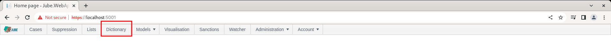

Click on the tree node in the top left hand corner of the screen to create a new Dictionary collection definition:

<!-- TODO(screenshot): file=model-references-empty-dictionary-definition.png route=/models/references/dictionaries state="replace the Razor-era image EmptyDictionaryDefinition.png with the Vue UI showing the same step" -->
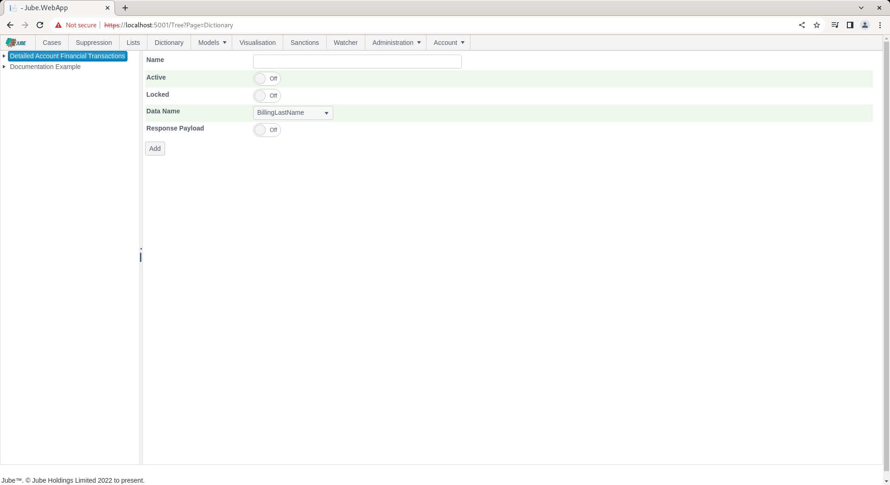

The Dictionary has the following properties:

| Value  | Description                                                                                                                         |
|--------|-------------------------------------------------------------------------------------------------------------------------------------|
| Lookup | The field from the data payload to pair to Dictionary during model invocation, for the purpose of looking for a value from the key. |

The Dictionary name is required and limited to 256 characters, and must be unique within the Model. The Lookup field
name is likewise required and limited to 256 characters.

The Key on a Key Value Pair is likewise required and limited to 256 characters. The Value is required, but zero is an
accepted Value (it is not treated as an empty entry).

Complete the page with the details as above or as below:

<!-- TODO(screenshot): file=model-references-template-values-for-dictionary-definition.png route=/models/references/dictionaries state="replace the Razor-era image TemplateValuesForDictionaryDefinition.png with the Vue UI showing the same step" -->
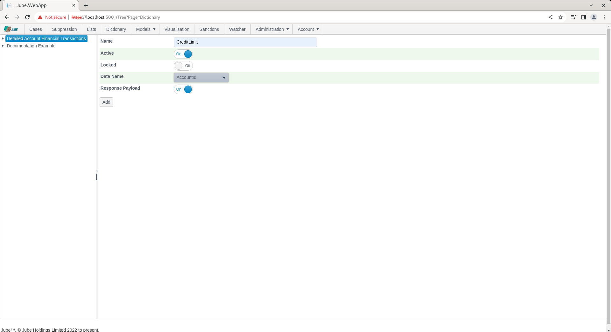

Click Add to create the container for the Key Value Pairs:

<!-- TODO(screenshot): file=model-references-added-dictionary-definition-for-key-value-pairs.png route=/models/references/dictionaries state="replace the Razor-era image AddedDictionaryDefinitionForKeyValuePairs.png with the Vue UI showing the same step" -->
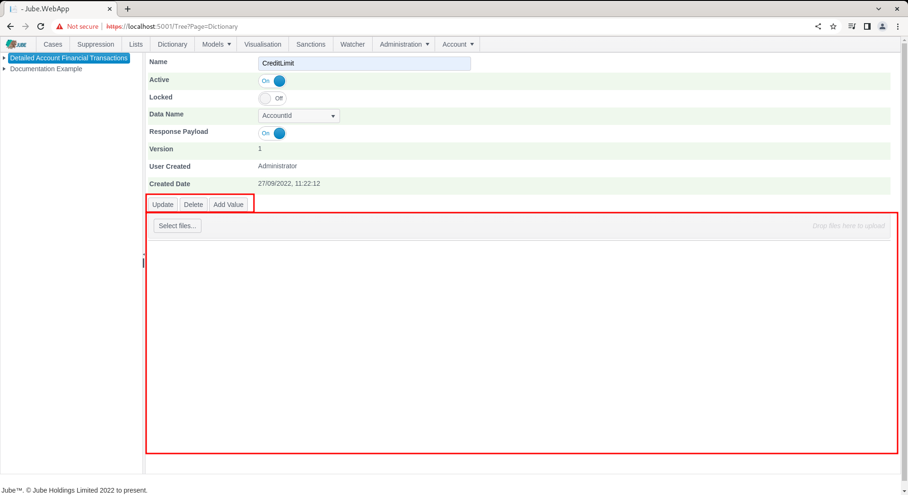

Locate the the Add Value button:

<!-- TODO(screenshot): file=model-references-add-value-button.png route=/models/references/dictionaries state="replace the Razor-era image AddValueButton.png with the Vue UI showing the same step" -->
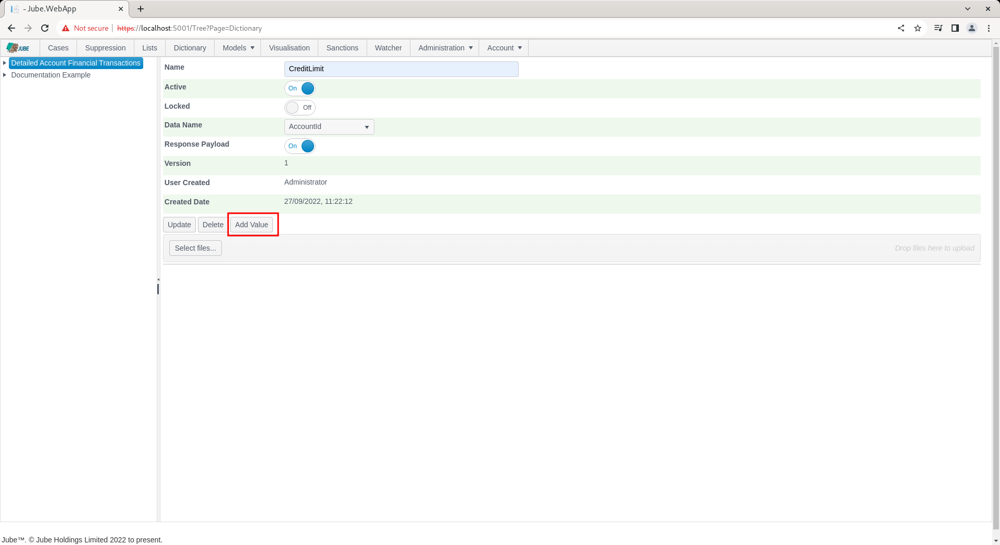

Click the Add Value button to expose the Key Value template:

<!-- TODO(screenshot): file=model-references-exposed-key-value-pair-template.png route=/models/references/dictionaries state="replace the Razor-era image ExposedKeyValuePairTemplate.png with the Vue UI showing the same step" -->
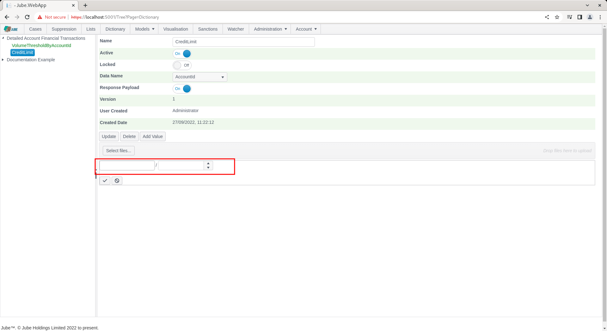

Upon clicking the Add Value button, the template for the creation of Key Value Pairs will be exposed. The left most
value is the Key. The Key is the value that will be matched with the payload, the value is what will be returned for
availability to further processing. Complete the Key with the AccountID value in the transaction payload (e.g. Test1):

<!-- TODO(screenshot): file=model-references-complete-key-template.png route=/models/references/dictionaries state="replace the Razor-era image CompleteKeyTemplate.png with the Vue UI showing the same step" -->
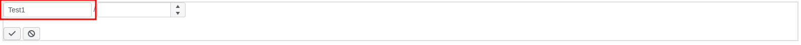

The right most value is the value that will be returned as a consequence of the lookup AccountID = Test1 (in this
example 123456.78). Complete the Value with 1234567.89, which will represent the Credit Limit being looked up for this
example:

<!-- TODO(screenshot): file=model-references-complete-value-template.png route=/models/references/dictionaries state="replace the Razor-era image CompleteValueTemplate.png with the Vue UI showing the same step" -->
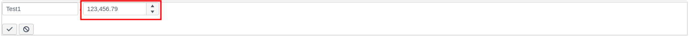

The Key Value Pair entry form also exposes an optional Delete Expiry Date field, using a date and time picker.

As with Lists, Delete Expiry Date has the same effect as deleting the Key Value Pair: once the date and time entered is
reached, the pair is automatically excluded from lookups and from the grid, without an explicit delete ever being
actioned. Leaving Delete Expiry Date blank, which is the default, means the pair never expires and will need to be
removed manually if it is to stop being available. The date and time entered must be in the future; an attempt to set a
value in the past is rejected by the server, with the reason displayed above the grid.

This applies to any field on the Key Value Pair entry, not only Delete Expiry Date: an empty Key or Value is likewise
rejected server-side. On rejection the entry is automatically re-opened for editing and highlighted in red, in addition
to the message shown above the grid, making it clear exactly which entry needs correcting.

A Key must be unique within its Dictionary: the server rejects an attempt to add a Key that already exists, exactly
as above. Matching is case-sensitive and exact, consistent with how the Dictionary is looked up at run time. A Key is
still considered to exist, and so still blocks a duplicate, for as long as its own deletion is sitting with a checker
awaiting approval, or was rejected and has not yet been retracted or resubmitted by the maker: in both cases the rule
engine continues to treat the pair as live until the deletion is actually approved, so the same Key cannot be re-added
in the meantime. Once a deletion is approved, the same Key may be added again like any other new entry.

Commit by clicking on the Tick icon:

<!-- TODO(screenshot): file=model-references-tick-confirm-button.png route=/models/references/dictionaries state="replace the Razor-era image TickConfirmButton.png with the Vue UI showing the same step" -->
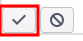

Or to cancel the creation of the Value click the opposing icon:

<!-- TODO(screenshot): file=model-references-circle-cancel-button.png route=/models/references/dictionaries state="replace the Razor-era image CircleCancelButton.png with the Vue UI showing the same step" -->

Upon the successful commit of the Key Value, it will appear updated:

<!-- TODO(screenshot): file=model-references-updated-key-value-pair-for-dictionary.png route=/models/references/dictionaries state="replace the Razor-era image UpdatedKeyValuePairForDictionary.png with the Vue UI showing the same step" -->
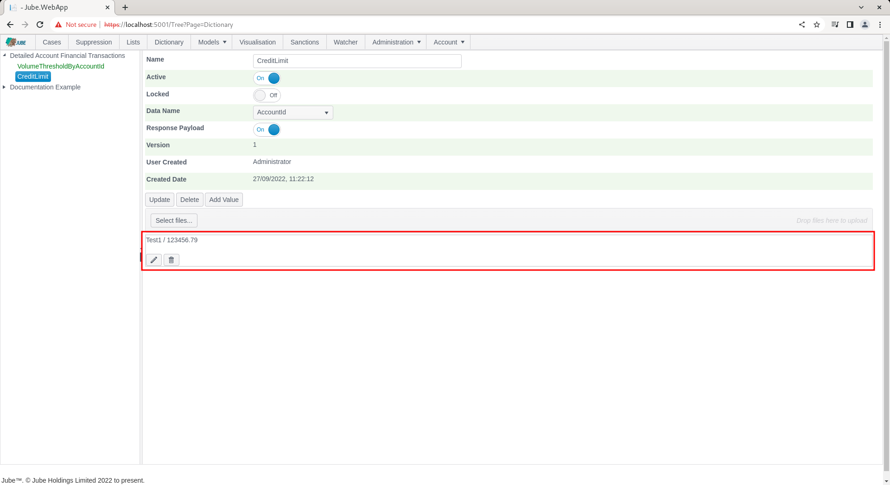

Keeping in mind that explicit synchronisation is not required, repeat the HTTP POST to
endpoint [https://localhost:5001/api/invoke/EntityAnalysisModel/90c425fd-101a-420b-91d1-cb7a24a969cc](https://localhost:5001/api/invoke/EntityAnalysisModel/90c425fd-101a-420b-91d1-cb7a24a969cc)
for response as follows:

<!-- TODO(screenshot): file=model-references-k-v-p-returned-in-response-payload.png route=/models/references/dictionaries state="replace the Razor-era image KVPReturnedInResponsePayload.png with the Vue UI showing the same step" -->
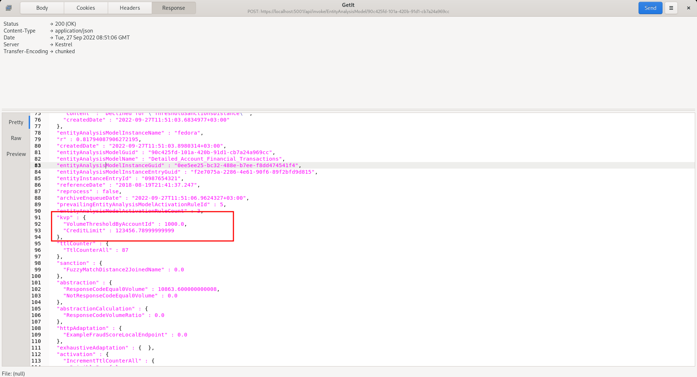

Keep in mind that the AccountId in the POST body was of key Test1, the value of 123456.789 has been returned by matching
during processing.

The updating and deletion of the Key Value pair follows the same process as it it were a List, documented beforehand.

It is also possible to upload a file of Key Value pair to the following specification given the downloadable template in
the page.

Each line follows the format Key,Value, optionally followed by a comma and a Delete Expiry Date. The Delete Expiry Date
must be in .NET's round-trip ("O") format, for example `2027-01-01T00:00:00.0000000Z` - this is enforced strictly, with
no other date format accepted, to avoid the day/month ambiguity inherent in free-form date parsing of a text file. Where
the Delete Expiry Date column is omitted or left blank on a new Key Value Pair, it never expires. Where an existing Key
Value Pair is updated by the upload and the Delete Expiry Date column is omitted altogether (rather than present but
blank), its existing Delete Expiry Date is left unchanged. A template CSV file, illustrating both a Key Value Pair with
no expiry and one with a Delete Expiry Date, can be downloaded directly from the Dictionary page using the Download CSV
Template link found next to the Select Files control.

A line whose key is empty, longer than 256 characters or contains a control character, or whose Delete Expiry Date is
not in that format, is logged and skipped, and the remaining lines are still imported: the import is not atomic. The
cells of the file are stored as data whatever they contain, including text that starts with `=`, `+`, `-` or `@`.

If an uploaded line's Key, Value and Delete Expiry Date (where the column is present) all already match an existing
entry exactly, nothing is written for that line and no new approval cycle is opened, so repeatedly uploading the same
file is harmless. If the Key matches an entry that is still awaiting approval of its own deletion, or was rejected and
has not yet been retracted or resubmitted by the maker, the line is skipped rather than inserted as a new entry: the
Key is still considered to exist until that deletion is actually approved.

The control to upload a file is the button Select Files:

<!-- TODO(screenshot): file=model-references-select-files-button.png route=/models/references/dictionaries state="replace the Razor-era image SelectFilesButton.png with the Vue UI showing the same step" -->
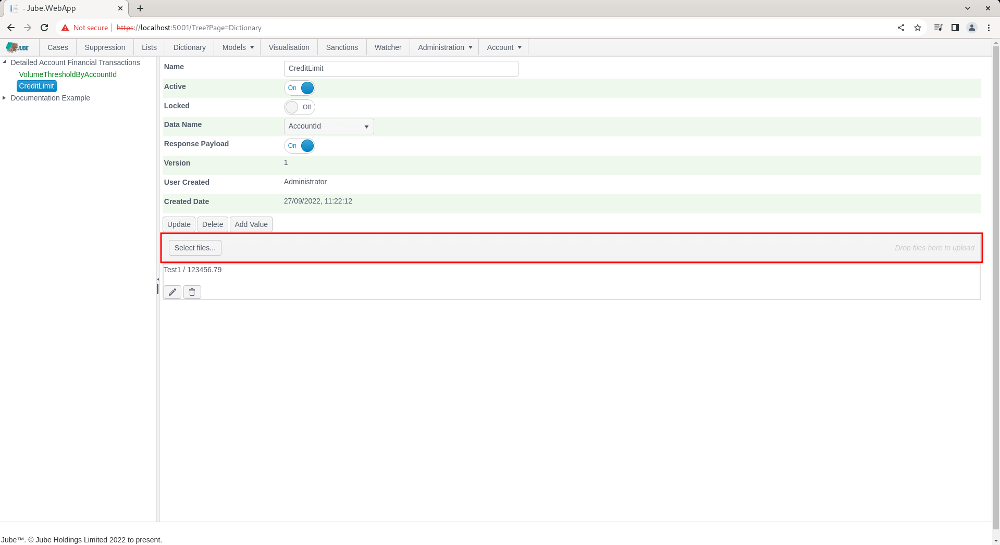

Either drag the file to the area show above, or click the button titled Select files, navigating to the file:

<!-- TODO(screenshot): file=model-references-file-selection-of-example-c-s-v.png route=/models/references/dictionaries state="replace the Razor-era image FileSelectionOfExampleCSV.png with the Vue UI showing the same step" -->
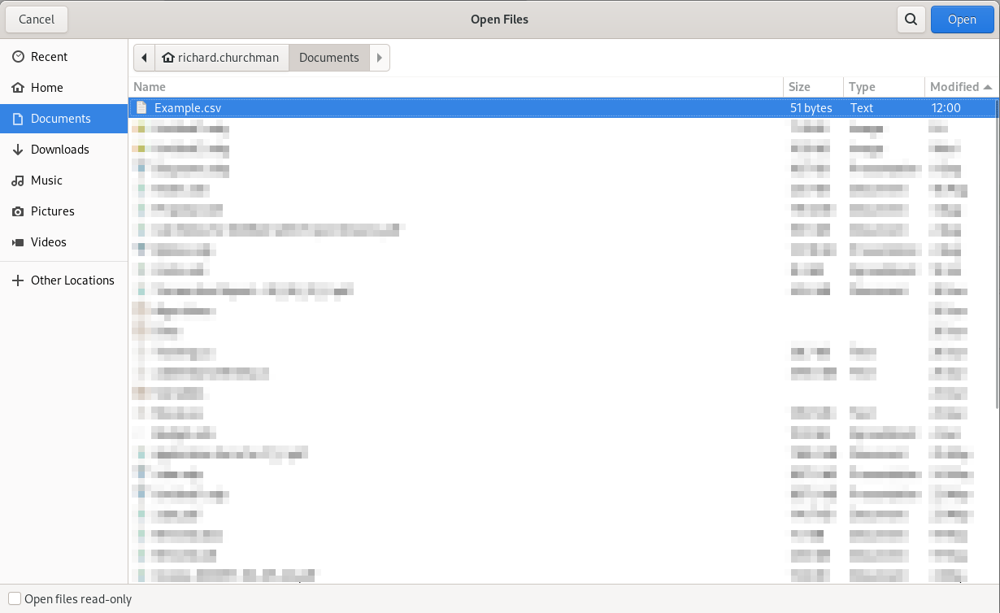

Clicking Open, which will happen implicitly if the file has been dragged and dropped, will both upload the file and
process, adding each row as a new Dictionary Key Value pair:

<!-- TODO(screenshot): file=model-references-merged-file-on-key.png route=/models/references/dictionaries state="replace the Razor-era image MergedFileOnKey.png with the Vue UI showing the same step" -->
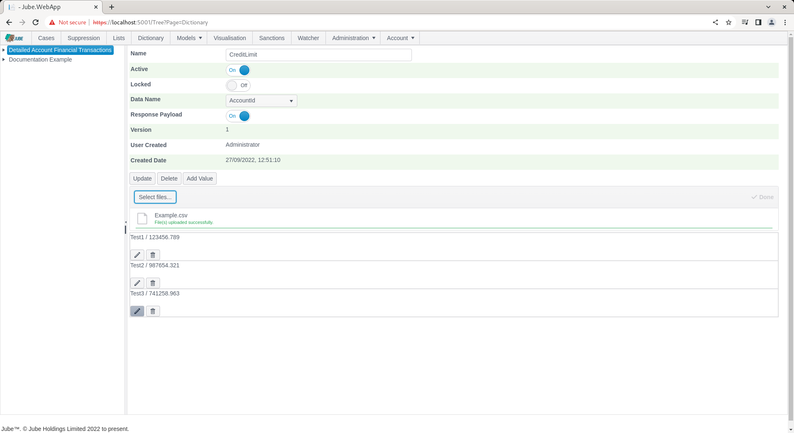

In the event of a conflict on the key, as here, it will be updated, otherwise inserted (subject to the uniqueness and
pending-deletion rules described above).

## Permissions and security

<!-- TODO(docs): confirm the permission number and wording against the running menu and the Roles page -->
Reading and writing this area requires permission 4. A user without it receives 403, and an unauthenticated request
receives 401. Every mutation also needs the antiforgery token for cookie sessions.

<!-- TODO(docs): owner to review this security paragraph, it was written from code, not from a running system -->
Dictionaries and their key value pairs are scoped to the caller's tenant through the parent Model; a foreign Dictionary
id behaves like a missing one. CSV cells are stored as data (formula and markup keys included) and file names are
sanitised and never used as paths.

<!-- TODO(docs): changes are subject to maker-checker approval when ApprovalsRequired is on; describe the Approvals tab, Resubmit and Retract for Dictionaries from the real UI -->
<!-- TODO(docs): every statement above about the Razor-era page layout (tree on the left, Add button, version pane) may be stale after the Vue port; re-read the whole page against the new UI -->
<!-- TODO(docs): add the Arabic and Urdu right-to-left note: identifiers, paths and code stay left-to-right inside right-to-left text -->
