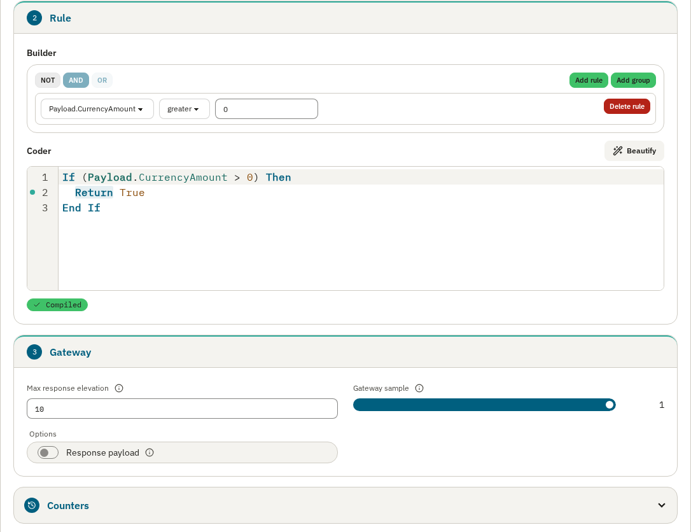
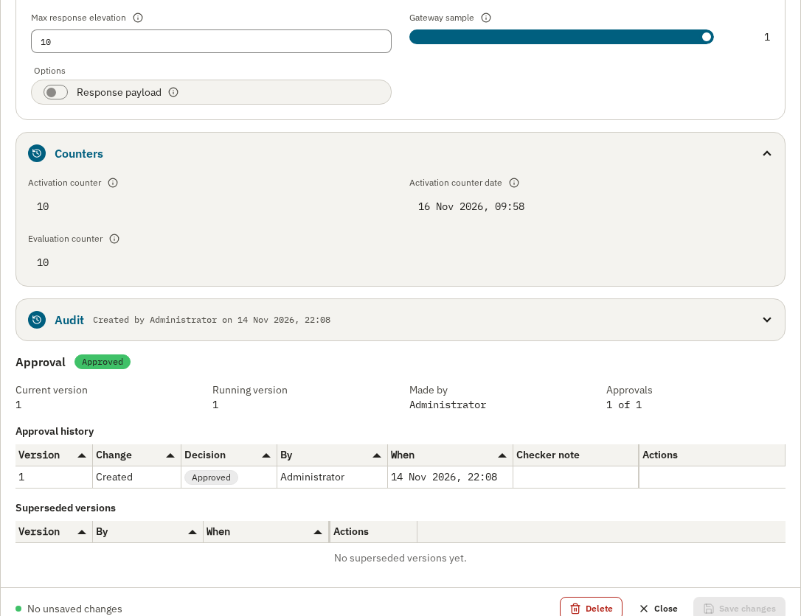

# Gateway Rules

Gateway Rules are pre-filtering and sampling to reduce the transaction volume eligible for the processing by more intensive functions that perhaps follow.

Transactions will only proceed to the subsequent steps in model processing in the event that a Gateway Rule matches. Upon a Gateway Rule matching, it can also be tested against a random sample, as a means to reduce the volume further.

## Where it lives

Navigate through the menu to Models, open the model, then the Gateway Rules hub card. Creating, changing, approving and deleting a Gateway Rule follows the common manner described in [Child Objects](../../../Navigation/ChildObjects/index.html).

## Behaviour

The page exists to create Gateway Rules, which are VB.net code fragments, to be compiled into the engine during synchronisation. Gateway Rules accept data objects and test the code fragment for equality, expecting a return of True on match, or otherwise False. The rule is composed in the manner described in [Rule Builder and Coder](../../../Navigation/RuleBuilderAndCoder/index.html), where the Builder and Coder offer the following data:

| Value      | Description                                                                                                |
|------------|------------------------------------------------------------------------------------------------------------|
| Payload    | The fields created in the Request XPath page, Inline Functions and Inline Scripts (if allocated).          |
| Dictionary | Values resolved from any configured Dictionary against the current Payload, accessed as `Dictionary.Name`. |

Gateway Rules are evaluated in ascending order of Priority. Gateway Rules exist to marshal a transaction or event for subsequent processing, and only on match, to the following processing steps:

* Sanctions.
* TTL Counters.
* Abstraction Rules.
* Abstraction Deviation.
* Abstraction Calculation.
* Adaptation.
* Activation Rules.

It follows that none of the aforementioned functions will be processed except in the event of a match on the Gateway Rule. Henceforth, to validate the Gateway Rule, it is necessary to deploy one of the aforementioned functions, although the payload written to the Archive does carry the element `matchedGatewayRule`, being true where a Gateway Rule matched and the transaction fell within its sample.

SHOT id=models-gateway-rules-rule
     route=/models
     steps=open-default-model, open-hub:Gateway Rules, open-first-row, scroll-to:Rule
     frame=record
     state=a Gateway Rule of the default model opened, showing the Rule group with a single Builder condition that Payload.CurrencyAmount is greater than 0, and the Gateway group with the sample and the maximum response elevation beneath
     conveys=a Gateway Rule is a rule over the Payload together with a sample and a ceiling on the Response Elevation
     alt=A Gateway Rule opened beneath its model, with the rule Builder holding one condition on the CurrencyAmount of the Payload, followed by the Gateway sample slider and the Max response elevation



## Fields

SHOT id=models-gateway-rules-gateway-and-counters
     route=/models
     steps=open-default-model, open-hub:Gateway Rules, open-first-row, open-section:Counters, scroll-to:Max response elevation
     frame=record
     state=the Gateway Rule of the default model scrolled to the Gateway group of its form, showing Max response elevation, the Gateway sample slider and Response payload, with the Counters section opened beneath to show the counters kept for the rule
     conveys=beneath the rule itself a Gateway Rule sets the ceiling on Response Elevation and its sample, and keeps counters of its own
     alt=The Gateway group of a Gateway Rule record showing Max response elevation, the Gateway sample slider and Response payload, with the Counters section open beneath



The parameters for the Gateway Rule are described as follows:

| Value                  | Description                                                                                                                                                                                                                                                                                                                                                                                                                                                                             | Example              |
|------------------------|-----------------------------------------------------------------------------------------------------------------------------------------------------------------------------------------------------------------------------------------------------------------------------------------------------------------------------------------------------------------------------------------------------------------------------------------------------------------------------------------|----------------------|
| Name                   | The name of the Gateway Rule. Required, limited to 256 characters, and unique within the Model without regard to case.                                                                                                                                                                                                                                                                                                                                                                  | AmountUSDOverZero    |
| Description            | A free text description of that which the Gateway Rule filters for.                                                                                                                                                                                                                                                                                                                                                                                                                     | Only priced events.  |
| Priority               | The order of evaluation relative to the other Gateway Rules of the Model, whereby lower values are evaluated first. The default is 0.                                                                                                                                                                                                                                                                                                                                                   | 0                    |
| Active                 | Whether the Gateway Rule takes part in evaluation. Active is off for a new Gateway Rule and must be switched on.                                                                                                                                                                                                                                                                                                                                                                         | True                 |
| Locked                 | Whether the Gateway Rule is protected from change.                                                                                                                                                                                                                                                                                                                                                                                                                                      | False                |
| Rule                   | The rule, composed in either the Builder or the Coder, being mutually exclusive, such that only the script of the surface selected is required.                                                                                                                                                                                                                                                                                                                                         | As below.            |
| Max response elevation | Upon a Gateway Rule Matching,  the Maximum Response Elevation is set such to provide some risk management to the magnitude of the Response Elevation.  For example,  if the Response Elevation is used to instruct a bid,  the open-boundedness could be cause for alarm. This value is the largest response elevation that may be responded,  with any values exceeding this value being truncated to this value.  Keep in mind that there are similar limits at the model level also. | 10                   |
| Gateway sample         | A percentage value,  between 0% and 100%, representing the sample that should be allowed through to subsequent processing.  The sample will only be taken in the event that the Rule returns as true.  For example,  if the Gateway Sample is set to 20%,  it would imply that only 20% of the matching transactions will be passed through for subsequent processing. The default is 100%.                                                                                             | 100%                 |
| Response payload       | Presented on the form, yet not retained for a Gateway Rule, reading back as off whatever is entered.                                                                                                                                                                                                                                                                                                                                                                                    | False                |

TODO(verify): the Response payload switch is shown in the Gateway group of the form, but the value is not persisted (EntityAnalysisModelGatewayRuleMapper always maps it to false). Owner to decide whether the switch is to be removed from the form or the value retained.

The form is arranged in the groups Identity, Rule, Gateway, Counters (collapsed) and Audit (collapsed), and the list of Gateway Rules shows the Priority beside the Name. A new Gateway Rule is presented with a Priority of 0, a Max response elevation of 10, a Gateway sample of 100%, and Active and Response payload off. The Max response elevation is a ceiling, 10 being also the ceiling given to a new Model: a Gateway Rule whose Max response elevation is set to 0 limits the Response Elevation of every transaction passing through it to 0, such that no Activation Rule can raise a Response Elevation. Only one Gateway Rule applies to a transaction, being the first to match in ascending order of Priority, and it is the Max response elevation of that rule which is the ceiling.

In reading the outcome of Gateway Rules for a transaction, three cases may be distinguished. Where no Gateway Rule matches, nothing further is computed for the transaction, such that its response carries no abstractions, TTL Counters or activations. Where a Gateway Rule matches yet the transaction falls outside the Gateway sample, the outcome is the same. Where a Gateway Rule matches and the transaction falls within the sample, processing continues and `matchedGatewayRule` is true in the archived payload. It follows that a model with no active Gateway Rule computes nothing beyond the payload, and that a model which is unexpectedly returning empty responses should have its Gateway Rules examined first.

The collapsed Counters group is maintained by the engine and is shown for information: Activation counter is the running count of transactions having matched the Gateway Rule, Activation counter date is the time at which it last matched, and Evaluation counter is the running count of transactions against which it was evaluated.

## Validation

A Gateway Rule is validated in the server, and is rejected where:

* The Name is empty, longer than 256 characters, or already exists in the Model.
* The script of the surface selected is empty, which is to say the Builder rule and its definition where the Builder is selected, or the Coder rule where the Coder is selected.
* A rule script is longer than 65,536 characters, or the Builder definition is larger than 1 MB.
* The rule script uses a word outside the token allow list.

* The Priority or the Max response elevation is negative, or the Gateway sample is not between 0 and 1, which is to say between 0% and 100%.

Each failure is written beneath the field it relates to and counted in the summary at the head of the form, as described in [Child Objects](../../../Navigation/ChildObjects/index.html), with the messages as follows:

| Field                  | Message                                                                                         |
|------------------------|-------------------------------------------------------------------------------------------------|
| Name                   | A name is required. The name must be 256 characters or fewer. This name already exists.         |
| Rule (Builder)         | A rule script is required. The rule script must be 65536 characters or fewer. A rule builder definition is required. The rule builder definition must be valid JSON of no more than 1 MB. |
| Rule (Coder)           | A Coder rule script is required. The Coder rule script must be 65536 characters or fewer.       |
| Priority               | The priority cannot be negative.                                                                |
| Max response elevation | The maximum response elevation cannot be negative.                                              |
| Gateway sample         | The gateway sample must be between 0 and 1.                                                     |

Builder and Coder rule scripts are checked against the token allow list upon being saved, and again at synchronisation, such that a refused script is never stored. The allowed vocabulary has no loops, and it follows that a rule always terminates.

## Example

An example rule that ensures that the CurrencyAmount is greater than 0, such that only priced transactions proceed, is written in the Coder as follows:

```vb
If (Payload.CurrencyAmount > 0) Then
  Return True
End If
```

With Gateway sample left at 100% every matching transaction proceeds to subsequent processing, and with Max response elevation at 10 no Activation Rule can raise the Response Elevation beyond 10 for a transaction having passed through this Gateway Rule.

## Permissions and security

Reading and writing Gateway Rules requires permission 10, Read Write Gateway Rule. A user without it receives 403, and an unauthenticated request receives 401. Every mutation also needs the antiforgery token for cookie sessions.
