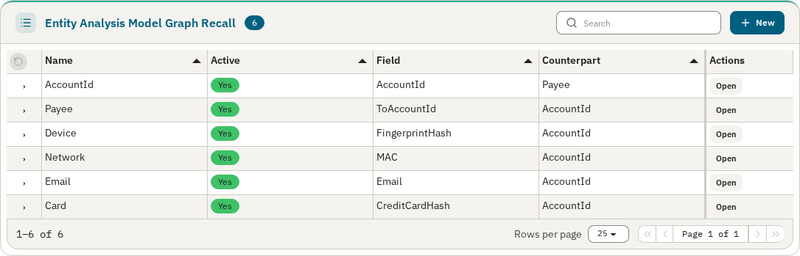
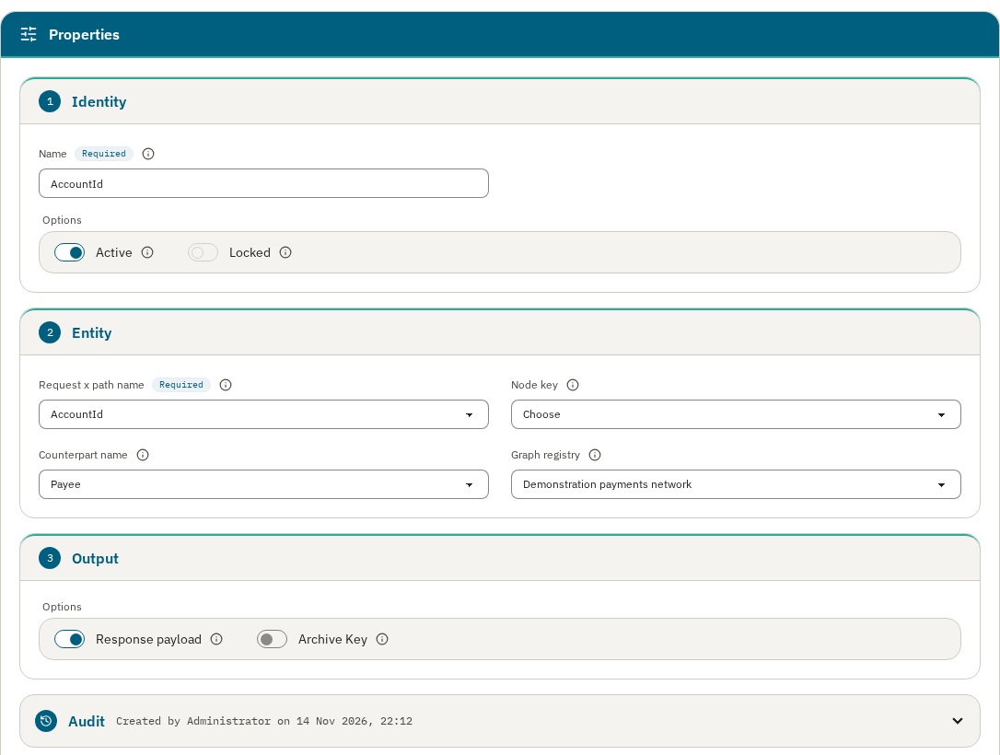

# Graph Recall

Graph Recall reads the relationship graph of the tenant during invocation and gives rules and the response the facts the graph holds about a value of the transaction, which is to say how close it is to confirmed fraud, which communities it bridges, whether it is a hub, which patterns it belongs to and the facts of the edge to a counterpart. Each value so recalled is configured as an entity of the model, and rules read it as `Graph.{Name}.{Member}`. The graph itself, its terms and its exploration are described in [Graph](../../Graph/index.html).

## What Graph Recall is for

A rule ordinarily sees one transaction and the history of one key. It cannot see that the account paying has shared a device with an account already confirmed as fraudulent, nor that the money it sends is two payments away from a known mule. That knowledge is held in the relationship graph, which is built from the archived transactions in the background, and Graph Recall is what brings it to the rule at the moment a transaction is processed. The question it answers is: what is already known about the company this account, card or device keeps?

The terms needed to read this page are as follows, each being described at greater length in [Graph](../../Graph/index.html):

| Term        | Meaning                                                                                                                                                         |
|-------------|-----------------------------------------------------------------------------------------------------------------------------------------------------------------|
| Node        | One thing in the graph: an account, a device, a card, an email address.                                                                                         |
| Edge        | A connection between two nodes, such as a payment from one account to another, or an account having used a device.                                              |
| Hop         | One step along an edge. Two accounts that paid each other are one hop apart, and two accounts that used the same device are two hops apart, through the device. |
| Confirmed   | A node known to be bad, by a case upon it having been closed as fraud.                                                                                          |
| Hub         | A node with a great many connections, such as a merchant or a shared public network, through which nearly everything is connected and which therefore says little. |
| Community   | A group of nodes more closely connected to each other than to the remainder of the graph.                                                                       |
| Tag         | A label placed upon a node, such as MoneyMule.                                                                                                                  |
| Pattern     | A shape recognised in the graph, such as money passing round in a cycle.                                                                                        |
| Entity      | One value of the transaction to be looked up in the graph, which is what is configured in this page.                                                            |
| Counterpart | A second entity of the same transaction, joined to the first so that the edge between the two can be read, such as the payee to the payer.                      |

To build from the simple case: a single entity named Payer, reading the request field AccountId, is enough for a rule to ask whether the paying account is known to the graph and how far it stands from confirmed fraud. A second entity named Payee, reading ToAccountId and filed under the Node key AccountId, allows the same to be asked of the receiving account. Naming Payee as the Counterpart name of Payer then allows the edge between the two to be read: whether this payer has paid this payee before, how many times and how much.

The demonstration payments network of the clean installation may be taken as the worked scenario. In it the account ACC-441 pays 9,500 to ACC-02, which passes the money to ACC-77, which passes it to ACC-88, from where it leaves to an exchange, and ACC-441 has used the device DEV-8831A, as have ACC-102, ACC-778 and ACC-915, the last of which is the subject of a case closed as Fraudulent. Supposing the device to be filed as a node, a transaction from ACC-441 to ACC-02 processed with the two entities above would present a rule with values of the following kind:

| Member read by the rule                | What it would say of the scenario                                                                                   |
|----------------------------------------|---------------------------------------------------------------------------------------------------------------------|
| `Graph.Payer.Known`                    | True, ACC-441 being present in the graph.                                                                           |
| `Graph.Payer.DistanceToConfirmed`      | 2, ACC-441 being one hop from the device and the device one hop from the confirmed ACC-915.                         |
| `Graph.Payer.ConfirmedWithin2`         | 1, there being one confirmed node within two hops.                                                                  |
| `Graph.Payer.Edge.Exists`              | True where ACC-441 has paid ACC-02 before, and False for a first payment.                                           |
| `Graph.Payer.Edge.Count`, `Edge.AmountSum` | The number of earlier payments from ACC-441 to ACC-02, and their total.                                         |
| `Graph.Payee.Degree`                   | The number of connections of ACC-02, which receives from several accounts and pays onward.                          |

The numbers are read as follows. A distance is a count of hops, such that a lower number is the more alarming: 0 is the node itself being confirmed, 1 is a direct connection, 2 is a connection through one intermediary. Distances are measured no further than the distance cap, which is 4 unless the GraphDistanceCap Environment Variable says otherwise, and a node with nothing confirmed within the cap, or a value not known to the graph at all, carries one more than the cap, which is to say 5. It follows that a rule should test for a small distance, as `DistanceToConfirmed <= 2`, and should never read 5 as a measurement. A count such as `ConfirmedWithin2` is read the other way, a higher number being the more alarming. `Known` should be consulted where the absence of the value from the graph is itself of interest, a new account being unknown rather than safe.

Graph Recall is switched off for the installation by default, by the EnableGraphRecall Environment Variable being False. Until it is set to True and the background loader has completed its first cycle, every entity carries the defaults described under Isolation and defaults below, which is to say `Known` False and every distance 5, whatever the graph holds.

## Where it lives

Navigate through the menu to Models, open the model, then the Graph Recall hub card, which sits in the Network group of cards beside [Svirfd](../Svirfd/index.html). Creating, changing, approving and deleting an entity follows the common manner described in [Child Objects](../../../Navigation/ChildObjects/index.html).

SHOT id=models-graph-recall-list
     route=/models
     steps=open-default-model, open-hub:Graph Recall
     frame=section:Entity Analysis Model Graph Recall
     state=the Graph Recall list of the default model, showing its six entities, AccountId, Payee, Device, Network, Email and Card, each on a row with its Active state, its Field and its Counterpart, and an Open action
     conveys=a model keeps one Graph Recall entity for each kind of thing it remembers in the graph, listed under the model
     alt=The Graph Recall list of the default model with six entities, AccountId, Payee, Device, Network, Email and Card, each on a row with its Active state, Field and Counterpart



SHOT id=models-graph-recall-entity
     route=/models
     steps=open-default-model, open-hub:Graph Recall, open-first-row
     frame=record
     state=a Graph Recall entity of the default model opened, named for the account, with its request field selected and a counterpart entity for the beneficiary chosen
     conveys=an entity names a request field to be looked up in the graph, and is explicitly joined to a counterpart for edge facts
     alt=A Graph Recall entity opened beneath its model, showing its name, the request field carrying the value, the node key, the counterpart entity and the graph registry



## Fields

| Value               | Description                                                                                                                                                                                                                                     | Example     |
|---------------------|-------------------------------------------------------------------------------------------------------------------------------------------------------------------------------------------------------------------------------------------------|-------------|
| Name                | The name rules read the entity by. Letters and digits only, starting with a letter, at most 64 characters, and unique within the model.                                                                                                         | Payer       |
| Active              | Whether the entity is recalled from the graph on every invocation of the model. On by default.                                                                                                                                                  | True        |
| Locked              | Whether the entity is protected from change.                                                                                                                                                                                                    | False       |
| Request x path name | The request field of the model that carries the value identifying the entity in the graph, selected from the fields of the model flagged Archive Key. Required, at most 128 characters.                                                         | AccountId   |
| Node key            | The graph node key the value is filed under when it differs from the field name, in the manner of the To Node Key of an edge definition, whereby a ToAccountId value is filed as an AccountId node. Left empty, the field name is used.         | AccountId   |
| Counterpart name    | Another entity of the same model that this one is joined to for edge facts and bridge detection, such as a Payer entity joined to its Payee. Never itself. Joins are explicit and never guessed, and it is left empty for none.                 | Payee       |
| Graph registry      | Restricts the edge facts to the edge definitions of one Graph Registry. Left empty, every active definition of the tenant is used.                                                                                                              |             |
| Response payload    | Whether the entity is returned in the response JSON under `Graph`. Off by default.                                                                                                                                                              | False       |
| Archive Key         | Whether the entity is written into the archive JSON for reporting and training. On by default. It is exclusive with Response payload, in that an entity is returned or stored, not both.                                                        | True        |

TODO(verify): the labels Request x path name, Node key, Counterpart name and Graph registry are derived from the property names in the server; confirm them against the form on a running system, and whether Request x path name is the label intended for the field.

The form is arranged in the groups Identity, Entity, Output and Audit (collapsed), and the list of entities shows, beside the Name, whether each is Active, its Field and its Counterpart. A new entity is presented with Active on, Archive Key on and Response payload off, and it is to be noted that Active being on for a new record is the reverse of most child objects. Since Archive Key and Response payload are exclusive, Archive Key must be switched off before Response payload is switched on, which is what is wanted when a new entity is to be inspected in the response while it is being tested.

Request x path name and Node key are each chosen from a list of the active request fields of the model. A field that has not been flagged Archive Key is offered also, with the words (not flagged Archive Key) after its name, as a reminder that the graph is built from the Archive Key table and that a field absent from it has nothing filed under it. Counterpart name is chosen from the other entities of the model, with an empty choice for none, and Graph registry from the Graph Registries of the tenant.

## Validation

An entity is validated in the server, and is rejected where:

* The Name is empty, is not letters and digits starting with a letter, or already exists in the model.
* The request field is not selected.
* The Counterpart name is the entity itself, or is not an entity of the same model.
* Response payload and Archive Key are both on.

Each failure is written beneath the field it relates to and counted in the summary at the head of the form, as described in [Child Objects](../../../Navigation/ChildObjects/index.html), with the messages as follows:

| Field               | Message                                                                                                                                       |
|---------------------|-----------------------------------------------------------------------------------------------------------------------------------------------|
| Name                | A name is required. The name may be at most 64 characters. The name must start with a letter and contain only letters and digits, because rules read it as Graph.{Name}. An entity with this name already exists on the model. |
| Request x path name | The request field whose value identifies the entity is required. A key may be at most 128 characters.                                         |
| Counterpart name    | An entity cannot be its own counterpart. The counterpart must name another entity of this model.                                              |
| Archive Key         | Archive Key and Response Payload are exclusive: an entity is either stored with the archived transaction or returned in the response, not both. |

## Members

The members of an entity, read in a rule as `Graph.{Name}.{Member}`, are as follows, and the Coder offers them all as completions:

| Member                                                    | Type    | Meaning                                                                                              |
|-----------------------------------------------------------|---------|------------------------------------------------------------------------------------------------------|
| `Known`                                                   | Boolean | Whether the value is present in the graph.                                                           |
| `Hub`                                                     | Boolean | Whether the node is a hub.                                                                           |
| `Degree`, `DegreeMoney`, `DegreeIdentity`                 | Integer | The number of connections of the node, in total and by kind of connection.                           |
| `HubNeighbourCount`                                       | Integer | The number of neighbours that are hubs.                                                              |
| `DistanceToConfirmed`                                     | Integer | The distance, in hops, to confirmed fraud.                                                           |
| `RelaxedDistanceToConfirmed`                              | Integer | The distance counting a non-hub counterpart one hop closer.                                          |
| `DistanceToNotConfirmed`                                  | Integer |                                                                                                      |
| `ConfirmedWithin1`, `ConfirmedWithin2`, `ConfirmedWithin3` | Integer | The count of confirmed nodes within one, two and three hops.                                         |
| `CommunityId`, `CommunitySize`                            | Integer | The community the node sits in, and its size.                                                        |
| `CommunityConfirmedRate`, `CommunityRateRatio`            | Double  |                                                                                                      |
| `BridgesCommunities`                                      | Boolean | The entity and its counterpart are connected and sit in different communities.                       |
| `BridgesToTagged`                                         | Boolean | Another entity of the transaction has a tag within two hops.                                         |
| `PageRank`, `HubScore`, `AuthorityScore`, `ClusteringCoefficient`, `PropagationScore` | Double  | The scores of the node.                                                  |
| `CoreNumber`                                              | Integer |                                                                                                      |
| `NearestTag`, `NearestTagDistance`                        | String, Integer | The nearest tag and the distance to it.                                                      |
| `Edge.Exists`, `Edge.Count`, `Edge.AmountSum`, `Edge.FirstSeenDays`, `Edge.LastSeenDays`, `Edge.Kind` | Boolean, Integer, Double, Double, Double, String | The facts of the edge to the counterpart. |
| `Tag(name).Known`, `Tag(name).Distance`, `Tag(name).Within1`, `Tag(name).Within2`, `Tag(name).Within3` | Boolean, Integer | The proximity of the node to a named tag.                              |
| `Pattern(kind)`                                           | Boolean | Whether the node belongs to a pattern of the kind named.                                             |

TODO(verify): owner to supply the meaning of DistanceToNotConfirmed, CommunityConfirmedRate, CommunityRateRatio and CoreNumber, and to confirm the meanings given for the remaining members, which were taken from the member names in Jube.GraphRecallProtocol/GraphEntity.cs rather than from a specification.

## Isolation and defaults

The manner in which the graph is held by the engine is as follows:

* The engine keeps one in-memory snapshot per tenant, loaded by the background loader from the graph rows of that tenant only. A transaction is evaluated against the snapshot of the tenant that owns the model, and if there is none, there is no fallback to another tenant.
* When the snapshot is absent (recall being switched off with the EnableGraphRecall Environment Variable, which is False by default, the loader not having finished its first cycle, or the tenant having no active registry) every entity carries typed defaults: `Known` False, every distance one beyond the distance cap, no tags, no patterns, no edge. A rule never fails because of it.
* Only active, undeleted registries and edge definitions contribute edges and joins.
* Memory is bounded per tenant by `GraphRecallMaximumNodesPerTenant` (default 2000000) and `GraphRecallMaximumEdgesPerTenant` (default 4000000). A hub, confirmed, tagged or high propagation node is loaded first. Reaching either cap is logged and the snapshot carries `Truncated` or `EdgesTruncated`.
* `GraphRecallHashKeys` (False by default) keeps a 64-bit hash of each value instead of the value, which saves memory at the price of a very small collision probability.
* If the loader cannot load any tenant it retries after at most 30 seconds, otherwise it waits `GraphRecallLoaderWait` (default 15 minutes).

TODO(verify): state the collision probability of GraphRecallHashKeys at 2000000 nodes once the owner confirms the hash

The settings are described in [Environment Variables](../../../Concepts/EnvironmentVariables/index.html).

## Example

With an entity named Payer joined to a counterpart named Payee, an Activation Rule might match where the payer is within two hops of confirmed fraud and has not paid this payee before, written in the Coder as follows:

```vbnet
If (Graph.Payer.DistanceToConfirmed <= 2 And Graph.Payer.Edge.Exists = False) Then
  Return True
End If
```

## Permissions and security

Reading and writing Graph Recall entities requires permission 15, Read Write HTTP Adaptation, there being no permission particular to Graph Recall. A user without it receives 403, and an unauthenticated request receives 401. Every mutation also needs the antiforgery token for cookie sessions.

TODO(verify): the page formerly named the permission as Edit Models (15). Permission 15 is Read Write HTTP Adaptation in the permission names, and it is what the Graph Recall service requires; owner to confirm that sharing the HTTP Adaptation permission is intended.
