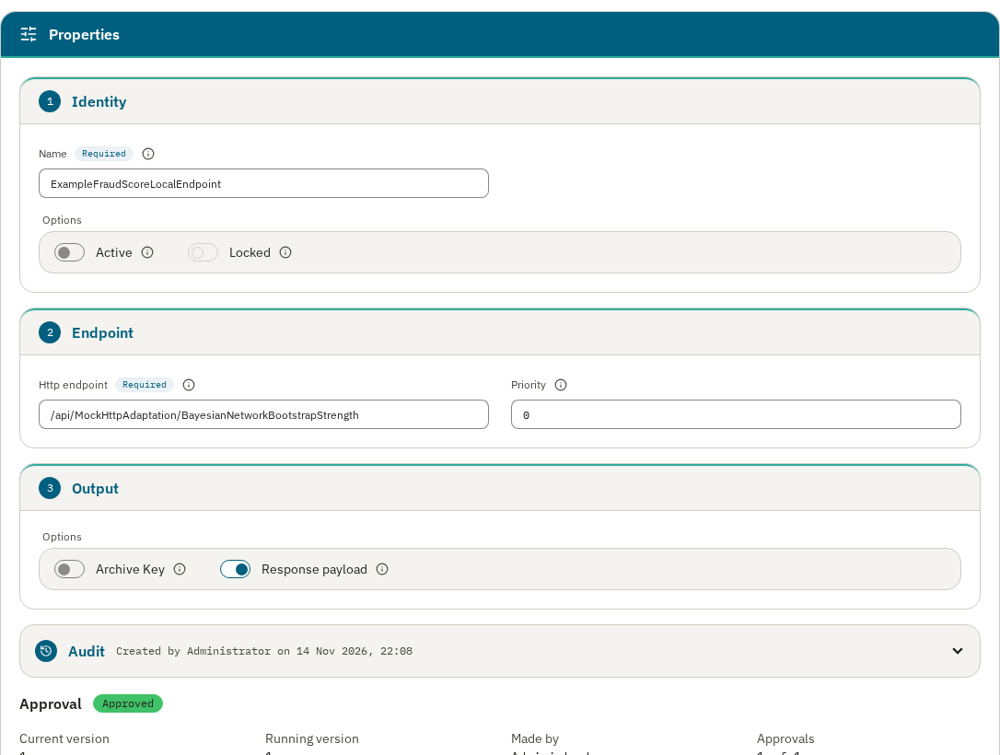

# HTTP Adaptation

An HTTP Adaptation is the means by which a model asks a scoring service of the institution's own, such as a machine learning model written in R or Python, for its opinion of a transaction while that transaction is being processed. Jube sends everything it has computed for the transaction, the service answers with a number, and the number is thereafter available to Activation Rules by name, such that a rule may act upon a score Jube did not itself produce.

HTTP Adaptation refers to the dispatch of the full transaction payload in a POST body to a remote HTTP endpoint for the receipt of a quantitative score, and optionally a structured explanation of it, in the JSON response body.

The request body is the entire `EntityAnalysisModelInstanceEntryPayload` for the transaction, which is to say Payload, Abstraction, TTL Counters, Abstraction Calculations, Sanctions, and any HTTP Adaptations with a lower Priority that have already been recalled for the same transaction.

The response body may still be a bare number for the simplest case:

```json
0.91
```

Alternatively, the response body may be a structured object carrying a score alongside model metadata, calibration, contribution and journey, for which the [HTTP Adaptation Protocol](../HTTPAdaptationProtocol/index.html) page gives the full response specification, the consumption rules, and a set of mock reference endpoints to test against.

The intention of HTTP Adaptation is to recall R models via Plumber, Python models via Flask or make use of any HTTP service that respects the payload specification set out above.

## Where it lives

Navigate through the menu to Models, open the model, then the HTTP Adaptation hub card. Creating, changing, approving and deleting an HTTP Adaptation follows the common manner described in [Child Objects](../../../Navigation/ChildObjects/index.html).

SHOT id=models-http-adaptation-record
     route=/models
     steps=open-default-model, open-hub:HTTP Adaptation, open-first-row
     frame=record
     state=an HTTP Adaptation of the default model opened, showing the Identity, Endpoint and Output groups with the mock endpoint under /api/MockHttpAdaptation
     conveys=an HTTP Adaptation is no more than the remainder of a URL and a priority, the base of the URL being set elsewhere
     alt=An HTTP Adaptation opened beneath its model, showing its name, the remainder of the URL to POST to, the priority, and the Archive Key and Response payload switches



## Fields

The HTTP Adaptation accepts the following parameters:

| Value            | Description                                                                                                                                                                                                                                                                                                                 | Example                                    |
|------------------|-----------------------------------------------------------------------------------------------------------------------------------------------------------------------------------------------------------------------------------------------------------------------------------------------------------------------------|--------------------------------------------|
| Name             | The name of the HTTP Adaptation, by which rules refer to it as `HttpAdaptation.Name`. Required, limited to 256 characters, and unique within the Model without regard to case.                                                                                                                                              | ExampleFraudScore                          |
| Active           | Whether the HTTP Adaptation is recalled on invocation. Active is off for a new HTTP Adaptation and must be switched on.                                                                                                                                                                                                     | True                                       |
| Locked           | Whether the HTTP Adaptation is protected from change.                                                                                                                                                                                                                                                                       | False                                      |
| Http endpoint    | Using the prefix specified in the HttpAdaptationUrl Environment Variable in concatenation with remainder of the URL for the HTTP Endpoint to POST to.  Assume no "/" terminating the HttpAdaptationUrl Environment Variable value, so this value must itself begin with "/". Required, up to 2048 characters.               | /api/MockHttpAdaptation/BareNumber         |
| Priority         | Ascending execution order among the adaptations on a model, to support boosting and model chaining, whereby a lower Priority adaptation is recalled first, and its result is available to a later one via the request body. Defaults to 0. Must be zero or greater.                                                         | 0.1                                        |
| Archive Key      | Whether the Value of every recall is also written to the Archive Key table for later analysis, as described in [Report Table](../../../Navigation/ReportTable/index.html). Off by default.                                                                                                                                  | False                                      |
| Response payload | Whether the Value is returned in the HttpAdaptation element of the response, as described in [Response Payload](../../../Navigation/ResponsePayload/index.html). Off by default.                                                                                                                                            | True                                       |

The form is arranged in the groups Identity, Endpoint, Output and Audit (collapsed), and the list of HTTP Adaptations shows the HTTP Endpoint beside the Name. A new HTTP Adaptation is presented with a Priority of 0 and with Active, Archive Key and Response payload off.

## Validation

Each failure is written beneath the field it relates to and counted in the summary at the head of the form, as described in [Child Objects](../../../Navigation/ChildObjects/index.html), with the messages as follows:

| Field         | Message                                                                                                                                                              |
|---------------|----------------------------------------------------------------------------------------------------------------------------------------------------------------------|
| Name          | A name is required. The name must be 256 characters or fewer. This name already exists.                                                                              |
| Http endpoint | An HTTP Endpoint is required. The HTTP Endpoint must be 2048 characters or fewer. The HTTP Endpoint must begin with '/'. The HTTP endpoint must be a plain path without control characters, whitespace or dot segments. |
| Priority      | The priority must be zero or greater.                                                                                                                                |

The destination is never typed in full by the person configuring the adaptation. The server prepends a base URL and the configured Http endpoint is only the remainder. To keep it that way the Http endpoint must begin with a single `/` and is refused when it contains a scheme or host (`https://evil.example/`), a backslash, whitespace, a control character (including a carriage return or line feed), or a dot segment (`.` or `..`, including the percent-encoded forms), so it cannot climb out of the path below the base URL. A query string is permitted. The same check is repeated when the model synchronises, so an endpoint that arrived by a Preservation import rather than the form is skipped (and logged) if it fails it.

## Example

In this example the scoring service is one of the mock reference endpoints that ship with Jube beneath `/api/MockHttpAdaptation`, which are described in the [HTTP Adaptation Protocol](../HTTPAdaptationProtocol/index.html) and are mapped unless the EnableMockEndpoints Environment Variable is False. The endpoint https://localhost:5001/api/MockHttpAdaptation/BareNumber answers every POST with the bare number 0.91, whatever the payload, and so serves to prove the round trip before a real service is put in its place. With the HttpAdaptationUrl Environment Variable at its development default of `http://localhost:5001`, the HTTP Adaptation is completed with the Name ExampleFraudScore, the Http endpoint /api/MockHttpAdaptation/BareNumber, a Priority of 0, and Active and Response payload switched on.

The default model is seeded with an HTTP Adaptation of its own, ExampleFraudScoreLocalEndpoint, pointed at /api/MockHttpAdaptation/BayesianNetworkBootstrapStrength, a mock that answers with a structured response carrying a score of 0.19. It is seeded inactive, and is recalled only once Active is switched on and the change approved.

Upon the HTTP Adaptation being approved it is taken up by the engine at its next cycle, without an explicit synchronisation. Repeat the HTTP POST to the model, as provided in `Http/Transaction.http`:

```http
POST https://localhost:5001/api/invoke/EntityAnalysisModel/90c425fd-101a-420b-91d1-cb7a24a969cc
Content-Type: application/json
X-API-KEY: <an API key>
```

The score is returned in the HttpAdaptation element of the response, abbreviated here:

```json
{
  "EntityAnalysisModelInstanceEntryGuid": "...",
  "ResponseElevation": { },
  "HttpAdaptation": {
    "ExampleFraudScore": 0.91
  }
}
```

TODO(verify): replace the abbreviated response above with one captured from a running system

Notice that the score of the mock, 0.91, has been returned, and is henceforth available for use in Activation Rules as `HttpAdaptation.ExampleFraudScore`.

In reading the HttpAdaptation element of a response, the presence of a number means that the remote service answered within the timeout with a successful status, and the number is whatever that service chose to return, its scale and its meaning being those of the service and not of Jube. The absence of a value for an adaptation that is active means that the call failed, timed out, was refused or was rejected by an open circuit breaker, as described under How the call is made below, in which case the reason is to be found in the server log and not in the response.

## Base URL: installation-wide or per Tenant

| Source                                   | Who sets it                                           | Rules                                                                                                                                                                                                                           |
|------------------------------------------|-------------------------------------------------------|---------------------------------------------------------------------------------------------------------------------------------------------------------------------------------------------------------------------------------|
| `HttpAdaptationUrl` environment variable | The operator                                          | Trusted. May be http and may be a loopback or private address, which is how the development default `http://localhost:5001` works. Userinfo, a query string, a fragment and schemes other than http or https are still refused. |
| Http adaptation URL on the Tenant record | The landlord only (the Tenants page is landlord-only) | Must be `https`, a public host, with no credentials, query string or fragment. Checked when saved, checked again when the model synchronises, and checked again at connection time.                                             |

A Tenant with no URL of its own uses the installation-wide settings. A Tenant with its own URL uses its own URL, its own timeout (or the installation-wide timeout when left at zero) and its own certificate validation switch (default on). Because the base URL is per Tenant, the adaptations of one Tenant no longer reach the scoring service of another Tenant by construction, unless the landlord points both at the same host.

The three Tenant properties are presented in the Http adaptation group of the Tenant form, as Http adaptation URL, Http adaptation timeout milliseconds and Http adaptation validate ssl. See [Enabling Multi Tenancy And Switching](../../../Concepts/MultiTenancy/EnablingMultiTenancyAndSwitching/index.html#http-adaptation-url) for the Tenant properties, the rules for the URL and when a change takes effect.

The guard on a Tenant URL is applied at connection time as well as on save, such that a name that is changed to point elsewhere afterwards (DNS rebinding) is also caught: the host name is resolved when the call is made, every address is checked, and the connection is made to a validated address itself. Refused are loopback (`127.0.0.0/8`, `::1`, `localhost`), link-local including cloud metadata (`169.254.0.0/16` and `fe80::/10`, so `169.254.169.254`), private ranges, shared address space, multicast, unspecified, reserved and tunnelled IPv6 forms of those, and unusual spellings such as `2130706433` or `0x7f000001`. Redirects are never followed. Proxies are not used. The operator can relax the guard for Tenant URLs for development only with `HttpAdaptationAllowInsecureTargets=True`.

That which is sent is the full transaction payload for the model, as above. There is no credential, token or custom header configured per adaptation, and it follows that nothing secret is stored in the adaptation, returned by the API or written to the log. Authentication to the remote service, if needed, must be handled by the network or by the service itself.

TODO(verify): owner to decide whether a per-tenant credential header is wanted for HTTP Adaptation; none exists today

## How the call is made

| Behaviour           | Detail                                                                                                                                                                                                                                                                                                                                                                         |
|---------------------|--------------------------------------------------------------------------------------------------------------------------------------------------------------------------------------------------------------------------------------------------------------------------------------------------------------------------------------------------------------------------------|
| Redirects           | Never followed. A 3xx answer is an unsuccessful call.                                                                                                                                                                                                                                                                                                                          |
| Unsuccessful status | Any status outside 200-299 is treated as a failure, the body is not parsed.                                                                                                                                                                                                                                                                                                    |
| Timeout             | The Tenant's timeout, else `HttpAdaptationTimeout` (default 1000 ms), for the whole call, and for the connection attempt. A Tenant timeout must be 0 or between 100 and 30000.                                                                                                                                                                                                 |
| Response size       | A response body over 4 MiB is refused.                                                                                                                                                                                                                                                                                                                                         |
| TLS                 | Certificates are validated by default (`HttpAdaptationValidateSsl` is `True`, and the Tenant switch defaults on). Turn validation off only against a development endpoint with a self-signed certificate.                                                                                                                                                                      |
| Cookies, proxies    | Not stored or sent; the environment proxy is not used.                                                                                                                                                                                                                                                                                                                         |
| Retries             | None by default (`ResilientHttpMaxRetries` is 0): the adaptation POST is not known to be idempotent, and a retry against an already slow endpoint multiplies the cost. A small budget with exponential backoff can be enabled, which retries only transient failures (5xx, 408, 429, network errors, timeouts).                                                                |
| Circuit breaker     | One breaker per Tenant and host. When the failure ratio in the sampling window reaches `ResilientHttpFailureRatio` with at least `ResilientHttpMinimumThroughput` calls, calls to that host are rejected without being sent for `ResilientHttpBreakDurationSeconds`, then one trial call is allowed. One Tenant's failing endpoint cannot open the breaker for another Tenant. |

When a call fails, times out, is refused or is rejected by an open breaker, the adaptation is recorded with an Error and no Value, which is the suppressed state described in the [HTTP Adaptation Protocol](../HTTPAdaptationProtocol/index.html): rules that read it see no value, the transaction carries on, and the failure is written to the server log. The manner in which a suppressed adaptation reads inside Builder and Coder rules is set out in that page, under Rule script access. Adaptations run one after another, so the worst case a failing endpoint adds to a transaction before its breaker opens is the number of active adaptations on the model multiplied by the timeout, and once the breaker is open it adds nothing.

The breaker is held in the memory of each engine process, and it follows that in a cluster each instance opens and closes its own breaker independently.

TODO(verify): confirm whether Archive Key records a row, and with what value, for a suppressed adaptation

## Permissions and security

Reading and writing HTTP Adaptations requires permission 15, Read Write HTTP Adaptation. A user without it receives 403, and an unauthenticated request receives 401. Every mutation also needs the antiforgery token for cookie sessions.
