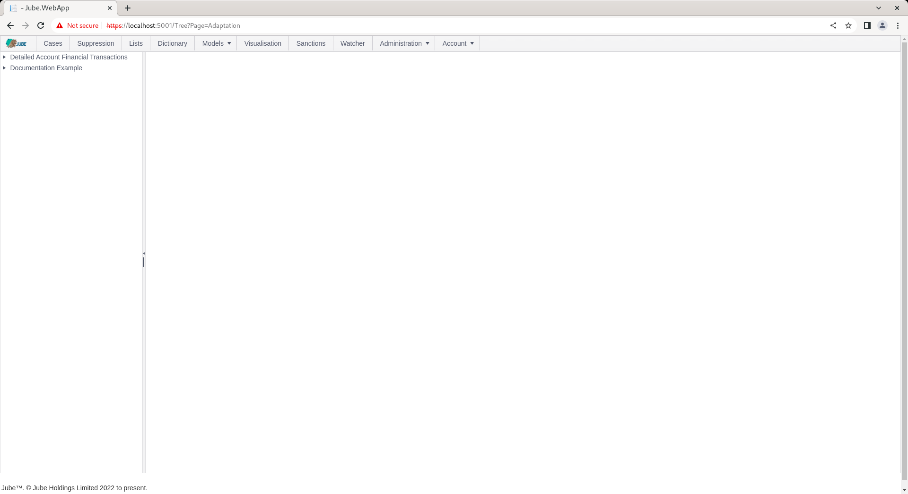
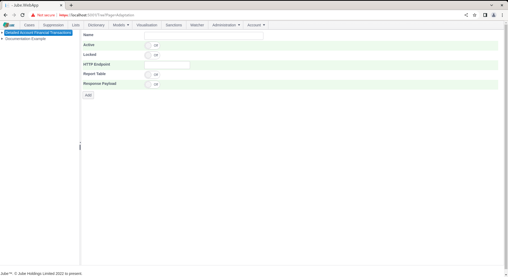
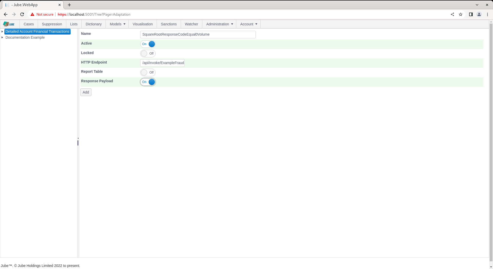
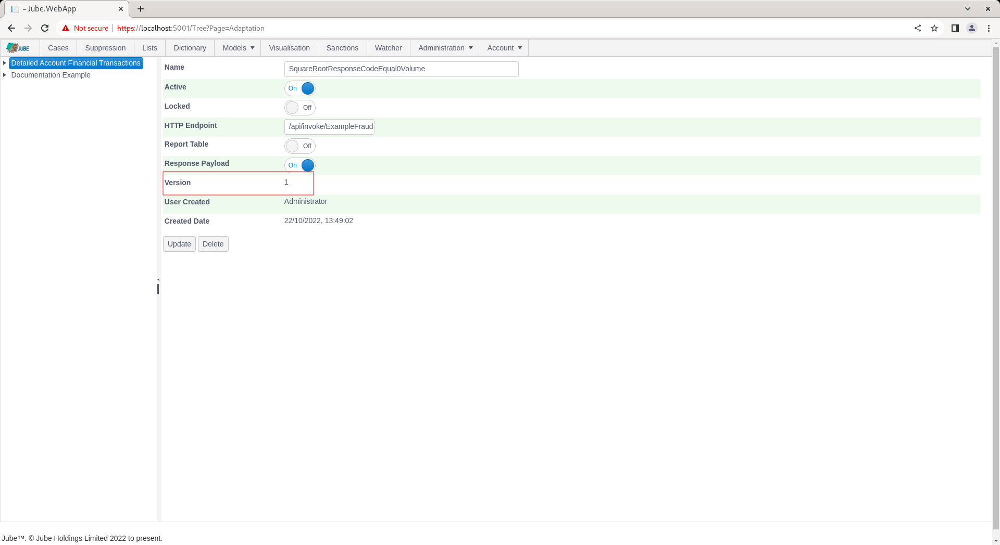
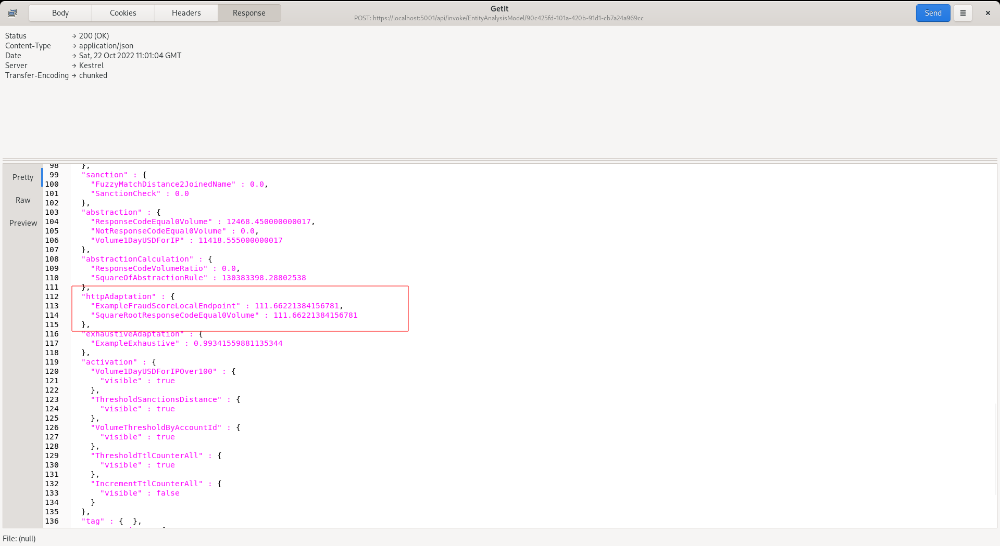

# HTTP Adaptation
HTTP Adaptation refers to the dispatch of the full transaction payload in a POST body to a remote HTTP endpoint for the receipt of a quantitative score, and optionally a structured explanation of it, in the JSON response body.

The request body is the entire `EntityAnalysisModelInstanceEntryPayload` for the transaction - Payload, Abstraction, TTL Counters, Abstraction Calculations, Sanctions, and any HTTP Adaptations with a lower Priority that have already been recalled for the same transaction.

The response body may still be a bare number for the simplest case:

``` json
0.91
```

Alternatively, a structured object carrying a score alongside model metadata, calibration, contribution and journey - see the [HTTP Adaptation Protocol](../HTTPAdaptationProtocol/index.html) page for the full response specification, consumption rules, and a set of mock reference endpoints to test against.

The intention of HTTP Adaptation is to recall R models via Plumber,  Python models via Flask or make use of any HTTP service that respects the payload specification set out above.

To create a HTTP Adaptation,  navigate Models >> Machine Learning >> HTTP Adaptation:



Click on a model in the tree to create a new HTTP Adaptation:



The HTTP Adaptation accepts the following parameters:

| Value         | Description                                                                                                                                                                                                                        | Example                                    |
|---------------|------------------------------------------------------------------------------------------------------------------------------------------------------------------------------------------------------------------------------------|--------------------------------------------|
| HTTP Endpoint | Using the prefix specified in the HttpAdaptationUrl Environment Variable in concatenation with remainder of the URL for the HTTP Endpoint to POST to.  Assume no "/" terminating the HttpAdaptationUrl Environment Variable value, so this value must itself begin with "/". Required, up to 2048 characters. | /api/invoke/ExampleFraudScoreLocalEndpoint |
| Priority      | Ascending execution order among the adaptations on a model, to support boosting/model chaining - a lower Priority adaptation is recalled first, and its result is available to a later one via the request body. Defaults to 0. Must be zero or greater. | 0.1                                         |

In this example an endpoint is available for the purpose of echoing back the Square Root of the ResponseCodeEqual0Volume Abstraction Rule Value at https://localhost:5001/api/invoke/ExampleFraudScoreLocalEndpoint.  Complete the page as follows:



Scroll down and click Add to create a version of the HTTP Adaptation:



Synchronise the model via Entity >> Synchronisation and repeat the HTTP POST to endpoint [https://localhost:5001/api/invoke/EntityAnalysisModel/90c425fd-101a-420b-91d1-cb7a24a969cc](https://localhost:5001/api/invoke/EntityAnalysisModel/90c425fd-101a-420b-91d1-cb7a24a969cc) for response as follows.



Notice that the score has been returned for use in Activation Rules in the Adaptation entity.

