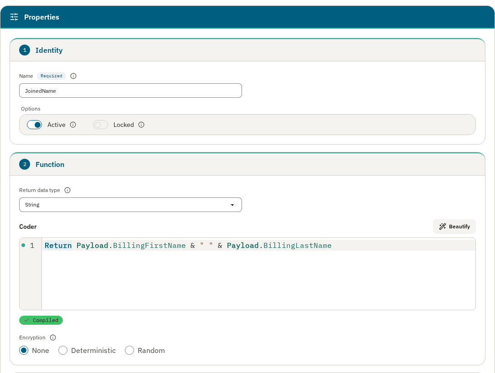

# Inline Functions

Inline functions exist for the purpose of adding new fields to the payload by performing coded functions on data added thus far (i.e. via Request XPath or Inline Scripts).

Consider the use case where data is extracted by Request XPath for a customer name as First Name and Last Name, separately, an Inline function might be used to concatenate these values to create a Full Name (which is the multipart string specification required of the real time sanctions checking).

An Inline Function is achieved by creating a VB.net code fragment which takes the various parameters taken from the payload collection of all values created by Request XPath or Inline Scripts.

## Where it lives

The page is available by navigating through the menu as Models, opening the model, then the Inline Functions hub card. Creating, changing, approving and deleting an Inline Function follows the common manner described in [Child Objects](../../../Navigation/ChildObjects/index.html).

SHOT id=models-inline-functions-record
     route=/models
     steps=open-default-model, open-hub:Inline Functions, open-row:JoinedName
     frame=record
     state=the JoinedName Inline Function of the default model opened, approved and active, showing the Function group with a Return data type of String and the Coder holding the concatenation of the billing first and last names, marked Compiled
     conveys=an Inline Function is a return data type and a single line of code over the Payload
     alt=An Inline Function opened beneath its model, showing its name, the Return data type and the Coder containing a VB.net fragment that joins two payload fields, with a Compiled badge beneath



## Fields

The parameters available to Inline Function are described as follows:

| Value            | Description                                                                                                                                                                                                                                                    | Example                                                         |
|------------------|----------------------------------------------------------------------------------------------------------------------------------------------------------------------------------------------------------------------------------------------------------------|-----------------------------------------------------------------|
| Name             | The name of the Inline Function, being the name of the field added to the payload, and available to rules as Payload.Name. Required, limited to 256 characters, and unique within the Model without regard to case.                                            | JoinedName                                                      |
| Active           | Whether the Inline Function takes part in invocation. Active is off for a new Inline Function and must be switched on.                                                                                                                                         | True                                                            |
| Locked           | Whether the Inline Function is protected from change.                                                                                                                                                                                                          | False                                                           |
| Return data type | The type of data that the Inline Function is set to return so that the right functions in the Abstraction and Activation Rules can be used, being one of String, Integer, Float, Date or Boolean.                                                              | String                                                          |
| Coder            | The creation of a vb.net function fragment which will return its value in the Matched variable. Required, and limited to 65,536 characters. The editor reports beneath it whether the fragment compiles, as Compiled.                                     | Return Payload.BillingFirstName & " " & Payload.BillingLastName |
| Encryption       | Only shown when Return data type is String. Encrypt the returned value before it is stored and archived, for which see [Field Level Encryption](../../../Concepts/FieldEncryption/index.html) for the None, Deterministic and Random options and how to choose between them. | Deterministic                                                   |
| Archive Key      | Whether the value returned is written to the Archive Key table, as described in [Report Table](../../../Navigation/ReportTable/index.html). Off by default.                                                                                                    | False                                                           |
| Response payload | Whether the value returned is included in the Payload element of the response, as described in [Response Payload](../../../Navigation/ResponsePayload/index.html). Off by default.                                                                             | True                                                            |

## Validation

Function scripts are VB.net fragments checked against the token allow list (the Rule Script Token table plus built-in words) when saved and again when the model synchronises, and a script using any other word (for example `System`, `Process`, `GetType`, `Shell`) is refused with `RuleScriptInvalid` and nothing is stored. Scripts cannot declare loops, types or imports. The maximum is 65,536 characters.

The form is arranged in the groups Identity, Function, Behaviour and Audit (collapsed). A new Inline Function is presented with Return data type as String, Encryption as None, and Active, Archive Key and Response payload off. There being no Builder for an Inline Function, the function is written in the Coder alone, whose status beneath reads Compiled, Errors, Checking, Return False or Disconnected as described in [Rule and Code Builder](../../../Navigation/RuleBuilderAndCoder/index.html).

Each failure is written beneath the field it relates to and counted in the summary at the head of the form, as described in [Child Objects](../../../Navigation/ChildObjects/index.html), with the messages as follows:

| Field            | Message                                                                                     |
|------------------|---------------------------------------------------------------------------------------------|
| Name             | A name is required. The name must be 256 characters or fewer. This name already exists.     |
| Return data type | The return data type must be String, Integer, Float, Date or Boolean.                       |
| Coder            | A function script is required. The function script must be 65536 characters or fewer. Where the function does not compile, the errors of the compiler with their positions. |
| Encryption       | The encryption option must be None, Deterministic or Random.                                |

An Inline Function whose value is named in the text of a rule, or chosen as a search key, a data name or a case key, cannot be deleted while it is so used, as described under Deleting an entity that is in use in [Child Objects](../../../Navigation/ChildObjects/index.html).

## Example

In this example an Inline Function is created as a Pi multiplier, having the Name CurrencyAmountByPi, a Return data type of Float, and Response payload switched on for the purposes of testing, with the Coder as follows:

```vbnet
Return Payload.AmountUSD * 3.14
```

Upon the Inline Function being created and thereafter approved, it is synchronised into the running model immediately on approval, without an explicit synchronisation.

Repeat the HTTP POST to the model, as provided in `Http/Transaction.http`, where the AmountUSD of the example JSON is 113.0550:

```http
POST http://localhost:5001/api/invoke/EntityAnalysisModel/90c425fd-101a-420b-91d1-cb7a24a969cc
Content-Type: application/json
X-API-KEY: <an API key>
```

Pay close attention to a new element by the name CurrencyAmountByPi in the Payload element of the response, abbreviated here, alongside the JoinedName that is returned by the Inline Function of that name in the default model:

```json
{
  "Payload": {
    "TxnId": "0987654321",
    "JoinedName": "Robert Mugabe",
    "CurrencyAmountByPi": 354.9927
  }
}
```

The value will be available for all further processing in model invocation as if it were passed in the JSON and extracted by Request XPath (in the case of JoinedName the value is of most use in Sanctions, being presented in the prescribed multipart string format).

## Permissions and security

Reading and writing Inline Functions requires permission 8, Read Write Inline Function. A user without it receives 403, and an unauthenticated request receives 401. Every mutation also needs the antiforgery token for cookie sessions.
