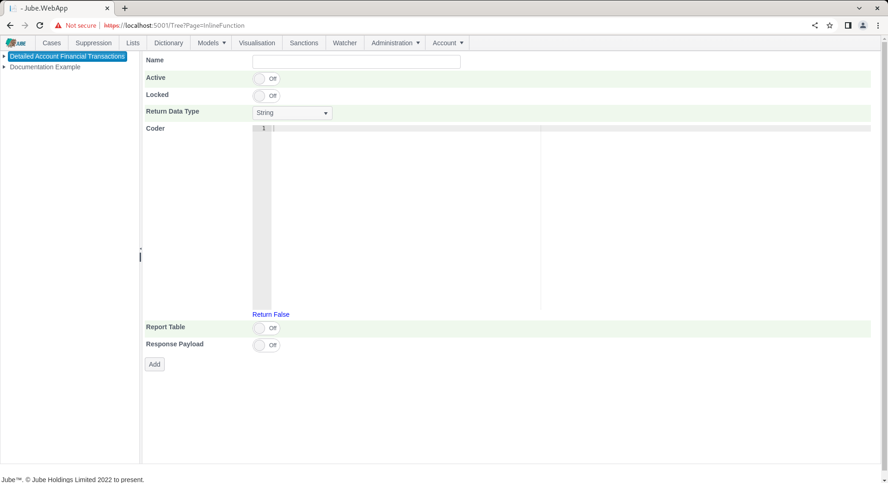
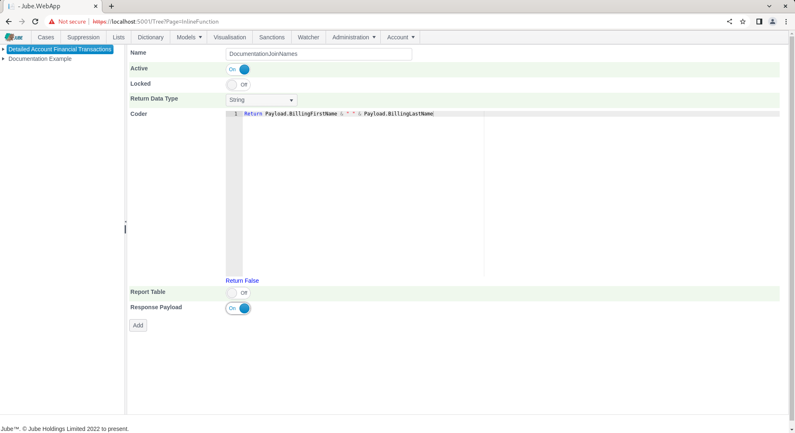
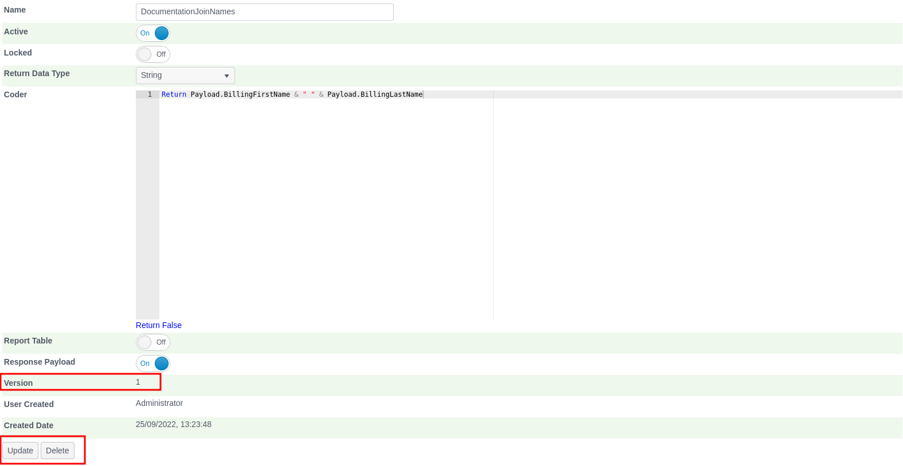
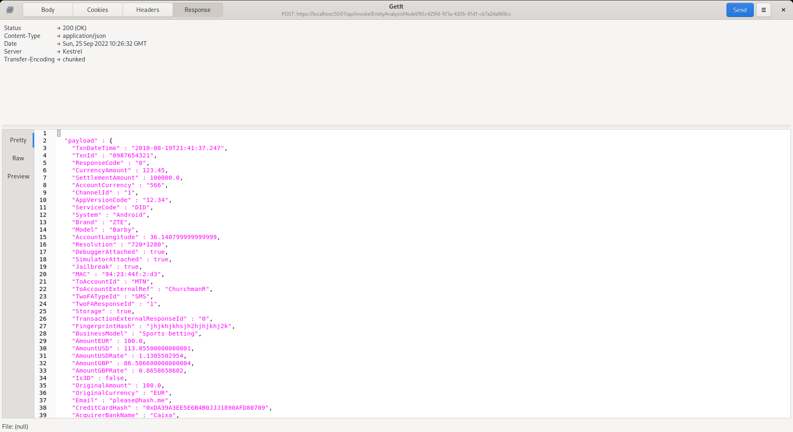
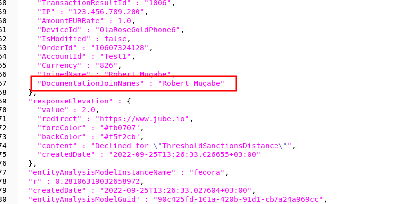

# Inline Functions

Inline functions exist for the purpose of adding new fields to the payload by performing coded functions on data added
thus far (i.e. via Request XPath of Inline Scripts).

Consider the use case where data is extracted by Request XPath for a customer name as First Name and Last Name,
separately, an Inline function might be used to concatenate these values to create a Full Name (which is the multi-part
string specification required of the real time sanctions checking).

An Inline Function is achieved by creating a VB.net code fragment which takes the various parameters taken from the
payload collection of all values created by Request XPath or Inline Scripts.

The page is available by navigating through the menu as Models >> References >> Inline Functions. Add a new Inline
Function by clicking an Entity Model entry in the tree towards the left hand side for the Detailed Account Financial
Transaction Model:

<!-- TODO(screenshot): file=model-references-empty-inline-function.png route=/models/references/inline-functions state="replace the Razor-era image EmptyInlineFunction.png with the Vue UI showing the same step" -->

The parameters available to Inline Function are described as follows:

| Value            | Description                                                                                                                                                                                                                                                    | Example                                                         |
|------------------|----------------------------------------------------------------------------------------------------------------------------------------------------------------------------------------------------------------------------------------------------------------|-----------------------------------------------------------------|
| Return Data Type | The type of data that the Inline Function is set to return so that the right functions in the Abstraction and Activation Rules can be used.                                                                                                                    | String                                                          |
| Code             | The creation of a vb.net function fragment which will return its value in the Matched variable.                                                                                                                                                                | Return Payload.BillingFirstName & " " & Payload.BillingLastName |
| Encryption       | Only shown when Return Data Type is String. Encrypt the returned value before it is stored and archived - see [Field Level Encryption](../../../Concepts/FieldEncryption/index.html) for the None/Deterministic/Random options and how to choose between them. | Deterministic                                                   |

Complete the form as per the above specification, and as below:

<!-- TODO(screenshot): file=model-references-documentation-inline-function.png route=/models/references/inline-functions state="replace the Razor-era image DocumentationInlineFunction.png with the Vue UI showing the same step" -->

Click Add to create the Inline Function version:

<!-- TODO(screenshot): file=model-references-added-inline-function.png route=/models/references/inline-functions state="replace the Razor-era image AddedInlineFunction.png with the Vue UI showing the same step" -->

Synchronise the model via Entity >> Synchronisation and repeat the HTTP POST to
endpoint [https://localhost:5001/api/invoke/EntityAnalysisModel/90c425fd-101a-420b-91d1-cb7a24a969cc](https://localhost:5001/api/invoke/EntityAnalysisModel/90c425fd-101a-420b-91d1-cb7a24a969cc)
for response as follows:

<!-- TODO(screenshot): file=model-references-comprehensive-response.png route=/models/references/inline-functions state="replace the Razor-era image ComprehensiveResponse.png with the Vue UI showing the same step" -->

Paying close attention to a new element by the name DocumentationJoinNames in the response payload:

<!-- TODO(screenshot): file=model-references-highlighted-new-element.png route=/models/references/inline-functions state="replace the Razor-era image HighlightedNewElement.png with the Vue UI showing the same step" -->

The value will be available for all further processing in model invocation as if it were passed in the JSON and
extracted by Request XPath (in this case the value is of most use in Sanctions being presented in the prescribed
multi-part string format).

## Permissions and security

<!-- TODO(docs): confirm the permission number and wording against the running menu and the Roles page -->
Reading and writing this area requires permission 8. A user without it receives 403, and an unauthenticated request
receives 401. Every mutation also needs the antiforgery token for cookie sessions.

<!-- TODO(docs): owner to review this security paragraph, it was written from code, not from a running system -->
Function scripts are VB.net fragments checked against the token allow list (the Rule Script Token table plus built-in
words) when saved and again when the model synchronises; a script using any other word (for example `System`, `Process`,
`GetType`, `Shell`) is refused with `RuleScriptInvalid` and nothing is stored. Scripts cannot declare loops, types or
imports. Maximum 65,536 characters.

<!-- TODO(docs): changes are subject to maker-checker approval when ApprovalsRequired is on; describe the Approvals tab, Resubmit and Retract for Inline Functions from the real UI -->
<!-- TODO(docs): every statement above about the Razor-era page layout (tree on the left, Add button, version pane) may be stale after the Vue port; re-read the whole page against the new UI -->
<!-- TODO(docs): add the Arabic and Urdu right-to-left note: identifiers, paths and code stay left-to-right inside right-to-left text -->
