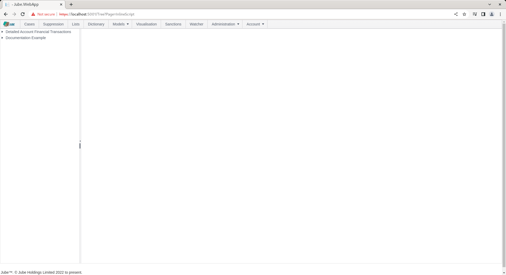
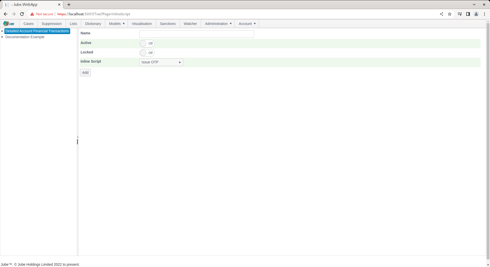
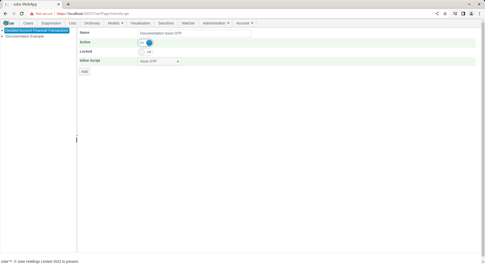
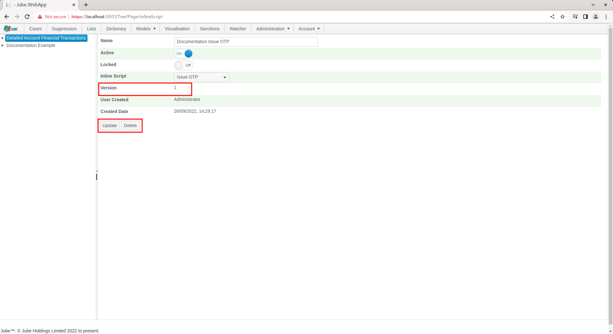
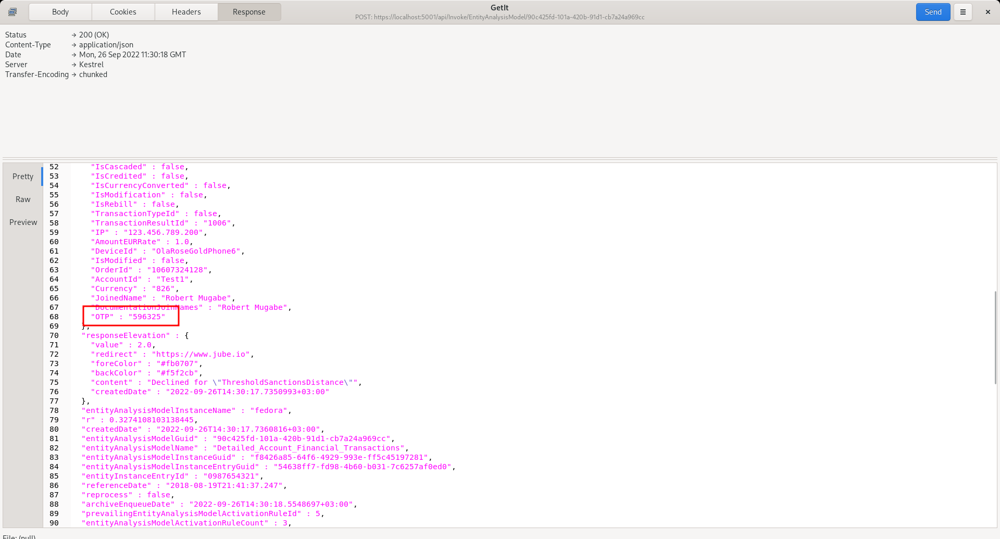

# Inline Scripts

Models inside Jube are extensible via the use of Inline Scripts. Inline Scripts use the processing context after
preparation of model invocation headers, Request XPath and Inline Functions. Inline Scripts exist as a means to
integrate external systems and
enrich payload values.

Inline Scripts once registered in the database are available for all models, however they must be registered in a model
for the payload to be populated in the same manner as Request XPath (i.e. it is available for the rules in the Payload
collection).

The system-wide Inline Script (which can be added only through direct entry to the database table
EntityAnalysisInlineScript as follows) is as per the following specification, and is intended to showcase the following
functionality:

* The required signatures for the invocation method, implementing IInlineScript required interface.
* The exposure of public properties to make data available to context payload and processing.
* The availability of attributes to allow for similar functionality to that available in Request XPath on public
  properties.
* The implementation of the ExecuteAsync() method from IInlineScript interface.

``` sql
select * from EntityAnalysisInlineScript
```

The EntityAnalysisInlineScript table in the database contains the following fields:

| Field      | Example               | Description                                                                                                                                 
|------------|-----------------------|---------------------------------------------------------------------------------------------------------------------------------------------|
| Code       | As below.             | The Inline Script source code,  likely validated externally using the Jube.Sandbox project.                                                 |    
| Dependency | IPTO.World.dll        | Any third party DLL's required are declared here, separated with ;. The DLL must be copied to the same directory as the Jube.Engine binary. |
| Name       | Example Inline Script | The name of the InlineScript, and available in model configuration.                                                                         |
| LanguageId | 2                     | 1 for Visual Basic,  2 for C#.                                                                                                              |


The database contains the following Visual Basic code to provide a "straight through", No IO, demonstration in the
default
environment, while also showing a minimal VB.net example (which is to say LanguageId = 1):

```vbnet
Imports System
Imports System.Net.Http
Imports System.Threading
Imports System.Threading.Tasks
Imports Newtonsoft.Json.Linq
Imports Jube.Engine.Attributes
Imports Jube.Engine.Attributes.Events
Imports Jube.Engine.Attributes.Properties
Imports Jube.Engine.EntityAnalysisModelInvoke.Context
Imports Jube.Engine.Interfaces

Public Class IssueOTP
Implements IInlineScript
    Public Property OTP As String

    <PayloadEvent>
    Public Async Function ExecuteAsync(context As Context) As Task(Of Boolean) Implements IInlineScript.ExecuteAsync
        OTP = RandomDigits(6)
        Return True
    End Function
    
    Private Function RandomDigits(ByVal length As Integer) As String
        Dim random = New Random()
        Dim s As String = String.Empty

        For i As Integer = 0 To length - 1
        s = String.Concat(s, random.[Next](10).ToString())
        Next

        Return s
    End Function	
End Class
```

# Interface

The Jube.Sandbox project meanwhile contains the following code C# (which is to say LanguageId = 2):

```csharp
// ReSharper disable RedundantUsingDirective
// ReSharper disable CheckNamespace

//The following are the minimum .Net libraries to make this work, however,  if using the Jube.Sandbox,  this will be shown,  as the project file is set to not default any assemblies and will be a like for like compile.
using System;
using System.Net.Http;
using System.Threading;
using System.Threading.Tasks;

//All assemblies are passed on the basis of what the Jube.App context is using, so nearly all libraries are supported.
using Newtonsoft.Json.Linq;

//The following are Jube libraries that contain the context and Inline Script attributes.
using Jube.Engine.Attributes;
using Jube.Engine.Attributes.Events;
using Jube.Engine.Attributes.Properties;
using Jube.Engine.EntityAnalysisModelInvoke.Context;
using Jube.Engine.Interfaces;

public class Example : IInlineScript//Class entry point is available in table configuration.
{
    //Attributes overlap with the same options available in Request XPath
    [ReportTable]    //ReportTable is evaluated on recall.
    [ResponsePayload]//ResponsePayload is evaluated in model synchronization and used in model response preparation.
    [Latitude]       //Latitude is evaluated in model synchronization and is used during model activation watcher dispatch.
    [Longitude]      //Longitude is evaluated in model synchronization and is used during model activation watcher dispatch.
    [SearchKey(SearchKeyTtlInterval = "h",
        SearchKeyTtlIntervalValue = 1,
        SearchKeyFetchLimit = 100,
        SearchKeyCache = false,
        SearchKeyCacheInterval = "d",
        SearchKeyCacheValue = 1,
        SearchKeyCacheSample = true,
        SearchKeyCacheFetchLimit = 100,
        SearchKeyCacheTtlInterval = "h",
        SearchKeyCacheTtlValue = 1)]                     //SearchKey ensures that this is exposed in for aggregation in both the background engine.
    public string UserAgent { get; set; } = string.Empty;//Public properties are available for processing, being analogous,  when taken together with attributes, to a Request XPath entry
    
    [ActivationRuleOverrideEvent(Guid="bc81ff60-3254-4f1a-9003-ecae5e114142", Priority = 1)]
    [PayloadEvent]
    public async Task<bool> ExecuteAsync(Context context)//Method entry point.  The Context object gives access to all resources that would otherwise be available during invocation.
    {
        //Example HTTP Call with the fetching of data from the context.
        using var client = new HttpClient();
        client.DefaultRequestHeaders.Add("User-Agent", "MyApp/1.0");
        client.DefaultRequestHeaders.Add("IP", context.EntityAnalysisModelInstanceEntryPayload.Payload["IP"]);//Here we are looking at the context, and while we are only extracting data here,  full access to all application resources are available in this context,  such as logging.

        var response = await client.GetStringAsync("https://postman-echo.com/get");//Get the data from remote using the standard HTTP client.

        //Example Parse and transpose to payload.
        var jObject = JObject.Parse(response);//The response stream is processed using Newtonsoft

 #pragma warning disable CS8600// Converting null literal or possible null value to non-nullable type.
        var userAgent = (string)jObject["headers"]?["user-agent"] ?? "Unknown";
 #pragma warning restore CS8600// Converting null literal or possible null value to non-nullable type.

        UserAgent = userAgent;

        return true; return true; //Behavior depends upon the event,  but in all cases properties will only be extracted to payload on return true;
    }
}
```

The Jube.Sandbox code, which is a project under the Jube solution, will provide the basis for further explanation as
follows. C# is the suggested Inline Script language.

The Jube.Sandbox is a project in the Jube solution and is configured to disallow implicit usings, and hence represents a
tight representation of the codes runtime environment. The Jube.Sandbox has a program and main application entry point
which allows for the creation of mock context:

```
using Jube.Dictionary;
using Jube.Engine.EntityAnalysisModelInvoke.Context;
using Jube.Engine.EntityAnalysisModelInvoke.Models.Payload.EntityAnalysisModelInstanceEntry;

var context = new Context {
    EntityAnalysisModelInstanceEntryPayload = new EntityAnalysisModelInstanceEntryPayload
    {
        Payload = new DictionaryNoBoxing
        {
            {
                "IP", "123.123.123.123"
            }
        }
    }
};

var exampleInlineScript = new Example();
await exampleInlineScript.ExecuteAsync(context);
```

Thereafter, invoking the script set out above.

An InlineScript is a complete .NET class written in VB.net or C#, and starts out
with all of the required using statements at the top of the class:

```csharp
using System;
using System.Net.Http;
using System.Threading;
using System.Threading.Tasks;

//All assemblies are passed on the basis of what the Jube.App context is using, so nearly all libraries are supported.
using Newtonsoft.Json.Linq;

//The following are Jube libraries that contain the context and Inline Script attributes.
using Jube.Engine.Attributes;
using Jube.Engine.Attributes.Events;
using Jube.Engine.Attributes.Properties;
using Jube.Engine.EntityAnalysisModelInvoke.Context;
using Jube.Engine.Interfaces;
```

After the using statements, the class can be declared, implementing the IInlineScript interface, and named as desired (
it can be anything that is not a reserved C# token):

```csharp
public class Example : IInlineScript
{
}
```

During synchronisation the IInlineScript interface implementation is inspected and the class taken to be the application
entry point.

The class at a minimum must contain one method conforming to the following signature, and otherwise enforced as per
the IInlineScript interface:

```csharp
public async Task<bool> ExecuteAsync(Context context)
{
}
```

The ExecuteAsync() method is called on each and every invocation, taking the invocation context as a parameter.  
A return of true or false is required which has different behavior depending upon the event.  
In all cases only upon true being returned will properties be inspected for inclusion in the payload.

The invocation context is a reference, hence updates to the context will be available in subsequent invocation pipeline
processing, the same process calling the class upstream. To return values from the ExecuteAsync() method, simply set the
value of a public property, as can be seen in the setting of UserAgent string as below:

```csharp
    public async Task<bool> ExecuteAsync(Context context)
    {
        using var client = new HttpClient();
        client.DefaultRequestHeaders.Add("User-Agent", "MyApp/1.0");
        client.DefaultRequestHeaders.Add("IP", context.EntityAnalysisModelInstanceEntryPayload.Payload["IP"]);
        
        var response = await client.GetStringAsync("https://postman-echo.com/get");
        
        var jObject = JObject.Parse(response);
        var userAgent = (string)jObject["headers"]?["user-agent"] ?? "Unknown";
        UserAgent = userAgent;
        
        return true; //Behavior depends upon the event,  but in all cases properties will only be extracted to payload on return true;
```

# Payload Property Attributes

Payload is exposed as a public property in the class with
certain attribute decoration to emulate configuration available in Request XPath (keeping in mind that Inline Scripts
serve much the same function, the aggregation of payload data before processing):

```csharp  
    [ReportTable]
    [ResponsePayload]
    [Latitude]
    [Longitude]
    [SearchKey(SearchKeyTtlInterval = "h",
        SearchKeyTtlIntervalValue = 1,
        SearchKeyFetchLimit = 100,
        SearchKeyCache = false,
        SearchKeyCacheInterval = "d",
        SearchKeyCacheValue = 1,
        SearchKeyCacheSample = true,
        SearchKeyCacheFetchLimit = 100,
        SearchKeyCacheTtlInterval = "h",
        SearchKeyCacheTtlValue = 1)]
    public string? UserAgent { get; set; }
```

As a property declared with a type (e.g. Public Property Hello as String) the data type will be taken from the property
type, supporting the following types only:

* String.
* Integer.
* Double.
* Date.
* Boolean.

Note that attribute decoration is available to achieve similar functionality as Request XPath documentation definitions,
given that attributes are intended to emulate that functionality:

* ResponsePayload.
* ReportTable.
* Latitude
* Longitude
* SearchKey.

The existence of the ResponsePayload or ReportTable attribute is boolean inference, the existence of which will
be taken to be true (inserting records into the ArchiveKey table), the absence is false. The SearchKey has more
parameters
available in the attribute:

| Value                     | Example |
|---------------------------|---------|
| SearchKeyTtlInterval      | h       |
| SearchKeyTtlIntervalValue | 1       |
| SearchKeyFetchLimit       | 100     |
| SearchKeyCache            | false   |
| SearchKeyCacheInterval    | d       |
| SearchKeyCacheValue       | 1       |
| SearchKeyCacheSample      | true    |
| SearchKeyCacheFetchLimit  | 100     |
| SearchKeyCacheTtlInterval | h       |
| SearchKeyCacheTtlValue    | 1       |

For each public property post invocation of the Inline Script, the public property value will be added to the context (
in the same manner as Request XPath would be),
and it does not need to be added manually (although it can be if for any reason the value needs to be silent).

# Event Attributes

Decorating the ExecuteAsync method with attributes specifies the event in the invocation pipeline for which the Inline
Script should be executed.

An event attributes shares the following common parameters which are used for matching given the event context (e.g.,
ActivationRuleOverride):

| Value    | Example                              | Description                                                                                                                                                                                                                                                                                                  |
|----------|--------------------------------------|--------------------------------------------------------------------------------------------------------------------------------------------------------------------------------------------------------------------------------------------------------------------------------------------------------------|
| Guid     | 0d551553-5a17-4d13-9836-b4695801be03 | On searching for Inline Scripts on events the Guid implies that it should only be executed if the event context (e.g., an Activation Rule Guid) matches.                                                                                                                                                     |
| Name     | Test                                 | On searching for Inline Scripts on events the Name implies that it should only be executed if the event context (e.g., an Activation Rule Name) matches.  While readable, this is a less durable approach and should only be used in the case an entity is locked and the Name is assured to be non-volatile |
| Priority | 0                                    | If there are more Inline Scrits available for a given event,  the order in which they are to be processed                                                                                                                                                                                                    |

```csharp
    [ActivationRuleOverrideEvent(Guid="bc81ff60-3254-4f1a-9003-ecae5e114142", Priority = 1)]
    [PayloadEvent]
    public async Task<bool> ExecuteAsync(Context context)//Method entry point.  The Context object gives access to all resources that would otherwise be available during invocation.
    {
        //Example HTTP Call with the fetching of data from the context.
        using var client = new HttpClient();
        client.DefaultRequestHeaders.Add("User-Agent", "MyApp/1.0");
        client.DefaultRequestHeaders.Add("IP", context.EntityAnalysisModelInstanceEntryPayload.Payload["IP"]);//Here we are looking at the context, and while we are only extracting data here,  full access to all application resources are available in this context,  such as logging.

        var response = await client.GetStringAsync("https://postman-echo.com/get");//Get the data from remote using the standard HTTP client.

        //Example Parse and transpose to payload.
        var jObject = JObject.Parse(response);//The response stream is processed using Newtonsoft

 #pragma warning disable CS8600// Converting null literal or possible null value to non-nullable type.
        var userAgent = (string)jObject["headers"]?["user-agent"] ?? "Unknown";
 #pragma warning restore CS8600// Converting null literal or possible null value to non-nullable type.

        UserAgent = userAgent;

        return true; //Behavior depends upon the event,  but in all cases properties will only be extracted to payload on return true;
    }
```

In the absence of the properties being provided, as is the case of PayloadEvent above, it implies broad coverage, for
example, for all Activation Rules in the case of ActivationRuleOverride.

True return values will have special behavior in the invocation depending on the invocation event,  however, property extraction with only take place given return True in all instances.

Event coverage during invocation is described in the following table:

| Event                       | Location                                                | Event Context                                          | True Behaviour                                                               |
|-----------------------------|---------------------------------------------------------|--------------------------------------------------------|------------------------------------------------------------------------------|
| PayloadEvent                | After Request XPath Processing                          | Parent entity Guid and Name (i.e. EntityAnalysisModel) | None except default Property extraction.                                     |
| ActivationRuleOverrideEvent | After Activation Rule Matching for each Activation Rule | Guid or Name                                           | Overides any match status from Activation Rule processing for that instance. |

The events in the table above are the invocation stages available, each allowing for extensibility at that point in
the pipeline without needing to modify the core.

# Deployment

In the event that the Inline Script fails to compile, a log entry will be written out with the compile errors at the
ERROR level. It is advisable to compile the class as part of a separate project before promoting in the database, and
the Jube.Sandbox project is made available for this purpose.

To promote an InlineScript to Jube, it is a question of inserting the class to a table in the database titled
InlineScript:

```sql
insert into InlineScript
(Code,
 Name,
 Dependency,
 Name,
 LanguageId)
Values (@TheInlineScriptAsAbove,
        @TheNameAvailableToEndUsers,
        @AnyDLLsRequired,
        @VisualBasicOrC#);
```

The Inline Script page exists to facilitate the registration of Inline Scripts for a model. The page is available by
navigating through the menu as Models >> References >> Inline Scripts:



Add a new Inline Script by clicking an Entity Model entry in the tree towards the left hand side:



The parameters available to Inline Script allocation in the model are:

| Value         | Description                                                              | Example   |
|---------------|--------------------------------------------------------------------------|-----------|
| Inline Script | The Inline Script to be invoked on each request being made to the model. | Issue OTP |

Complete the page as above parameter and as follows:



Click Add to create the first version of this Inline Script allocation in the model:



Synchronise the model via Entity >> Synchronisation and repeat the HTTP POST to
endpoint [https://localhost:5001/api/invoke/EntityAnalysisModel/90c425fd-101a-420b-91d1-cb7a24a969cc](https://localhost:5001/api/invoke/EntityAnalysisModel/90c425fd-101a-420b-91d1-cb7a24a969cc)
for response as follows:



Notice a field added as "OTP" in the response, which was also exposed by the Inline Script as being a property such that
it is available in the rule builder and coder. Keep in mind that an Inline Script can expose many properties and add
many elements, hence the name of the inline script itself has limited relevance.

Although the inline script set out above is basic, simply appending a value to the payload as if it had been passed
originally in the request JSON, Inline Scripts can be used for far more complex integration and data processing.