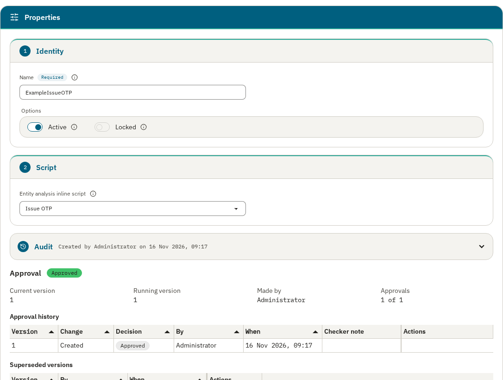

# Inline Scripts

Models inside Jube are extensible via the use of Inline Scripts. Inline Scripts use the processing context after preparation of model invocation headers, Request XPath and Inline Functions. Inline Scripts exist as a means to integrate external systems and enrich payload values.

There are two parts to an Inline Script. The code is held in a system-wide catalogue in the database, which is available for all models. The code must then be registered in a model for the payload to be populated in the same manner as Request XPath (i.e. it is available for the rules in the Payload collection).

## Where it lives

The catalogue is the database table EntityAnalysisInlineScript, and code can be added to it only through direct entry to that table, as described under Deployment below.

The registration of an Inline Script in a model is made by navigating through the menu to Models, opening the model, then the Inline Scripts hub card. Creating, changing, approving and deleting a registration follows the common manner described in [Child Objects](../../../Navigation/ChildObjects/index.html).

The default model is created with the Issue OTP Inline Script already registered and active, so a registration is only needed for a further Inline Script or a further model.

## The catalogue

```sql
select * from "EntityAnalysisInlineScript"
```

The EntityAnalysisInlineScript table in the database contains the following fields:

| Field        | Example               | Description                                                                                                                                                                                                                     |
|--------------|-----------------------|---------------------------------------------------------------------------------------------------------------------------------------------------------------------------------------------------------------------------------|
| Id           | 1                     | The identity of the Inline Script, assigned by the database, and the value a model registration refers to.                                                                                                                      |
| Code         | As below.             | The Inline Script source code, likely validated externally using the Jube.Sandbox project.                                                                                                                                      |
| Dependency   | IPTO.World.dll        | Any third party DLL's required are declared here, separated with ; (a comma is also accepted). Each DLL is looked for in the same directory as the Jube.Engine binary and, if it is not there, in the .NET framework directory. |
| Name         | Example Inline Script | The name of the InlineScript, and available in model configuration.                                                                                                                                                             |
| LanguageId   | 2                     | 2 for C#. Any other value, or no value, is compiled as Visual Basic (1 by convention).                                                                                                                                          |
| CreatedDate  | 2026-01-01 00:00:00   | When the Inline Script was created or last changed. It is informational: the engine compares the Code, Dependency and LanguageId to decide whether to compile a row again.                                                      |
| Compiled     | 1                     | Written by the engine on synchronisation: 1 when the Inline Script compiled, 0 when it did not.                                                                                                                                 |
| CompileError |                       | Written by the engine on synchronisation: the compile errors when Compiled is 0, otherwise empty.                                                                                                                               |

The database contains the following Visual Basic code to provide a "straight through", No IO, demonstration in the default environment, while also showing a minimal VB.net example (which is to say LanguageId = 1). This is the Issue OTP Inline Script:

```vbnet
Imports System
Imports System.Net.Http
Imports System.Threading
Imports System.Threading.Tasks
Imports Newtonsoft.Json.Linq
Imports Jube.Engine.Attributes
Imports Jube.Engine.Attributes.Events
Imports Jube.Engine.Attributes.Properties
Imports Jube.Engine.EntityAnalysisModelInvoke.Context
Imports Jube.Engine.Interfaces

Public Class IssueOTP
Implements IInlineScript
    <ResponsePayload> Public Property OTP As String

    <PayloadEvent>
    Public Async Function ExecuteAsync(context As Context) As Task(Of Boolean) Implements IInlineScript.ExecuteAsync
        OTP = RandomDigits(6)
        Return True
    End Function
    
    Private Function RandomDigits(ByVal length As Integer) As String
        Dim random = New Random()
        Dim s As String = String.Empty

        For i As Integer = 0 To length - 1
        s = String.Concat(s, random.[Next](10).ToString())
        Next

        Return s
    End Function	
End Class
```

## Interface

C# is the suggested Inline Script language. The Jube.Sandbox project contains the following C# code (which is to say LanguageId = 2), which provides the basis for further explanation, and is intended to showcase the following functionality:

* The required signatures for the invocation method, implementing IInlineScript required interface.
* The exposure of public properties to make data available to context payload and processing.
* The availability of attributes to allow for similar functionality to that available in Request XPath on public properties.
* The implementation of the ExecuteAsync () method from IInlineScript interface.

```csharp
// ReSharper disable RedundantUsingDirective
// ReSharper disable CheckNamespace

//The following are the minimum .Net libraries to make this work, however,  if using the Jube.Sandbox,  this will be shown,  as the project file is set to not default any assemblies and will be a like for like compile.
using System;
using System.Net.Http;
using System.Threading;
using System.Threading.Tasks;

//All assemblies are passed on the basis of what the Jube.App context is using, so nearly all libraries are supported.
using Newtonsoft.Json.Linq;

//The following are Jube libraries that contain the context and Inline Script attributes.
using Jube.Engine.Attributes;
using Jube.Engine.Attributes.Events;
using Jube.Engine.Attributes.Properties;
using Jube.Engine.EntityAnalysisModelInvoke.Context;
using Jube.Engine.Interfaces;

public class Example : IInlineScript//Class entry point is found by its implementation of IInlineScript.
{
    //Attributes overlap with the same options available in Request XPath
    [CacheIndex(Id = 1001)]
    [ReportTable]    //ReportTable is evaluated on recall.
    [ResponsePayload]//ResponsePayload is evaluated in model synchronization and used in model response preparation.
    [Latitude]       //Latitude is evaluated in model synchronization and is used during model activation watcher dispatch.
    [Longitude]      //Longitude is evaluated in model synchronization and is used during model activation watcher dispatch.
    [SearchKey(SearchKeyTtlInterval = "h",
        SearchKeyTtlIntervalValue = 1,
        SearchKeyFetchLimit = 100,
        SearchKeyCache = false,
        SearchKeyCacheInterval = "d",
        SearchKeyCacheValue = 1,
        SearchKeyCacheSample = true,
        SearchKeyCacheFetchLimit = 100,
        SearchKeyCacheTtlInterval = "h",
        SearchKeyCacheTtlValue = 1)]                      //SearchKey ensures that this is exposed in for aggregation in both the background engine.
    public string? UserAgent { get; set; } = String.Empty;//Public properties are available for processing, being analogous,  when taken together with attributes, to a Request XPath entry

    [ActivationRuleOverrideEvent(Guid = "bc81ff60-3254-4f1a-9003-ecae5e114142", Priority = 1)]
    [PayloadEvent]
    public async Task<bool> ExecuteAsync(Context context)//Method entry point.  The Context object gives access to all resources that would otherwise be available during invocation.
    {
        //Example HTTP Call with the fetching of data from the context.
        using var client = new HttpClient();
        client.DefaultRequestHeaders.Add("User-Agent", "MyApp/1.0");
        client.DefaultRequestHeaders.Add("IP", context.EntityAnalysisModelInstanceEntryPayload.Payload["IP"]);//Here we are looking at the context, and while we are only extracting data here,  full access to all application resources are available in this context,  such as logging.

        var response = await client.GetStringAsync("https://postman-echo.com/get");//Get the data from remote using the standard HTTP client.

        //Example Parse and transpose to payload.
        var jObject = JObject.Parse(response);//The response stream is processed using Newtonsoft

 #pragma warning disable CS8600// Converting null literal or possible null value to non-nullable type.
        var userAgent = (string)jObject["headers"]?["user-agent"] ?? "Unknown";
 #pragma warning restore CS8600// Converting null literal or possible null value to non-nullable type.

        UserAgent = userAgent;

        return true;//Behavior depends upon the event,  but in all cases properties will only be extracted to payload on return true;
    }
}
```

The Jube.Sandbox is a project in the Jube solution and is configured to disallow implicit usings, and hence represents a tight representation of the codes runtime environment. The Jube.Sandbox has a program and main application entry point which allows for the creation of mock context, thereafter invoking the script set out above:

```csharp
using Jube.Dictionary;
using Jube.Engine.EntityAnalysisModelInvoke.Context;
using Jube.Engine.EntityAnalysisModelInvoke.Models.Payload.EntityAnalysisModelInstanceEntryPayload;

var context = new Context
{
    EntityAnalysisModelInstanceEntryPayload = new EntityAnalysisModelInstanceEntryPayload
    {
        Payload = new DictionaryNoBoxing<string>
        {
            {
                "IP", "123.123.123.123"
            }
        }
    }
};

var exampleInlineScript = new Example();
await exampleInlineScript.ExecuteAsync(context);
```

An InlineScript is a complete .NET class written in VB.net or C#, and starts out with all of the required using statements at the top of the class, as in the listing above.

After the using statements, the class can be declared, implementing the IInlineScript interface, and named as desired (it can be anything that is not a reserved C# token):

```csharp
public class Example : IInlineScript
{
}
```

During synchronisation the compiled code is inspected for the first public, non-abstract class implementing the IInlineScript interface, and that class is taken to be the application entry point. The class name is not registered anywhere, and the class must have a public constructor taking no parameters, as a new instance is created for every invocation.

The class at a minimum must contain one method conforming to the following signature, and otherwise enforced as per the IInlineScript interface:

```csharp
public async Task<bool> ExecuteAsync(Context context)
{
}
```

The ExecuteAsync () method is called on each and every invocation, taking the invocation context as a parameter. A return of true or false is required which has different behavior depending upon the event. In all cases only upon true being returned will properties be inspected for inclusion in the payload.

The invocation context is a reference, hence updates to the context will be available in subsequent invocation pipeline processing, the same process calling the class upstream. To return values from the ExecuteAsync () method, simply set the value of a public property, as can be seen in the setting of the UserAgent string in the listing above.

## Payload Property Attributes

Payload is exposed as a public property in the class with certain attribute decoration to emulate configuration available in Request XPath (keeping in mind that Inline Scripts serve much the same function, the aggregation of payload data before processing), as can be seen on the UserAgent property in the listing above.

As a property declared with a type (e.g. Public Property Hello as String) the data type will be taken from the property type, supporting the following types only:

* String.
* Integer.
* Double.
* Date.
* Boolean.

The nullable form of each type (e.g. int? in C#) is also supported. A property of any other type is ignored, as is a property whose value is null after ExecuteAsync () has returned.

Attribute decoration is available to achieve similar functionality as Request XPath documentation definitions, given that attributes are intended to emulate that functionality. The existence of the ResponsePayload, ReportTable, Latitude or Longitude attribute is boolean inference, the existence of which will be taken to be true, the absence is false:

| Attribute       | Behaviour when present                                                                                                                                  |
|-----------------|---------------------------------------------------------------------------------------------------------------------------------------------------------|
| ResponsePayload | The property is written to the Payload element of the model response. Without it the property is available to rules but is not returned to the caller. |
| ReportTable     | A record is inserted into the ArchiveKey table for the property on each invocation.                                                                     |
| Latitude        | The property is used as the latitude in Activation Watcher dispatch when no Request XPath is set as the latitude.                                       |
| Longitude       | The property is used as the longitude in Activation Watcher dispatch when no Request XPath is set as the longitude.                                     |
| CacheIndex      | Takes a single Id parameter, giving the property a numeric cache index identifier in the same manner as a Request XPath.                                |

The SearchKey has more parameters available in the attribute:

| Value                     | Example |
|---------------------------|---------|
| SearchKeyTtlInterval      | h       |
| SearchKeyTtlIntervalValue | 1       |
| SearchKeyFetchLimit       | 100     |
| SearchKeyCache            | false   |
| SearchKeyCacheInterval    | d       |
| SearchKeyCacheValue       | 1       |
| SearchKeyCacheSample      | true    |
| SearchKeyCacheFetchLimit  | 100     |
| SearchKeyCacheTtlInterval | h       |
| SearchKeyCacheTtlValue    | 1       |

For each public property post invocation of the Inline Script, the public property value will be added to the context (in the same manner as Request XPath would be), and it does not need to be added manually (although it can be if for any reason the value needs to be silent).

## Where Properties Appear

Once an Inline Script is registered and active in a model, each of its public properties is treated as a payload element of that model, named after the property and addressed as Payload.Name (e.g. Payload.OTP). The properties surface in the following areas:

| Area                             | How the property appears                                                                                                                                                                                                                                                             |
|----------------------------------|--------------------------------------------------------------------------------------------------------------------------------------------------------------------------------------------------------------------------------------------------------------------------------------|
| Rule builder and coder           | Offered as Payload.Name in the Payload group of the coder completions of every rule editor of the model (for example Gateway Rules, Abstraction Rules and Activation Rules), and in the builder field list, with the operators of its data type, where the editor offers a builder. |
| Filter builders over stored data | Offered as Payload.Name in the filter builders that read archived transactions (the Case filter, Journal filter, Exhaustive filter and Backtest), where it is read from the payload element of the archived JSON.                                                                  |
| Abstraction Rule drop downs      | Listed in the Search Key and the Search Function Key drop downs. String and Double properties only, as the engine reads a key as a String and an aggregated value as a Double.                                                                                                      |
| TTL Counter drop downs           | Listed in the drop downs for the data name the counter is grouped by and the data value the counter is incremented by. String and Double properties only, for the same reason.                                                                                                      |
| Rule parsing and compilation     | Recognised by the rule parser, when a rule is saved and when the model is synchronised, so that Payload.Name compiles with the data type of the property.                                                                                                                            |
| Model response                   | Written to the Payload element of the response when the property is decorated with ResponsePayload.                                                                                                                                                                                  |
| Archive                          | Stored in the payload element of the archived JSON alongside the Request XPath values, and inserted into the ArchiveKey table when decorated with ReportTable. Reprocessing reads the property back from the archive with its data type.                                            |
| Search Keys                      | A property decorated with SearchKey is added to the Search Keys of the model, making it available for Abstraction Rule search and the Search Key Cache in the same manner as a Request XPath flagged as a Search Key.                                                               |
| Activation Watcher               | A property decorated with Latitude or Longitude positions the activation when no Request XPath is set for that purpose.                                                                                                                                                              |
| Model Integrity and dependencies | Each property is shown as an Inline script property among the inputs of the model dependency graph, with the rules that refer to it. Deleting the registration of an Inline Script is refused while a rule in the model depends on one of its properties.                          |
| Rule testing                     | Each property is listed as a name in the rule evaluation context used to test a rule. Where the EnableInlineScriptExecution Environment Variable is True (it is False by default), the Inline Script can be executed outside the engine and the values of its properties overlaid on that context. |

The lists in the user interface are built by reading the Code of the Inline Script rather than by executing it, which has the following consequences:

* A property is listed as soon as the Inline Script is registered and active in the model, before the model is synchronised.
* Property names are matched without regard to case, so two properties differing only by case are taken to be the same.
* A public property of a type other than String, Integer, Double, Date or Boolean is listed as a String, although the engine does not add a property of an unsupported type to the payload.
* A property is listed whether or not ExecuteAsync () sets it. A property left as null, or an invocation where ExecuteAsync () returns False, leaves the element absent from the payload for that invocation.

## Event Attributes

Decorating the ExecuteAsync method with attributes specifies the event in the invocation pipeline for which the Inline Script should be executed, as can be seen in the listing above, where the method is decorated with both ActivationRuleOverrideEvent and PayloadEvent.

An event attributes shares the following common parameters which are used for matching given the event context (e.g., ActivationRuleOverride):

| Value    | Example                              | Description                                                                                                                                                                                                                                                                                                  |
|----------|--------------------------------------|--------------------------------------------------------------------------------------------------------------------------------------------------------------------------------------------------------------------------------------------------------------------------------------------------------------|
| Guid     | 0d551553-5a17-4d13-9836-b4695801be03 | On searching for Inline Scripts on events the Guid implies that it should only be executed if the event context (e.g., an Activation Rule Guid) matches.                                                                                                                                                     |
| Name     | Test                                 | On searching for Inline Scripts on events the Name implies that it should only be executed if the event context (e.g., an Activation Rule Name) matches.  While readable, this is a less durable approach and should only be used in the case an entity is locked and the Name is assured to be non-volatile |
| Priority | 0                                    | Orders the event attributes declared on a single Inline Script. It does not order one Inline Script against another: Inline Scripts are processed in the order in which they were registered in the model.                                                                                                   |

Guid and Name are matched for ActivationRuleOverrideEvent only, and when both are given both must match. They are accepted on PayloadEvent but are not matched: an Inline Script decorated with PayloadEvent is executed on every invocation of each model in which it is registered.

In the absence of Guid and Name being provided it implies broad coverage, for example, for all Activation Rules in the case of ActivationRuleOverrideEvent.

True return values will have special behavior in the invocation depending on the invocation event, however, property extraction will only take place given return True in all instances. An exception thrown from ExecuteAsync () is logged at the ERROR level and treated as a return of False.

Event coverage during invocation is described in the following table:

| Event                       | Location                                                                 | Event Context                             | True Behaviour                                                                                                                                         |
|-----------------------------|--------------------------------------------------------------------------|-------------------------------------------|--------------------------------------------------------------------------------------------------------------------------------------------------------|
| PayloadEvent                | After Request XPath and Inline Function processing, before Gateway Rules | None, it is executed on every invocation. | None except default Property extraction.                                                                                                               |
| ActivationRuleOverrideEvent | After Activation Rule Matching for each Activation Rule                  | The Activation Rule Guid and Name         | Sets the Activation Rule as matched for that instance, whatever the rule itself returned. A return of False leaves the match status of the rule as is. |

The events in the table above are the invocation stages available, each allowing for extensibility at that point in the pipeline without needing to modify the core.

## Deployment

In the event that the Inline Script fails to compile, a log entry will be written out with the compile errors at the ERROR level, and the Compiled and CompileError fields of the EntityAnalysisInlineScript table are updated with the outcome. It is advisable to compile the class as part of a separate project before promoting in the database, and the Jube.Sandbox project is made available for this purpose.

To promote an InlineScript to Jube, it is a question of inserting the class to a table in the database titled EntityAnalysisInlineScript:

```sql
insert into "EntityAnalysisInlineScript"
("Code",
 "Name",
 "Dependency",
 "LanguageId",
 "CreatedDate")
values (@TheInlineScriptAsAbove,
        @TheNameAvailableToEndUsers,
        @AnyDLLsRequired,
        @VisualBasicOrCSharp,
        now() at time zone 'utc');
```

To change an Inline Script that has already been promoted, update the Code (and the Dependency or LanguageId if they have changed):

```sql
update "EntityAnalysisInlineScript"
set "Code"        = @TheInlineScriptAsAbove,
    "CreatedDate" = now() at time zone 'utc'
where "Id" = @TheInlineScriptId;
```

On the next model synchronisation the engine compares the Code, Dependency and LanguageId of each row with the Inline Script it has loaded and compiles the row again when any of them differ. The CreatedDate is not part of that comparison and is updated above only to keep a record of the change. A changed Inline Script replaces the loaded one as a whole, taking its properties, property attributes and event attributes from the new Code, and the models synchronised pick up the replacement. Where the changed Code fails to compile, the Inline Script loaded beforehand continues to be used, and the Compiled and CompileError fields record the failure until the Code is corrected.

## Fields

The parameters available to the registration of an Inline Script in the model are:

| Value         | Description                                                                                                                           | Example   |
|---------------|---------------------------------------------------------------------------------------------------------------------------------------|-----------|
| Name          | The name of the registration. Required, and unique within the Model.                                                                  | Issue OTP |
| Entity analysis inline script | The Inline Script, selected from the catalogue, to be invoked on each request being made to the model.                | Issue OTP |
| Active        | Whether the Inline Script is invoked and its properties offered to rules. Active is off for a new registration and must be switched on. | True      |
| Locked        | Whether the registration is protected from change.                                                                                    | False     |

The form is arranged in the groups Identity and Script, followed by the collapsed Audit group, the catalogue selection being labelled Entity analysis inline script, which is derived from the name of the property in the server. The selection offers every Inline Script of the catalogue by name, and the code of the script is neither shown nor edited in the form. A new registration is presented with Active off.

Each failure is written beneath the field it relates to and counted in the summary at the head of the form, as described in [Child Objects](../../../Navigation/ChildObjects/index.html), with the messages as follows:

| Field                         | Message                                                                                 |
|-------------------------------|-----------------------------------------------------------------------------------------|
| Name                          | A name is required. The name must be 256 characters or fewer. This name already exists. |
| Entity analysis inline script | An Inline Script is required. The selected Inline Script does not exist.                |

A registration whose properties are named in the text of a rule, or chosen as a search key, a data name or a case key, cannot be deleted while they are so used, as described under Deleting an entity that is in use in [Child Objects](../../../Navigation/ChildObjects/index.html).

SHOT id=models-inline-scripts-registration
     route=/models
     steps=open-default-model, open-hub:Inline Scripts, open-row:ExampleIssueOTP
     frame=record
     state=the Issue OTP registration of the default model opened, approved and active, showing the form with the catalogue selection
     conveys=registering an Inline Script in a model is a small form selecting from the catalogue; the code is not edited here
     alt=The Issue OTP Inline Script registration opened beneath the default model, showing the name, the Inline Script selected from the catalogue and the Active switch



## Example

With the Issue OTP Inline Script registered, active and approved in the default model, as it is by default, make an HTTP POST to the model, as provided in `Http/Transaction.http`:

```http
POST http://localhost:5001/api/invoke/EntityAnalysisModel/90c425fd-101a-420b-91d1-cb7a24a969cc
Content-Type: application/json
X-API-KEY: <an API key>
```

Notice a field added as "OTP" in the Payload element of the response, abbreviated here:

```json
{
  "EntityAnalysisModelInstanceEntryGuid": "...",
  "ResponseElevation": { },
  "Payload": {
    "OTP": "482913"
  }
}
```

TODO(verify): replace the abbreviated response above with one captured from a running system

The field was exposed by the Inline Script as being a property, such that it is also available in the rule builder and coder as Payload.OTP. Keep in mind that an Inline Script can expose many properties and add many elements, hence the name of the inline script itself has limited relevance.

A property is returned in the response only when it is decorated with the ResponsePayload attribute, as the OTP property of the Issue OTP Inline Script is. Without the attribute a property is available to the rules but is not in the response.

Although the inline script set out above is basic, simply appending a value to the payload as if it had been passed originally in the request JSON, Inline Scripts can be used for far more complex integration and data processing.

## Permissions and security

Reading and writing this area requires permission 9, Read Write Inline Script. A user without it receives 403, and an unauthenticated request receives 401. Every mutation also needs the antiforgery token for cookie sessions.

An Inline Script registration is only a reference: the C# or VB.net code lives in the system-wide Inline Script catalogue, which is read-only through the API (rows are created and compiled outside it), so a tenant user cannot author code here. The catalogue is not tenant scoped.
