# Lists

The Lists Page facilitates the creation of lists of data that can be referenced as an operator in all rules in the
models. For example, the Lists page can be used to maintain a list of bad customer account identifiers that can be
referenced using the Builder or Coder.

Lists might for example be used to maintain large Deny and Accept lists, without having to embed large amounts of
complexity into rules, instead embedding only the list reference.

Lists are synchronised by the engine in the background constantly, and they do not require an explicit synchronisation.
It follows that any new list value is available more of less straight away.

The page is available by navigating to the menu item Lists, in the main page. The positioning of the List navigation is
in the main section, even though it is in fact part of models, for the purposes of delegating this otherwise
administrative function to customer service orientated roles:

<!-- TODO(screenshot): file=model-references-menu-item-list.png route=/models/references/lists state="replace the Razor-era image MenuItemList.png with the Vue UI showing the same step" -->
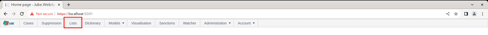

Click as customary to expose a model tree which takes a similar form as other model administration objects:

<!-- TODO(screenshot): file=model-references-lists-top-of-tree.png route=/models/references/lists state="replace the Razor-era image ListsTopOfTree.png with the Vue UI showing the same step" -->
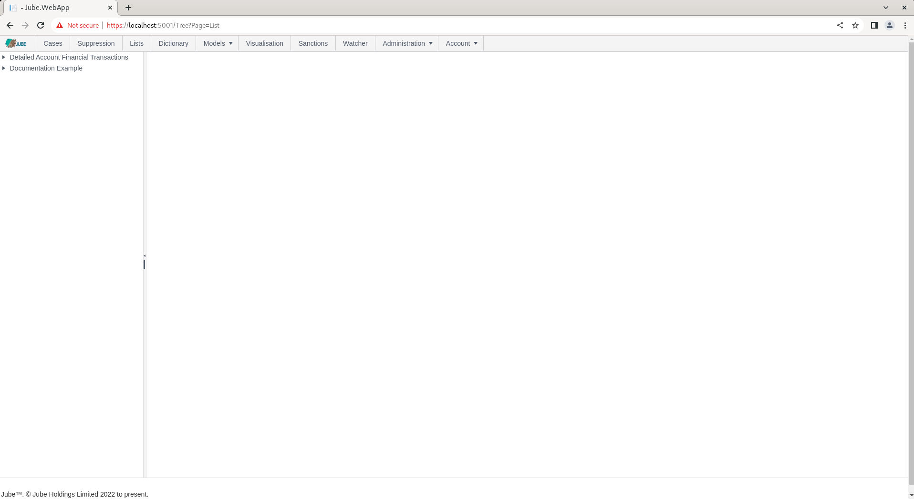

To create a list, click on the Model in the tree towards the left hand side:

<!-- TODO(screenshot): file=model-references-empty-list-ready-for-add.png route=/models/references/lists state="replace the Razor-era image EmptyListReadyForAdd.png with the Vue UI showing the same step" -->
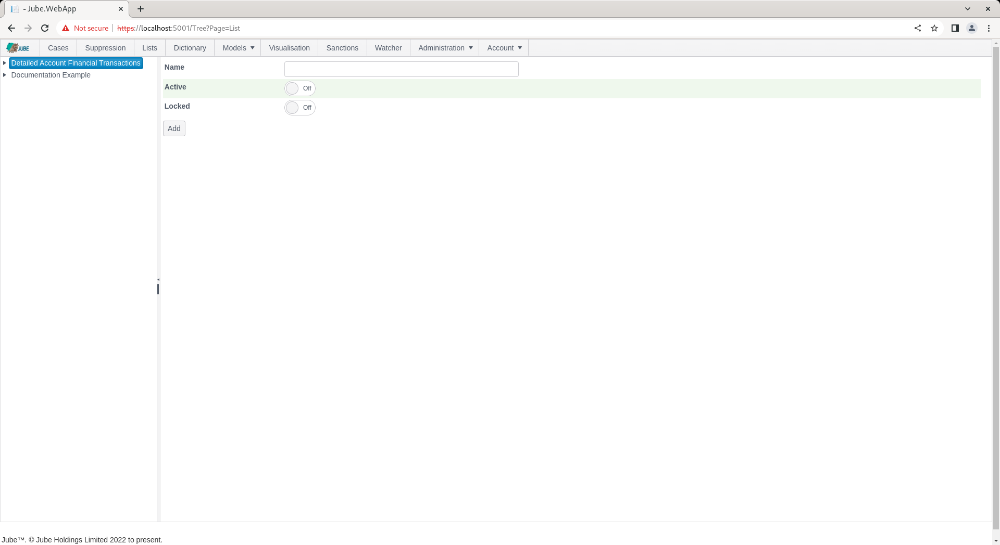

There are no parameters beyond the common parameters, the List is taken to be the Name. The name is required and limited
to 256 characters, and must be unique within the Model.

Creating a List by the name Bad Customers:

<!-- TODO(screenshot): file=model-references-example-list-bad-customers.png route=/models/references/lists state="replace the Razor-era image ExampleListBadCustomers.png with the Vue UI showing the same step" -->
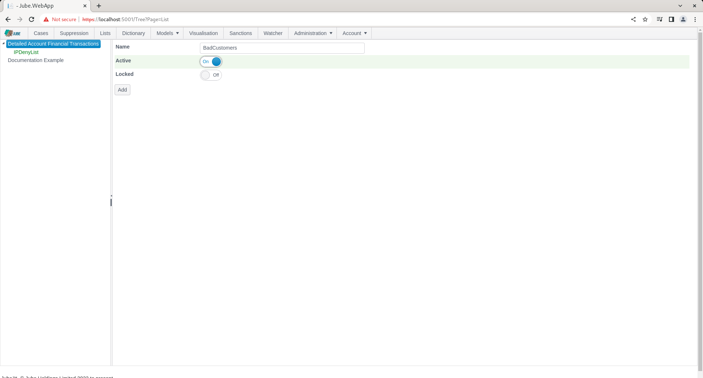

Click the Add button to confirm creation of the List:

<!-- TODO(screenshot): file=model-references-added-list-of-bad-customers.png route=/models/references/lists state="replace the Razor-era image AddedListOfBadCustomers.png with the Vue UI showing the same step" -->
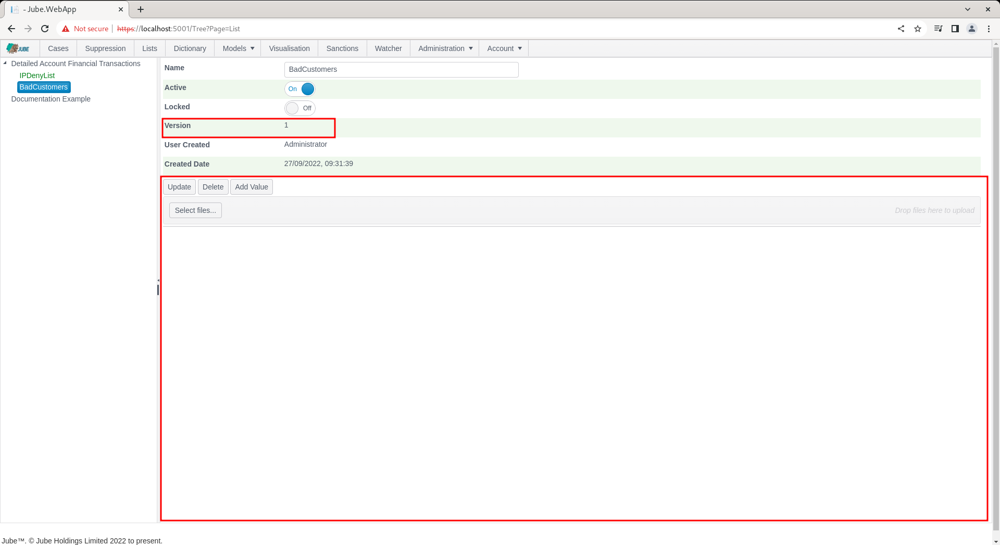

The List values are maintained using a grid facilitating the addition, updating and removal of List Values:

<!-- TODO(screenshot): file=model-references-children-values.png route=/models/references/lists state="replace the Razor-era image ChildrenValues.png with the Vue UI showing the same step" -->
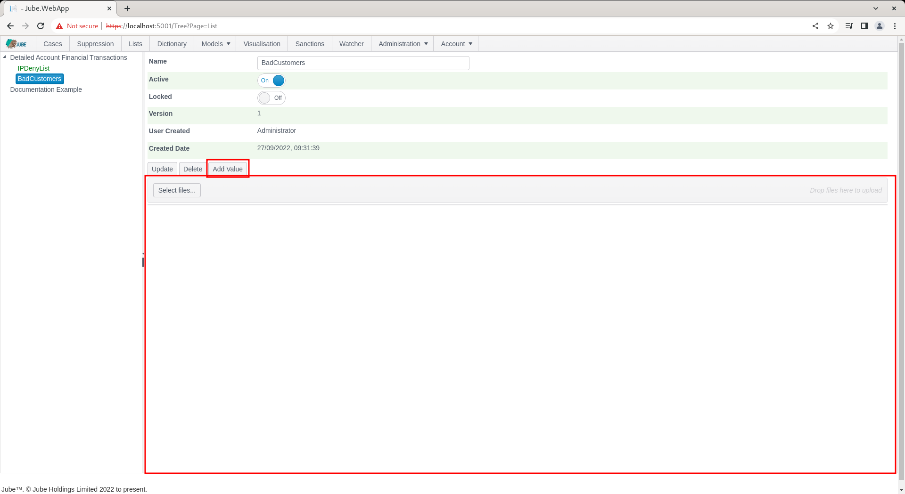

To add a value to the list, a button is implemented titled 'Add Value':

<!-- TODO(screenshot): file=model-references-add-value-button.png route=/models/references/lists state="replace the Razor-era image AddValueButton.png with the Vue UI showing the same step" -->
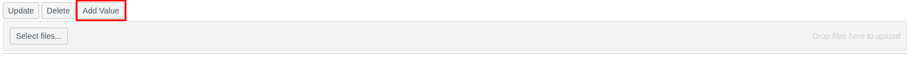

Clicking the Add button will overlay a form and create a new entry in the grid:

<!-- TODO(screenshot): file=model-references-template-for-add-value-to-list.png route=/models/references/lists state="replace the Razor-era image TemplateForAddValueToList.png with the Vue UI showing the same step" -->

To commit the new value, click on the tick icon:

<!-- TODO(screenshot): file=model-references-tick-confirm-button.png route=/models/references/lists state="replace the Razor-era image TickConfirmButton.png with the Vue UI showing the same step" -->

Or to cancel the creation of the Value click the opposing icon:

<!-- TODO(screenshot): file=model-references-circle-cancel-button.png route=/models/references/lists state="replace the Razor-era image CircleCancelButton.png with the Vue UI showing the same step" -->
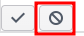

Include the value as follows in the input box:

<!-- TODO(screenshot): file=model-references-example-value-for-list-value.png route=/models/references/lists state="replace the Razor-era image ExampleValueForListValue.png with the Vue UI showing the same step" -->
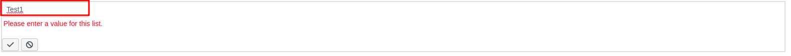

The Add/Update Value form also exposes an optional Delete Expiry Date field, alongside the List Value, using a date and
time picker.

Delete Expiry Date has the same effect as deleting the List Value: once the date and time entered is reached, the value
is automatically excluded from processing and from the grid, without an explicit delete ever being actioned. Leaving
Delete Expiry Date blank, which is the default, means the value never expires and will need to be removed manually if it
is to stop being available. The date and time entered must be in the future; an attempt to set a value in the past is
rejected by the server, with the reason displayed above the grid.

This applies to any field on the List Value entry, not only Delete Expiry Date: an empty List Value is likewise rejected
server-side, as is a List Value longer than 512 characters. On rejection the entry is automatically re-opened for
editing and highlighted in red, in addition to the message shown above the grid, making it clear exactly which entry
needs correcting.

A List Value must be unique within its List: the server rejects an attempt to add a value that already exists,
exactly as above. Matching is case-sensitive and exact, consistent with how rules compare against the List at
run time. A value is still considered to exist, and so still blocks a duplicate, for as long as its own deletion is
sitting with a checker awaiting approval, or was rejected and has not yet been retracted or resubmitted by the maker:
in both cases the rule engine continues to treat the value as live until the deletion is actually approved, so the
same text cannot be re-added in the meantime. Once a deletion is approved, the same value may be added again like
any other new entry.

To update a List Value, click on the pen icon for the list value to be updated. Upon clicking the Pen icon:

<!-- TODO(screenshot): file=model-references-edit-button-existing-list-value.png route=/models/references/lists state="replace the Razor-era image EditButtonExistingListValue.png with the Vue UI showing the same step" -->
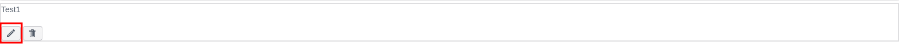

A form with a text box will be overlay:

<!-- TODO(screenshot): file=model-references-overlay-list-item-for-edit.png route=/models/references/lists state="replace the Razor-era image OverlayListItemForEdit.png with the Vue UI showing the same step" -->
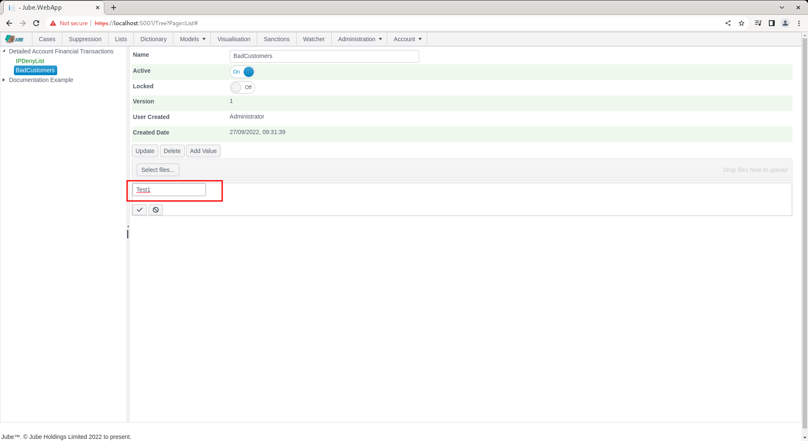

Update the text box with the new value:

<!-- TODO(screenshot): file=model-references-updated-existing-list-value.png route=/models/references/lists state="replace the Razor-era image UpdatedExistingListValue.png with the Vue UI showing the same step" -->
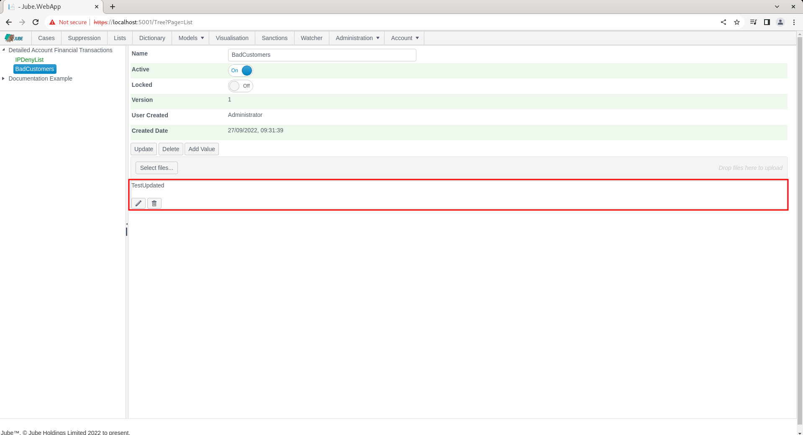

Commit by clicking on the Tick icon:

<!-- TODO(screenshot): file=model-references-tick-confirm-button.png route=/models/references/lists state="replace the Razor-era image TickConfirmButton.png with the Vue UI showing the same step" -->

Or to cancel the edit of the Value click the opposing icon:

<!-- TODO(screenshot): file=model-references-circle-cancel-button.png route=/models/references/lists state="replace the Razor-era image CircleCancelButton.png with the Vue UI showing the same step" -->

Upon the successful commit of the Value, it will appear updated in the List control:

<!-- TODO(screenshot): file=model-references-updated-list-value.png route=/models/references/lists state="replace the Razor-era image UpdatedListValue.png with the Vue UI showing the same step" -->
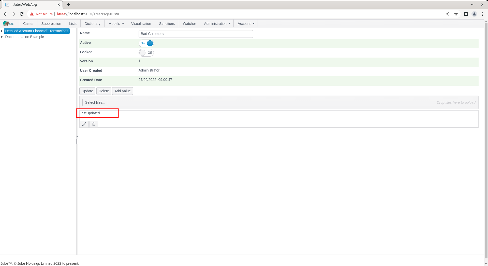

To delete a List value entry, it is a simple matter of clicking on the Disk Icon next to the List Value targeted for
deletion:

<!-- TODO(screenshot): file=model-references-delete-button.png route=/models/references/lists state="replace the Razor-era image DeleteButton.png with the Vue UI showing the same step" -->
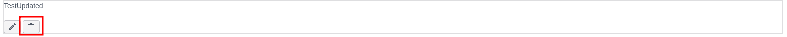

A confirmation of the delete will be sought:

<!-- TODO(screenshot): file=model-references-confirm-delete-of-list-value.png route=/models/references/lists state="replace the Razor-era image ConfirmDeleteOfListValue.png with the Vue UI showing the same step" -->
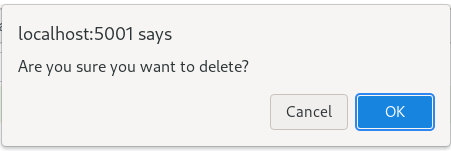

Upon confirming the delete, it will be removed from the list of values:

<!-- TODO(screenshot): file=model-references-value-deleted.png route=/models/references/lists state="replace the Razor-era image ValueDeleted.png with the Vue UI showing the same step" -->
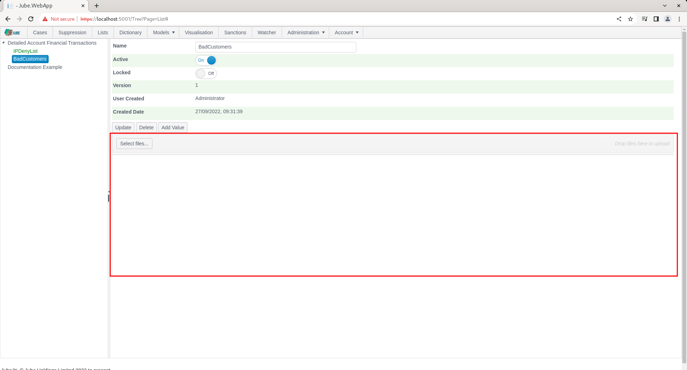

It is also possible to upload a list of values by uploading a CSV file given the downloadable template in the page.

Note there is no column header in the above file and structure. Each line is a List Value, optionally followed by a
comma and a Delete Expiry Date. The Delete Expiry Date must be in .NET's round-trip ("O") format, for example
`2027-01-01T00:00:00.0000000Z` - this is enforced strictly, with no other date format accepted, to avoid the day/month
ambiguity inherent in free-form date parsing of a text file. Where the Delete Expiry Date is omitted or left blank, the
List Value never expires. A template CSV file, illustrating both a List Value with no expiry and one with a Delete
Expiry Date, can be downloaded directly from the List page using the Download CSV Template link found next to the Select
Files control. A blank value, one longer than 512 characters, or a line the database rejects is logged and skipped, and
the remaining lines are still imported.

The same uniqueness rule applies to an uploaded line as to a value added by hand. If a line's value and Delete Expiry
Date both already match an existing entry exactly, the line is left alone: it is counted as imported, but nothing is
written and no new approval cycle is opened, so repeatedly uploading the same file is harmless. If the value matches
an existing entry but the Delete Expiry Date differs, or the value matches one still awaiting approval of its own
deletion (or rejected and not yet retracted or resubmitted), the line is rejected as a duplicate and skipped, the same
way a blank or over-long value is. List CSV upload only ever adds new values; unlike Dictionary, it never updates an
existing entry.

The control to upload a file is the button Select Files:

<!-- TODO(screenshot): file=model-references-select-files-button.png route=/models/references/lists state="replace the Razor-era image SelectFilesButton.png with the Vue UI showing the same step" -->
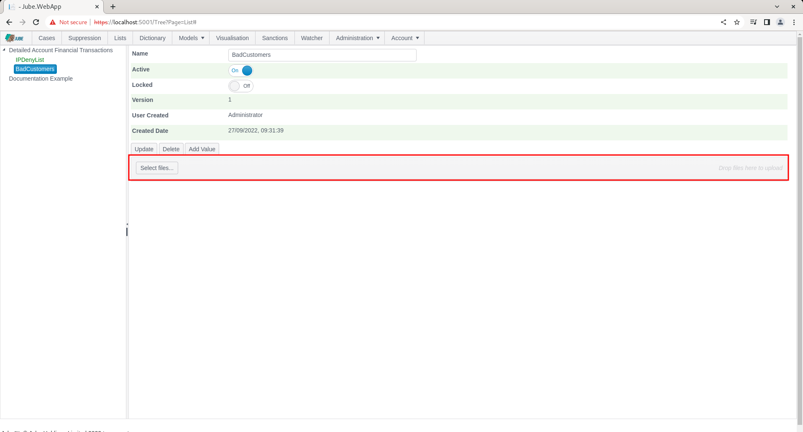

Either drag the file to the area shown above, or click the button titled Select files, navigating to the file:

<!-- TODO(screenshot): file=model-references-select-file.png route=/models/references/lists state="replace the Razor-era image SelectFile.png with the Vue UI showing the same step" -->
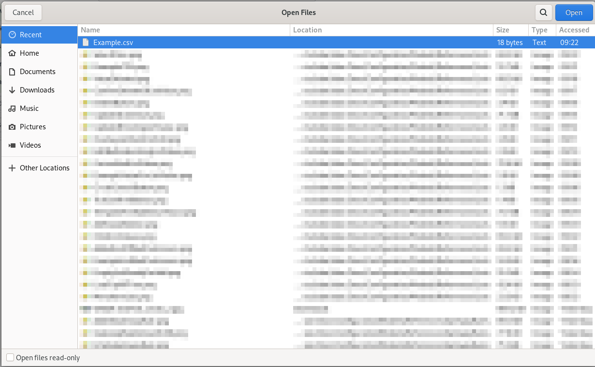

Clicking Open, which will happen implicitly if the file has been dragged and dropped, will both upload the file and
process, adding each row as a new list entry:

<!-- TODO(screenshot): file=model-references-uploaded-list-values.png route=/models/references/lists state="replace the Razor-era image UploadedListValues.png with the Vue UI showing the same step" -->
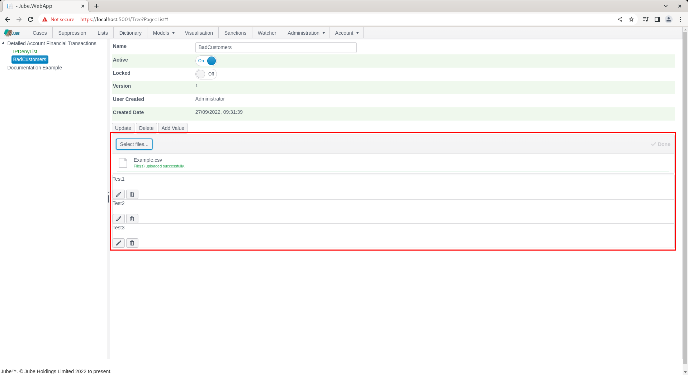

The list and its values will now be available to rules, for example:

<!-- TODO(screenshot): file=model-references-list-available-in-gateway-rule.png route=/models/references/lists state="replace the Razor-era image ListAvailableInGatewayRule.png with the Vue UI showing the same step" -->
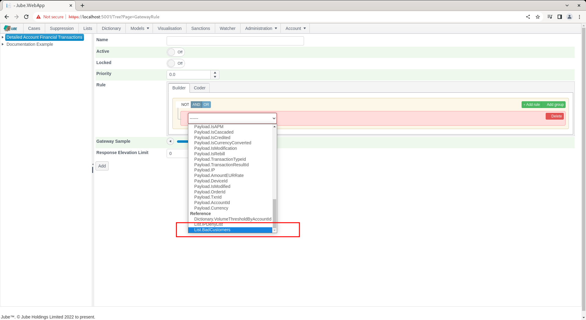

## Permissions and security

<!-- TODO(docs): confirm the permission number and wording against the running menu and the Roles page -->
Reading and writing this area requires permission 3. A user without it receives 403, and an unauthenticated request
receives 401. Every mutation also needs the antiforgery token for cookie sessions.

<!-- TODO(docs): owner to review this security paragraph, it was written from code, not from a running system -->
Lists and List Values are scoped to the caller's tenant through the parent Model; a foreign List id behaves like a
missing one. A list value is limited to 512 characters and must be unique in the List. CSV rows are loaded as data,
never executed; a blank or over-long first cell counts as a row error.

<!-- TODO(docs): changes are subject to maker-checker approval when ApprovalsRequired is on; describe the Approvals tab, Resubmit and Retract for Lists from the real UI -->
<!-- TODO(docs): every statement above about the Razor-era page layout (tree on the left, Add button, version pane) may be stale after the Vue port; re-read the whole page against the new UI -->
<!-- TODO(docs): add the Arabic and Urdu right-to-left note: identifiers, paths and code stay left-to-right inside right-to-left text -->
