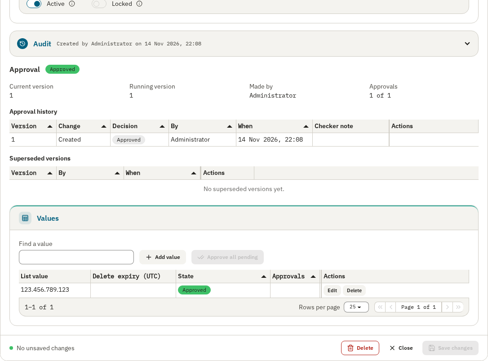
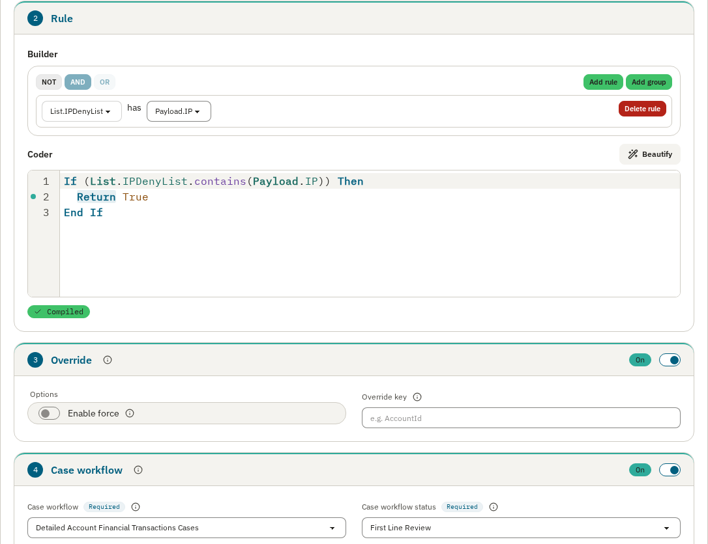

# Lists

Lists facilitate the creation of lists of data that can be referenced as an operator in all rules in the models. For example, a List can be used to maintain bad customer account identifiers that can be referenced using the Builder or Coder.

Lists might for example be used to maintain large Deny and Accept lists, without having to embed large amounts of complexity into rules, instead embedding only the list reference.

## Where it lives

Navigate through the menu to Models, open the model, then the Lists hub card. Creating, changing, approving and deleting a List follows the common manner described in [Child Objects](../../../Navigation/ChildObjects/index.html).

Lists are no longer an item in the main menu. The purpose that positioning served, the delegating of this otherwise administrative function to customer service orientated roles, is retained by permission instead: a role granted only permission 3, Read Write List, is presented with the Models menu item and can maintain Lists.

## Fields

| Value  | Description                                                                                                                                                                     | Example      |
|--------|---------------------------------------------------------------------------------------------------------------------------------------------------------------------------------|--------------|
| Name   | The name of the List, by which rules refer to it. Required, limited to 256 characters, and unique within the Model without regard to case.                                      | BadCustomers |
| Active | Whether the List is taken up by the engine and offered to rules. Active is off for a new List and must be switched on.                                                          | True         |
| Locked | Whether the List is protected from change.                                                                                                                                      | False        |

As rules refer to a List as `List.Name`, a name without spaces is advised.

## List Values

The values of a List are maintained in the Values panel, which is presented once the List has been created and is open.

SHOT id=models-lists-values
     route=/models
     steps=open-default-model, open-hub:Lists, open-row:IPDenyList, scroll-to:Values
     frame=record
     state=the IPDenyList of the default model opened, with the Values panel showing several values in differing states: approved, awaiting approval, one with a Delete expiry, and one deletion awaiting approval
     conveys=values are maintained in a grid beneath the List, and each value carries its own approval state
     alt=A List opened beneath its model with the Values panel listing each value alongside its delete expiry, state, approvals and actions



The panel has a box to find a value, matching any part of the value without regard to case, an Add value button, and Approve all pending. Values are shown 25 to a page, with the following columns:

| Column              | Description                                                                                               |
|---------------------|-----------------------------------------------------------------------------------------------------------|
| List value          | The value, limited to 512 characters.                                                                     |
| Delete expiry (UTC) | The date and time at which the value expires, if any.                                                     |
| State               | Approved, Awaiting approval, Deletion awaiting approval, Rejected or Deletion rejected.                   |
| Approvals           | The approvals recorded against the number required.                                                       |
| Made by             | The user having made the change.                                                                          |
| Checker note        | The note given by the checker upon approving or rejecting.                                                |
| Return note         | The note given by the maker upon resubmitting or retracting.                                              |
| Actions             | Edit and Delete, and for the purposes of approval, Approve, Reject, Resubmit and Retract.                 |

Values are added and edited in the row itself, committing with Save or abandoning with Cancel. Deleting a value seeks confirmation under the heading Delete this value?, and the value thereafter stays listed as a pending deletion until a checker approves it.

The clean installation carries three Lists in the default model, of which two are those by which the panel may be followed, the third being HighRiskCountries, which holds the country codes IR, KP and MM as Approved and is read by the Abstraction Rule HighRiskCountry. IPDenyList holds five values: 192.0.2.10, 192.0.2.44 and 198.51.100.23 are Approved and never expire, 198.51.100.90 is Approved with a Delete expiry ninety days after installation, and 203.0.113.77 is Awaiting approval and so plays no part in processing. WatchedAccounts likewise holds ACC-441, ACC-02 and ACC-77 as Approved, ACC-88 as Approved with a Delete expiry thirty days after installation, and ACC-300 as Awaiting approval. It follows that a rule testing `List.IPDenyList.contains(Payload.IP)` matches a transaction from 192.0.2.10 and does not match one from 203.0.113.77 until that value has been approved by a second user.

The controls of the panel behave as follows:

| Control             | Behaviour                                                                                                                                                                                             |
|---------------------|-------------------------------------------------------------------------------------------------------------------------------------------------------------------------------------------------------|
| Find a value        | Filters the values as it is typed. Where nothing matches the grid reads No values match the current filter., which is also what an empty List reads.                                                  |
| Add value           | Places a blank row for the new value. It is not available while a row is being added or edited, one row being worked upon at a time.                                                                  |
| Save                | Stores the row and returns the notice Value saved. The value is then Awaiting approval, with the approvals shown as 0 of 1 where one approval is required.                                            |
| Cancel              | Abandons the row without storing anything.                                                                                                                                                            |
| Edit                | Opens the row for the value and its Delete expiry to be altered. An edit to an Approved value returns it to Awaiting approval, the engine continuing with the version before until it is approved.    |
| Delete              | Upon confirmation, returns the notice Value deleted, pending approval. and the State reads Deletion awaiting approval.                                                                                |
| Approve, Reject     | Offered against a value awaiting a decision, to a user holding permission 44, Allow Approval, who did not make the change. A note may be entered under Checker note beforehand, and the notice reads Approved. or Rejected. |
| Resubmit, Retract   | Offered against a rejected value. Retract is offered only where an earlier version was approved. A note may be entered under Return note, and the notice reads Resubmitted. or Retracted.            |
| Approve all pending | Approves every value the user is able to approve. It is not available where there is nothing awaiting that the user may approve. Any value that could not be approved is reported above the grid with its reason. |

The State is a badge, and where the approval state of the values cannot be fetched, which is the case for a user holding neither permission 44, Allow Approval, nor permission 45, View Pending Approvals, each State reads Status unavailable and the panel states Approval status is unavailable. Reload to check. Should the values themselves not be fetched, the panel reads The values could not be loaded. Refresh the page to try again.

### Delete Expiry Date

A value may optionally be given a Delete Expiry Date. It is entered in the local time of the browser and stored as UTC.

Delete Expiry Date has the same effect as deleting the List Value: once the date and time entered is reached, the value is automatically excluded from processing, without an explicit delete ever being actioned. Leaving Delete Expiry Date blank, which is the default, means the value never expires and will need to be removed manually if it is to stop being available. The date and time entered must be in the future.

### Validation

A List Value is validated in the server, and is rejected where:

* The value is empty.
* The value is longer than 512 characters.
* The Delete Expiry Date is not in the future.
* The value already exists in the List.

On rejection the reason is displayed above the grid, and the entry remains open for editing so that it can be corrected. The reasons given are, in the order of the rules above: Please enter a value for this list., The value must be 512 characters or fewer., Delete Expiry Date must be greater than the current date and time., and This value already exists in the list.

A List itself is validated upon Create and Save changes, the Name being refused with A name is required., The name must be 256 characters or fewer. or This name already exists. A List named in the text of a rule cannot be deleted while it is so used, the refusal naming each rule, as described under Deleting an entity that is in use in [Child Objects](../../../Navigation/ChildObjects/index.html).

A List Value must be unique within its List. Matching is case-sensitive and exact, consistent with how rules compare against the List at run time. A value is still considered to exist, and so still blocks a duplicate, for as long as its own deletion is sitting with a checker awaiting approval, or was rejected and has not yet been retracted or resubmitted by the maker: in both cases the rule engine continues to treat the value as live until the deletion is actually approved, so the same text cannot be re-added in the meantime. Once a deletion is approved, the same value may be added again like any other new entry.

## Approval and synchronisation

Lists are synchronised by the engine in the background constantly, on every pass of model synchronisation (every ten seconds by default, as set by the ModelSynchronisationWait Environment Variable), and they do not require an explicit synchronisation.

The engine takes up only what has been approved, as described in [Maker Checker](../../../Concepts/MakerChecker/index.html). It follows that:

* A new value is available to rules more or less straight away upon being approved, and not before.
* A value whose deletion is awaiting approval continues to be available to rules until the deletion is approved.
* Only the values of an active List, that have not expired, are loaded.

Approve all pending approves every value awaiting approval in the List in one action, for a checker having many values to pass.

## Uploading values

Values can be loaded in bulk from a CSV file through the API, by a multipart POST of the file to `/api/EntityAnalysisModelListCsvFileUpload/{listId}`.

TODO(verify): the Vue user interface has no control to upload a CSV file to a List, and the downloadable template was removed with the Razor pages. Owner to decide whether the upload control is to be restored; this section then needs the name of the control.

There is no column header in the file. Each line is a List Value, optionally followed by a comma and a Delete Expiry Date in .NET's round-trip ("O") format, which avoids the day/month ambiguity inherent in free-form date parsing of a text file. Where the Delete Expiry Date is omitted or left blank, the List Value never expires. For example, a List Value with no expiry and one with a Delete Expiry Date:

```
ExampleListValue1
ExampleListValue2,2027-01-01T00:00:00.0000000Z
```

A blank value, one longer than 512 characters, a Delete Expiry Date that is not in the round-trip format or is not in the future, or a line the database rejects is skipped and counted as an error, and the remaining lines are still imported. The format is enforced strictly, such that a date written in any other form is never taken to mean that the value does not expire.

The same uniqueness rule applies to an uploaded line as to a value added by hand. If a line's value and Delete Expiry Date both already match an existing entry exactly, the line is left alone: it is counted as imported, but nothing is written and no new approval cycle is opened, so repeatedly uploading the same file is harmless. If the value matches an existing entry but the Delete Expiry Date differs, or the value matches one still awaiting approval of its own deletion (or rejected and not yet retracted or resubmitted), the line is rejected as a duplicate and skipped, the same way a blank or over-long value is. List CSV upload only ever adds new values; unlike Dictionary, it never updates an existing entry.

The number of lines imported and the number in error are recorded for each upload in the EntityAnalysisModelListCsvFileUpload table.

## Example

A List is referred to in a rule as `List.Name`. In the Builder, the List is offered among the fields under Reference, with the operator has, in the Lists group of operators. In the Coder, the same is written with contains, as in the Activation Rule of the default model that matches an IP address against the IPDenyList:

```vb
If (( List.IPDenyList.contains(Payload.IP))) Then
  Return True
End If
```

The rule returns True where the IP of the transaction is an approved, unexpired value of the IPDenyList.

SHOT id=models-lists-in-rule-builder
     route=/models
     steps=open-default-model, open-hub:Activation Rules, open-row:AllIPDenyList, scroll-to:Rule
     frame=record
     state=an Activation Rule of the default model in the Builder with a condition on List.IPDenyList using the has operator against Payload.IP
     conveys=a List is embedded in a rule as a single reference, whatever the number of values
     alt=The rule Builder showing a condition that tests whether the IPDenyList has the IP of the transaction



## Permissions and security

Reading and writing Lists and List Values, including the upload of a CSV file, requires permission 3, Read Write List. A user without it receives 403, and an unauthenticated request receives 401. Every mutation also needs the antiforgery token for cookie sessions.

Lists and List Values are scoped to the caller's tenant through the parent Model; a foreign List id behaves like a missing one. CSV rows are loaded as data, never executed.
