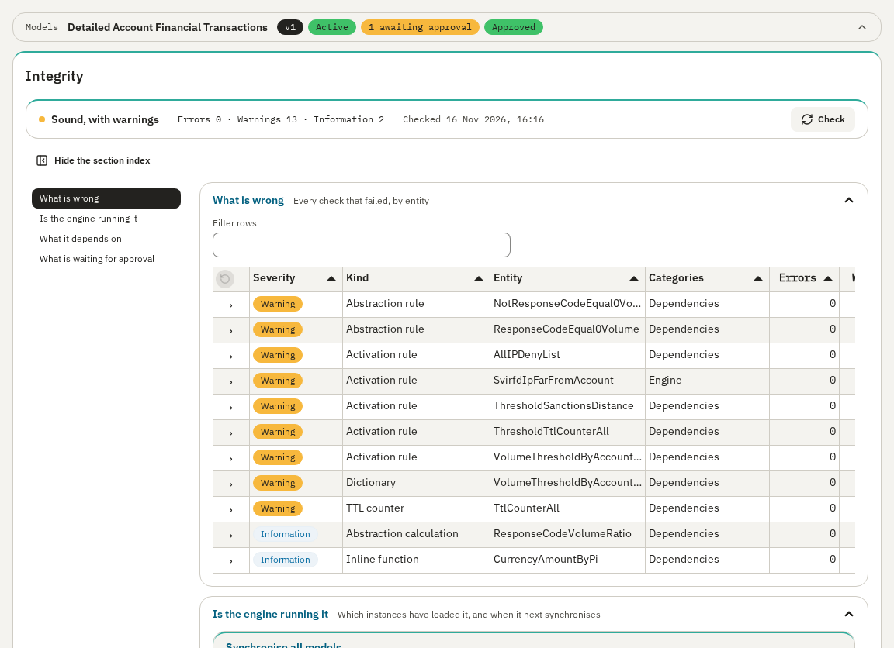
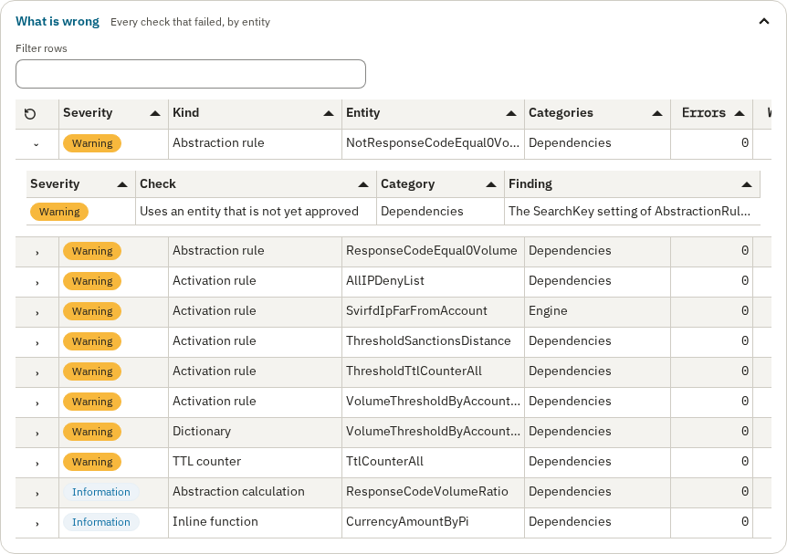
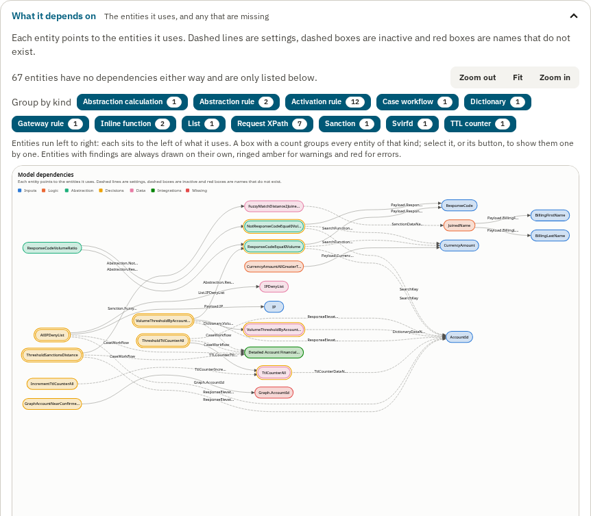
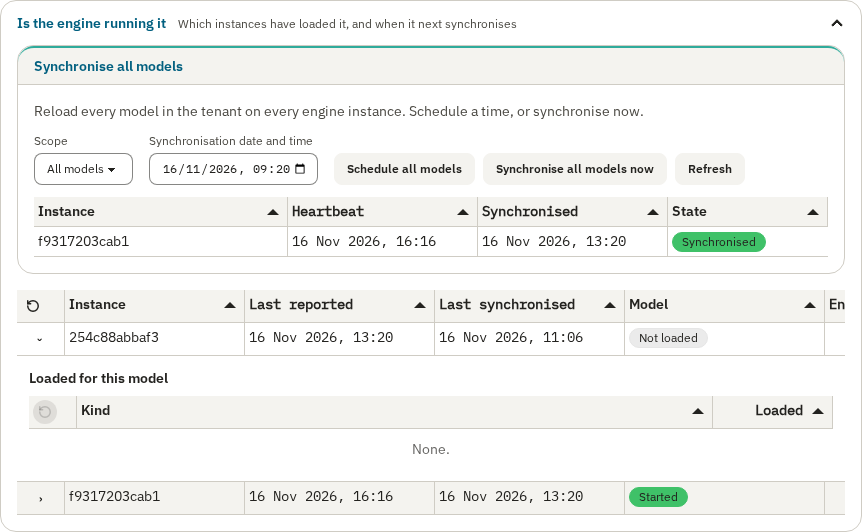

# Model Integrity

Model Integrity checks the basics of a model and lists anything that is wrong or may not work as intended. It answers four questions of a model in one place: what is wrong, whether the engine is running it, what it depends on, and what is waiting for approval. Nothing in the integrity check changes the model, with the exception of the scheduling of a synchronisation and the deciding of approvals, each of which is subject to its own permission.

The reason for its existence is that a model is many small parts which name one another, and which are changed by one person, approved by another and loaded by an engine at a later moment, such that there are three things which may each differ: what has been configured, what has been approved, and what the engine is running. A rule may be perfectly valid in itself and yet do nothing, because the list it names was deleted, because the counter it reads is switched off for the model, or because the engine has yet to load it. Model Integrity is the page to consult whenever a model does not behave as its configuration suggests it should, and before and after any change of consequence.

A finding is one thing the check has noticed about one entity, an entity being any part of the model: a Request XPath, a rule, a list, a counter, or the model itself. The verdict at the head is read as follows:

| Verdict              | Colour | Meaning                                                                               | What to do                                                             |
|----------------------|--------|---------------------------------------------------------------------------------------|------------------------------------------------------------------------|
| Sound                | Green  | No errors and no warnings. Information findings may still be listed.                   | Nothing.                                                               |
| Sound, with warnings | Amber  | No errors, and at least one warning: something may not work as intended.              | Read each warning, most being a matter of waiting or of synchronising. |
| Not sound            | Red    | At least one error: something does not work.                                          | Open What is wrong and deal with each error before relying upon the model. |

## Where it lives

Navigate through the menu to Models, and click Open on the model. Alongside the hub cards for the child objects, a card titled Integrity is presented, described as Findings, engine state, dependencies and synchronisation, to a user having permission 60, View Model Integrity. Clicking the card adds the integrity check to the story as a step beneath the model.

The step is headed by a verdict, being one of Not sound, Sound, with warnings, or Sound, alongside the number of Errors, Warnings and Information findings and the time the model was checked, with Check to check it again. Beneath are four sections that open and collapse, with an index of the sections alongside by which a section can be moved to:

| Section | Described as | Open at first |
|---------|--------------|---------------|
| What is wrong | Every check that failed, by entity | Yes |
| Is the engine running it | Which instances have loaded it, and when it next synchronises | Yes |
| What it depends on | The entities it uses, and any that are missing | No |
| What is waiting for approval | Changes that are not live until they are approved | No |

The grids sort and filter in the manner of the other grids in Jube, and their rows expand.

The counts at the head are written as Errors, Warnings and Information, each followed by its number, and the time as Checked followed by the date and time. The check is made upon the step being opened and again upon Check being clicked, and not otherwise, such that after a change has been made, approved or synchronised elsewhere, Check is to be clicked for the findings to reflect it. A user who is not permitted is told You do not have permission to view model integrity., and should the check fail for any other reason the head reads The model could not be checked.

SHOT id=models-model-integrity-canvas
     route=/models
     steps=open-default-model, open-hub:Integrity
     frame=page
     state=the integrity check of the default model, with the verdict and the counts of errors, warnings and information at its head, the section index, and the What is wrong and Is the engine running it sections open, the first showing several entities with findings
     conveys=the integrity check is one step under the model answering four questions, headed by a single verdict
     alt=The integrity check opened beneath a model, showing a verdict with counts of findings, an index of four sections, and the open sections listing findings by entity and the engine instances

## What is wrong

The section presents one row per entity with findings (or the model itself, or an engine instance), with the columns Severity (the worst of its findings), Kind, Entity, Categories, Errors, Warnings and Information. Expanding a row presents the checks for the entity: the Severity, the Check, the Category and the Finding, which is to say what was found. For example, a rule that names a TTL counter that does not exist, a rule the engine could not compile at its last synchronisation, TTL counters that are disabled for the model, or a search key whose TTL silently shortens the window of an abstraction rule. Where there is nothing to report the section reads "No findings."

SHOT id=models-model-integrity-finding-expanded
     route=/models
     steps=open-default-model, open-hub:Integrity, scroll-to:What is wrong, expand-first-row
     frame=section:What is wrong
     state=the What is wrong section of the Integrity page of the default model, listing the entities with findings by Severity, Kind, Entity and Categories, the first row, an Abstraction rule with a Warning, expanded to show its checks with the Severity, Check, Category and Finding of each
     conveys=each entity with findings is one row, and expanding it shows the checks behind the severity and what each one found
     alt=The What is wrong section of Model Integrity listing entities with warnings, the first row expanded to show the checks for that entity with their Severity, Check, Category and Finding

## Is the engine running it

The section presents one row per engine instance, with the columns Instance, Last reported, Last synchronised, Model (whether the instance has the model Started, Loaded, not started, or Not loaded) and Entities loaded. Expanding a row presents how many entities of each kind the instance has loaded for this model, and expanding a kind presents the Name, Id and Guid of each entity (an entity the engine still runs but that has since been deleted shows no guid, and is marked Not in the database). Where the engine has not loaded something yet, or is still running something deactivated, the findings say so, and synchronising the model brings the engine up to date.

The Model column is a badge, read as follows: Started, in green, means the instance is processing transactions for the model; Loaded, not started, in amber, means the instance has the model yet is not processing it; and Not loaded, without colour, means the instance does not have the model at all. In a healthy installation every instance reads Started with a Last reported time within the last two minutes. Where no instance has anything to report the section reads No engine instance has synchronised this tenant's models., and should the state not be fetched, The engine state could not be loaded.

The section also holds the synchronisation panel, described under Synchronisation below.

## What it depends on

The section presents a diagram of the whole model, laid out left to right, in which each entity sits to the left of the entities it uses, and the page scrolls down when a column is long. Each box shows the name of the entity, coloured by kind. Settings, such as a search key or the data name of a TTL counter, are drawn as dashed lines, inactive entities as dashed boxes and names that resolve to nothing as red boxes. Entities that use nothing and that nothing uses are left out of the diagram (they are still in the table, and the page says how many).

A model with more than 40 connected entities opens grouped, with one box per kind with a count, such as "Activation rule ×9", and one arrow between two groups with how many uses it stands for. Selecting a group, or the button for its kind under Group by kind above the diagram, shows its entities one by one, and selecting the button again groups them. A smaller model opens in full. Which kinds are shown is kept in the address, as `expanded`, so a link opens the same view, and Automatic goes back to the default. Entities with findings are always drawn on their own, even inside a grouped kind, with an amber ring for warnings and a red ring for errors, so the scale of the model and its problems are both visible at once. When a view would be too large to draw legibly, for example every kind expanded on a very large model, the page groups the largest kinds until it fits rather than failing. A long column wraps into several columns of at most 12 entities.

Hovering over a box shows what it uses and what uses it, and through which names, and hovering over a line shows what it joins. Clicking a box highlights it with everything it is connected to and opens its row in the table, and Show on diagram on a row in the table highlights the entity in the diagram. Clicking an empty part of the diagram, or pressing Esc, clears the highlight. The diagram is fitted to the width of the page and sized to its content, and can be zoomed by scrolling, or with Zoom in, Zoom out and Fit, and moved by dragging.

Below the diagram, under Entities in the model, is one row per entity, with a box to Find an entity and the columns Kind, Entity, Active, Uses (how many entities it uses), Used by (how many use it) and Missing names (how many names it uses that do not exist). Expanding a row presents what it uses and what uses it, Through which name, and How, being Rule text or a Setting.

SHOT id=models-model-integrity-dependencies
     route=/models
     steps=open-default-model, open-hub:Integrity, open-section:What it depends on
     frame=section:What it depends on
     state=the What it depends on section of the default model, with the dependency diagram drawn left to right, a dashed setting line and a ringed entity with a finding visible, and the first rows of the Entities in the model table beneath
     conveys=the dependencies of a model are drawn as one diagram, in which what an entity uses, and what uses it, can be followed
     alt=The dependency diagram of a model with entities as coloured boxes joined left to right, and the table of entities beneath

## What is waiting for approval

The section presents the changes to the entities of this model that are waiting for approval, grouped by kind, with the columns Kind, Waiting (entities and values) and Of which deletions. Expanding a kind presents the Entities awaiting approval, with the Name, the Change, the Version, who it was Made by, any Values, and the actions, which a user holding the approval permission can use to Approve or Reject here, as described in [Maker Checker](../../../Concepts/MakerChecker/index.html) and [Child Objects](../../../Navigation/ChildObjects/index.html). Where nothing is waiting, the section reads "Nothing is awaiting approval in this model."

The Change of an entity reads Edit for a new or changed entity and Deletion for one whose deletion is awaiting. Approve and Reject act upon the entity at once, and where the entity is a List or a Dictionary having values of its own awaiting, Approve values approves those values in one action, confirmation being returned as Approved followed by the number of values. The outcomes other than success are written within the section, as follows:

| Circumstance                                                        | Message                                                  |
|---------------------------------------------------------------------|----------------------------------------------------------|
| The user holds neither permission 44 nor permission 45.             | You do not have permission to view pending approvals.    |
| The user may view yet not decide, and attempts to (403).            | You do not have permission to do that.                   |
| The approval or rejection is refused by the server.                 | The reasons given by the server, as described in [Child Objects](../../../Navigation/ChildObjects/index.html), or The Approve was refused. where none is given. |
| The values could not be approved.                                   | The values could not be approved.                        |
| The section could not be fetched.                                   | The pending approvals could not be loaded.               |

Upon a decision being made here, the counts of changes awaiting upon the hub cards, the record steps and the table of models follow, and the verdict is brought up to date upon Check being clicked.

## The checks

Each finding has a severity: Error means something does not work, Warning means something may not work as intended, and Information is for information only. The findings are listed errors first.

| Check | Severity | Category | What it means |
|-------|----------|----------|---------------|
| Uses a name that does not exist | Error (Information when the entity is inactive) | Dependencies | Rule text or a setting names something that does not exist, so the rule would not compile or the setting would not work. |
| Uses an inactive entity | Warning | Dependencies | An active entity uses an inactive one, which the engine does not load. |
| Uses an entity that is not yet approved | Warning | Dependencies | An active entity uses one whose change is waiting for approval, which the engine does not run until it is approved. |
| Not used by anything | Information | Dependencies | An active list, dictionary, TTL counter, abstraction rule, abstraction calculation, inline function or adaptation that nothing in the model uses. |
| Did not compile in the engine | Error | Compilation | The engine could not compile an active rule at its last synchronisation, so it is not running. The compile error of the engine itself is given. |
| Model is inactive | Information | Configuration | The model is inactive, so the engine does not load it. |
| No active activation rules | Information | Configuration | No transaction can activate. |
| TTL counters are disabled | Warning | Configuration | TTL counters are disabled for the model, so an active counter is never incremented or read, and rules see 0. |
| Search key history is shorter than the rule window | Warning | Configuration | A search key keeps history for less time than the interval of an abstraction rule, so the engine silently uses the shorter window (see [Abstraction Rules](../AbstractionRules/index.html#the-search-window)). |
| Search key keeps no history for the rule window | Warning | Configuration | The search key has no TTL, so the window of the abstraction rule collapses to the reference date of the transaction. |
| Engine state is unavailable | Information | Engine | No engine runs alongside this instance and none has recorded what it loaded, so only the heartbeats of the engine instances can be checked. |
| No engine instance has synchronised | Warning | Engine | No engine instance has synchronised the models of the tenant. |
| Engine instance has stopped reporting | Error | Engine | An engine instance has not reported for more than 2 minutes but less than 60. After 60 minutes it drops out of the findings and is removed at the next synchronisation. |
| Model is not loaded by an engine instance | Warning | Engine | An engine instance that is reporting has not loaded the (active) model. An instance that has stopped reporting is shown as stopped instead. |
| Model is loaded but not started | Warning | Engine | An engine instance has loaded the model but not started it. |
| Not loaded by an engine instance | Warning | Engine | An active entity is not loaded by an engine instance: it is waiting for synchronisation, did not compile or, for an activation rule, is not approved. |
| Engine still runs an entity that is no longer active | Warning | Engine | An engine instance is still running an entity that is no longer active, until the model is synchronised. |
| Waiting for approval | Information | Engine | An entity (or a change to it) is waiting for approval, so the engine does not run it, or still runs the last approved version. |

### How to read each finding

The table above says what each check is. The table as follows says what the engine is doing in consequence, and what would ordinarily be done about it, the wording of the finding as presented being given so that it may be recognised:

| Finding, as worded                                                                                              | What the engine is doing                                                                     | What to do                                                                                                           |
|-----------------------------------------------------------------------------------------------------------------|----------------------------------------------------------------------------------------------|----------------------------------------------------------------------------------------------------------------------|
| The rule text of Activation rule X names List.HighRisk, which does not exist, so it will not work.             | The rule does not compile, and is not run.                                                   | Create the missing entity under that name, or correct the name in the rule.                                          |
| The same, ending it is inactive, so this only matters if it is activated.                                       | Nothing, the entity being inactive.                                                          | Correct it before making the entity active.                                                                          |
| The SearchKey setting of Abstraction rule X names IP, which does not exist, so it will not work.               | The setting cannot be honoured.                                                              | Choose a field that exists, or create the field.                                                                     |
| The rule text of X uses List Y, which is inactive, so the engine does not load it and the use will not work.   | The rule is run, yet the thing it uses is absent.                                            | Make the used entity active, or remove the use.                                                                      |
| The rule text of X uses List Y, which is not yet approved, so the engine does not run it and the use will not work until it is. | The same, until the approval is given.                                    | Approve the used entity, in What is waiting for approval.                                                            |
| List Y is active but nothing in the model uses it.                                                              | The entity is loaded and has no effect.                                                      | Nothing need be done. It may be a part being prepared, or one that may be deactivated.                               |
| The engine could not compile Activation rule X at its last synchronisation, so it is not running, followed by the error. | The rule is not run.                                                              | Correct the rule according to the error given, have it approved, and check again after the next synchronisation.     |
| The model is inactive, so the engine does not load or invoke it.                                                | Invocations of the model are answered as Not Found.                                          | Switch on Active in the Properties of the model and have the change approved.                                        |
| The model has no active activation rules, so no transaction can activate.                                       | Transactions are processed and nothing ever fires.                                           | Create or activate an Activation Rule.                                                                               |
| TTL counters are disabled for the model, so the engine neither increments nor reads X; rules see it as 0.       | Every rule reading the counter sees 0.                                                       | Switch on Enable TTL counter in the Properties of the model.                                                         |
| The search key X keeps history for 7 Days, which is shorter than the rule's 30 Days, so the engine silently uses the shorter window. | The Abstraction Rule aggregates over 7 days and not 30.             | Lengthen the TTL of the search key on its Request XPath, or shorten the Search interval of the rule to what is kept. |
| The search key X has no TTL, so the engine limits the abstraction rule's window to the reference date alone and it aggregates almost nothing. | The Abstraction Rule sees little beyond the transaction itself. | Switch on Search key for the field, with a TTL of at least the window of the rule.                                   |
| No engine instance has synchronised this tenant's models.                                                       | Nothing is being run, or the engine has yet to start.                                        | Confirm that an engine is running, then synchronise.                                                                 |
| Engine instance X last reported at a given time and is not running.                                             | That instance processes nothing.                                                             | Restart the instance. It leaves the list of its own accord after an hour.                                            |
| Engine instance X has not loaded the model; synchronise it.                                                     | That instance answers invocations of the model as Not Found.                                 | Synchronise the model.                                                                                               |
| Engine instance X has loaded the model but not started it.                                                      | That instance is not yet processing the model.                                               | Wait a cycle and check again, then synchronise should it persist.                                                    |
| X is approved and active but engine instance Y has not loaded it: synchronise the model, and check that it compiles. | That instance processes without the entity.                                             | Synchronise, and look for a Did not compile in the engine finding beside it.                                         |
| Engine instance X is still running Y, which is no longer active; synchronise the model to unload it.            | That instance continues to apply something that was switched off.                            | Synchronise the model.                                                                                               |
| X is waiting for approval, so engine instance Y does not run it yet.                                            | A new entity is not run.                                                                     | Approve it, in What is waiting for approval.                                                                         |
| X has a change waiting for approval, so engine instance Y is still running the last approved version.           | The version before continues to be applied.                                                  | Approve or reject the change.                                                                                        |

To take the clean installation as an example, the List value 203.0.113.77 of the IPDenyList and the pair CASH-BRANCH-07 of the Dictionary VolumeThresholdByAccountId are installed awaiting approval, and it follows that What is waiting for approval counts them among the values waiting until a second user has approved or rejected them.

The comparison with the engine covers request XPaths, inline functions, gateway rules, abstraction rules, abstraction calculations, TTL counters, sanctions, HTTP adaptations and activation rules.

The titles and messages of the checks are localised in the server, and follow the language of the request, with the table above being the English text.

## Where the engine's state comes from

The engine may run in the same process as the user interface and API, or on separate nodes. What the engine has loaded is read from one of two places:

- When the engine runs in the same process, what it has loaded is read from it directly.
- Otherwise, at every synchronisation, each engine instance records, for each model it has loaded, whether it has started it and which entities it has loaded, one row per instance and model in `EntityAnalysisModelEngineSnapshot`. These records are read instead. When the engine does run in the same process, the records of the other instances are still used.

When neither is available, the Engine state is unavailable finding is shown and only the heartbeats are checked. The heartbeats and synchronisation dates come from the node status entries, and compile results from the `Compiled` and `CompileError` columns the engine writes at synchronisation (see [Rule Compilation Tokens and Extensions](../RuleCompilationAlgorithm/index.html#compile-diagnostics)).

The data is read from `/api/EntityAnalysisModelIntegrity`, `/api/EntityAnalysisModelEngineState` and `/api/EntityAnalysisModelDependencyGraph`, which call the same service the agent tools use.

## Synchronisation

Engine instances compile the rules of a model and load its entities at a synchronisation, and until one runs, a change made, and approved, is not what the engine is running. A synchronisation takes place as a matter of routine at each cycle of the engine (every ten seconds by default, as set by the ModelSynchronisationWait Environment Variable), yet one can also be scheduled by hand.

The section Is the engine running it holds a panel titled Synchronise this model, which reloads this model on every engine instance, leaving the other models of the tenant as they are:

| Value | Description |
|-------|-------------|
| Synchronise this model now | Schedules a synchronisation for this model for the current time. |
| Synchronisation date and time, Schedule this model | Schedules a synchronisation for later. The date cannot be more than one year ahead, beyond which the page reads "The schedule is too far in the future. Choose a nearer date." |
| Refresh | Reads the state of the instances again. |

Above the table of models, on the Models page, a panel titled Synchronise all models offers the same, as Synchronise all models now and Schedule all models, for every model in the tenant.

Within the integrity check the panel carries, ahead of the date and the buttons, a selector labelled Scope, offering All models and This model only, and it opens upon This model only, the panel being titled Synchronise this model and its buttons being those of the table above. Upon All models being chosen the panel is titled Synchronise all models and its buttons read Schedule all models and Synchronise all models now, acting upon every model of the tenant.

The Synchronisation date and time opens upon the present time. The messages of the panel are as follows: Choose a date and time first. where Schedule is clicked with the date cleared, The schedule is too far in the future. Choose a nearer date. as above, You do not have permission to schedule synchronisation. where the server refuses the user, The synchronisation could not be scheduled. for any other failure, the message of the server where the limit upon the number of requests has been reached, and No engine instance has reported. in place of the grid of instances where there are none.

The panel needs permission 5, Allow Synchronisation, to schedule anything. Without it the instances are shown and nothing can be scheduled.

Each click adds one row to the schedule (there is no de-duplication, so two clicks are two rows). A tenant may add at most `SynchronisationScheduleMaxPerTenant` rows (100 by default) and one model at most `SynchronisationScheduleMaxPerModel` (30) within `SynchronisationScheduleWindowMinutes` (10), and past either the request is refused with a message and HTTP 429.

Every engine instance polls the schedule, and an instance honours the rows that have become due since its last synchronisation. A row for one model synchronises only that model and leaves the other models of the tenant as they are, whereas if a row for the whole tenant is also due, the whole tenant is synchronised. An instance that has never synchronised the tenant honours every row that is due. Each instance stamps its synchronisation with the time it asked for pending rows, not the time it finished, so a row scheduled while a long synchronisation is running is picked up by the next one.

The grid below the buttons lists the instances that have reported in the last hour, with the columns Instance, Heartbeat (the time of the last heartbeat), Synchronised (the time of the last synchronisation) and State:

| State | Description |
|-------|-------------|
| Unavailable | No heartbeat for 2 minutes. |
| Pending | A due synchronisation has not been honoured yet. |
| Synchronised | The instance has honoured everything due. |

SHOT id=models-model-integrity-engine
     route=/models
     steps=open-default-model, open-hub:Integrity, scroll-to:Is the engine running it, expand-first-row
     frame=section:Is the engine running it
     state=the Is the engine running it section, with the Synchronise this model panel listing two instances, one Synchronised and one Unavailable, above the grid of engine instances with one expanded to show the entities loaded for the model by kind
     conveys=the engine is checked instance by instance, and a synchronisation is scheduled from the same place
     alt=The engine section of the integrity check showing the synchronisation panel with the state of each instance, and an engine instance expanded to list the number of entities of each kind it has loaded

## Permissions and security

| Action | Permission |
|--------|------------|
| Integrity check, engine state, dependency graph | 60, View Model Integrity |
| Schedule synchronisation, see instance status | 5, Allow Synchronisation |
| See what is waiting for approval | 45, View Pending Approvals |
| Approve or reject what is waiting for approval | 44, Allow Approval |
| Download a sample, from the Sample card alongside Integrity | 40, View Entity Analysis Model Sampling |

A user without permission 60 is told "You do not have permission to view model integrity." The integrity check is scoped to the tenant of the caller.
