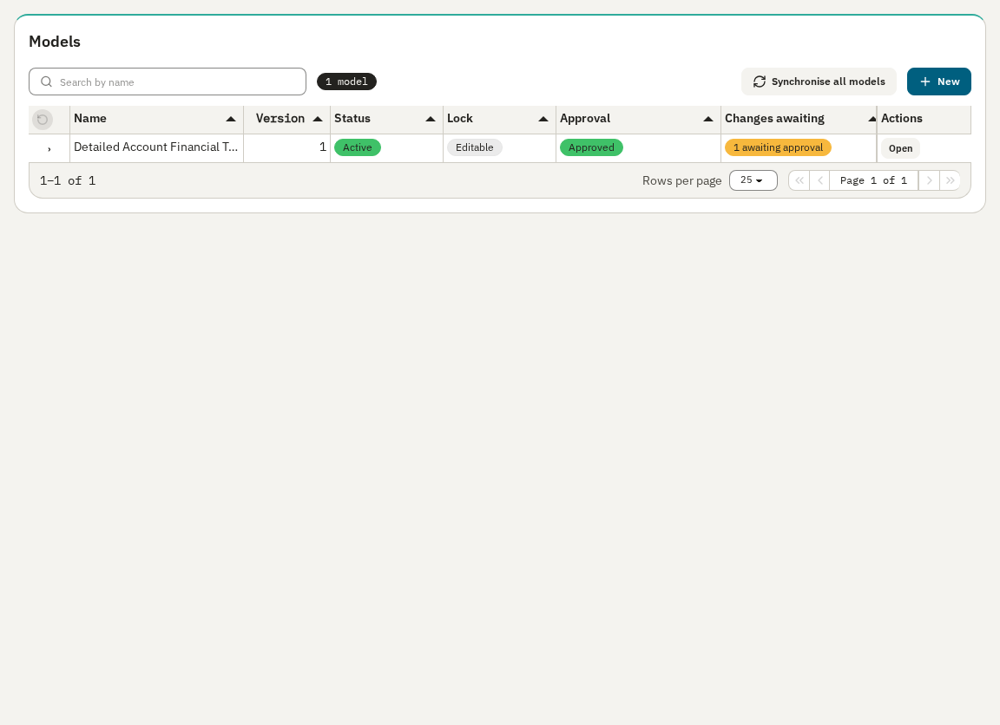
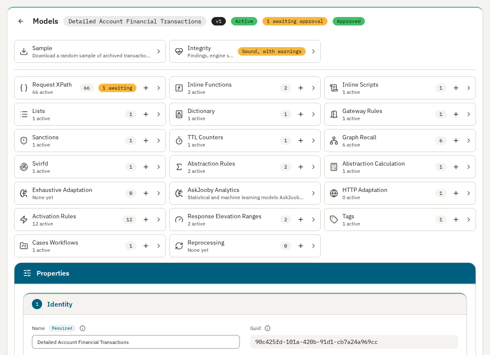
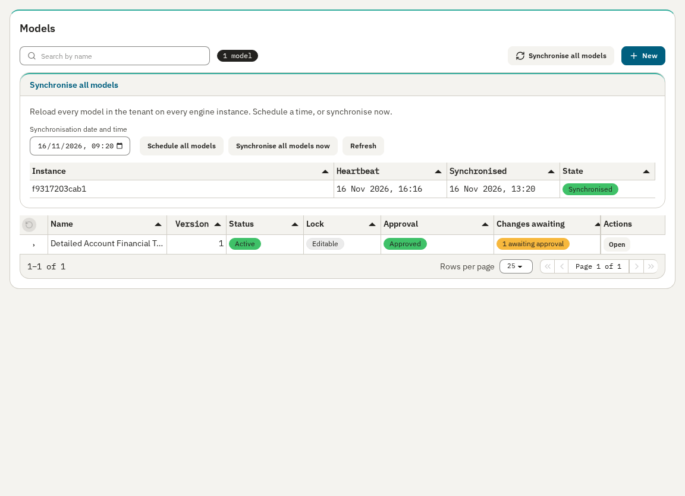

# Model Configuration

Jube does not have a fixed model specification nor integration API, instead, Models are configured via the user interface assuming the availability of JSON on integration.

The default and example models are built around the following JSON object:

```json
{
  "AccountId": "Test1",
  "TxnId": "0987654321",
  "TxnDateTime": "2018-08-19T21:41:37.247",
  "Currency": "826",
  "ResponseCode": "0",
  "CurrencyAmount": "123.45",
  "SettlementAmount": "100000",
  "AccountCurrency": "566",
  "IP": "8.8.8.8",
  "DeviceId": "OlaRoseGoldPhone6",
  "ChannelId": "1",
  "AppVersionCode": "12.34",
  "ServiceCode": "DID",
  "System": "Android",
  "Brand": "ZTE",
  "Model": "Barby",
  "AccountLongitude": "36.1408",
  "AccountLatitude": "5.3536",
  "OS": "Lollypop",
  "Resolution": "720*1280",
  "DebuggerAttached": "True",
  "SimulatorAttached": "True",
  "Jailbreak": "True",
  "MAC": "94:23:44f:2:d3",
  "ToAccountId": "MTN",
  "ToAccountExternalRef": "ChurchmanR",
  "TwoFATypeId": "SMS",
  "TwoFAResponseId": "1",
  "TransactionExternalResponseId": "0",
  "Storage": "True",
  "FingerprintHash": "jhjkhjkhsjh2hjhjkhj2k",
  "IndustryName": "GAMING",
  "BusinessModel": "Sports betting",
  "AmountEUR": "100.0000",
  "AmountEURRate": "1.0000000000",
  "AmountUSD": "113.0550",
  "AmountUSDRate": "1.1305502954",
  "AmountGBP": "86.5866",
  "AmountGBPRate": "0.8658658602",
  "Is3D": "False",
  "OriginalAmount": "100.0000",
  "OriginalCurrency": "EUR",
  "Email": "please@hash.me",
  "CreditCardHash": "0xDA39A3EE5E6B4B0JJJ1890AFD80709",
  "AcquirerBankName": "Caixa",
  "ActionDate": "2019-04-17 01:18:15Z",
  "APMAccountId": "",
  "BankId": "57",
  "BillingAddress": "Address Line 1",
  "BillingCity": "Address Line 2",
  "BillingCountry": "DE",
  "BillingFirstName": "Robert",
  "BillingLastName": "Mugabe",
  "BillingPhone": "1234567890",
  "BillingState": "",
  "BillingZip": "123456",
  "IsAPM": "True",
  "IsCascaded": "False",
  "IsCredited": "False",
  "IsCurrencyConverted": "False",
  "IsModification": "False",
  "IsModified": "False",
  "IsRebill": "False",
  "OrderId": "10607324128",
  "TransactionTypeId": "1000",
  "TransactionResultId": "1006"
}
```

The example JSON is used extensively throughout this documentation, however naming elements aside, it is a highly generic format. Jube can handle any correctly formed JSON, seeking to be directed to the data elements via JSONPath. JSONPath is a query language for JSON and has the effect of allowing for the support of any existing interfaces that set forth the POST body as JSON.

In this guide a rudimentary HTTP request tool called Cartero (https://cartero.danirod.es/) is used, for which the request is provided as `Http/Transaction.cartero`, alongside `Http/Transaction.http` for the tools within most IDE's, such as Jetbrains. Many other HTTP testing tools are available, such as Postman. For completeness, the above example JSON would represent a POST body for HTTP invocation:

```http
POST https://localhost:5001/api/invoke/EntityAnalysisModel/90c425fd-101a-420b-91d1-cb7a24a969cc
Content-Type: application/json
X-API-KEY: <an API key>

{
  "AccountId": "Test1",
  "TxnId": "0987654321",
  "TxnDateTime": "2018-08-19T21:41:37.247",
  "...": "the remainder of the example JSON"
}
```

Invocation is explained in more depth elsewhere in the documentation, and it is suffice to draw attention in the above to the HTTP verb as being of type POST, the JSON comprising the POST body, and the url slug api/invoke/EntityAnalysisModel/<Guid> (whereby the Guid is the model identifier). It follows that a Model is an endpoint in practice.

The documentation will proceed on the basis of reconstructing the default or example model, installed by Migration also.

## Where it lives

Navigate through the menu to Models (the route being `/models`). The Models page is a single story: it starts as a table of every model in the tenant and grows step by step as a model is opened, then an area under it, and then a record in that area, in the manner described in [Child Objects](../../../Navigation/ChildObjects/index.html). The Models page is where a model is first defined and allocated a GUID (Globally Unique Identifier) for recall.

A new model is created with New above the table, the creation being refused by the server where the user does not hold permission 6, Read Write Model, and an existing model is opened with Open on its row, whereupon the parameters of the model are presented as the Properties form towards the bottom half of the page, beneath the cards. Creating, changing, approving and deleting a model thereafter follows the common manner of [Child Objects](../../../Navigation/ChildObjects/index.html), a model being subject to approval as a child object is.

SHOT id=models-models-table
     route=/models
     steps=none
     frame=page
     state=the Models page showing the table of models with the Detailed Account Financial Transactions model, its version, Active status, Editable lock, Approved approval state and None awaiting
     conveys=the Models page starts as a table of the models of the tenant, from which a model is opened
     alt=The Models page with a search box and a table listing each model alongside its version, status, lock, approval state, changes awaiting, and when and by whom it was last changed



## The Models story page

The Models page at `/models` is one continuous story rather than a set of separate screens. Each step stays on the page, collapsed to a single line, until it is returned to, and the steps are as follows:

1. **The Models table.** Lists the models of the tenant with their Version, Status (Active or Inactive), Lock (Locked or Editable), Approval state, the number of Changes awaiting approval, and when and by whom each was last changed. The search box filters by name and the badge shows how many models match. New starts a new model, as described in [Parent Objects](../../../Navigation/ParentObjects/index.html), and Synchronise all models is offered only to a user holding permission 5.
2. **A model.** Opening a model shows a status line (version, Active or Inactive, Locked, approval state and changes awaiting approval), then hub cards, then the model properties as a form below them. The cards are the child areas of the model, grouped under References, Abstraction, Machine Learning and Network, plus Response Elevation Ranges, Activation Rules, Cases Workflows and Reprocessing. Each card shows how many records exist, how many are active and locked, and a badge when changes await approval, and carries a shortcut that opens a new record for that area.
3. **Operate cards.** Sample (the download of a random sample of archived transactions, permission 40, described in [Sampling](../Sampling/index.html)), Integrity (findings, engine state, dependencies and synchronisation, permission 60 to view and 5 to synchronise, described in [Model Integrity](../ModelIntegrity/index.html)) and AskJooby Analytics (the statistical and machine learning models trained for the model) appear only to users who hold the matching permission. Each is a step of its own with the model fixed.
4. **An area, then a record, then its children.** Drilling down replaces the list by the record, one line per level, and Back returns one level. If a form has unsaved edits, leaving it asks first (Keep editing or Discard changes).

SHOT id=models-models-model-opened
     route=/models
     steps=open-default-model
     frame=page
     state=the default model opened, showing the collapsed Models step, the status line, the hub cards grouped under References, Abstraction, Machine Learning and Network, the Sample and Integrity cards, and the top of the Properties form
     conveys=a model is a status line, a card for each of its areas, and its own properties beneath
     alt=The Detailed Account Financial Transactions model opened on the Models page, with grouped hub cards for its child areas, the operate cards, and the Identity group of the model Properties form



### Address and deep links

The story is kept in the address as `?path=`, for example `EntityAnalysisModel:12,CaseWorkflow:5,CaseWorkflowXPath:9` or `EntityAnalysisModel:12,~integrity`. Opening such a link rebuilds the story. Identifiers must be plain positive decimal numbers, and anything else (hexadecimal, exponent, fraction, padding, negative) is ignored and the page starts at the table. The link carries no authority: the model is looked up in the list the server returns for the tenant, and every record is read through the same permission and tenant checks as a click would be, so a link to a model of another tenant shows the table.

## Fields

The table as follows gives an introduction to each parameter of a model. The form is arranged in the groups Identity and Entry & Reference Date, followed by the groups Cache, Response Elevation Limit, Activation Watcher, Archiving & Counters, Implicit Async, Logs and Response Trace, each of which starts collapsed. Where a switch governs further parameters, those parameters are presented upon the switch being on.

| Value                                 | Description                                                                                                                                                                                                                                                                                                                                                                                                                                                                                                                                                                                                                                                                                                                                                                                                                                                                                                                                                                                         | Example                              |
|---------------------------------------|-----------------------------------------------------------------------------------------------------------------------------------------------------------------------------------------------------------------------------------------------------------------------------------------------------------------------------------------------------------------------------------------------------------------------------------------------------------------------------------------------------------------------------------------------------------------------------------------------------------------------------------------------------------------------------------------------------------------------------------------------------------------------------------------------------------------------------------------------------------------------------------------------------------------------------------------------------------------------------------------------------|--------------------------------------|
| Name                                  | The name of the model, which must be unique within the tenant without regard to case.                                                                                                                                                                                                                                                                                                                                                                                                                                                                                                                                                                                                                                                                                                                                                                                                                                                                                                               | Detailed Account Financial Transactions |
| Guid                                  | When a Model is created it is allocated a GUID (Globally Unique Identifier) which will be the key to the model upon it being recalled via the HTTP Endpoint.  For example,  the GUID is used in recalling the model via this endpoint as: [https://localhost:5001/api/invoke/EntityAnalysisModel/90c425fd-101a-420b-91d1-cb7a24a969cc](https://localhost:5001/api/invoke/EntityAnalysisModel/90c425fd-101a-420b-91d1-cb7a24a969cc). It is allocated by the server and cannot be changed.                                                                                                                                                                                                                                                                                                                                                                                                                                                                                                             | 90c425fd-101a-420b-91d1-cb7a24a969cc |
| Active                                | Whether the model takes part in invocation and synchronisation. Active is off for a new model and must be switched on.                                                                                                                                                                                                                                                                                                                                                                                                                                                                                                                                                                                                                                                                                                                                                                                                                                                                              | True                                 |
| Locked                                | Whether the model is protected from change.                                                                                                                                                                                                                                                                                                                                                                                                                                                                                                                                                                                                                                                                                                                                                                                                                                                                                                                                                         | False                                |
| Entry name                            | The name of the field,  as extracted from the HTTP POST Body,  that represents the entry identifier or key.  An example of an Entry might be an Transaction identifier in the processing of financial transactions.                                                                                                                                                                                                                                                                                                                                                                                                                                                                                                                                                                                                                                                                                                                                                                                 | TxnId                                |
| Entry x path                          | The JSONPath specifying the location of the Entity in the HTTP Post Body.                                                                                                                                                                                                                                                                                                                                                                                                                                                                                                                                                                                                                                                                                                                                                                                                                                                                                                                           | $.TxnId                              |
| Reference date name                   | The name of the field,  as extracted from the HTTP POST Body or using the current time,  that represents the Reference Date.  An example of a Reference Date might be the date time as of Now taken from the API endpoints system time.                                                                                                                                                                                                                                                                                                                                                                                                                                                                                                                                                                                                                                                                                                                                                             | TxnDateTime                          |
| Reference date payload location type  | Where the Reference Date is read from, being either Body, in which case it is extracted via the Reference date x path, or Now, in which case it is the current UTC time of the server.                                                                                                                                                                                                                                                                                                                                                                                                                                                                                                                                                                                                                                                                                                                                                                                                              | Body                                 |
| Reference date x path                 | Subject to Now not having been specified for the Payload Location, the XPath or JSONPath specifying the location of the Reference Date in the HTTP Post Body.                                                                                                                                                                                                                                                                                                                                                                                                                                                                                                                                                                                                                                                                                                                                                                                                                                       | $.TxnDateTime                        |
| Enable payload j object               | A flag indicating that every request is parsed into a Newtonsoft JObject held on the payload and available to Inline Scripts. Switching it off reads only the configured Entry, Reference Date and Request XPaths in a single streaming pass, which is faster; the JObject is then built only if something asks for it, so a script that reads it still works but pays for a second parse. Switching off only takes effect while those paths are all simple dotted or indexed paths (for example `$.payload.Amount` or `$.items[0].sku`); any filter, wildcard, recursive descent or quoted path makes the Model parse as if this flag were on.                                                                                                                                                                                                                                                                                                                                                     | True                                 |
| Enable cache                          | A flag that indicates if entry data is to be stored in the Cache for the purposes of backing Abstraction Rules.  In ultra high throughput environments it is sometimes more manageable to store TTL Counters instead.                                                                                                                                                                                                                                                                                                                                                                                                                                                                                                                                                                                                                                                                                                                                                                               | True                                 |
| Cache fetch limit                     | A limit applied on the retrieval of data from the cache set in order to avoid the real-time transaction processing being flooded by a very active entities (i.e. Accounts with an implausibly high number of transactions,  such as test accounts).  When retrieval is made from the Cache it is done so by selecting all records where there is a match on a search key,  hence there is the potential for denial of service events without such a constraint. The return of large amounts of data from the cache can degrade response times and affect response times in a linear fashion.  The maximum number of records to be returned from the index,  and then fetched from the heap \ payload key value pair. In the case of both Resp and Postgres Database the limit is pushed down and limited in the server to avoid redundant data coming across the wire.  Fetch limits do not have any effect on the deletion of data which will defer to the reference date to determine deletion.    | 100                                  |
| Cache TTL interval                    | For the calculation of offsetting the current reference date for creation of a deletion threshold, the interval to be used in the calculation of the threshold.  For example Days,  when used in conjunction with the value 1,  would imply payload or latest entries older than 1 day offset before the current reference date will be deleted from the cache.                                                                                                                                                                                                                                                                                                                                                                                                                                                                                                                                                                                                                                     | Days                                 |
| Cache TTL interval value              | For the calculation of offsetting the current reference date for creation of a deletion threshold, the interval value to be used in the calculation of the threshold.  For example 1,  when used in conjunction with the interval Days,  would imply payload or latest entries older than 1 day offset before the current reference date will be deleted.                                                                                                                                                                                                                                                                                                                                                                                                                                                                                                                                                                                                                                           | 1                                    |
| Enable sanction cache                 | A flag indicating if the requests to the computationally expensive Levenshtein Distance algorithm for the Sanctions checking should first refer to a time limited cache.                                                                                                                                                                                                                                                                                                                                                                                                                                                                                                                                                                                                                                                                                                                                                                                                                            | True                                 |
| Max response elevation                | The maximum Response Elevation allowed in response payload model.  In the event a Response Elevation is specified to exceed this value,  it is clipped to this maximum.                                                                                                                                                                                                                                                                                                                                                                                                                                                                                                                                                                                                                                                                                                                                                                                                                             | 10                                   |
| Enable response elevation limit       | A flag indicating if there should exist a limit on the number of Response Elevations that can be set in a within a defined period as follows.                                                                                                                                                                                                                                                                                                                                                                                                                                                                                                                                                                                                                                                                                                                                                                                                                                                       | True                                 |
| Max response elevation interval       | Given Enable response elevation limit, the time interval type in which the number of Response Elevations will be counted in (e.g. Hours).                                                                                                                                                                                                                                                                                                                                                                                                                                                                                                                                                                                                                                                                                                                                                                                                                                                           | Hours                                |
| Max response elevation value          | Given Enable response elevation limit, the time value to be used in conjunction with the interval in which the number of Response Elevations will be counted (e.g. 1).                                                                                                                                                                                                                                                                                                                                                                                                                                                                                                                                                                                                                                                                                                                                                                                                                              | 1                                    |
| Max response elevation threshold      | Given Enable response elevation limit, the maximum number of Response Elevations that can be set within the time period, else returning 0 if in excess.                                                                                                                                                                                                                                                                                                                                                                                                                                                                                                                                                                                                                                                                                                                                                                                                                                             | 1000                                 |
| Enable activation watcher             | A flag indicating that activations for the model are streamed to the Activation Watcher, subject to the sample and, in a similar manner to Enable response elevation limit, to a time bound threshold beyond which further activations are withheld.                                                                                                                                                                                                                                                                                                                                                                                                                                                                                                                                                                                                                                                                                                                                                | True                                 |
| Max activation watcher interval       | Given Enable activation watcher, the time interval type in which the number of activations sent to the Activation Watcher will be counted (e.g. Hours).                                                                                                                                                                                                                                                                                                                                                                                                                                                                                                                                                                                                                                                                                                                                                                                                                                             | Hours                                |
| Max activation watcher value          | Given Enable activation watcher, the time value to be used in conjunction with the interval in which the number of activations will be counted (e.g. 1).                                                                                                                                                                                                                                                                                                                                                                                                                                                                                                                                                                                                                                                                                                                                                                                                                                            | 1                                    |
| Max activation watcher threshold      | Given Enable activation watcher, the maximum number of activations streamed to the Activation Watcher within the time period, beyond which further activations are withheld from the stream.                                                                                                                                                                                                                                                                                                                                                                                                                                                                                                                                                                                                                                                                                                                                                                                                        | 1000                                 |
| Activation watcher sample             | The Activation Watcher is intended to provide for a streaming overview of the proportions of risk. Given Enable activation watcher, a random sample determining the selection to the Activation Watcher.                                                                                                                                                                                                                                                                                                                                                                                                                                                                                                                                                                                                                                                                                                                                                                                            | 100%                                 |
| Enable TTL counter                    | A flag that indicates if the TTL counter entries are to be stored in the Cache for the purposes of backing TTL Counters.                                                                                                                                                                                                                                                                                                                                                                                                                                                                                                                                                                                                                                                                                                                                                                                                                                                                            | True                                 |
| Enable rdbms archive                  | A flag to indicate if model data should be stored in the Archive table of Postgres.                                                                                                                                                                                                                                                                                                                                                                                                                                                                                                                                                                                                                                                                                                                                                                                                                                                                                                                 | True                                 |
| Enable activation archive             | A flag to indicate if the activations of the model are retained in the activation archive, backing case creation and downstream reporting.                                                                                                                                                                                                                                                                                                                                                                                                                                                                                                                                                                                                                                                                                                                                                                                                                                                          | True                                 |
| Enable implicit async                 | A flag indicating that a plain synchronous invocation (no Async switch on the URL) should still wait inline for the Model to finish processing, up to the Timeout Milliseconds value below, before falling back to a same-shape response populated with only the fields known before processing began. See [HTTP API Asynchronous Model Invocation](../../../Concepts/API/HTTPAsynchronousModelInvocation/index.html) for the full behaviour and how to monitor it.                                                                                                                                                                                                                                                                                                                                                                                                                                                                                                                                 | True                                 |
| Implicit async timeout milliseconds   | Given Enable implicit async, the number of milliseconds a synchronous invocation waits inline before falling back to the same-shape, not-yet-complete response described above.                                                                                                                                                                                                                                                                                                                                                                                                                                                                                                                                                                                                                                                                                                                                                                                                                     | 5000                                 |
| Enable logs                           | The master switch for the capture of invocation logs for the model, in that Enable logs info and Enable logs warn threshold below only capture when this is also on. Switching it off disables both immediately, without losing their own settings underneath.                                                                                                                                                                                                                                                                                                                                                                                                                                                                                                                                                                                                                                                                                                                                      | False                                |
| Enable logs info                      | Captures the same step-by-step trace normally only visible via log4net INFO logging into a `logs` array on the invocation payload instead, for a sampled subset of invocations (see Enable sampling below), so it can be pulled from the Archive (and, optionally, the direct response) without needing backend log access. Independent of Enable logs warn threshold below, the two being separate monitors, not mutually exclusive levels of one switch, and can be on together, individually, or not at all. Does not affect log4net's own INFO logging, which remains controlled separately by the logging configuration. See [HTTP API Invocation Trace Log](../../../Concepts/API/InvocationTraceLog/index.html).                                                                                                                                                                                                                                                                              | False                                |
| Enable sampling                       | Given Enable logs info is on, only capture a random sample of invocations (see Sample percentage below) rather than every one, so Info-level detail can run continuously in production at a small fraction of its normal cost. Has no effect on Enable logs warn threshold, which always evaluates every invocation regardless of this switch. Also gates the always-on Response Time Pipeline and Task Performance Counter capture for this Model, so a report can correlate a sampled invocation's log with its own timing/memory data. See [HTTP API Invocation Trace Log](../../../Concepts/API/InvocationTraceLog/index.html).                                                                                                                                                                                                                                                                                                                                                                 | False                                |
| Sample percentage                     | Given Enable sampling is on, the percentage (0-100) of invocations captured at Info level, e.g. `0.02` for roughly 1 in 5000 invocations.                                                                                                                                                                                                                                                                                                                                                                                                                                                                                                                                                                                                                                                                                                                                                                                                                                                           | 100                                  |
| Enable logs warn threshold            | Captures a trace point into the same `logs` array as Enable logs info, but only when the gap since the previous captured entry exceeds Logs warn threshold milliseconds below, being an always-on anomaly watch (every invocation, never sampled) rather than a representative sample. Independent of Enable logs info above. See [HTTP API Invocation Trace Log](../../../Concepts/API/InvocationTraceLog/index.html).                                                                                                                                                                                                                                                                                                                                                                                                                                                                                                                                                                             | False                                |
| Logs warn threshold milliseconds      | Given Enable logs warn threshold is on, the number of milliseconds a trace point's gap since the last captured entry must exceed to be captured.                                                                                                                                                                                                                                                                                                                                                                                                                                                                                                                                                                                                                                                                                                                                                                                                                                                    | 250                                  |
| Enable logs in response               | A flag indicating that invocation responses for this Model should include the captured `logs` array, in addition to it always being included in the Archive payload whenever either Enable logs info or Enable logs warn threshold is on.                                                                                                                                                                                                                                                                                                                                                                                                                                                                                                                                                                                                                                                                                                                                                           | True                                 |
| Enable trace                          | A flag indicating that invocation responses for this Model should echo the full per-stage and per-rule performance breakdown (Stages), already captured to the Archive regardless of this switch, into the direct response too, in addition to the always-present task wrapper stats. See [HTTP API Performance Trace](../../../Concepts/API/PerformanceTrace/index.html) for the full shape and how it differs from what always reaches the Archive.                                                                                                                                                                                                                                                                                                                                                                                                                                                                                                                                               | True                                 |

A new model is presented with the following values already in place, each of which may be altered before Create is clicked, and every switch not listed is off:

| Value                                | For a new model |
|--------------------------------------|-----------------|
| Active                               | Off             |
| Reference date payload location type | Body            |
| Enable payload j object              | On              |
| Cache fetch limit                    | 100             |
| Cache TTL interval                   | Hours           |
| Cache TTL interval value             | 3               |
| Max response elevation               | 10              |
| Max response elevation interval      | Days            |
| Max response elevation value         | 1               |
| Max response elevation threshold     | 100             |
| Max activation watcher interval      | Days            |
| Max activation watcher value         | 1               |
| Max activation watcher threshold     | 100             |
| Activation watcher sample            | 100%            |
| Implicit async timeout milliseconds  | 5000            |
| Sample percentage                    | 100             |
| Logs warn threshold milliseconds     | 250             |

It follows that a model created with nothing but a name and the entry and reference date parameters neither stores data in the cache, keeps TTL Counters, nor archives anything, and Enable cache, Enable TTL counter and Enable rdbms archive are to be switched on where Abstraction Rules, TTL Counters and the Archive are to be relied upon. Reference date x path is presented only while Reference date payload location type is Body, and the parameters governed by a switch (the interval, value and threshold of the Response Elevation Limit and of the Activation Watcher, the timeout of Implicit Async, and the parameters beneath Enable logs) are presented only while that switch is on. The Guid is blank until the model has been created, being allocated by the server.

The form also presents Entry payload location type, in the Entry & Reference Date group, and Enable elasticsearch archive, in the Archiving & Counters group, each of which is shown for information only, cannot be set, and is not retained.

TODO(verify): the labels above are derived mechanically from the property names in the server, which is why XPath reads as x path, JObject as j object and RDBMS as rdbms, and why the page formerly gave labels such as Enable Response Elevation Limit: Interval. Confirm each label against the form on a running system (a switch that governs a whole group may be presented as the heading of that group, without Enable), and owner to decide whether Entry x path, Reference date x path, Enable payload j object and Enable rdbms archive are to be given proper labels.

## Validation

A model is validated in the server, as follows:

* Name, Entry name and Reference date name are required and limited to 256 characters.
* Entry x path and Reference date x path are required and limited to 1024 characters, except that Reference date x path is not required when Reference date payload location type is set to Now.
* Reference date payload location type must be Body or Now.
* Cache TTL interval, and (only when their respective Enable switch is on) Max response elevation interval and Max activation watcher interval, must be one of Seconds, Minutes, Hours or Days.
* Activation watcher sample must be between 0 and 1, and is only validated when Enable activation watcher is on.
* Implicit async timeout milliseconds must be greater than zero, and is only validated when Enable implicit async is on.
* Sample percentage must be greater than 0 and no more than 100, and is only validated when Enable logs info and Enable sampling are both on.
* Logs warn threshold milliseconds must be greater than zero, and is only validated when Enable logs warn threshold is on.
* Cache fetch limit, Cache TTL interval value and Max response elevation must be zero or greater, as must (only when their respective Enable switch is on) Max response elevation value, Max response elevation threshold, Max activation watcher value and Max activation watcher threshold.
* Entry x path and Reference date x path must not use the regular expression operator of JSONPath, being `=~`.

Each failure is written beneath the field it relates to and counted in the summary at the head of the form, as described in [Child Objects](../../../Navigation/ChildObjects/index.html), with the messages as follows:

| Field                                 | Message                                                                                                           |
|---------------------------------------|-------------------------------------------------------------------------------------------------------------------|
| Name                                  | A name is required. The name must be 256 characters or fewer. This name already exists.                           |
| Entry name                            | An entry name is required. The entry name must be 256 characters or fewer.                                        |
| Entry x path                          | An entry XPath (JSONPath) is required. The entry XPath must be 1024 characters or fewer. The XPath must not use the regular expression operator (=~). |
| Reference date name                   | A reference date name is required. The reference date name must be 256 characters or fewer.                       |
| Reference date payload location type  | The reference date payload location must be Body or Now.                                                          |
| Reference date x path                 | A reference date XPath (JSONPath) is required unless the reference date payload location is set to Now. The reference date XPath must be 1024 characters or fewer. The XPath must not use the regular expression operator (=~). |
| Cache fetch limit                     | The cache fetch limit must be zero or greater.                                                                    |
| Cache TTL interval                    | The cache TTL interval must be Seconds, Minutes, Hours or Days.                                                   |
| Cache TTL interval value              | The cache TTL interval value must be zero or greater.                                                             |
| Max response elevation                | The maximum response elevation must be zero or greater.                                                           |
| Max response elevation interval       | The response elevation limit interval must be Seconds, Minutes, Hours or Days.                                    |
| Max response elevation value          | The response elevation limit value must be zero or greater.                                                       |
| Max response elevation threshold      | The response elevation limit threshold must be zero or greater.                                                   |
| Max activation watcher interval       | The Activation Watcher limit interval must be Seconds, Minutes, Hours or Days.                                    |
| Max activation watcher value          | The Activation Watcher limit value must be zero or greater.                                                       |
| Max activation watcher threshold      | The Activation Watcher limit threshold must be zero or greater.                                                   |
| Activation watcher sample             | The Activation Watcher sample rate must be between 0 and 1.                                                       |
| Implicit async timeout milliseconds   | The Implicit Async timeout must be greater than zero milliseconds.                                                |
| Sample percentage                     | The Sample Percentage must be greater than 0 and no more than 100.                                                |
| Logs warn threshold milliseconds      | The Logs Warn threshold must be greater than zero milliseconds.                                                   |

The incorrect configuration of Response Elevation and Limits is one of the more common reasons why Response Elevations may be zero, even though they are set to a value in an Activation Rule.

## Synchronisation

The architecture of Jube is such that the real-time processing is separated from the configurations, which require synchronisation into the engine. Without synchronisation, the endpoint would return HTTP status Not Found (404). A change, upon being approved, is taken up by the engine at its next cycle, yet all of the models of the tenant can also be synchronised by hand.

Synchronise all models, above the table of models, is shown only to a user holding permission 5, and presents the synchronisation pane. The pane shows the instances running the engine and their status, be that when the last Heartbeat or the last model synchronisation took place, alongside the following:

| Element                        | Description                                                                                              |
|--------------------------------|----------------------------------------------------------------------------------------------------------|
| Synchronisation date and time  | A date and time at which the synchronisation is to take place, for use with Schedule all models.         |
| Schedule all models            | Schedules the reload of every model in the tenant, on every engine instance, for the date and time given. |
| Synchronise all models now     | Reloads every model in the tenant on every engine instance straight away.                                |
| Refresh                        | Reads the list of instances again.                                                                       |
| State                          | For each instance, Pending while the synchronisation is awaited, Synchronised once it has completed, or Unavailable. |

It follows that upon requesting a synchronisation each instance shows Pending, and upon Refresh, Synchronised once the synchronisation has completed. A single model is synchronised in the same manner from its Integrity card, using Synchronise this model.

SHOT id=models-models-synchronise-all
     route=/models
     steps=click:Synchronise all models
     frame=page
     state=the synchronisation pane open above the table of models, showing the date and time field, the Schedule all models, Synchronise all models now and Refresh buttons, and one engine instance with its Heartbeat, Synchronised time and a Synchronised state
     conveys=synchronisation is requested for every instance of the engine, each of which reports its own state
     alt=The Synchronise all models pane on the Models page, listing an engine instance alongside its heartbeat, the time it last synchronised and a Synchronised state badge



## Example

The GUID is in this example 90c425fd-101a-420b-91d1-cb7a24a969cc. It follows that the HTTP endpoint will be https://localhost:5001/api/invoke/EntityAnalysisModel/90c425fd-101a-420b-91d1-cb7a24a969cc.

In the case of AMQP integration, a header key value a pair of EntityAnalysisModelGuid = 90c425fd-101a-420b-91d1-cb7a24a969cc would be used.

The invoke endpoint is an authenticated endpoint and requires the creation of an X-API-KEY header, as documented in the [Authentication](../../../Concepts/Authentication/index.html) section of the documentation. Upon synchronisation and the embedding of the X-API-KEY header in the request, proceed to POST the example JSON to the endpoint, as set out at the head of this page, and observe the response, abbreviated here:

```json
{
  "CreatedDate": "...",
  "EntityAnalysisModelInstanceEntryGuid": "...",
  "EntityInstanceEntryId": "...",
  "ReferenceDate": "...",
  "ResponseElevation": { },
  "Payload": {
    "TxnId": "0987654321",
    "JoinedName": "Robert Mugabe"
  },
  "Dictionary": {
    "VolumeThresholdByAccountId": 1000.0
  },
  "TtlCounter": {
    "TtlCounterAll": 2.0
  },
  "Sanction": {
    "FuzzyMatchDistance2JoinedName": 0.0
  },
  "Abstraction": {
    "ResponseCodeEqual0Volume": 246.9,
    "NotResponseCodeEqual0Volume": 0.0
  },
  "AbstractionCalculation": {
    "ResponseCodeVolumeRatio": 0.0
  }
}
```

TODO(verify): replace the abbreviated response above with one captured in full from a running system. The elements from Payload onwards were transcribed from the owner's screenshot of a response from the default model; the names of the elements before Payload were taken from the code that builds the response (BuildJsonResponses) and not from a captured response.

It can be observed that the HTTP response status is of 200, which means that there was no error in processing. In the event that there is an error in processing it will be communicated by HTTP status code:

* Bad Request (400) in the event that a head check fails for the JSON, the JSON does not parse, is of invalid length or is subject other constraints.
* Service Unavailable (503) in the event the engine is not ready to respond to requests from the model, which may happen when an instance is starting.
* Not Found (404) in the event a bad Guid has been provided or the Guid cannot be matched to a synchronised model.
* Internal Error (500) in the event of other unspecified processing error available to the logs.

TODO(verify): the page formerly stated that an engine that is not ready returns 204. On this branch InvokeService returns 503 where the engine context is not ready; owner to confirm that 503 is intended, as integrations may have been written to expect 204.

## Isolation, lock, deletion and approval

The manner in which a model is protected is as follows:

* Every read, update and delete is scoped to the tenant of the caller. A model of another tenant behaves exactly like a model that does not exist. Fields the client may send but that the server owns (identifier, GUID, tenant, created and updated user and date, soft-delete markers, version bump) are ignored on create and update.
* Name must be unique within the tenant, compared without regard to case.
* A stale Version on update is refused as a conflict instead of overwriting the change of another user, although a Version of zero skips the check.
* Deleting a model is a soft delete that keeps its history. A deleted model is hidden from the table but is still reachable by its numeric identifier, and updating a deleted model brings it back.
* A Locked model cannot be updated or deleted (the server answers as if it were not found). A user holding permission 6 can unlock it with Unlock, beside the back arrow on the model step (`POST /api/EntityAnalysisModel/{id}/Unlock`), and the unlock is recorded in the version history like an edit.
* Models take part in maker-checker approval: a rejected change can be resubmitted unchanged or retracted back to the last approved version, each with an optional note, for which see [Maker Checker](../../../Concepts/MakerChecker/index.html) for the cycle.

## Roles

Which roles may invoke or see a model is set in the Roles panel of the model, which is the allocation of roles to rules and not to users. A role can only be allocated if it belongs to the same tenant as the model.

The Roles panel is presented beneath the Properties form and the Approval section of a model that has been created, under the title Roles, and it is not presented for a new model. It takes the form of two lists side by side, Available roles and Assigned roles, with the buttons Assign selected, Assign all, Unassign selected and Unassign all moving roles between them, an empty list reading Nothing here. Nothing is stored as roles are moved: the panel has its own Save changes and Discard changes, separate from those of the Properties form, with a badge stating the number of changes not yet saved (for example 2 unsaved), and neither button is available until a role has been moved. Upon Save changes, confirmation is returned as a notice reading Roles saved. While the roles are being fetched the panel reads Loading roles, and should they not be fetched, The roles could not be loaded. Refresh the page to try again.

## Permissions and security

| Action                                                                                                         | Permission                                              |
|----------------------------------------------------------------------------------------------------------------|---------------------------------------------------------|
| Read one model, create, update, delete, resubmit or retract a rejected change                                  | 6, Read Write Model                                     |
| List models (the table, and the bounded list, filter and count operations used by other pages and agent tools) | any of 6 to 26, 37, 3, 4, 1 or 40                       |
| Synchronise all models or one model                                                                            | 5, Allow Synchronisation                                |
| Sample                                                                                                         | 40, View Entity Analysis Model Sampling                 |
| Integrity view                                                                                                 | 60, View Model Integrity                                |

A user holding only a list permission (for example Read Write Activation Rule) can see the table but cannot open the properties of a model for editing, and the server answers a read, create, update or delete without permission 6 with a refusal and writes nothing.
