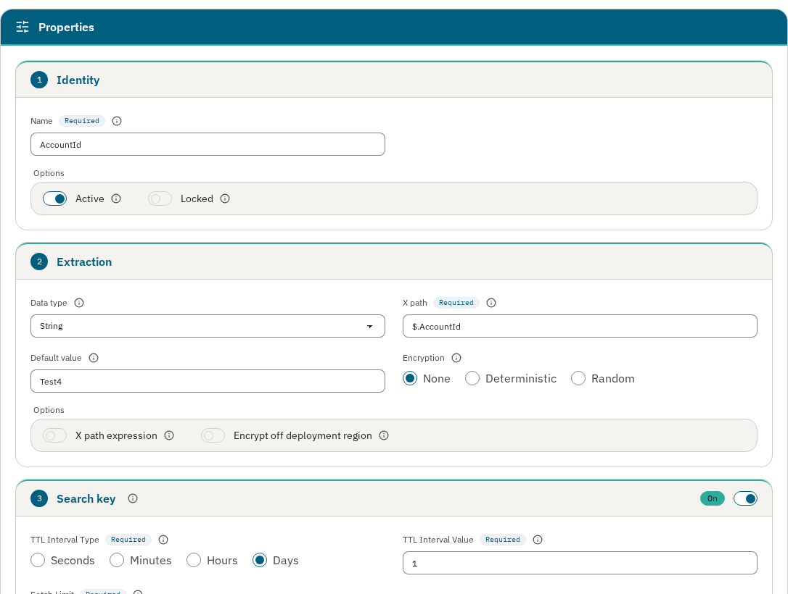
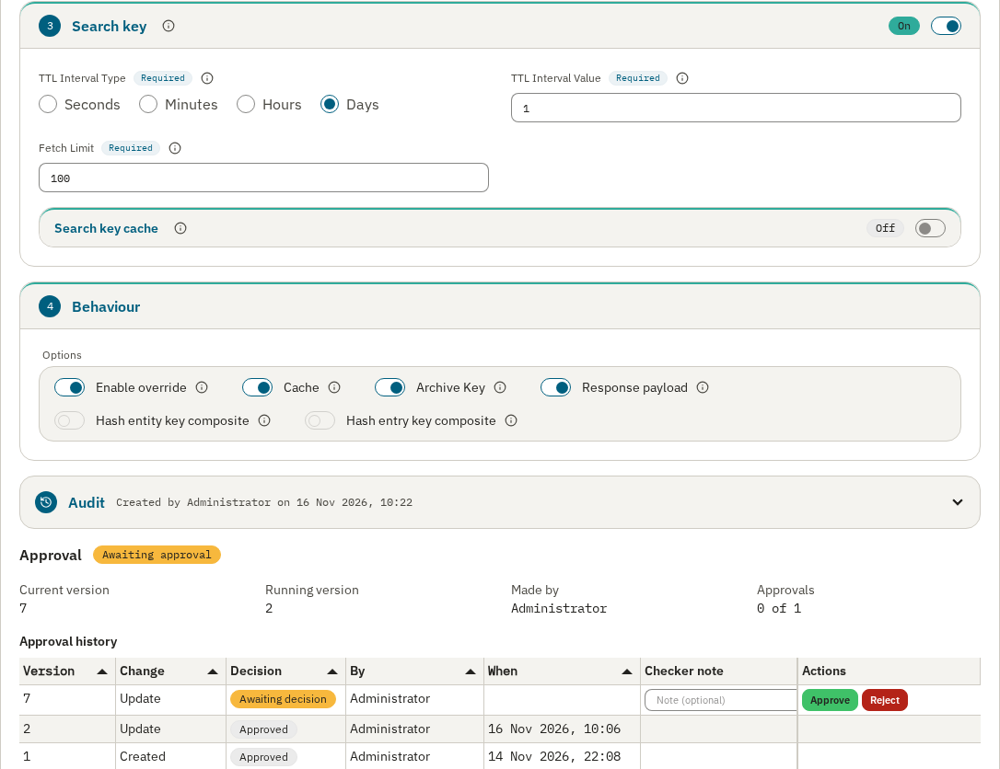

# Request XPath

A Request XPath tells a model where to find one value in the JSON it receives, what to call it, and what type of data it is. Nothing in the JSON is available to a rule until a Request XPath has been created for it, and it follows that the collection of Request XPath for a model is, in effect, the list of fields of that model: a Request XPath named IP makes the value available to every rule as `Payload.IP`.

When a request is received from an HTTP Endpoint for a model it should have data contained in the POST body as JSON, as following example:

```json
{
  "AccountId": "Test1",
  "TxnId": "0987654321",
  "TxnDateTime": "2018-08-19T21:41:37.247",
  "Currency": "826",
  "ResponseCode": "0",
  "CurrencyAmount": "123.45",
  "SettlementAmount": "100000",
  "AccountCurrency": "566",
  "IP": "8.8.8.8",
  "DeviceId": "OlaRoseGoldPhone6",
  "ChannelId": "1",
  "AppVersionCode": "12.34",
  "ServiceCode": "DID",
  "System": "Android",
  "Brand": "ZTE",
  "Model": "Barby",
  "AccountLongitude": "36.1408",
  "AccountLatitude": "5.3536",
  "OS": "Lollypop",
  "Resolution": "720*1280",
  "DebuggerAttached": "True",
  "SimulatorAttached": "True",
  "Jailbreak": "True",
  "MAC": "94:23:44f:2:d3",
  "ToAccountId": "MTN",
  "ToAccountExternalRef": "ChurchmanR",
  "TwoFATypeId": "SMS",
  "TwoFAResponseId": "1",
  "TransactionExternalResponseId": "0",
  "Storage": "True",
  "FingerprintHash": "jhjkhjkhsjh2hjhjkhj2k",
  "IndustryName": "GAMING",
  "BusinessModel": "Sports betting",
  "AmountEUR": "100.0000",
  "AmountEURRate": "1.0000000000",
  "AmountUSD": "113.0550",
  "AmountUSDRate": "1.1305502954",
  "AmountGBP": "86.5866",
  "AmountGBPRate": "0.8658658602",
  "Is3D": "False",
  "OriginalAmount": "100.0000",
  "OriginalCurrency": "EUR",
  "Email": "please@hash.me",
  "CreditCardHash": "0xDA39A3EE5E6B4B0JJJ1890AFD80709",
  "AcquirerBankName": "Caixa",
  "ActionDate": "2019-04-17 01:18:15Z",
  "APMAccountId": "",
  "BankId": "57",
  "BillingAddress": "Address Line 1",
  "BillingCity": "Address Line 2",
  "BillingCountry": "DE",
  "BillingFirstName": "Robert",
  "BillingLastName": "Mugabe",
  "BillingPhone": "1234567890",
  "BillingState": "",
  "BillingZip": "123456",
  "IsAPM": "True",
  "IsCascaded": "False",
  "IsCredited": "False",
  "IsCurrencyConverted": "False",
  "IsModification": "False",
  "IsModified": "False",
  "IsRebill": "False",
  "OrderId": "10607324128",
  "TransactionTypeId": "1000",
  "TransactionResultId": "1006"
}
```

The first step in processing is to parse the JSON to ensure that it is valid.

Once parsed, elements can be extracted from the POST body using JSONPath. The Request XPath page is where model fields are specified alongside their JSONPath position in the POST Body. Various other parameters specifying how this field should be processed by the model are alongside the Request XPath value extracted.

## Where it lives

The Request XPath page is available by navigating through the menu as Models, and opening the model of interest, in this case the Detailed Account Financial Transactions model, then the Request XPath hub card, which exposes all of the Request XPath configured for the model. Creating, changing, approving and deleting a Request XPath follows the common manner described in [Child Objects](../../../Navigation/ChildObjects/index.html), in which the Request XPath is itself taken as the example.

SHOT id=models-request-xpath-record
     route=/models
     steps=open-default-model, open-hub:Request XPath, open-row:AccountId
     frame=record
     state=the AccountId Request XPath of the default model opened, approved and active, showing the Identity and Extraction groups, the Search Key group expanded with Search key switched on, and the Behaviour group
     conveys=a Request XPath pairs a name with a JSONPath and a data type, and carries the switches that decide how the value is cached, searched and returned
     alt=The AccountId Request XPath opened beneath the default model, showing its name, data type and JSONPath, the search key settings and the Enable override, Cache, Archive Key and Response payload switches



## Fields

The Request XPath accepts the following parameters, arranged in the groups Identity, Extraction, Search Key (which starts collapsed) and Behaviour:

| Value                    | Description                                                                                                                                                                                                                                                                                                                                                                                                                                                                                                                                                                                                                                     | Example       |
|--------------------------|-------------------------------------------------------------------------------------------------------------------------------------------------------------------------------------------------------------------------------------------------------------------------------------------------------------------------------------------------------------------------------------------------------------------------------------------------------------------------------------------------------------------------------------------------------------------------------------------------------------------------------------------------|---------------|
| Name                     | The name of the field, by which it is added to the payload and by which rules refer to it as Payload.Name.                                                                                                                                                                                                                                                                                                                                                                                                                                                                                                                                      | IP            |
| Active                   | Whether the field takes part in extraction on invocation. Active is off for a new Request XPath and must be switched on.                                                                                                                                                                                                                                                                                                                                                                                                                                                                                                                        | True          |
| Locked                   | Whether the Request XPath is protected from change.                                                                                                                                                                                                                                                                                                                                                                                                                                                                                                                                                                                             | False         |
| Data type                | The datatype of the data being extracted from the HTTP Request.  The datatype specified is important as it effects the types of predication that can happen in the rules.  Possible values are: String (Text and General Data); Integer (Numbers without any decimal places); Float (Numbers with decimal places); Date (Date and Time); Boolean (True or False); Latitude and Longitude (which are Float in effect); IP (an IPv4 or IPv6 address held as text, usable wherever a String is, and looked up for IP intelligence on every invocation when a Svirfd entry of the model names it).                                                  | String        |
| X path                   | Valid JsonPath to extract a value from the JSON received via POST or AMQP.                                                                                                                                                                                                                                                                                                                                                                                                                                                                                                                                                                      | $.IP          |
| Default value            | The default value to be used in the event the XPath returns a null token. Optional (1024 characters at most), and if left blank, a null token is omitted from the payload rather than being added with a default value. For a Date field, when supplied, it must be an integer number of days offset from now.                                                                                                                                                                                                                                                                                                                                  | Empty         |
| Encryption               | Only shown for String fields. Encrypt the extracted value before it is stored and archived, for which see [Field Level Encryption](../../../Concepts/FieldEncryption/index.html) for the None, Deterministic and Random options and how to choose between them.                                                                                                                                                                                                                                                                                                                                                                                 | Deterministic |
| Search key               | If the field is flagged as a search key it allows the value extracted to be used to query the cache in the Abstraction Rule processing.  For example,  if a count of all transactions having taken place on an IP address are required,  this would be flagged as a Search Key, which would mean that during execution the value extracted in this process will be used as a predicate in a select from the Cache (i.e.All from Cache where Cache IP = This IP).                                                                                                                                                                                | True          |
| TTL Interval Type        | In the case of Resp a sorted set is maintained of entries for this key which links off to the actual record subject to TTL deletion at as specified in the model level.  The TTL Interval Type is used to calculate a threshold at which the index is deleted for this key.  For example Days, when taken with a TTL Interval Value of 1,  would imply that the index is deleted if the record is older than 1 day offset for the Reference Date. In the case of Postgres Database being used for cache, this value has no effect on the traditional index given Postgres Database cache. One of Seconds, Minutes, Hours or Days.               | Hours         |
| TTL Interval Value       | In the case of Resp a sorted set is maintained of entries for this key which links off to the actual record subject to TTL deletion at as specified in the model level.  The TTL Interval Value is used to calculate a threshold at which the index is deleted for this key.  For example 1, when taken with a TTL Interval Type of Days,  would imply that the index is deleted if the record is older than 1 day offset for the Reference Date. In the case of Postgres Database being used for cache, this value has no effect on the traditional index.                                                                                     | 1             |
| Fetch Limit              | The return of large amounts of data from the cache can degrade response times and affect response times in a linear fashion.  The maximum number of records to be returned from the index,  and then fetched from the heap \ payload key value pair. In the case of both Resp and Postgres Database the limit is pushed down and limited in the server to avoid redundant data coming across the wire. Fetch limits do not have any effect on the deletion of data which will defer to the reference date to determine deletion.                                                                                                                | 100           |
| Search key cache         | For a Search Key to retrieve data for each transaction it can place significant load on the Cache and Jube instance and is quite impractical, as there might be an extremely large amount of data available for that Search Key (e.g. consider a Merchant with millions of transactions a day).  A Search Key Cache defers the processing of these Search Keys to a background engine to process each of the possible Search Keys,  saving the calculations off to a Cache,  with that calculation being referenced real-time rather than the raw data.                                                                                         | False         |
| Selection Interval Type  | The date interval taken together with the Selection Interval Value which specifies how frequently the Cache Keys should be recalculated (but even then it is only done on new data being available).                                                                                                                                                                                                                                                                                                                                                                                                                                           | Hours         |
| Selection Interval Value | The value taken together with the Selection Interval Type which specifies how frequently the Cache Keys should be recalculated (but even then it is only done on new data being available).                                                                                                                                                                                                                                                                                                                                                                                                                                                    | 1             |
| Selection Sample         | In order to reduce processing demand in the calculation of Search Keys,  a representative sample can be specified to reduce the number of records brought back for each possible search key. All distinct search keys will be processed but only a sample of data for that search key value will be returned.  In most cases a sizeable representative sample is perfectly adequate.                                                                                                                                                                                                                                                            | False         |
| Selection Limit          | For each distinct search key value,  the maximum number of transaction that can be returned from the Cache for calculations to be performed.                                                                                                                                                                                                                                                                                                                                                                                                                                                                                                    | 100000        |
| Cache TTL Interval Type  | The date interval taken together with Cache TTL Interval Value and is how long a distinct Search Key,  once calculated,  should live before being purged from the Cache.                                                                                                                                                                                                                                                                                                                                                                                                                                                                        | Days          |
| Cache TTL Interval Value | The value taken together with Cache TTL Interval Type and is how long a distinct Search Key,  once calculated,  should live before being purged from the Cache.                                                                                                                                                                                                                                                                                                                                                                                                                                                                                 | 1             |
| Enable override          | A flag indicating if this value should be available in the Override page.  Suppression allows the consequences of Rule Activations (such as Response Elevations, thus event decline) to be ignored based on the a key value pair (e.g. IP = 123.456.789.987).                                                                                                                                                                                                                                                                                                                                                                                   | True          |
| Cache                    | A flag that indicates if the payload entry is to be serialised to the cache to support Abstraction Rules.  This is an important feature that allows for pragmatic control over the data stored in Resp having the effect of greatly reducing cache pressure,  cost and marginally improving serialisation performance on invocation.  Payload is serialised to the cache on the basis of an index rather than the full name specified, further reducing capacity requirements (i.e., each index is a single byte in Resp after serialisation).  It is worth noting that only entries designated as Cache will be available to Abstraction Rules. | True          |
| Archive Key              | Whether the value extracted is written to the Archive Key table, as described in [Report Table](../../../Navigation/ReportTable/index.html). Off by default.                                                                                                                                                                                                                                                                                                                                                                                                                                                                                    | False         |
| Response payload         | Whether the value extracted is included in the Payload element of the response, as described in [Response Payload](../../../Navigation/ResponsePayload/index.html). Off by default.                                                                                                                                                                                                                                                                                                                                                                                                                                                             | True          |

A new Request XPath is presented with Data type as String, Encryption as None, every switch off (Active, Search key, Search key cache, Enable override, Cache, Archive Key and Response payload among them), and, once the switches governing them are on, TTL Interval Type as Hours with a TTL Interval Value of 1, a Fetch Limit of 100, Selection Interval Type as Hours with a Selection Interval Value of 1, Selection Sample off, a Selection Limit of 100000, and Cache TTL Interval Type as Hours with a Cache TTL Interval Value of 1. It follows that a field created with nothing but its Name and X path is extracted, once made Active, and may be used in rules, yet it is neither returned in the response, stored in the cache, nor available as a search key until the corresponding switch is on. Encryption is presented only while Data type is String.

The fields from TTL Interval Type to Search key cache are presented upon Search key being switched on, and the fields from Selection Interval Type to Cache TTL Interval Value are presented upon Search key cache being switched on in addition. The Extraction group also presents the switches X path expression and Encrypt off deployment region, and the Behaviour group the switches Hash entity key composite and Hash entry key composite, each of which is shown for information only, cannot be set, and is not retained.

TODO(verify): the JSONPath field is labelled X path, and the form is headed New Entity Analysis Model Request X Path, both being derived mechanically from the property and type names in the server (confirmed in the owner's screenshot ExamplePropertiesBasic.png). Owner to decide whether these are to read XPath and Request XPath; this page and Navigation/ChildObjects then need the label corrected.

TODO(verify): Selection Sample is a switch on this branch (SearchKeyCacheSample is a boolean), whereas the page formerly gave it as a proportion with the example 1 (for 100%). Owner to confirm that the switch is intended, and what proportion is sampled when it is on.

SHOT id=models-request-xpath-search-key
     route=/models
     steps=open-default-model, open-hub:Request XPath, open-row:AccountId, scroll-to:Search key
     frame=record
     state=the AccountId Request XPath of the default model scrolled to the Search key group of its form, the group switched on and showing a TTL interval of 1 Days, a Fetch limit of 100 and the Search key cache switched off, with the Behaviour group and the Approval section, awaiting approval, beneath
     conveys=making a payload element a Search Key is a switch on its Request XPath that brings with it the settings for how long, and how much, is recalled by that key
     alt=The Search key group of the AccountId Request XPath record, switched on with a TTL interval of 1 Days and a Fetch limit of 100, above the Behaviour group and an Approval section awaiting approval



## Validation

Name and X path are required (256 and 1024 characters respectively, at most), and Name must be unique within the Model without regard to case. The TTL Interval, Selection Interval and Cache TTL Interval fields of the Search Key group are only validated, and only need to be supplied, when Search key (and, for the fields beneath Search key cache, Search key cache) is switched on.

The limits upon the numeric fields of the Search Key group are as follows. Fetch Limit and Selection Limit must be between 0 and 1,000,000. TTL Interval Value, Selection Interval Value and Cache TTL Interval Value must be zero or greater, and no greater than a ceiling that depends upon the interval chosen, being 2,000,000,000 for Seconds, 52,560,000 for Minutes, 876,000 for Hours and 36,500 for Days, which is one hundred years in each case save Seconds. A value above the ceiling is refused with the same message as a value below zero, the message naming both bounds.

Each failure is written beneath the field it relates to and counted in the summary at the head of the form, with the messages as follows:

| Field                    | Message                                                                                                 |
|--------------------------|---------------------------------------------------------------------------------------------------------|
| Name                     | A name is required. The name must be 256 characters or fewer. This name already exists.                 |
| Data type                | The data type must be String, Integer, Float, Date, Boolean, Latitude, Longitude or IP.                 |
| X path                   | An XPath (JSONPath) is required. The XPath must be 1024 characters or fewer. The XPath must not use the regular expression operator (=~). |
| Default value            | The default value must be 1024 characters or fewer. The default value for a Date field must be an integer number of days offset from now. |
| Encryption               | The encryption option must be None, Deterministic or Random.                                            |
| TTL Interval Type        | The search key TTL interval must be Seconds, Minutes, Hours or Days.                                    |
| TTL Interval Value       | The search key TTL interval value must be zero or more and within the limit for the chosen interval.    |
| Fetch Limit              | The search key fetch limit must be between 0 and 1,000,000.                                             |
| Selection Interval Type  | The search key cache interval must be Seconds, Minutes, Hours or Days.                                  |
| Selection Interval Value | The search key cache interval value must be zero or more and within the limit for the chosen interval.  |
| Selection Limit          | The search key cache fetch limit must be between 0 and 1,000,000.                                       |
| Cache TTL Interval Type  | The search key cache TTL interval must be Seconds, Minutes, Hours or Days.                              |
| Cache TTL Interval Value | The search key cache TTL interval value must be zero or more and within the limit for the chosen interval. |

A Request XPath that is named by something else in the model, such as the search key of an Abstraction Rule or the text of a rule, cannot be deleted while it is so used, as described under Deleting an entity that is in use in [Child Objects](../../../Navigation/ChildObjects/index.html).

Request XPath values are evaluated as JSONPath by Newtonsoft `SelectToken` (or the fast-path reader), not XML XPath, and as there is no XML parsing, XXE does not apply. The regular expression operator `=~` is refused on save (`XPathRegexNotPermitted`) because Newtonsoft evaluates it without a timeout. An XPath that does not parse falls back to the default value at run time.

## Example

In this example, a new Request XPath is created having the Name Test, a Data type of String, an X path of `$.Test` and a Default value of DefaultValue, being certain to set the Response payload switch to ensure that the extracted value is returned for testing.

Subject to configuration in the ApprovalsRequired Environment Variable, which is 1 by default, the change must be approved by a checker before it takes effect, as described in [Maker Checker](../../../Concepts/MakerChecker/index.html). A maker cannot ordinarily approve their own change, although for the purpose of this documentation the exception afforded to the landlord tenant, where a user holding both the write permission and permission 44, Allow Approval, may create a change and approve it alone, allows for self-approval. Approval triggers the synchronisation of that element into the running model, without an explicit synchronisation.

Include the element in the example payload in the HTTP client, here as the first element of the example JSON (the remainder of which is abbreviated), and send it to the model, as provided in `Http/Transaction.http`:

```http
POST http://localhost:5001/api/invoke/EntityAnalysisModel/90c425fd-101a-420b-91d1-cb7a24a969cc
Content-Type: application/json
X-API-KEY: <an API key>

{
  "Test": "Example",
  "AccountId": "Test1",
  "TxnId": "0987654321",
  "TxnDateTime": "2018-08-19T21:41:37.247",
  "...": "the remainder of the example JSON"
}
```

Notice the Test element is now present in the Payload element of the response, abbreviated here, which would indicate that the value was extracted from the request, processed and then included in the response payload:

```json
{
  "Payload": {
    "IP": "8.8.8.8",
    "AmountEURRate": 1.0,
    "DeviceId": "OlaRoseGoldPhone6",
    "IsModified": false,
    "OrderId": "10607324128",
    "TxnId": "0987654321",
    "Test": "Example",
    "JoinedName": "Robert Mugabe"
  },
  "Dictionary": {
    "VolumeThresholdByAccountId": 1000.0
  }
}
```

It can be seen that the values are returned as their data type, such that a Float is returned as a number and a Boolean as true or false, rather than as the strings in which they were sent.

This process would be repeated for each element required in processing and is available in the JSON, which for the purpose of this documentation has already been done by default.

The Guid for the Detailed Account Financial Transactions model is 90c425fd-101a-420b-91d1-cb7a24a969cc. The HTTP endpoint will be [https://localhost:5001/api/invoke/EntityAnalysisModel/90c425fd-101a-420b-91d1-cb7a24a969cc](https://localhost:5001/api/invoke/EntityAnalysisModel/90c425fd-101a-420b-91d1-cb7a24a969cc) throughout this documentation. In the case of AMQP integration, a header key value a pair of EntityAnalysisModelGuid = 90c425fd-101a-420b-91d1-cb7a24a969cc will be used throughout this documentation.

## Dates

It can be observed throughout the platform that the API is quite flexible. Date parsing and exchange is quite tricky and to reduce issues in the implementation and support of the platform, a single date format is supported. When a value is extracted and designated as a date, it will be converted to a .net native date type using the DateTime.TryParse method:

[https://learn.microsoft.com/en-us/dotnet/api/system.datetime.tryparse?view=net-10.0](https://learn.microsoft.com/en-us/dotnet/api/system.datetime.tryparse?view=net-10.0)

In the event that the TryParse fails, a fall-back to the first possible date and time ever occurs. This can cause some data integrity issues, hence, for the purposes of data interchange, only the Round-trip date/time pattern is supported:

```
yyyy'-'MM'-'dd'T'HH':'mm':'ss'.'fffffffK

2008-06-12T18:45:15.0000000-05:00
```

[https://docs.microsoft.com/en-us/dotnet/standard/base-types/standard-date-and-time-format-strings#Roundtrip](https://docs.microsoft.com/en-us/dotnet/standard/base-types/standard-date-and-time-format-strings#Roundtrip)

It is not necessary to specify the date precision beyond the second level however, it remains optional, with precision less than or equal to seconds being mandatory.

Given the promiscuous nature of the TryParse function, it is perfectly plausible that other datetime formats will work adequately, and it is possible to achieve reliable datetime exchange without adhering to round-trip date and time format, however it would rely upon correct configuration of the server culture and is not suggested.

## Permissions and security

Reading and writing Request XPath requires permission 7, Read Write Request XPath. A user without it receives 403, and an unauthenticated request receives 401. Every mutation also needs the antiforgery token for cookie sessions.
