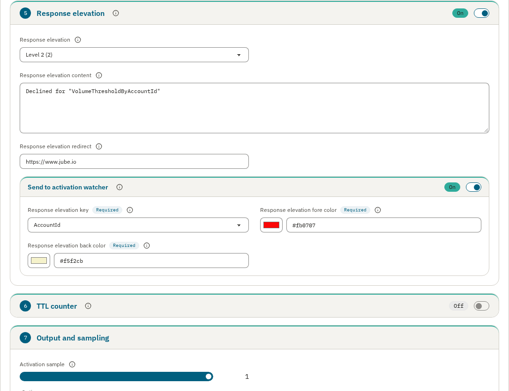
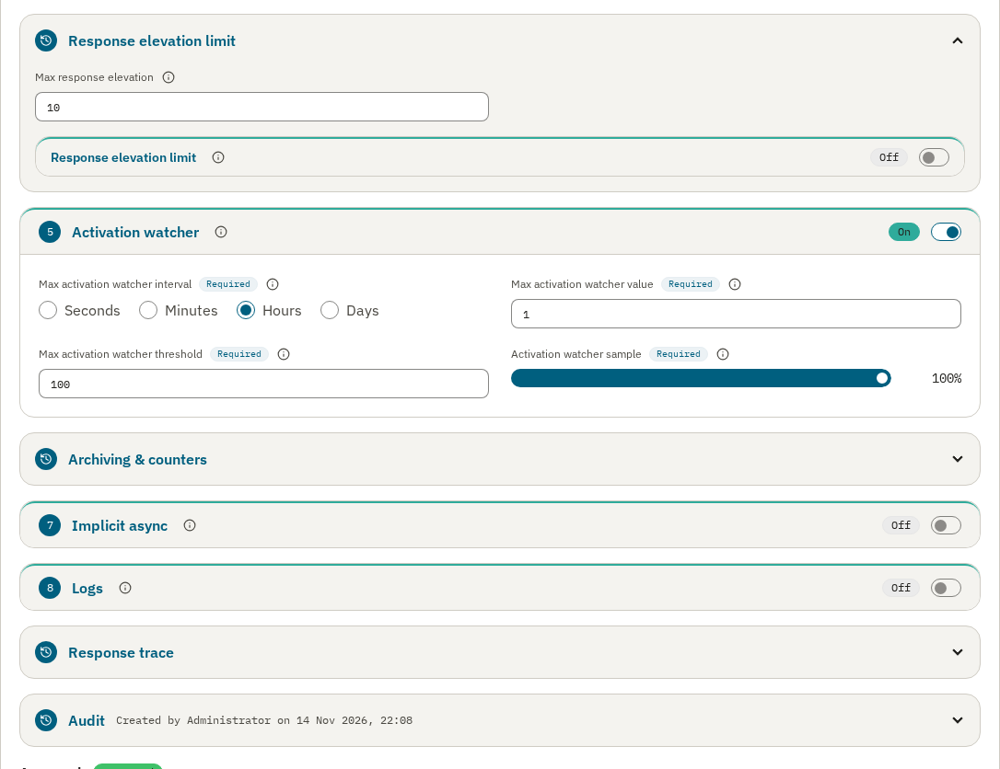

# Activation Rules with Response Elevation

The Response Elevation is the means by which a model tells the system that called it what to do about a transaction. It is a single integer returned in the response, where 0 means that nothing was raised and a higher number means a more severe outcome, the meaning of each level (to proceed, to hold or to decline) being given by the [Response Elevation Range](../ResponseElevationRanges/index.html) into which it falls.

Response elevation, commonly inferred as a decline code, is a consequence of the activation rule match. The Response Elevation has several other properties which can direct action, with the values being returned in the response payload also.

## Where it lives

The Response Elevation is a group of fields on the Activation Rule, rather than a child object of its own. Navigate through the menu to Models, open the model, then the Activation Rules hub card, and open the Activation Rule of interest, in this example the rule created beforehand in [Activation Rules](../BasicActivationRules/index.html), titled Volume1DayUSDForIPOver100. The group titled Response Elevation is presented beneath the rule, and the fields within it are presented upon the response elevation being switched on. The saving and approving of the change follows the common manner described in [Child Objects](../../../Navigation/ChildObjects/index.html).

SHOT id=models-response-elevation-group
     route=/models
     steps=open-default-model, open-hub:Activation Rules, open-row:VolumeThresholdByAccountId, scroll-to:Response Elevation
     frame=record
     state=the Activation Rule opened with the Response Elevation group switched on, a range selected for the level, and the content and redirect completed
     conveys=the Response Elevation is switched on within the Activation Rule and its level is picked from the ranges of the model
     alt=The Response Elevation group of an Activation Rule, switched on, showing the level selected from the Response Elevation Ranges alongside the content and redirect to be returned



## Fields

| Value                         | Description                                                                                                                                                                                                                                      | Example                              |
|-------------------------------|--------------------------------------------------------------------------------------------------------------------------------------------------------------------------------------------------------------------------------------------------|--------------------------------------|
| Enable response elevation     | Whether the Response Elevation is raised, alongside the other outbound messages, on the Activation Rule matching. Off by default.                                                                                                                | True                                 |
| Response elevation            | The integer level reported in the response payload, such that a consolidated response (for example a transaction decline or hold) can be inferred. It is picked by Name from the active Response Elevation Ranges of the Model.                 | 9                                    |
| Response elevation content    | Free text detailing the Activation Rule match, for example the message to be served to the customer in an online fraud prevention implementation.                                                                                                | This transaction needs verification. |
| Response elevation redirect   | A URL to redirect the user or advertising exchange to on the Activation Rule matching.                                                                                                                                                           | https://example.com/verify           |
| Send to activation watcher    | Whether a match ticks out a message to the Activation Watcher, used in conjunction with the sample of the Model so as not to flood the Activation Watcher in high throughput implementations. The three fields that follow are presented upon it being switched on, and are then required. | True                                 |
| Response elevation key        | The identifier value (for example the Account Id) accompanying the message sent to the Activation Watcher, selected from the fields of the model.                                                                                                | AccountId                            |
| Response elevation fore color | The fore colour, as a hex value, sent to the Activation Watcher and the response payload.                                                                                                                                                        | `#FFFFFF`                            |
| Response elevation back color | The back colour, as a hex value, sent to the Activation Watcher and the response payload.                                                                                                                                                        | `#A1B2C3`                            |

TODO(verify): the labels above are derived from the property names in the server; confirm them against the form on a running system, in particular whether the switch is presented as the heading of the group rather than as Enable response elevation.

## Ranges

The Response Elevation is an integer and is picked by Name from the [Response Elevation Ranges](../ResponseElevationRanges/index.html) of the Model. An Activation Rule cannot be saved with a level outside every active range, and the Engine does not send out the elevation of a rule whose level is outside every active range.

It is worth noting that if more than one Activation Rule seeks to allocate a Response Elevation, it can only be to a value greater than the one already existing (hence the name Response Elevation). The value is thereafter subject to the limits of the model and of the Gateway Rule, as described in [Model Configuration](../Models/index.html) and [Gateway Rules](../GatewayRules/index.html), whereby a value in excess of the maximum is clipped to that maximum.

SHOT id=models-response-elevation-model-limit
     route=/models
     steps=open-default-model, open-section:Response Elevation Limit, scroll-to:Response Elevation Limit
     frame=record
     state=the Properties form of the default model scrolled to the Response elevation limit group, opened to show a Max response elevation of 10 and the Response elevation limit switch beneath it switched off, with the Activation watcher group and the groups of the form that follow beneath
     conveys=the model itself carries the limits on Response Elevation, in a group of its own Properties form
     alt=The Response elevation limit group of the Properties form of the default model, showing a Max response elevation of 10 and the Response elevation limit switch switched off, with the Activation watcher group and further groups beneath



In reading the Response Elevation of a response, three cases may be distinguished. A value of 0 means that no Activation Rule with a Response Elevation matched, or that what matched was withheld, which may be by an override of kind Suppress, by the Response Elevation limit of the model having been reached, or by the rule being in shadow mode. A value greater than 0 is the highest level among the rules that matched, clipped to the Max response elevation of the model. And where several rules matched, the content, redirect and colours returned are those accompanying the level that prevailed.

The Response elevation list offers one entry for each active Response Elevation Range of the model, and where the model has none the list is empty and a Response Elevation cannot be chosen, such that the ranges are to be created, and approved, first. The validation of the group is as follows, each failure being written beneath its field:

| Field                         | Message                                                                                                         |
|-------------------------------|-----------------------------------------------------------------------------------------------------------------|
| Response elevation            | The response elevation cannot be negative. The response elevation must fall inside an active Response Elevation Range of the Model. |
| Response elevation content    | The response elevation content must be 65536 characters or fewer.                                               |
| Response elevation redirect   | The response elevation redirect must be 512 characters or fewer.                                                |
| Response elevation key        | A response elevation key is required when sending to the Activation Watcher.                                    |
| Response elevation fore color | A fore colour is required when sending to the Activation Watcher. The fore colour must be a hex value, for example #0000FF. |
| Response elevation back color | A back colour is required when sending to the Activation Watcher. The back colour must be a hex value, for example #FF0000. |

## Example

Complete the Response Elevation as a level of 9, thus inferring a decline with escalation severity 9, alongside a content and a redirect. Upon the change being approved it is taken up by the engine at its next cycle, without an explicit synchronisation. Repeat the HTTP POST to the model, as provided in `Http/Transaction.http`:

```http
POST https://localhost:5001/api/invoke/EntityAnalysisModel/90c425fd-101a-420b-91d1-cb7a24a969cc
Content-Type: application/json
X-API-KEY: <an API key>
```

The ResponseElevation element of the response, abbreviated here, is returned as follows:

```json
{
  "EntityAnalysisModelInstanceEntryGuid": "...",
  "ResponseElevation": {
    "Value": 9.0,
    "Name": "Decline",
    "Redirect": "https://example.com/verify",
    "ForeColor": "#FFFFFF",
    "BackColor": "#A1B2C3",
    "Content": "This transaction needs verification."
  }
}
```

TODO(verify): replace the abbreviated response above with one captured from a running system, the Name being that of the Response Elevation Range into which level 9 falls in the default model

It can be seen from the HTTP response payload that the Response Elevation has been returned as 9, alongside the URL and example messages configured.

## Permissions and security

The Response Elevation is saved with the Activation Rule, and it follows that reading and writing it requires permission 17, Read Write Activation Rule. A user without it receives 403, and an unauthenticated request receives 401.
