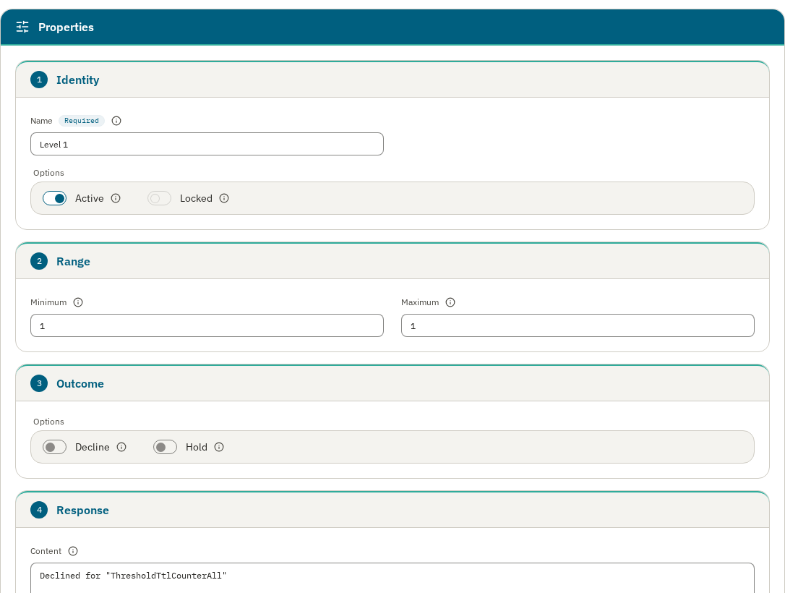
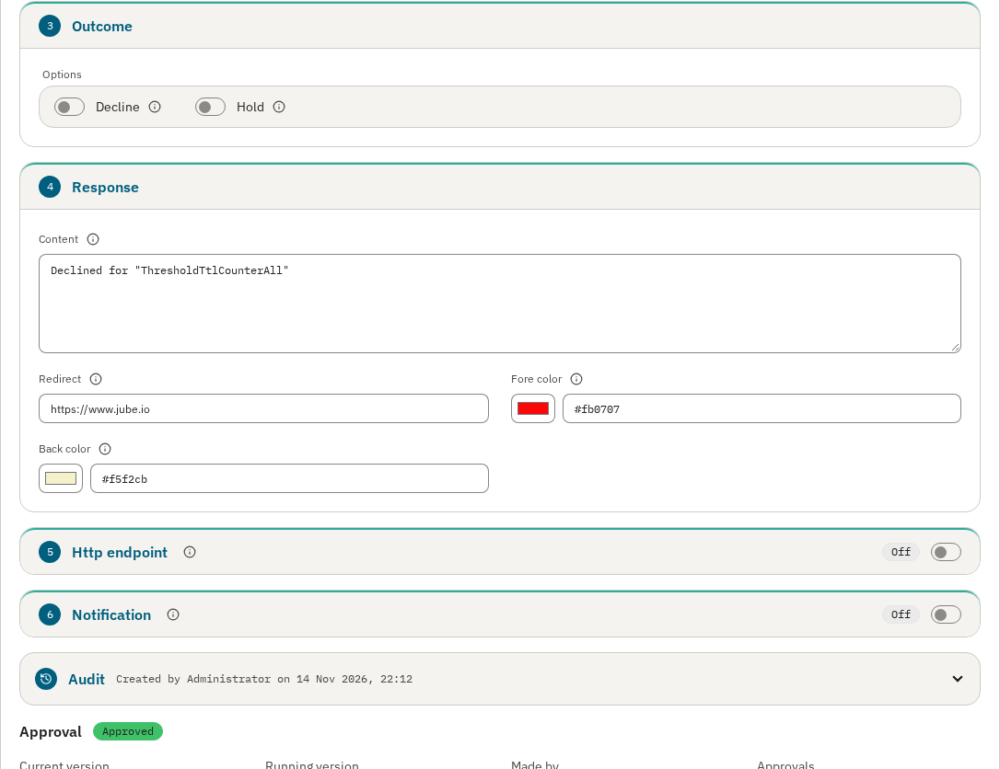

# Response Elevation Ranges

The receiving system expects the Response Elevation as an integer, and an Activation Rule may only elevate the response to a level that a Response Elevation Range has been defined for. A Response Elevation Range names a band of levels and says what reaching it means, which is to say a decline, a hold, or neither.

To take an example, a model might carry three ranges, as follows, which between them give every level from 1 to 10 a meaning:

| Name            | Minimum | Maximum | Decline | Hold | What the receiving system is being told                            |
|-----------------|---------|---------|---------|------|--------------------------------------------------------------------|
| Monitor         | 1       | 4       | Off     | Off  | Something of note was seen, and the payment proceeds.              |
| Hold for review | 5       | 7       | Off     | On   | The payment is held until an analyst releases or refuses it.       |
| Decline         | 8       | 10      | On      | Off  | The payment is declined.                                           |

An Activation Rule raising a Response Elevation of 6 would then be picked as Hold for review in the form of the rule, and a transaction matching it, and no rule of a higher level, would be returned with the level 6 and the Name Hold for review, and would be held. Were a second rule of level 9 to match the same transaction, the higher level prevails, and the transaction would be returned as 9, Decline. A level that falls inside no active range cannot be chosen for an Activation Rule at all.

## Where it lives

Navigate through the menu to Models, open the model, then the Response Elevation Ranges hub card. Creating, changing, approving and deleting a Response Elevation Range follows the common manner described in [Child Objects](../../../Navigation/ChildObjects/index.html).

The list of ranges differs from that of other child objects in the columns it shows, being Name, From and To (the Minimum and Maximum), Decline, Hold and Active, the last three each reading Yes or No, such that the bands of a model and their outcomes can be read from the list without a range being opened.

SHOT id=models-response-elevation-ranges-record
     route=/models
     steps=open-default-model, open-hub:Response Elevation Ranges, open-first-row
     frame=record
     state=a Response Elevation Range of the default model opened, approved and active, showing the Identity, Range, Outcome and Response groups, with Hold switched on and the colours set
     conveys=a range is a named band of integer levels with an outcome and the presentation sent with the response
     alt=A Response Elevation Range opened beneath its model, showing its name, the minimum and maximum levels, the Decline and Hold switches, and the content, redirect and colours returned in the response

## Fields

The form is arranged in the groups Identity, Range, Outcome and Response, followed by the groups Http endpoint and Notification, which start collapsed:

| Value                           | Description                                                                                                                                                                                                                                                                                                                                                                             | Example                                  |
|---------------------------------|-----------------------------------------------------------------------------------------------------------------------------------------------------------------------------------------------------------------------------------------------------------------------------------------------------------------------------------------------------------------------------------------|------------------------------------------|
| Name                            | Required, up to 256 characters and unique within the Model without regard to case. The Name is shown beside the integer level wherever the level is shown, the Activation Watcher and the Case Key Journal among them, and is how the range is picked in an Activation Rule.                                                                                                             | Hold for review                          |
| Active                          | Whether Activation Rules may elevate the response to a level inside the range. A range that is not Active is not sent out. Active is off for a new range and must be switched on.                                                                                                                                                                                                        | True                                     |
| Locked                          | Whether the range is protected from change.                                                                                                                                                                                                                                                                                                                                             | False                                    |
| Minimum                         | The lowest integer level in the range, inclusive. Not negative.                                                                                                                                                                                                                                                                                                                         | 5                                        |
| Maximum                         | The highest integer level in the range, inclusive. Not below Minimum. Set equal to Minimum for a single level.                                                                                                                                                                                                                                                                          | 7                                        |
| Decline                         | The outcome of reaching this range is a decline.                                                                                                                                                                                                                                                                                                                                        | False                                    |
| Hold                            | The outcome of reaching this range is that the payment is held for review. A decline never holds, so Decline and Hold cannot both be on.                                                                                                                                                                                                                                                | True                                     |
| Content                         | Free text sent with the response when the range is reached, for example the message to be shown to the customer.                                                                                                                                                                                                                                                                        | This transaction needs verification.     |
| Redirect                        | A URL to redirect the user or advertising exchange to when the range is reached.                                                                                                                                                                                                                                                                                                         | https://example.com/verify               |
| Fore color                      | The fore colour sent to the Activation Watcher and in the response when the range is reached, as a six digit hex value.                                                                                                                                                                                                                                                                  | `#A1B2C3`                                |
| Back color                      | The back colour sent to the Activation Watcher and in the response when the range is reached, as a six digit hex value.                                                                                                                                                                                                                                                                  | `#FFFFFF`                                |
| Enable http endpoint            | Whether an asynchronous web hook is called when the range is reached. The fields that follow are presented upon it being switched on.                                                                                                                                                                                                                                                   | True                                     |
| Http endpoint                   | The web hook, being an absolute http or https URL. The scheme, host and port are written out literally; the tokens `[@Payload.FieldName@]`, `[@Hold.Name@]`, `[@Hold.Elevation@]` and `[@Hold.EntryGuid@]` are allowed only in the path and query, and every value is URL encoded.                                                                                                       | https://example.com/hooks/elevation      |
| Http endpoint type              | The method of the web hook call, POST or GET.                                                                                                                                                                                                                                                                                                                                           | POST                                     |
| Http endpoint header name       | Optional. The name of a request header that carries a credential on the web hook call. It is set together with Http endpoint credential variable, or neither is set.                                                                                                                                                                                                                    | Authorization                            |
| Http endpoint credential variable | Optional. The name of an environment variable that starts with `JUBE_HOOK_`, whose value is sent in the header. The value is never stored in the database, never written to the Archive and never read from a variable without that prefix.                                                                                                                                            | JUBE_HOOK_PAYMENTS                       |
| Enable notification             | Whether an asynchronous notification is sent when the range is reached. The fields that follow are presented upon it being switched on.                                                                                                                                                                                                                                                 | True                                     |
| Notification type               | The channel of the notification, Email or SMS.                                                                                                                                                                                                                                                                                                                                          | Email                                    |
| Notification destination        | The email address or telephone number to which the notification is sent. Required where the notification is enabled.                                                                                                                                                                                                                                                                    | name@example.com                         |
| Notification subject            | The subject line, for an Email notification.                                                                                                                                                                                                                                                                                                                                            | Response elevated                        |
| Notification body               | The body of the notification, in which tokens are replaced with values from the Payload.                                                                                                                                                                                                                                                                                                | Account [@AccountId@] has been held.     |

TODO(verify): the labels above are derived from the property names in the server (Fore color, Back color, Http endpoint and so on); confirm them against the form on a running system, and whether the American spelling of the two colour labels and the casing of Http are intended.

SHOT id=models-response-elevation-ranges-outcome-response
     route=/models
     steps=open-default-model, open-hub:Response Elevation Ranges, open-first-row, scroll-to:Outcome
     frame=record
     state=a Response Elevation Range of the default model scrolled to the Outcome group of its form, showing the Decline and Hold switches, with the Response group and its Content beneath, followed by the groups for the HTTP endpoint and the notification
     conveys=below its name and bounds a range says what follows when it is reached, a decline or a hold, the content returned, and any message sent
     alt=The Outcome group of a Response Elevation Range record showing the Decline and Hold switches, above the Response group holding the content returned and the groups that follow

## Validation

A Response Elevation Range is validated in the server, and is rejected where:

* The Name is empty, longer than 256 characters, or already exists in the Model.
* Minimum is negative, or Maximum is below Minimum.
* The range overlaps another range of the Model, in which case the message names the range that clashes.
* Decline and Hold are both on.
* A colour is not a six digit hex value such as `#A1B2C3`.
* The web hook is enabled without an address, or only one of the credential header and the credential variable is given.
* The address of the web hook is refused by the [Outbound Host Policy](../../Administration/OutboundHostPolicy/index.html): loopback, private, link-local (cloud metadata) and other internal addresses, and any scheme other than http or https, are refused when saved and again when called, redirects are never followed, and a trusted internal receiver must be listed in `JUBE_HOOK_ALLOWED_HOSTS` or `JUBE_HOOK_ALLOWED_CIDRS`.

A new range is presented with Minimum and Maximum at 0, Http endpoint type as POST, Notification type as Email, and every switch off, being Active, Decline, Hold, Enable http endpoint and Enable notification. Each failure is written beneath the field it relates to and counted in the summary at the head of the form, as described in [Child Objects](../../../Navigation/ChildObjects/index.html), with the messages as follows:

| Field                             | Message                                                                                                   |
|-----------------------------------|-----------------------------------------------------------------------------------------------------------|
| Name                              | A name is required. The name must be 256 characters or fewer. This name already exists.                   |
| Minimum                           | The first level cannot be negative.                                                                       |
| Maximum                           | The last level cannot be below the first level.                                                           |
| The range as a whole              | This range overlaps the range named, followed by the Name of the range that clashes.                      |
| Hold                              | A range cannot both decline and hold; a decline never holds.                                              |
| Content                           | The content must be 65536 characters or fewer.                                                            |
| Redirect                          | The redirect must be 512 characters or fewer.                                                             |
| Fore color, Back color            | The colour must be a hex value such as #A1B2C3.                                                           |
| Http endpoint                     | A web hook URL is required when the web hook is enabled. The web hook URL must be 512 characters or fewer. The web hook must be an absolute http or https URL whose scheme, host and port are written out literally, with tokens only in the path and query. Where the address is blocked by the outbound host policy, a message saying so and naming `JUBE_HOOK_ALLOWED_HOSTS` and `JUBE_HOOK_ALLOWED_CIDRS`. |
| Http endpoint type                | The web hook method must be POST or GET.                                                                  |
| Http endpoint header name         | The credential header name is required when a credential variable is given. The credential header name must be a plain header name and not a reserved one. |
| Http endpoint credential variable | The credential variable is required when a credential header name is given. The credential variable must be an environment variable name that starts with JUBE_HOOK_ followed by capital letters, digits or underscores. |
| Notification type                 | The notification channel must be Email or SMS.                                                            |
| Notification destination          | A destination is required when the notification is enabled. The destination must be 512 characters or fewer. |
| Notification subject              | The subject must be 512 characters or fewer.                                                              |
| Notification body                 | The body must be 65536 characters or fewer.                                                               |

A range cannot be created under a deleted Model, and cannot be moved to another Model by an edit.

## Ranges and Activation Rules

The response elevation of an Activation Rule is picked from a list of the active ranges of the Model, each shown by Name and its levels, and the Activation Rule stores the integer, as described in [Activation Rules with Response Elevation](../ResponseElevation/index.html). The rule cannot be saved with a level that is outside every active range. When the Model is synchronised the Engine applies the same test, so a rule whose level falls in no active range does not elevate the response and a warning is logged.

## What the Engine does when a range is reached

The highest level reached by a transaction resolves to exactly one range. The Name is added to the response beside the integer, and when the range is a Hold or a Decline the Engine stamps a `hold` element in the payload that is archived with the transaction, such that everything about the state of a payment lives in the Archive:

| Element                                                             | Meaning                                                                                                                                                                                                                                   |
|---------------------------------------------------------------------|-------------------------------------------------------------------------------------------------------------------------------------------------------------------------------------------------------------------------------------------|
| `stateId`                                                           | 1 Held, 2 Declined, 3 Released, 4 Refused. A Decline is stamped Declined and can never be released or refused.                                                                                                                            |
| `rangeId`, `rangeName`, `rangeMinimum`, `rangeMaximum`, `elevation` | The range that stamped it and the level reached.                                                                                                                                                                                          |
| `stampedDate`                                                       | When the hold was stamped.                                                                                                                                                                                                                |
| `decision`                                                          | Who released or refused the payment, when, why, through which release hook and with which HTTP status.                                                                                                                                    |
| `legs`                                                              | Every message sent about the hold, each with its kind (email, SMS, web hook, release hook, refuse hook), its outcome (queued, sent, failed, not sent), the time, the destination without its query string, the HTTP status and any error. |

A range that is neither a Hold nor a Decline names the elevation but stamps nothing. Reprocessing never stamps a hold and never changes one that exists, the existing `hold` element being carried over unchanged.

Every later change to the element, a message leg being recorded or a payment being released or refused, rewrites the archived payload, raises the version of the Archive row and keeps the earlier state in the Archive version table, which is the audit trail of the payment. The date of the transaction is not moved.

### Asynchronous messages

The Notification of a range is sent through the same path as every other notification. The Web hook has its own queue and sender, and chooses between the in-process queue and AMQP in exactly the way notifications do: where notifications go over AMQP, web hooks do too, on the `jubeWebhooks` queue. The size of the web hook queue is written with the other queue balances and appears as Webhook in the asynchronous queue balance. An address whose host is not written out literally, or that the Outbound Host Policy blocks, is refused, recorded as a Refused leg and never called. The outcome of each message is recorded in `legs` once the archived row exists, the Engine retrying for about a minute while the Archive catches up.

The notifications on an Activation Rule are no longer read by the Engine, and it follows that they are to be recreated on a range.

## Releasing a held payment

A payment in the Held state is released or refused from the Decide pane of the case page, in the Held payment lightbox, by a user having permission 68, Release Held Payments. Both need a reason. The web hook that releases is configured in the [Case Workflow Release Hook](../../CaseManagement/CreatingCaseWorkflowReleaseHook/index.html).

## Existing models

Response Elevation was a floating point number before ranges were introduced. The upgrade rounds each value to an integer and creates a single level range for every distinct rounded value in a Model, named `Level` followed by the integer, carrying the content, redirect and colours of the first Activation Rule that used it. Where two different values round to the same integer they share a range and the upgrade logs a notice, so those rules should be reviewed by hand. No range is a decline or a hold until it is set to be one.

## Permissions and security

Reading and writing Response Elevation Ranges requires permission 17, Read Write Activation Rule, there being no permission particular to ranges, although the reading of the ranges of a Model is also afforded to permission 1, Read Write Case. A user without permission receives 403, and an unauthenticated request receives 401. Every mutation also needs the antiforgery token for cookie sessions.
