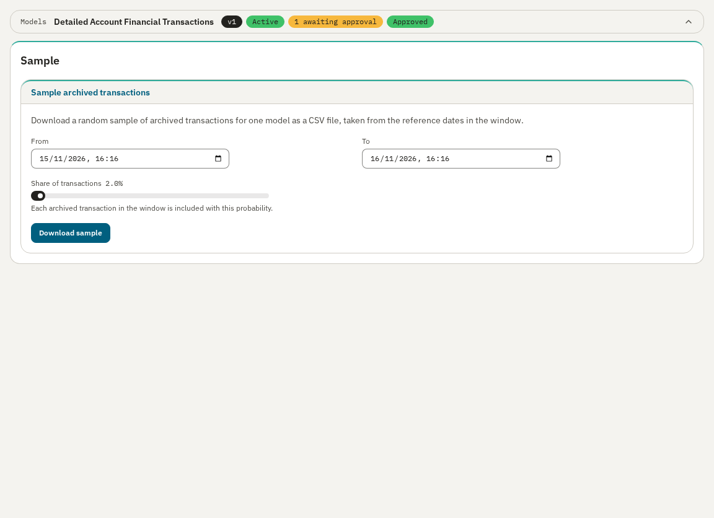

# Sampling

Sampling is a lightweight CSV export tool that extracts a representative sample of data for a given date range and flattens out all model elements to a CSV format for independent ingestion into analytical tools such as R.

Sampling takes the following steps:

* A query is predicated on a defined random selection between a given date range.
* The query returns the JSON from the Archive table.
* All model elements, such as Payload, Abstraction etc, are extracted from the JSON via their JSONPath representations, before being transposed to a CSV representation as their datatype (for example, strings are enclosed in double quotes).
* The CSV, including header record, is exported as a file stream, and downloaded by the browser.

## Where it lives

Navigate through the menu to Models, open the model, then the Sample card, which is presented among the cards of the model only to a user having the permission described below. The card opens a step of its own, titled Sample archived transactions, with the model fixed as the one that is open. It follows that there is no selection of a model to be made, which is of importance as the parsing of the Archive JSON varies remarkably by model configuration.

Sampling is no longer an item in the menu beneath Models.

SHOT id=models-sampling-card
     route=/models
     steps=open-default-model, open-hub:Sample
     frame=page
     state=the default model opened with the Sample archived transactions step beneath it, the window set to the last day and the Share of transactions slider at 2%
     conveys=a sample is a date window and a share, taken for the model that is open
     alt=The Sample archived transactions step of a model, showing the From and To date and time fields, the Share of transactions slider and the Download sample button

## Fields

| Value                 | Description                                                                                                                                                                                                                 | Example          |
|-----------------------|-----------------------------------------------------------------------------------------------------------------------------------------------------------------------------------------------------------------------------|------------------|
| From                  | The start of the window, entered in the local time of the browser. The date filtering is performed based on the Reference Date and not the Created Date in the Archive. The default is one day before the present time.     | 2026-01-01 00:00 |
| To                    | The end of the window, which must be after its start. The default is the present time.                                                                                                                                      | 2026-01-02 00:00 |
| Share of transactions | The sample is the percentage within the date range selected using a random digit in the underlying query, which is to say that each archived transaction in the window is included with this probability. The default is 2%, and 100% returns all records. | 2%               |

The Share of transactions is a slider moving in steps of 1% from 0% to 100%, with the share chosen stated beside its label and, beneath it, the reminder Each archived transaction in the window is included with this probability. It follows that the share is a probability and not a quota: a share of 2% over a window holding 10,000 archived transactions returns about 200 rows, a different 200 or so upon each download, and a share of 0% returns the header alone. The step itself carries the explanation Download a random sample of archived transactions for one model as a CSV file, taken from the reference dates in the window.

Upon clicking Download sample the query is run and the CSV file is downloaded by the browser, with confirmation being returned as Downloaded followed by the name of the file. While the file is being prepared the button reads Preparing… and cannot be clicked again. Nothing of the window or the share is retained, the step returning to its defaults each time it is opened. The outcomes other than a download are as follows, each being written above the button in place of the confirmation:

| Circumstance                                                  | Message                                                |
|---------------------------------------------------------------|--------------------------------------------------------|
| The start of the window has been cleared.                     | Enter the start of the window.                         |
| The end of the window has been cleared.                       | Enter the end of the window.                           |
| The end of the window is not after its start.                 | The end of the window must be after its start.         |
| The share is not between 0 and 1.                             | The share must be between 0 and 1.                     |
| The user is refused by the server (403).                      | You do not have permission to download samples.        |
| The server refuses the request as invalid, the size of the file among the reasons. | The reason given by the server.   |
| The server returns nothing.                                   | The server returned an empty file. Try again.          |
| Any other failure.                                            | The sample could not be downloaded.                    |

This file handles nesting from the model objects with a . separator in the header and is otherwise a compliant, string escaped CSV which can be ingested into analytical tooling such as R.

## Validation

The card does not submit a request, instead presenting the reason, where:

* The start or the end of the window is not entered.
* The end of the window is not after its start.
* The share is not between 0 and 1.

The same rules are applied again in the server, keeping in mind that the user interface is a fascia of the API.

## Limits and safeguards

The download is bounded, for the purposes of protecting both the database and the memory of the server, as follows:

* A model that is not in the tenant of the user, or has been deleted, is reported as not found.
* At most 100,000 archive rows are read per download, and the archive rows are streamed, one at a time, into the file, which is built in memory. The file may not grow past the value of the SampleMaxBytes Environment Variable (32 MiB by default), and a sample that would do so is refused with a message asking for a narrower date range or a lower rate, rather than being cut short. It follows that a file that downloads is always complete up to the 100,000 row limit.
* A text cell that starts with `=`, `+`, `-`, `@`, a tab or a carriage return and is not a number is prefixed with a single quote, such that a spreadsheet does not evaluate it as a formula.
* Each download, successful or not, is recorded in the EntityAnalysisModelSampleExecutionLog table with the window, the rate, the number of rows and the error when there was one.
* The query reads the reporting database when the ReportConnectionString Environment Variable is set, otherwise the main database, as described in [Environment Variables](../../../Concepts/EnvironmentVariables/index.html).
* A payload field whose JSONPath uses a regular expression filter (`=~`) is stopped after 250 milliseconds and the cell is left empty or zero, henceforth a pattern cannot hold the download up.

TODO(verify): owner to confirm 32 MiB and 100,000 rows are the right defaults. An archive row carries the whole payload and every derived value (commonly several kilobytes of JSON), so 100,000 rows are hundreds of megabytes of JSON read per request, whereas a CSV row holds only the columns of the model.

## Permissions and security

Downloading a sample requires permission 40, View Entity Analysis Model Sampling, and the Sample card is not presented without it. A user without it receives 403, and an unauthenticated request receives 401.
