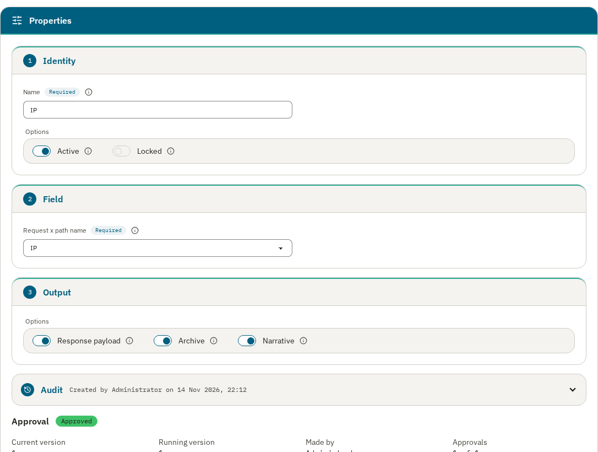
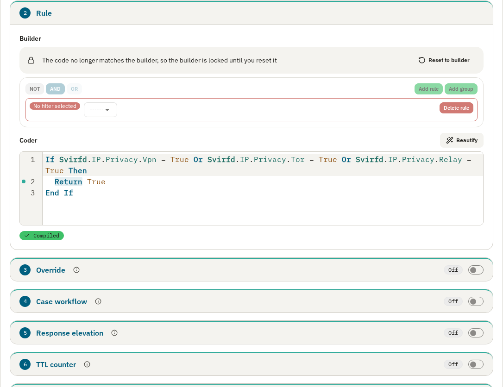

# Svirfd

Svirfd looks up an IP address for IP intelligence from [svirfd.com](https://svirfd.com) on every invocation of a model, and surfaces the whole record to rules, the response and the archive. It is built on the `Svirfd` NuGet package.

The purpose is to let a rule ask what kind of place on the internet a transaction has come from, which the address alone does not say: whether it belongs to a home broadband provider or a data centre, whether it is a VPN or a Tor exit, which operator announces it, and roughly where it is. A Svirfd entry of a model names the request field holding the address, and from then on every transaction carries the answer, to be read by rules by name. To take the simplest case, an entry named Customer reading the request field IP allows a rule to match where `Svirfd.Customer.Privacy.Vpn` is True.

> Data: svirfd.com, built from RIR delegated statistics, RouteViews, RIPE NCC RIS, open traceroutes, Wikidata (CC0) and
> operator-published lists. Credit svirfd.com where this data is shown.

## Where it lives

Navigate through the menu to Models, open the model, then the Svirfd hub card, which sits in the Network group of cards beside [Graph Recall](../GraphRecall/index.html). Creating, changing, approving and deleting an entry follows the common manner described in [Child Objects](../../../Navigation/ChildObjects/index.html), and entries travel with a model export.

The entry of a model is not to be confused with the Svirfd item of the main menu, which is the page for looking up an address typed by the user and for observing the state of the feed, as described in [Svirfd](../../Svirfd/index.html).

SHOT id=models-svirfd-entry
     route=/models
     steps=open-default-model, open-hub:Svirfd, open-first-row
     frame=record
     state=a Svirfd entry of the default model opened, approved and active, showing the Identity, Field and Output groups with the IP request field selected and Archive switched on
     conveys=an entry names an IP field of the model to be looked up, and says where the record is to be sent
     alt=A Svirfd entry opened beneath its model, showing its name, the IP request field selected, and the Response payload, Archive and Narrative switches



## The IP data type

A Request XPath has the data type IP. It is held as text and behaves as a String everywhere a String does: Dictionary lookups, Sanctions, TTL Counters, Abstraction Rule search keys, the case key, suppression and Archive Key. Setting a field to IP does nothing more on its own, and an IP field stays available whatever the value of the EnableSvirfd Environment Variable.

## Fields

| Value               | Description                                                                                                                                                                                        | Example  |
|---------------------|----------------------------------------------------------------------------------------------------------------------------------------------------------------------------------------------------|----------|
| Name                | The name rules read the record by, as `Svirfd.{Name}.{Member}`. Letters and digits only, starting with a letter, and unique within the model.                                                      | Customer |
| Active              | Whether the address is looked up on every invocation. On by default.                                                                                                                               | True     |
| Locked              | Whether the entry is protected from change.                                                                                                                                                        | False    |
| Request x path name | A Request XPath of the model with data type IP, whose value is the address looked up, selected from the fields of the model. Required.                                                             | IP       |
| Response payload    | Whether the whole record is returned in the response JSON under `Svirfd`. Off by default.                                                                                                          | False    |
| Archive             | Whether the record is written into the archive JSON under `svirfd`, which reporting, training and the case journal read. On by default.                                                            | True     |
| Narrative           | Whether the plain English narrative is rendered onto the record, such that it is returned in the response and archived with it. On by default, and switched off to keep the record to data alone.  | True     |

TODO(verify): the label Request x path name is derived from the property name in the server; confirm it against the form on a running system, and whether it is the label intended for the field.

The form is arranged in the groups Identity, Field, Output and Audit (collapsed), and the list of entries shows, beside the Name, whether each is Active and its Field. A new entry is presented with Active, Archive and Narrative on and Response payload off, Active being on for a new record being the reverse of most child objects. Unlike a Graph Recall entity, Response payload and Archive are not exclusive, and both may be on.

A value that is not an address, or a lookup that cannot be answered, leaves the entry absent, in which case every member reads as `Nothing` and a rule never fails because of it.

## Validation

An entry is validated in the server, and is rejected where:

* The Name is empty, is not letters and digits starting with a letter, or already exists in the model.
* The request field is not selected, or is not a Request XPath of the model having the data type IP.

Each failure is written beneath the field it relates to and counted in the summary at the head of the form, as described in [Child Objects](../../../Navigation/ChildObjects/index.html), with the messages as follows:

| Field               | Message                                                                                                                                                   |
|---------------------|-----------------------------------------------------------------------------------------------------------------------------------------------------------|
| Name                | A name is required. The name must start with a letter and contain only letters and digits, because rules read it as Svirfd.{Name}.{Member}. An entry with this name already exists on the model. A limit upon its length is stated in the form The name may be at most, followed by the number of characters. |
| Request x path name | The request field whose value identifies the entry is required. The field must be a request XPath of this model with data type IP.                        |

It follows that a model having no Request XPath of Data type IP cannot carry a Svirfd entry, and that the field is to be given that Data type, and the change approved, beforehand.

## Reading the record in rules

Every rule type can read the record: Gateway, Abstraction, Activation, Inline Function, Inline Script, case search and the Exhaustive and Advanced Analytics variables.

```vb
If Svirfd.Customer.Privacy.Vpn = True Or Svirfd.Customer.Privacy.Tor = True Then
    Return True
End If
```

| Member        | Example                                                                                                              |
|---------------|----------------------------------------------------------------------------------------------------------------------|
| Scalars       | `Svirfd.Customer.Asn.Name`, `Svirfd.Customer.Location.CityConfidence`, `Svirfd.Customer.Routing.Prefix`              |
| Nested blocks | `Svirfd.Customer.Connection.Hosting`, `Svirfd.Customer.Cloud.Provider`, `Svirfd.Customer.Registry.Country`           |
| First origin  | `Svirfd.Customer.Routing.Origin.Rpki`, `Svirfd.Customer.Routing.Origin.Peers`                                        |
| Array lengths | `Svirfd.Customer.Lists.Count`, `Svirfd.Customer.Privacy.ListsChecked.Count`                                          |
| Distance      | `Svirfd.Customer.DistanceKm(latitude, longitude)`, `DistanceMiles(...)`, `WithinKm(latitude, longitude, kilometres)` |

A `Nothing` is not `False`. In the record a null means no public source says, so a VPN flag of null is not a statement that the address is not a VPN, and `Privacy.ListsChecked` names the lists that were consulted. A city is only as good as its confidence and evidence, and it follows that `Location.City` is not to be acted upon when `Location.CityConfidence` is `none` or `low`.

`DistanceKm` uses the located coordinates, falling back to the hub and then the default point, and answers `Nothing` when the record places the address nowhere. The distance is a Haversine great-circle distance, so it composes with the other geospatial extensions.

The Builder lists every member under the group Svirfd with its type, and the Coder offers them as completions.

### Time zone

Each record carries `Timezone.Id`, the IANA zone of the address (for example `Europe/Warsaw`) and `Timezone.Basis`, being whether the country has one zone or the located city chose it. It is null when the country has several zones and no city is known. Rules read it as `Svirfd.{Name}.Timezone.Id`, which is useful to set beside the zone reported by the browser of a visitor.

SHOT id=models-svirfd-activation-rule
     route=/models
     steps=open-default-model, open-hub:Activation Rules, open-row:SvirfdIpIsVpnOrTor, scroll-to:Rule
     frame=record
     state=the SvirfdIpIsVpnOrTor Activation Rule of the default model scrolled to its Rule group, showing the Builder locked beneath the notice that the code no longer matches the builder, and the Coder holding the rule text, which matches where Svirfd.IP.Privacy.Vpn, Svirfd.IP.Privacy.Tor or Svirfd.IP.Privacy.Relay is True, with a status of Compiled and the Override, Case workflow, Response elevation and TTL counter groups switched off beneath
     conveys=the Svirfd record is read in a rule in the manner of any other value, here to match upon an address that is a VPN, a Tor exit or a relay
     alt=The Rule group of the SvirfdIpIsVpnOrTor Activation Rule showing a locked Builder above the Coder, whose rule text tests the Vpn, Tor and Relay values of the Svirfd record of the IP, with a Compiled status beneath



## Inline Scripts

An Inline Script receives the whole invocation context, so it reads the record, and can look up any address it derives:

```csharp
var record = context.EntityAnalysisModelInstanceEntryPayload.Svirfd["IP"];
var vpn = record?.Privacy?.Vpn;
var other = await context.EntityAnalysisModel.Services.Svirfd.LookupAsync("203.0.113.9", CancellationToken.None);
```

## The case journal

For a transaction that has an archived record, the [Case Key Journal](../../CaseManagement/WorkingCaseKeyJournal/index.html) shows the members of the record as the `svirfd` columns, and on an IP key of the transaction card opens the Svirfd panel: a fresh lookup of the same address beside the archived record, with every member that has changed since, marked.

## Modes and limits

The Svirfd variables are described in [Environment Variables](../../../Concepts/EnvironmentVariables/index.html). Without a key the client calls the public API on the open tier, which is one lookup a second per address, being enough to trial the feature, and `EnableSvirfdRemoteEngineLookup` can switch per-transaction lookups off. A Premium key loads the whole index into the process, such that a lookup is a memory read, with no rate limit and no address leaving the server.

Turning `EnableSvirfd` off removes the lookup, the Svirfd page, the case journal panel and the Ask Jooby tool, because the structure of a record cannot be verified without it. It does not remove the IP data type from models.

### Staying up when the feed does not

With a Premium key the client loads the whole index and a lookup is a memory read. If that download fails at start (a rate limit, the index still loading on the service, a network failure), the client does not stop: it answers every lookup from the public API at once, reports the state `FellBackToRemote`, and retries the download in the background, pausing `SvirfdLocalRetryPause` first and doubling up to ten minutes. When the snapshot loads it switches to Local. A key the service refuses stays on the API. The Svirfd page shows the state while it is not `LocalReady`.

`SvirfdCacheDirectory` keeps the downloaded snapshot (about 75 MB) so that a restart loads it from disk and fetches only that which changed, instead of downloading it all again. It is to be pointed at a folder that survives a restart, and the Docker compose file mounts a volume for it. If the service has not been heard from for `SvirfdStaleAfter`, the state becomes `Stale` and the last good index keeps answering. Every request names Jube in its user agent.

## What leaves the installation

IP addresses are personal data under most data protection regimes, and it follows that the circumstances in which an address is sent outside of the installation are set out in full as follows:

* Local and Directory modes never send a transaction address anywhere: the index is held in the process (Local downloads the public snapshot, whereas Directory reads files with no network at all).
* Remote mode (the open tier, or a key without the Premium feed grant) sends one HTTPS request per address to `SvirfdBaseUrl`, and only when a model has an active Svirfd entry and `EnableSvirfdRemoteEngineLookup` is True. The request carries the address in the path, the API key, and a user agent naming the Svirfd package and Jube. No other field of the payload, no tenant, model, user or transaction identifier is sent.
* Private, loopback, link-local, carrier-grade NAT, multicast and unspecified addresses (for example `10.0.0.5`, `192.168.1.1`, `fe80::1`) are never sent: they have no public record, and sending them would disclose the internal address plan.
* Answers are cached in memory for `SvirfdRemoteCacheMinutes`, shared by every tenant of the installation because an address record is public data, not tenant data. The cache is not written to disk.
* Remote lookups run through the shared `Jube.ResilientHttp` pipeline: a timeout (`SvirfdRemoteLookupTimeout`, at least 50 ms), a breaker per service host that opens after repeated transient failures (the `ResilientHttp*` settings), and no retry, because a lookup happens inside a transaction and the open tier allows one a second. On top of that Svirfd keeps the pauses the service itself dictates: its `Retry-After`, an exponential pause after a rate limit, five seconds after a timeout or failure, and off until restart when the key is refused.
* To send nothing, set `EnableSvirfdRemoteEngineLookup` to False (Remote lookups during invocation stop, although the Svirfd page still looks up the address a user types), set `EnableSvirfd` to False, or use Directory mode. The two environment switches are installation-wide. A tenant also opts in by configuring a Svirfd entry on a model, and the platform operator can switch remote lookups off for one tenant, as below.
* `SvirfdBaseUrl` must be an `https` address with no embedded credentials (plain `http` is accepted only for a loopback host such as a local test server). Otherwise the client is not created, the error is logged and lookups are off, so the API key and addresses are never sent in clear. It is an operator setting, and no tenant or API caller can change it.
* The API key is read from the environment (it may be a `[@SvirfdApiKey@]` secret file token), is never stored in the database, never returned by `/api/Svirfd/Status` and never written to the log by Jube.

### The switch for a tenant

On the Tenants page (Administration, then Tenants, visible only to a landlord user), the Svirfd remote lookups enabled switch, in the Data protection group, is on by default for every existing and new tenant. When it is switched off, the engine makes no remote Svirfd lookup for the transactions of that tenant, the Svirfd page and the case journal comparison make none for the users of that tenant, and no address leaves the installation for that tenant. Local and Directory lookups, and the behaviour when Svirfd is offline, are unchanged.

The effective rule is that both must allow: `EnableSvirfd` and `EnableSvirfdRemoteEngineLookup` on the installation, and the switch on the tenant. The switch is read when models are synchronised, so a change takes effect on the next synchronisation (the Svirfd page and journal read it on each request). A tenant administrator cannot change it, the data protection posture of the tenant being decided by the platform operator, exactly like the HTTP Adaptation settings. Cached remote answers are never served to a tenant whose switch is off. The Svirfd status shows `TenantRemoteLookupsEnabled`.

TODO(verify): the owner and the data protection officer must confirm this section: the lawful basis wording, whether a data processing agreement with svirfd.com is needed, and whether landlord-only is the intended control for the tenant switch or tenants should be able to switch it off themselves (see review/svirfd-tenant-switch.md).

TODO(verify): confirm with the owner the retry decision for remote lookups (none), as the interactive Svirfd page could take a small retry budget; and confirm that the Svirfd package never logs or echoes the API key in exception messages, which the status page shows in the last error.

TODO(verify): the Svirfd package is pinned to exactly 0.0.3 in Jube.Svirfd.csproj ([0.0.3]); the upgrade procedure and the 0.0.3 brief are to be documented once the owner confirms them.

## Licence

The package is MIT. The data is licensed separately for internal use under the [svirfd.com licence](https://svirfd.com/licence): credit svirfd.com wherever the data is shown, do not redistribute it, and destroy local copies when a Premium subscription ends. Jube shows the credit on every surface that shows a record.

## Permissions and security

Reading and writing the Svirfd entries of a model requires permission 15, Read Write HTTP Adaptation, there being no permission particular to the entries, whereas the Svirfd page of the main menu requires permission 72, View Svirfd. A user without permission receives 403, and an unauthenticated request receives 401. Every mutation also needs the antiforgery token for cookie sessions.
