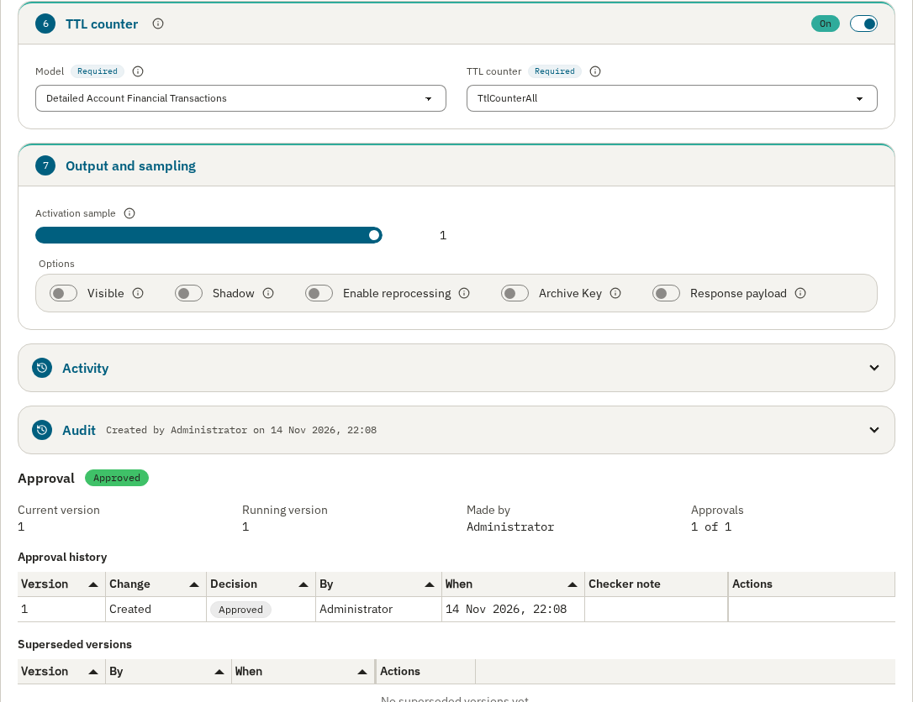

# TTL Counter Activation Rule Incrementation

In previous documentation the [TTL Counter](../TTLCounters/index.html) definition was introduced and a TTL Counter by the name of IP was created. A TTL Counter does not count of its own accord, rather it is incremented as a consequence of an Activation Rule matching, and this page describes how an Activation Rule is directed to increment a TTL Counter.

As introduced elsewhere in this documentation, TTL Counters exist as a lightweight means to maintain state and history for a given key.

## Where it lives

The incrementation is a property of the Activation Rule, not of the TTL Counter. Navigate through the menu to Models, open the model, then the Activation Rules hub card, and open the Activation Rule that is to increment the counter. The fields are in the TTL Counter group of the form, which is collapsed until opened. Changing the Activation Rule, and the approval of that change, follows the common manner described in [Child Objects](../../../Navigation/ChildObjects/index.html).

## Fields

| Value | Description | Example |
|-------|-------------|---------|
| Increment TTL counter | Whether TTL Counter incrementation occurs on this Activation Rule matching. Switching it on presents the two fields that follow, both of which are then required. | True |
| Model | The Model containing the TTL Counter to increment. | Detailed Account Financial Transactions |
| TTL counter | The TTL Counter, configured on the Model selected, to be incremented. | IP |

Increment TTL counter is off for a new Activation Rule, and while it is off neither Model nor TTL counter is presented. The Model list offers every model of the tenant, and the TTL counter list is filled upon a model being chosen, with the TTL Counters of that model, and is emptied upon the model being changed, such that a counter is always chosen afresh for the model selected. Should Create or Save changes be clicked with either left unchosen, the Activation Rule is refused with A Model is required when Increment TTL Counter is enabled. or A TTL Counter is required when Increment TTL Counter is enabled., and where the counter chosen does not belong to the model chosen, as may be the case for a request made through the API directly, with The TTL Counter to increment was not found in the selected Model.

A TTL Counter that an Activation Rule increments cannot be deleted while it is so used, the refusal naming the Activation Rule, as described under Deleting an entity that is in use in [Child Objects](../../../Navigation/ChildObjects/index.html).

It is worthy of note that TTL Counters can be incremented cross model, which assumes that the field named as the TTL counter data name of the counter (IP in this example) is available to both models, as the value is taken from the payload of the transaction having matched the Activation Rule. The Model holding the TTL Counter must have Enable TTL counter switched on, otherwise nothing is incremented.

## Behaviour

Incrementation takes place after the activation of the rule, whereas the TTL Counters were fetched before any Activation Rule was tested. It follows that an Activation Rule cannot observe its own increment in the rule that caused it, and that the increment written to the cache is available to the subsequent transaction.

Upon the Activation Rule matching, the value of the counter held for the transaction in process is advanced by the increment also, such that Activation Rules of a later priority, and the response, are presented with the value inclusive of the increment.

TODO(verify): the page formerly showed the first response after configuration with the counter still at 0, on the basis that counts are fetched before incrementation. ActivationRuleTtlCounterExtensions now also adds the increment to the TtlCounter collection of the transaction in process, so the first response is expected to show 1. Confirm on a running system which value the first response carries, and correct the paragraph above and the example below if it is still 0.

A TTL Counter is not incremented where:

* The Activation Rule is in shadow mode, as a match in shadow has no effect.
* The transaction is being processed by a reprocessing job.
* The payload of the transaction does not carry the field named as the TTL counter data name.
* Enable sum is on for the TTL Counter and the value to add is negative, not a number or infinite.
* The ActivationRuleIdempotency Environment Variable is True and the same transaction has already incremented the same TTL Counter, in which case a duplicate invocation of the transaction is not counted twice. ActivationRuleIdempotency is False by default.

## Example

The TTL Counter by the name of IP is to be incremented on the match of the Activation Rule Volume1DayUSDForIPOver100. In the TTL Counter group of that Activation Rule:

| Value | Example |
|-------|---------|
| Increment TTL counter | True |
| Model | The same model |
| TTL counter | IP |

Upon the change to the Activation Rule being approved, and taken up by the engine at its next cycle, the HTTP POST to the endpoint [https://localhost:5001/api/invoke/EntityAnalysisModel/90c425fd-101a-420b-91d1-cb7a24a969cc](https://localhost:5001/api/invoke/EntityAnalysisModel/90c425fd-101a-420b-91d1-cb7a24a969cc) is repeated. The Activation Rule should of course be showing as activated, however, the TTL Counter will have been incremented also. Repeating the HTTP POST once more returns a response as follows:

```json
"ttlCounter": {
  "TtlCounterAll": 145,
  "IP": 1
}
```

It can be seen that the TTL counter was incremented on the first post, and is now available for the subsequent transaction.

The TTL Counter is thereafter available for rule construction, being offered among the fields of the Builder as `TTLCounter.IP`, and written in the same manner in the Coder.

SHOT id=models-ttl-counter-incrementation-activation-rule
     route=/models
     steps=open-default-model, open-hub:Activation Rules, open-row:IncrementTtlCounterAll, scroll-to:TTL Counter
     frame=record
     state=an Activation Rule of the default model opened with the TTL Counter group expanded, Increment TTL counter switched on, and the Model and TTL counter selected
     conveys=the incrementing of a TTL Counter is configured on the Activation Rule, naming the model and the counter
     alt=The TTL Counter group of an Activation Rule, with Increment TTL counter switched on and a model and TTL Counter selected



## Permissions and security

The incrementation is configured on the Activation Rule, henceforth it requires permission 17, Read Write Activation Rule, which also allows the TTL Counters of a model to be listed for the purposes of selection. Creating the TTL Counter itself requires permission 12, Read Write TTL Counter.
