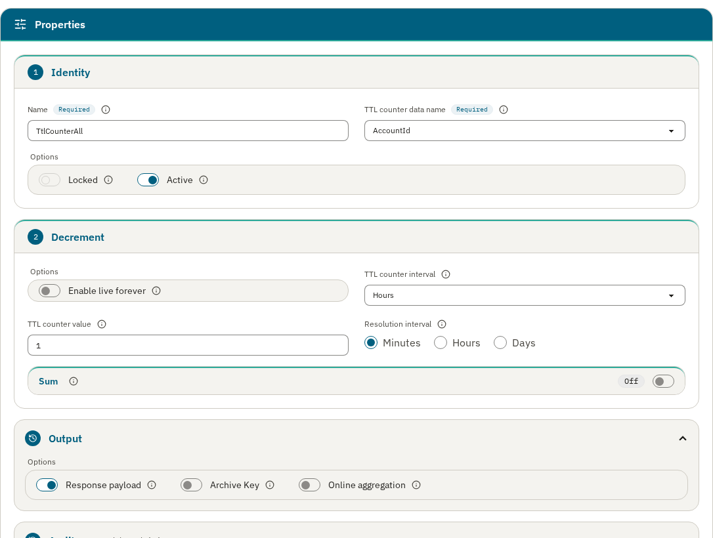
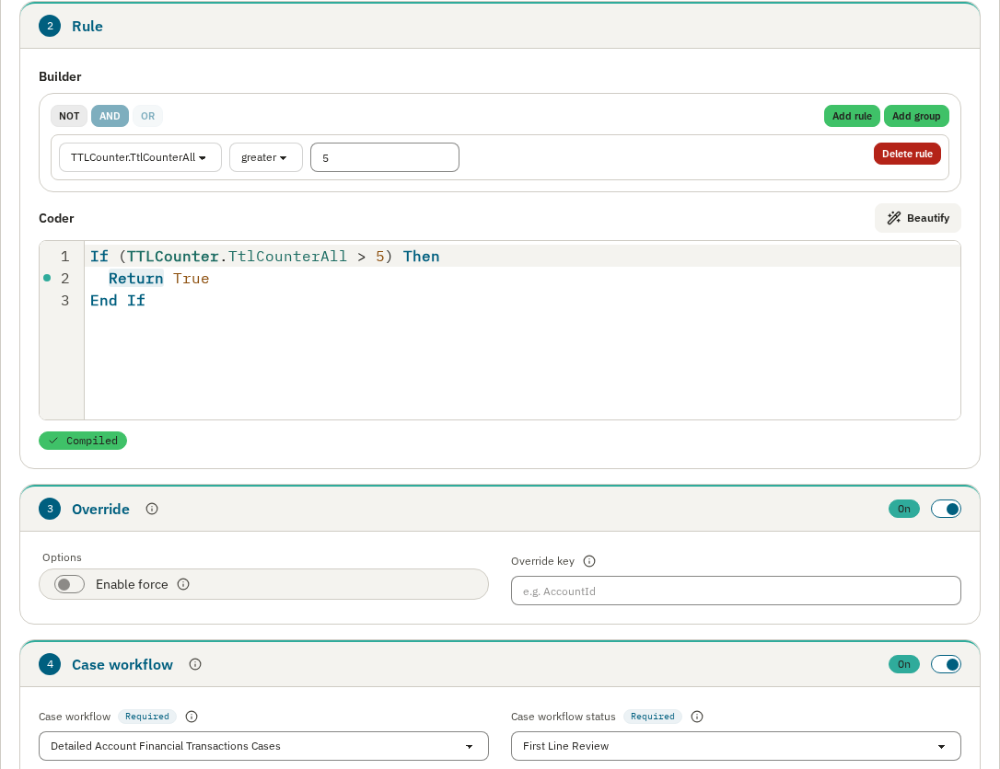

# TTL Counters

A TTL Counter answers the question of how many times something has happened recently for a given key, for example how many high value transactions an account has made in the last day, or how many declines an IP address has had in the last hour. It is a number that goes up by one each time a chosen Activation Rule matches, and comes back down of its own accord once that match is older than a prescribed time, which is the Time to Live from which it takes its name.

Time to Live Counters (TTL Counters) are an alternative way to create model memory without needing to store the full transaction or event data in the cache tables. TTL Counters are incremented as the result of an Activation Rule matching and are set to live for only a prescribed amount of time after entry increment creation, after which they will decrement.

TTL Counters allow for a condition only counter, storing a lightweight counter entry as opposed to the entire transaction or event picture that would otherwise be in the cache. It follows that the storage of TTL Counters is substantially less burdensome than maintaining the full transaction picture in cache.

The storage required to maintain a TTL Counter is substantially less than that required to keep a full history in the cache, it is therefore a useful tool when dealing with ultra-high volumes requiring retention of historic events for a very long period of time. Instead of storing the full picture of an event in the Cache, a very lightweight counter entry can be stored, which can thus be retained for a substantially longer period of time as it takes up so much less space. For basic count type rules, it is advisable to use TTL Counters instead of Abstraction Rules.

TTL Counters are created and stored in their own collection such that they can be referenced separately in Activation and Abstraction Rules, as `TTLCounter.Name`.

The TTL Counter process relies on the Cache Database aggregating all TTL Counter entries and returning the count for each TTL Counter, achieved in a single request of the Cache Database.

There are two types of TTL Counter, Online Aggregation and Offline Aggregation, the latter being referred to also as Cached Aggregation.

## How a TTL Counter works

The terms used in this page are as follows:

| Term                | Meaning                                                                                                                                                                  |
|---------------------|--------------------------------------------------------------------------------------------------------------------------------------------------------------------------|
| Key                 | The field upon which the counter is kept, named in TTL counter data name. With AccountId as the key there is one count for each account.                                 |
| Increment           | The adding of one to the count (or of an amount, where Enable sum is on) for the key of the transaction, which takes place upon an Activation Rule matching.             |
| Time to live        | How long an increment counts for, being the TTL counter value and TTL counter interval taken together.                                                                   |
| Decrement           | The taking off of an increment once it is older than the time to live.                                                                                                   |
| Entry               | The record kept of an increment so that it can be taken off later.                                                                                                       |
| Resolution          | The coarseness with which entries are kept. With a resolution of Hours, every increment in the same hour shares one entry and is taken off together.                     |
| Online aggregation  | The entries are counted afresh for each transaction, which is exact yet more costly to read.                                                                             |
| Cached aggregation  | A running total is kept and adjusted, which is cheap to read yet is decremented by a background process, and so may lag.                                                 |

A TTL Counter has a life of four parts. It is defined in this page, which creates nothing but a name, a key and a time to live. It is incremented by an Activation Rule, as described in [TTL Counter Activation Rule Incrementation](../TTLCounterActivationRuleIncrementation/index.html), and a counter that no Activation Rule increments remains at 0 for ever. It is read by every transaction of the same key, being fetched before any Activation Rule is tested and offered to rules as `TTLCounter.Name`. And it is decremented as its increments grow older than the time to live.

To make this concrete, suppose a TTL Counter named HighValue is kept upon AccountId with a time to live of 1 Days, and that an Activation Rule matching where AmountEUR is greater than 500 is directed to increment it. The nine demonstration transactions of the account ACC-441 would then proceed as follows, the value seen being that fetched before the rules of the transaction are tested:

| Transaction | When, from the first     | AmountEUR | HighValue seen by the transaction | Incremented                                |
|-------------|--------------------------|-----------|-----------------------------------|--------------------------------------------|
| DEMO-TRV-01 | 0 hours                  | 42        | 0                                 | No                                         |
| DEMO-TRV-02 | 3 hours                  | 18        | 0                                 | No                                         |
| DEMO-TRV-03 | 9 hours                  | 65        | 0                                 | No                                         |
| DEMO-TRV-04 | 1 day 2 hours            | 120       | 0                                 | No                                         |
| DEMO-TRV-05 | 1 day 2 hours 40 minutes | 980       | 0                                 | Yes                                        |
| DEMO-TRV-06 | 1 day 3 hours 5 minutes  | 1450      | 1                                 | Yes                                        |
| DEMO-TRV-07 | 1 day 9 hours            | 30        | 2                                 | No                                         |
| DEMO-TRV-08 | 2 days 1 hour            | 2200      | 2                                 | Yes                                        |
| DEMO-TRV-09 | 2 days 7 hours           | 55        | 1                                 | No                                         |

It can be seen that the rule causing an increment does not see that increment when it is tested, DEMO-TRV-05 being fetched as 0 although it is itself of high value, and that the counter falls without anything being done: by the time DEMO-TRV-09 arrives the two London transactions are more than a day old and have been taken off, leaving only the increment made by DEMO-TRV-08. With Online aggregation on, the values are exactly as given. With it off, the last value is about 1 rather than exactly 1, since the decrement is made by a background process in steps of the Resolution interval.

In reading a TTL Counter, a value of 0 means one of four things: nothing has yet incremented it for that key, every increment has lapsed, no Activation Rule has been directed to increment it, or Enable TTL counter is off for the model. An Activation Rule would ordinarily compare the counter with a threshold, for example `TTLCounter.HighValue > 2`, to act upon the third high value transaction in a day.

## Where it lives

Navigate through the menu to Models, open the model, then the TTL Counters hub card. Creating, changing, approving and deleting a TTL Counter follows the common manner described in [Child Objects](../../../Navigation/ChildObjects/index.html), which is to say that a TTL Counter is subject to approval in the manner of every other child object.

For TTL Counters to be enabled, the Enable TTL counter switch must be set at the model level, in the Archiving & Counters group of the Properties form of the model. In the event that the switch is not on, the routine will be stepped over, with an INFO message being written out that this has occurred, although the performance timer is still written out. When TTL Counters are disabled for the model, no counter is incremented or read and rules see 0 for every counter, and [Model Integrity](../ModelIntegrity/index.html) reports this when the model has active counters.

Upon a TTL Counter definition having been created, it will be available in the form of an Activation Rule such that it can be incremented as a consequence of an Activation Rule matching, as described in [TTL Counter Activation Rule Incrementation](../TTLCounterActivationRuleIncrementation/index.html).

SHOT id=models-ttl-counters-record
     route=/models
     steps=open-default-model, open-hub:TTL Counters, open-first-row, open-section:Output
     frame=record
     state=a TTL Counter of the default model opened, with the Identity group showing the name and data name, the Decrement group showing the interval, value and resolution, and the Output group expanded
     conveys=a TTL Counter is defined by the key it counts upon and the time an increment lives before it is taken off
     alt=A TTL Counter opened beneath its model, showing the Identity, Decrement and Output groups of its form



## Fields

The form is arranged in the groups Identity, Decrement, Output (collapsed) and Audit (collapsed). The remaining fields of the Decrement group are presented only where Enable live forever is off, and TTL counter data value only where Enable sum is on.

| Value | Description | Example |
|-------|-------------|---------|
| Name | The name of the TTL Counter, by which rules refer to it. | IP |
| Active | Whether the TTL Counter is taken up by the engine. Active is off for a new TTL Counter and must be switched on. | True |
| Locked | Whether the TTL Counter is protected from change. | False |
| TTL counter data name | The key to be extracted from the data payload that will be used for the purposes of grouping the TTL Counter (e.g. Account ID). This value allows counts to be maintained on different keys. | IP |
| Enable live forever | A flag that indicates if the TTL Counter should ever be decremented. In the event that the flag is specified, the TTL counter cache will be updated but no TTL counter entry will be created to wind back that counter entry, or rather Cached Aggregation. The concept of Cached Aggregation is that the TTL Counters are incremented in real-time for the grouping key, so the pre aggregated counter can be recalled more rapidly in real-time from the cache. The Cached Aggregation moves some computational and processing expense to the real-time processing, as it requires two trips to the cache database, one of which increments a value, rather than just an insert in online aggregation. A background process is responsible for decrementing Cached Aggregation, henceforth, it is possible that Cached Aggregations will be slightly latent and inaccurate. If an absolute real-time picture and immediate decrementing of TTL Counters is required, then Online Aggregation would be the most appropriate choice. Live forever would mean that there is no record made available for background decrement. | False (Recommended) |
| TTL counter interval | The amount of time before the TTL Counter is to be decremented after a counter entry has been created and incremented the counter, being one of Seconds, Minutes, Hours, Days, Months or Years. It is taken together with the TTL counter value. | Days |
| TTL counter value | The number of the TTL counter interval before the TTL Counter is to be decremented. | 1 |
| Resolution interval | The truncation of the Reference Date for the purpose of deprecation, stored as TTL Counter Entries in cache, being one of Minutes, Hours or Days. TTL Counter Entries are used to decrement the TTL Counter on expiration of it by a background task. The resolution allows for pragmatic storage of the TTL Counter Values in the cache, given that TTL Counters exist for the purpose of maintaining very long term state, and their deprecation might not be time sensitive. For example, suppose that the resolution is Days, it implies that a single TTL Counter Entry will be made for a given day truncated, with the value being incremented on new increments of the TTL Counter, only spilling into a new TTL Counter Entry when the actual truncated day lapses, whereby the implication is that the TTL Counter is decremented daily. | Hours |
| Enable sum | A flag to indicate if a Float or Integer value extracted from the invocation payload should be used to increment the TTL Counter and its TTL Counter Entry for deprecation, otherwise incremented by one. | False |
| TTL counter data value | The Float value from the payload to increment the TTL Counter value by, extracted from the invocation payload during invocation. | None |
| Response payload | Whether the value of the TTL Counter is returned in the response to the transaction, as described in [Response Payload](../../../Navigation/ResponsePayload/index.html). | True |
| Archive Key | Whether the value is promoted for the purposes of reporting, as described in [Report Table](../../../Navigation/ReportTable/index.html). | False |
| Online aggregation | A flag that indicates if the TTL counter entries should be counted up in real time on each event, which is computationally expensive and places load on the Cache, but reduces the need for the upsert of the TTL Counter counters cache on match and in the real-time recall of a model. Online aggregation only stores the instance or entry of a TTL Counter being incremented and does not update a summary value which is faster and less computationally expensive at this stage, but far more expensive in retrieval. In the event that neither Online nor cache aggregation returns records during processing, the TTL Counter value is added to the collection, albeit with a value of 0 alongside the TTL Counter Name. If a record is returned, the TTL Counter Value is extracted from the results set, with that value being added to the collection alongside the TTL Counter name. Online Aggregation targets the Reference Date of the transaction, otherwise it is the Created \ System date of insert of the transaction. | False (Recommended) |

A new TTL Counter is presented with a TTL counter interval of Hours, a TTL counter value of 1, a Resolution interval of Hours, and every switch off, being Active, Enable live forever, Enable sum, Response payload, Archive Key and Online aggregation. TTL counter data name, and TTL counter data value where Enable sum is on, are each chosen from a list of the fields of the model in alphabetical order, being the active Request XPath of Data type String, Float and IP together with the values returned by the active Inline Scripts and Inline Functions. A Request XPath of Data type Integer is not offered, as the engine reads the data value as a Float and an Integer would be read as zero; a whole number that is to be summed is therefore declared as a Float.

## The window and decrementing

The window a TTL Counter covers depends on its type. An Online Aggregation counter counts the increments whose Reference Date falls in the window ending at the Reference Date of the transaction being processed, both ends included, so its value is exact for that transaction. Months and years are calendar months and years, so a one month window ending on 31 March starts on 28 or 29 February. Any other counter keeps a running count, and each increment is taken off by the background thread once it is older than the interval (in steps of the Resolution interval), so the count covers about the window rather than exactly. A counter that lives forever has no window and is never taken off.

Where the background thread is relied upon to decrement TTL counters, the eligibility for TTL lapse is based on the model's own Reference Date tracking (the most recent transaction Reference Date seen for that model, advanced on every invocation), which is to say that it is not wall-clock system time, and not the date the counter entry was created. A model that stops receiving transactions stops advancing this Reference Date, so its TTL Counters stop ageing out too, however much real time passes, as the background thread only ever compares against the last Reference Date it has on record for that model.

If the TTL counter interval is ever something other than the six values in Validation below, as would be the case for a malformed or legacy row, the background decrement thread falls back to treating it as Days, rather than leaving the threshold of the counter unchanged. This differs from the read-time online aggregation window, which leaves the Reference Date unchanged for an unrecognised interval. In practice this divergence should not be reachable, keeping in mind that the value is validated to one of the six units upon being saved.

## Negative and Sum values

With Enable sum on, the value taken from the payload is added to the counter. A value that is negative, not a number or infinite is not counted: the increment is skipped, no decrement entry is written, and nothing is claimed for Activation Rule Idempotency. The reason is that the cached decrement removes a counter at zero or below, so a negative entry would leave a permanent phantom value once other entries expired. It follows that refunds and reversals should be modelled with a separate counter fed by the absolute value. A skipped increment is recorded in the trace log of the invocation only.

## Counter keys and tenant isolation

Every counter value and every decrement entry is stored in the cache under a key that begins with the tenant, the Model Guid and the TTL Counter Guid, followed by the TTL counter data name and the value taken from the payload. It follows that two tenants, two Models or two TTL Counters never share a counter, even when their data values are identical.

## Validation

A TTL Counter is validated in the server, and is rejected where:

* The Name is empty, longer than 256 characters, or already in use by another TTL Counter of the Model, without regard to case.
* The TTL counter data name is empty, regardless of whether Enable live forever is on, or is longer than 256 characters.
* The TTL counter interval is not one of Seconds, Minutes, Hours, Days, Months or Years.
* The TTL counter value is negative, or exceeds the limit for its unit, being 2,000,000,000 seconds, 52,560,000 minutes, 876,000 hours, 36,500 days, 1,200 months or 100 years.
* The Resolution interval is not one of Minutes, Hours or Days.
* Enable sum is on and no TTL counter data value is given, or the TTL counter data value is longer than 256 characters.
* The Model does not exist in the tenant of the caller, or has been deleted.

Each failure is written beneath the field it relates to and counted in the summary at the head of the form, as described in [Child Objects](../../../Navigation/ChildObjects/index.html), with the messages as follows:

| Field                  | Message                                                                                     |
|------------------------|---------------------------------------------------------------------------------------------|
| Name                   | A name is required. The name must be 256 characters or fewer. This name already exists.     |
| TTL counter data name  | A data name is required to group the counter. The data name must be 256 characters or fewer. |
| TTL counter interval   | The interval type must be one of Seconds, Minutes, Hours, Days, Months or Years.            |
| TTL counter value      | The interval value cannot be negative or exceed the limit for the chosen interval type.     |
| Resolution interval    | The resolution interval must be one of Minutes, Hours or Days.                              |
| TTL counter data value | A data value is required when Sum is enabled. The data value must be 256 characters or fewer. |

A locked TTL Counter cannot be edited or deleted, and the deleting of a TTL Counter is a logical delete. A TTL Counter that an Activation Rule increments, or that is named in the text of a rule, cannot be deleted while it is so used, as described under Deleting an entity that is in use in [Child Objects](../../../Navigation/ChildObjects/index.html).

## Example

A TTL Counter to count upon the IP of a transaction, living for one day, would be created as follows:

| Value | Example |
|-------|---------|
| Name | IP |
| Active | True |
| TTL counter data name | IP |
| Enable live forever | False |
| TTL counter interval | Days |
| TTL counter value | 1 |
| Resolution interval | Hours |
| Enable sum | False |
| Response payload | True |
| Archive Key | False |
| Online aggregation | False |

Mindful that a TTL Counter must be incremented by an Activation Rule match, when recalled at this time it would return zero in the response body. Upon the TTL Counter being approved, and taken up by the engine at its next cycle, repeating the HTTP POST to the endpoint [https://localhost:5001/api/invoke/EntityAnalysisModel/90c425fd-101a-420b-91d1-cb7a24a969cc](https://localhost:5001/api/invoke/EntityAnalysisModel/90c425fd-101a-420b-91d1-cb7a24a969cc) returns the TTL Counter in the ttlCounter element of the response, alongside the TTL Counter already present in the model:

```json
"ttlCounter": {
  "TtlCounterAll": 89,
  "IP": 0
}
```

It can be seen that TTL Counters are being recalled in their aggregated state, albeit, given no incrementation by Activation Rule, returned as 0 for IP. Values are available for Activation Rules subsequently, as an alternative to Abstraction Rules.

SHOT id=models-ttl-counters-threshold-rule
     route=/models
     steps=open-default-model, open-hub:Activation Rules, open-row:ThresholdTtlCounterAll, scroll-to:Rule
     frame=record
     state=the ThresholdTtlCounterAll Activation Rule of the default model scrolled to its Rule group, showing the condition of the rule in the Builder and the equivalent rule text in the Coder beneath, which compares the TtlCounterAll TTL Counter with a threshold
     conveys=a TTL Counter is tested in an Activation Rule in the manner of any other value, by its name
     alt=The Rule group of the ThresholdTtlCounterAll Activation Rule showing its condition in the Builder and the rule text in the Coder, which compares the TtlCounterAll counter with a threshold



## Permissions and security

Reading and writing TTL Counters requires permission 12, Read Write TTL Counter. The TTL Counters of a model can also be listed by a user having permission 17, Read Write Activation Rule, for the purposes of choosing the TTL Counter that an Activation Rule increments. A user without permission receives 403, and an unauthenticated request receives 401. Every mutation also needs the antiforgery token for cookie sessions. TTL Counters are scoped to the tenant of the caller through the parent Model.

The Created User and Created Date of a TTL Counter are those of its current version, in that each save stamps the saving user and time, and the previous version is kept in the version history with its own author. Maker-checker approval, as described in [Maker Checker](../../../Concepts/MakerChecker/index.html), relies on this to prevent a maker approving their own version. There is no separate Updated User column.
