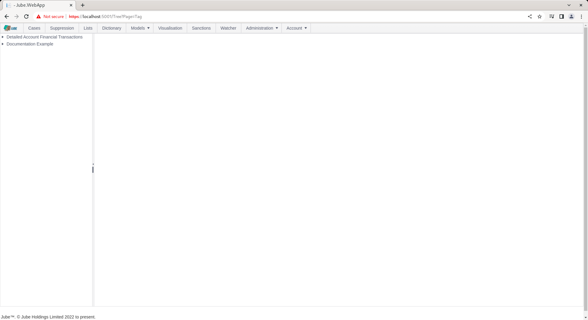
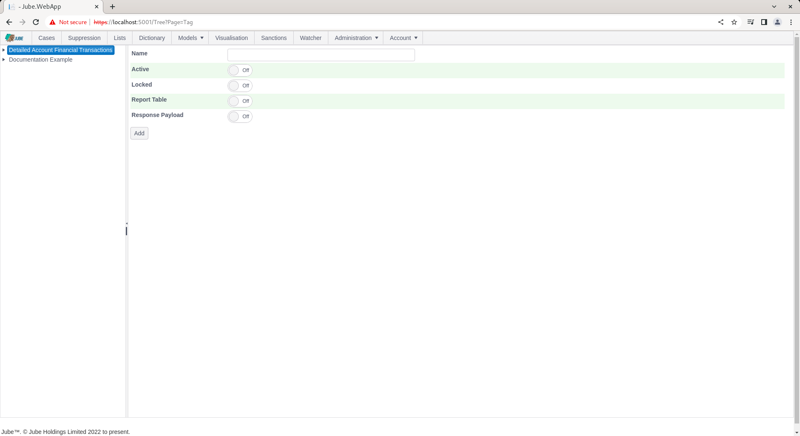
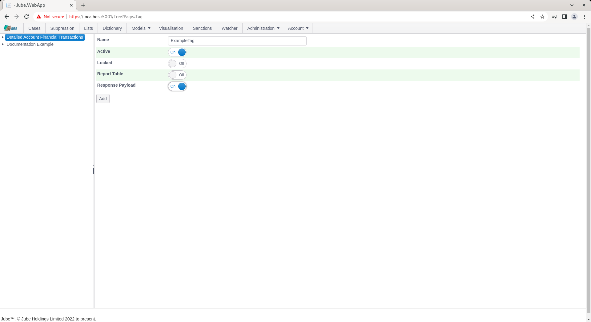
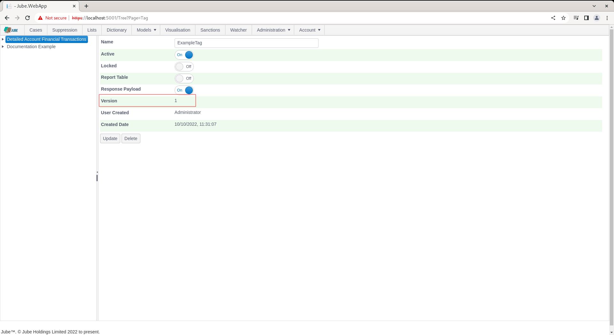
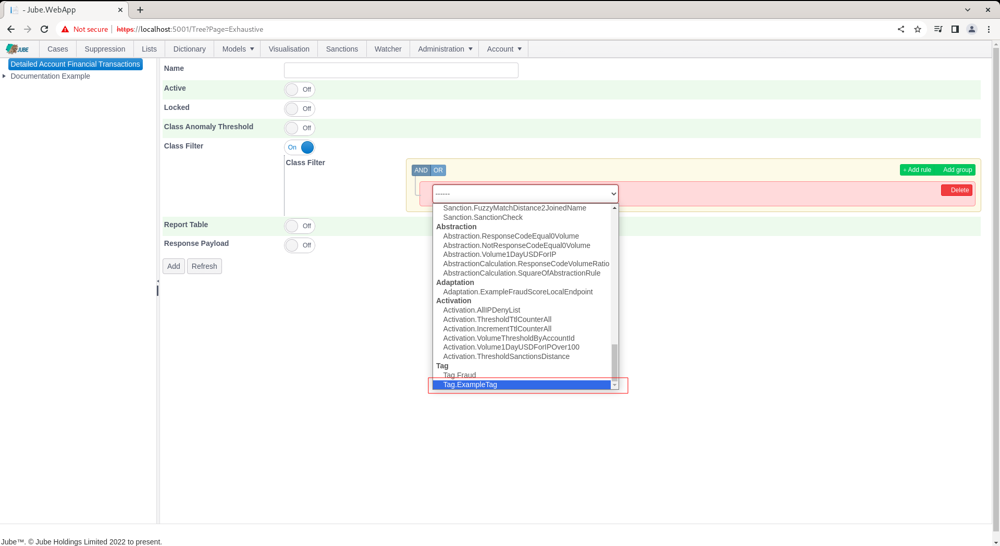

# Tags

Jube will likely drive decisions via Response Elevation, and as with all such systems, may be prone to error.

Tags provide an means to obtain feedback to drive advanced analytics and machine learning with the goal of reducing that
error.

The Tags page has the simple purpose of creating a list of Tags that are eligible to be added to the Tags section of the
payload in the Archive database table. Tags can thereafter be used in reporting, advanced analytics or machine learning
training. For example, one example of a Tag would be marking fraud to be blended into an anomaly classification.

To create a Tag, navigate to Models >> References >> Tags:

<!-- TODO(screenshot): file=model-references-tag-top-of-tree.png route=/models/references/tags state="replace the Razor-era image TagTopOfTree.png with the Vue UI showing the same step" -->

Click on the top of tree node to create a new Tag:

<!-- TODO(screenshot): file=model-references-empty-tag.png route=/models/references/tags state="replace the Razor-era image EmptyTag.png with the Vue UI showing the same step" -->

There are no parameters beyond the common parameters, the Tag is taken to be the Name. The name is required and limited
to 256 characters, and must be unique within the Model.

Complete the page as follows:

<!-- TODO(screenshot): file=model-references-example-tag-values.png route=/models/references/tags state="replace the Razor-era image ExampleTagValues.png with the Vue UI showing the same step" -->

Scroll down and click Add to create a version of the Tag:

<!-- TODO(screenshot): file=model-references-created-a-version-of-a-tag.png route=/models/references/tags state="replace the Razor-era image CreatedAVersionOfATag.png with the Vue UI showing the same step" -->

The Tag is subject to immediate synchronisation and will be available for merge to Archive payload on the basis of the
EntityAnalysisModelEntityInstanceGuid. In the absence of a Tag existing, a 400 Bad Request http status code will be
returned. The existence of the in Archive is not validated.

The Tag is also available for filtering in Exhaustive machine learning, which is explained in another section of this
documentation, although as follows for illustrative purposes:

<!-- TODO(screenshot): file=model-references-example-of-tag-in-exhaustive.png route=/models/references/tags state="replace the Razor-era image ExampleOfTagInExhaustive.png with the Vue UI showing the same step" -->

## Permissions and security

<!-- TODO(docs): confirm the permission number and wording against the running menu and the Roles page -->
Reading and writing this area requires permission 37 (reading by Model also accepts permission 1). A user without it
receives 403, and an unauthenticated request receives 401. Every mutation also needs the antiforgery token for cookie
sessions.

<!-- TODO(docs): owner to review this security paragraph, it was written from code, not from a running system -->
Tag names are limited to 256 characters and unique within a Model (case-insensitive).

<!-- TODO(docs): changes are subject to maker-checker approval when ApprovalsRequired is on; describe the Approvals tab, Resubmit and Retract for Tags from the real UI -->
<!-- TODO(docs): every statement above about the Razor-era page layout (tree on the left, Add button, version pane) may be stale after the Vue port; re-read the whole page against the new UI -->
<!-- TODO(docs): add the Arabic and Urdu right-to-left note: identifiers, paths and code stay left-to-right inside right-to-left text -->
