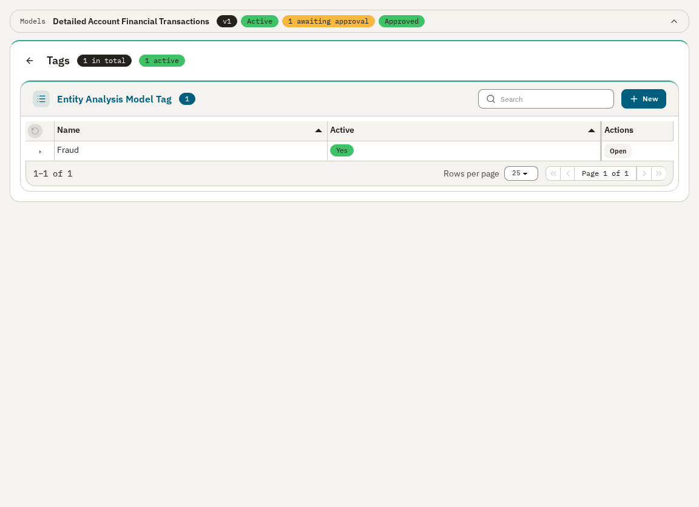

# Tags

Jube will likely drive decisions via Response Elevation, and as with all such systems, may be prone to error.

Tags provide a means to obtain feedback to drive advanced analytics and machine learning with the goal of reducing that error.

The Tags page has the simple purpose of creating a list of Tags that are eligible to be added to the Tags section of the payload in the Archive database table. Tags can thereafter be used in reporting, advanced analytics or machine learning training. For example, one example of a Tag would be marking fraud to be blended into an anomaly classification.

## Where it lives

Navigate through the menu to Models, open the model, then the Tags hub card. Creating, changing, approving and deleting a Tag follows the common manner described in [Child Objects](../../../Navigation/ChildObjects/index.html).

SHOT id=models-tags-list
     route=/models
     steps=open-default-model, open-hub:Tags
     frame=page
     state=the default model opened with the list of Tags beneath it, showing several Tags by name
     conveys=a Tag is no more than a name registered against the model
     alt=The list of Tags of the default model, one row for each Tag with its name and an Open action



## Fields

There are no parameters beyond the common parameters, as the Tag is taken to be the Name:

| Value  | Description                                                                                                                              | Example |
|--------|------------------------------------------------------------------------------------------------------------------------------------------|---------|
| Name   | The Tag, as it is to be merged into the Archive payload. Required, limited to 256 characters, and unique within the Model without regard to case. | Fraud   |
| Active | Whether the Tag is eligible to be applied to the Archive payload. Active is off for a new Tag and must be switched on.                    | True    |
| Locked | Whether the Tag is protected from change.                                                                                                | False   |

The form has the Identity group alone, followed by the collapsed Audit group, and the Name is refused upon Create or Save changes with A name is required., The name must be 256 characters or fewer. or This name already exists.

The clean installation registers the Tags Fraud, ConfirmedFraud, FalsePositive, CustomerVerified and MoneyMule against the default model, and these are the Tags offered wherever a Tag is chosen for that model, in the tagging of a case and in the filters of a backtest among them. It is in a backtest that a Tag is most readily seen at work: a Tag such as ConfirmedFraud, chosen as what counts as positive, is what allows the backtest to say how many of the transactions a rule fired upon were in truth fraud, as described in [Backtest](../Backtest/index.html).

## Applying a Tag

Upon approval the Tag is taken up by the engine at its next cycle, without an explicit synchronisation, and is thereafter available for merge to the Archive payload on the basis of the EntityAnalysisModelInstanceEntryGuid, which is returned in the response of each invocation. The merge is requested by an HTTP PUT to the tagging endpoint, the body naming the entry and the Tags to be merged:

```http
PUT https://localhost:5001/api/invoke/Archive/Tag
Content-Type: application/json
X-API-KEY: <an API key>

{
  "EntityAnalysisModelInstanceEntryGuid": "<the Guid returned by the invocation>",
  "Tag": ["Fraud"]
}
```

The request is placed in a queue and merged to the Archive in the background, henceforth the HTTP status of 200 confirms only that the request was accepted. An empty body, or a body exceeding the size allowed, returns a 400 Bad Request http status code. The existence of the entry in the Archive is not validated.

TODO(verify): the page formerly stated that a Tag not existing for the model returns 400 Bad Request. On this branch the endpoint (InvokeService.Tag) queues the request and returns 200 without inspecting the Tag, so confirm on a running system what the background tagging does with a Tag that is not registered, or not active, for the model, and state it here.

The Tag is also available for filtering in Exhaustive machine learning, which is explained in the [Exhaustive Adaptation](../../ExhaustiveAdaptation/index.html) section of this documentation, where the Tags of the model are offered in the filter such that training can be directed to, for example, only those transactions marked as fraud.

## Permissions and security

Reading and writing Tags requires permission 37, Read Write Tags, although the reading of the Tags of a Model is also afforded to permission 1, Read Write Case, for the purposes of a case worker being presented with the Tags available. A user without permission receives 403, and an unauthenticated request receives 401. Every mutation also needs the antiforgery token for cookie sessions.
