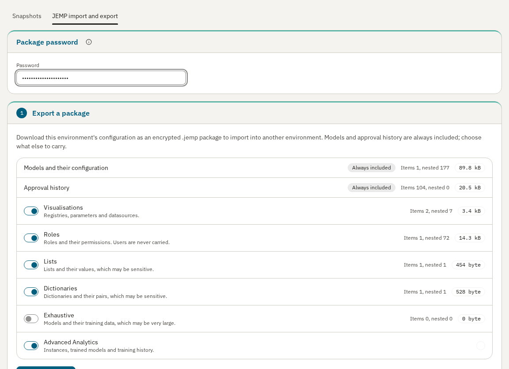
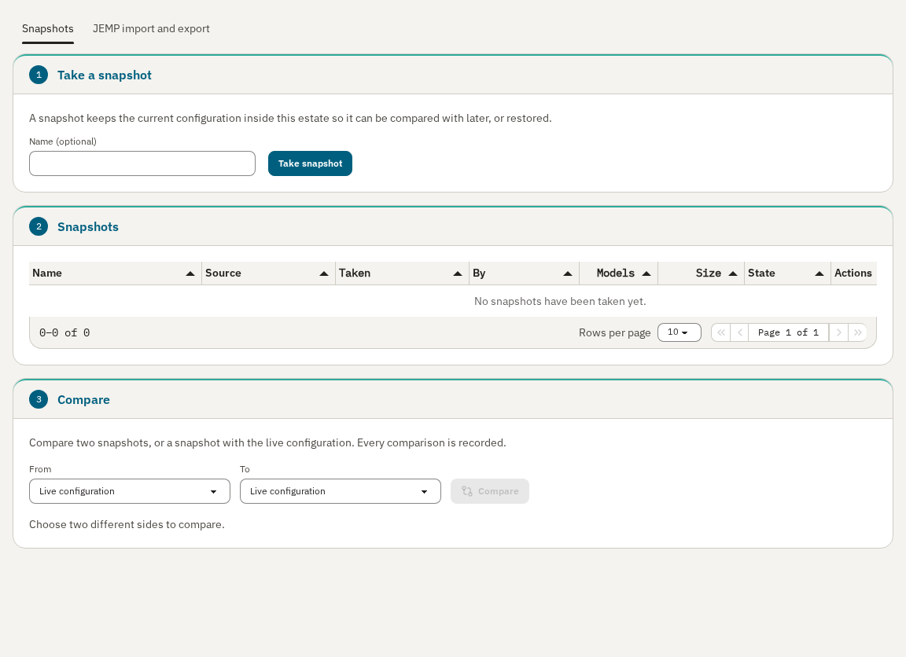

# Preservation

Preservation answers two questions that every administrator of a configured system comes to ask. The first is: having built and tested this configuration here, how is it to be carried to another environment without building it again by hand. The second is: having changed this configuration, how is it to be put back as it was. The first is answered by Move, which writes the configuration to an encrypted file that another environment can read, and the second by Safeguard, which keeps copies of the configuration inside the environment itself.

A handful of terms are used throughout:

| Term          | Meaning                                                                                                                                                                             |
|---------------|-------------------------------------------------------------------------------------------------------------------------------------------------------------------------------------|
| Configuration | The definitions that make the system behave as it does: Models and everything beneath them, Case Workflows, and optionally Visualisations, Roles, Lists, Dictionaries and trained models. It is not the transactions, the cases or the users. |
| Package       | A single file, ending `.jemp`, holding the configuration of one tenant, compressed and encrypted with a password.                                                                    |
| Export        | Writing a package from the configuration as it stands. Nothing is changed by an export.                                                                                              |
| Import        | Replacing the whole configuration of a tenant with the contents of a package. It is a replacement and not a merge: what is not in the package is removed.                            |
| Preview       | Reading a package, or a snapshot, and stating what would change were it to be imported or restored, without changing anything.                                                       |
| Snapshot      | A copy of the configuration of a tenant kept in the database of the same environment, to be compared with or restored later.                                                         |
| Restore       | Replacing the whole configuration of a tenant with the contents of a snapshot, by the same means as an import.                                                                       |

Two examples are carried through this page. In the first, the default model Detailed Account Financial Transactions has been configured in a test environment and is to be carried to production: a password is typed, the package is downloaded in test, and in production the same password is typed, the file chosen, the preview read and the import confirmed. In the second, an administrator about to rework the Activation Rules of that model takes a snapshot named Before rule changes, makes the changes, compares the snapshot with the live configuration to see exactly what was altered, and, the changes having proved mistaken, restores the snapshot.

Preservation is functionality to allow for the Export and Import of definitions and various lookup data to facilitate the migration of configuration between environments, and for the keeping of snapshots of that configuration within an environment, such that there is always a way back. Entity Analysis Model Configuration Data, and all data rolling up to Entity Analysis Models, is exported in all cases, and includes:

* Entity Analysis Models definition data.
* Request XPath definition data.
* Inline Function definition data.
* Inline Script definition data, but not including the Inline Script itself.
* Gateway Rule definition data.
* Sanction matching definition data, but not including the Sanctions data itself.
* Tag definition data.
* Time To Live Counter definition data.
* Abstraction Rule definition data.
* Abstraction Calculation data.
* HTTP Adaptation definition data, but not the models which are available on a remote basis.
* Activation Rule definition data.
* Case Workflow definition data:
    * Case Workflow Status definition data.
    * Case Workflow XPath definition data.
    * Case Workflow Form definition data.
    * Case Workflow Action definition data.
    * Case Workflow Display definition data.
    * Case Workflow Macro definition data.
    * Case Workflow Filter definition data.

In the case of certain data rolling up to Entity Analysis Models, the data can be both selectively exported and imported in the case of:

* Exhaustive models, including training data, which has the potential to be very large.
* Lists and List Values, which have the potential to contain sensitive or production data.
* Dictionaries and Dictionary Values, which have the potential to contain sensitive or production data.
* Advanced Analytics instances, trained models and training history.

Overrides are deliberately not carried by Preservation, in either direction. An override suppresses or forces an Activation Rule for one live key value, such as a card or a customer, hence it is operational data belonging to a running estate, not model configuration, and moving it between environments would carry production decisions into places they were never meant to reach. Overrides are administered on the Override page and expire on their own Delete Expiry Date.

Visualisation Registry (reports configuration) data, and all data rolling up to Visualisation Registries, can be selectively exported, but is adjacent configuration not otherwise subordinate to Entity Analysis Model definition data.

Roles and Role Permissions can also be selectively exported, and are likewise adjacent configuration not otherwise subordinate to Entity Analysis Model definition data. Users themselves, and the allocation of Users to Tenants, are never exported or imported, and the consequence of this for existing Users when Roles are imported is described under Role Import and Orphaned Users below.

## Production Data

Production data is not exported and the Preservation functionality is not intended as a replacement for database or cache backup procedures. Production data includes, but is not limited to:

* Archive transaction data.
* Case data, such as:
    * Case Notes.
    * Case Event data.
    * Case Execution Log data.
    * Case Search and Case Filter Session data.
    * Case Form data.
    * Case Audit data.
    * Case File Uploads.
* Search Key Cache calculation data, such as:
    * Search Key Cache Instance Data.
    * Distinct Values processed in Search Key Cache Instance for each key.
    * Abstraction Values that are created for each key value, and also stored in cache.
* System Performance and Monitoring data:
    * HTTP Processing Counters.
    * Asynchronous Queue Balances.
    * Entity Analysis Model Asynchronous Queue Balances.
    * Entity Analysis Model Processing.
* Users.
* Tenant Registry.
* Tenant Registry User Allocations.
* Sanctions.
* Engine Instance data.
* Model Synchronisation data.
* Reprocessing instance data.
* Inline Script code data.
* Any and all data in the cache.
* Migrations Version History data.

## Where it lives

Navigate through the menu to Administration, then Preservation. Preservation answers two different concerns, and each has its own tab on the page:

| Concern   | Tab                    | Purpose                                                                                   |
|-----------|------------------------|-------------------------------------------------------------------------------------------|
| Safeguard | Snapshots              | Keep, compare and restore the configuration of one estate, so there is always a way back. |
| Move      | JEMP import and export | Carry configuration between environments as an encrypted `.jemp` file.                    |

The Snapshots tab is presented first. The tab in view is held in the address of the browser, taking the form `/administration/preservation?tab=move`, such that either tab can be linked to directly.

Both assume permission 38, Allow Preservation Import and Export, is granted to the Role. Restoring a snapshot needs the separate permission described under Snapshots.

## Move

The JEMP import and export tab begins with a panel titled Package password, holding a single Password shared by the export and the import beneath it. It is the only secret needed to move a file, as the key is derived from it as described in the Encryption Scheme below, and nothing about the environment is involved. The password must be at least 12 characters. Until it is, the page states The password must be at least 12 characters. Export and import stay switched off until it is., and both Download package and Preview import stay switched off, and the server refuses to export with a shorter one. The minimum exists because the password is the whole of the protection of the file: the key is derived from it and from nothing else, hence a short password could be found by trial however strong the encryption. Beneath its heading the panel states: The password is the encryption key of the package. The same password is needed to import it again. The password is held in the page only for as long as the page is open; it is not stored in the browser nor in the server, and upon the page being reloaded it must be typed again.

SHOT id=preservation-move-tab
     route=/administration/preservation
     steps=open-tab:JEMP import and export, fill:Password=correct-horse-battery
     frame=page
     state=the JEMP import and export tab with an acceptable password entered, showing the Package password panel, the Export a package step listing what is always included and each optional switch with its counts and size and the running total beside Download package, and the Import a package step with its file chooser and Preview import
     conveys=one password serves both the export and the import, and the export shows what it would carry before anything is downloaded
     alt=The JEMP import and export tab of the Preservation page, with a password panel above an export step listing each kind of data with a switch, a count and a size, and an import step with a file chooser



### Export

The step titled Export a package lists what the package would carry. Models and their configuration, and the Approval history, are marked Always included. Each kind of optional data has its own switch, and beside it the number of items it carries and how large it is, taken from the live configuration, with a running total of the size before compression and encryption:

| Switch             | Default | Carries                                                                             |
|--------------------|---------|-------------------------------------------------------------------------------------|
| Visualisations     | On      | Visualisation Registry data and all data rolling up to it.                          |
| Roles              | On      | Role and Role Permission data. See Role Import and Orphaned Users below.            |
| Lists              | On      | Lists and List Values, which may contain sensitive or production data.              |
| Dictionaries       | On      | Dictionaries and Dictionary Values, which may contain sensitive or production data. |
| Exhaustive         | Off     | Exhaustive models and training data, which has the potential to be very large.      |
| Advanced Analytics | On      | Advanced Analytics instances, trained models and training history.                  |

The step is introduced with: Download this environment's configuration as an encrypted .jemp package to import into another environment. Models and approval history are always included; choose what else to carry. Beside each row is written its content in the form Items 12, nested 340, being the number of items of that kind and the number of rows held beneath them, and its size, and the running total reads About 1.2 MB before compression and encryption., rising and falling as the switches are moved. The switches return to their defaults upon the page being reloaded. Where the content cannot be established the step states What the package would carry could not be worked out., and a download that fails is reported as The package could not be exported.

What travels, and what does not, is henceforth as follows. Always: the Models with everything defined beneath them, the Case Workflows, and the approval history of each. By choice: Visualisations, Roles, Lists, Dictionaries, Exhaustive models and Advanced Analytics. Never: transactions, cases, users, sanctions entries, overrides, the code of Inline Scripts, anything held in the cache, and the remainder set out under Production Data above. In the first example, the package made in test with the defaults carries the default model, its rules, its Case Workflow, the Lists IPDenyList and WatchedAccounts with their values and the Dictionary VolumeThresholdByAccountId, yet none of the demonstration transactions nor the three demonstration cases.

Clicking Download package compresses and encrypts the export model to the scheme below and saves a file. The file name is a GUID allocated in the auditing of the export process, as described below. The file extension is .jemp, which stands for Jube Encrypted Message Pack.

The file is not human-readable, in that it is encrypted and authenticated, and cannot be opened without the password.

Given binary serialisation and compression, .jemp files are very small, which allows for the simple exchange of files via email, irrespective of content filtering.

### Import

Importing, in the step titled Import a package, is a matter of three actions, being to choose a `.jemp` file, to preview it, and to confirm. Only .jemp files are eligible for upload, decryption, deserialisation and import.

The password and the package travel together in one serialised request body, JSON or MessagePack, never in a form, the query string or a header. The package is base64 text in a JSON body and a binary value in MessagePack. The format of the package itself, and the checks made on it, are the same in either case.

Preview import decrypts and reads the file with the password and compares it with the live configuration. Nothing is imported and nothing from the file is stored on the server, so the browser keeps the file and sends it again when the import is confirmed. The preview shows:

* How many entities the import would add, remove and change, and how many are unchanged, by section and then entity by entity, with the before and after of every changed property. Identifiers, GUIDs, audit stamps, versions and the numeric references between entities are ignored, because they differ between environments without meaning anything.
* Warnings, which do not stop the import: the file carries no approval history (see Approval History below), the file carries no Roles (an import replaces the tenant's Roles, so they would be removed), the file carries Lists, Dictionaries or Exhaustive data that may be large or hold production data, or the file is of an older format.
* Blockers, which disable the confirmation: a Role that would have to be re-keyed, or a Privilege blocker as described below.
* The Users who would be left without a Role and deactivated (see Role Import and Orphaned Users below), and whether the importing User stays active.

The preview is headed What the import would change, with the four counts Added, Removed, Changed and Unchanged, followed by By section and then Differences, the latter listing for each entity its Section, Where it sits, the Change and the Detail, a changed property being written as its name, its value before and its value after. Where the package and the live configuration are the same it states: Nothing would change: the package matches the live configuration. Where the differences are too numerous to list it states There are more differences than are listed here. The counts are complete. The Users who would be left without a Role are stated as a number, followed by You stay active; everybody else affected is deactivated. or They would all be deactivated. as the case may be.

In the first example, the preview in a production environment still holding the configuration of a clean installation would show the rules altered in test as Changed, any rule created in test as Added, any rule deleted in test as Removed, and the great majority of entities as Unchanged, which is the assurance sought before confirming.

The preview is dropped when the password or the file changes, so a stale preview can never be imported. Preview import pressed without a file having been chosen states Choose a package file first.

Import package needs the box I understand this replaces the tenant's configuration ticked, and replaces the configuration of the tenant the User is switched into with the contents of the file. Assuming the decryption is valid to the scheme, the bytes are decompressed, deserialised and iterated to import all data. Above the box the page warns: Importing replaces the whole of this tenant's configuration with the package. Package imported. is returned on success, with the statement The package was imported. A snapshot of the previous configuration was taken first, so the change can be undone., the file chooser being emptied and the preview withdrawn, or an error in the event of failure. A file that cannot be decrypted, which is to say a wrong password as much as a damaged or foreign file, is reported as That file could not be read as a package. Check the file and the password. A user refused by the server is told You are not permitted to import packages., and any other failure is given as The package could not be previewed or imported.

Every import first takes a safety snapshot of the configuration it is about to replace, named Before import of followed by the identifier of the package and with everything included, so an import can always be undone from the Snapshots tab.

### Privilege limit

An import (and a snapshot restore) replaces the tenant's Roles and their permission grants, so it is refused unless the person importing holds every permission carried by the Roles in the package and by the Roles about to be replaced. Landlord users are exempt. Users whose Role is left without a match are given a recovery Role carrying only the importer's own permissions.

The preview shows this up front. When the package, or the Roles it would replace, carry a permission the importing User does not hold, the preview lists a Privilege blocker and the confirmation stays disabled, rather than the refusal arriving only when Import package is clicked. The blocker reads The package or the tenant's current roles carry permissions you do not hold, so the import would be refused. Only a user holding every one of those permissions, or a landlord, can import. The refusal itself, should the import be requested through the API regardless, is a bare 403, the same as any permission refusal.

### Safeguards on import

Two imports into the same tenant at the same time are serialised, which is to say that the second waits for the first to commit and then replaces its result, so the tenant never ends with two copies of the configuration.

Permission rows (the role grants on Models, Case Workflows and Visualisations) that name a Model, Case Workflow, Visualisation or Role which is not part of the package are discarded on import, so a package can never attach a grant to something belonging to another tenant. The tenant a row is stamped with is always the importer's own, whatever the file says.

The size of a package is bounded as follows:

| Environment Variable                   | Default               | Description                                                                                                                                                              |
|----------------------------------------|-----------------------|--------------------------------------------------------------------------------------------------------------------------------------------------------------------------|
| PreservationImportMaxBytes             | 104857600 (100 MiB)   | The largest package accepted. The request body limit of the import and preview routes is derived from it, allowing for base64 text and a 1 MiB envelope, and a larger body is refused with 413 before it is parsed. |
| PreservationImportMaxDecompressedBytes | 1073741824 (1 GiB)    | The largest size to which a package may decompress, beyond which it is refused.                                                                                          |

A package refused for its size is reported in the page as The package is larger than this server accepts. Ask an administrator to raise PreservationImportMaxBytes or export less.

## Snapshots

An Export produces an encrypted file for a person to keep. A Snapshot is the same export body, kept inside Jube instead, stored as JSON in a jsonb column so that it can be both restored and queried.

Snapshots exist so there is always a way back. The intention is that a snapshot is taken before configuration changes, so the state before the change can be restored, and so the estate can be examined as it stood at a point in time without reading through audit tables.

Snapshots are reached from the Snapshots tab. The tab is laid out as numbered steps, being Take a snapshot, the list of Snapshots, Compare and, upon Restore being clicked for a snapshot, Restore.

The list shows the tenant's snapshots, most recent first and 10 to a page, with the following columns:

| Column  | Description                                                                     |
|---------|---------------------------------------------------------------------------------|
| Name    | The name given, or Snapshot followed by its identifier where none was given.    |
| Source  | What took the snapshot, as set out below.                                       |
| Taken   | When it was taken.                                                              |
| By      | By whom.                                                                        |
| Models  | How many Models the body holds.                                                 |
| Size    | The size of the body.                                                           |
| State   | Ready, or Failed where it did not complete.                                     |
| Actions | Compare, Restore, Download and Delete.                                          |

The body itself is never listed, only described, but a row's Download action saves the JSON, as a file named snapshot- followed by the identifier, a failure being reported as The snapshot could not be downloaded. Before any snapshot has been taken the list states No snapshots have been taken yet., and where the list cannot be read, The snapshots could not be loaded.

SHOT id=preservation-snapshots-tab
     route=/administration/preservation
     steps=none
     frame=page
     state=the Snapshots tab with several snapshots listed from differing sources, including one named Before import of followed by an identifier, and the Compare step beneath with its From and To selections
     conveys=snapshots are taken, listed, compared and restored in one place, and every import leaves a snapshot behind it
     alt=The Snapshots tab of the Preservation page, with a step to take a snapshot, a list of snapshots with their source, date, user, size and state, and the step for comparing two of them



### Taking one

Take snapshot records the tenant's configuration as it currently stands, with an optional name for the reason. A snapshot is always whole, in that Exhaustive models, their training data and their trial history are included, because a snapshot that left them out could not restore the tenant to the state it recorded. Nothing in the running configuration is changed by taking a snapshot. The step carries a single field, Name (optional), and upon Take snapshot being clicked the page confirms Snapshot taken., the field is emptied and the new snapshot appears at the head of the list. In the second example the name typed is Before rule changes, and the row reads Before rule changes, Preservation page, the date and time, the user, the number of Models, the Size and Ready.

A snapshot name may be at most 200 characters, and the source of a request made directly (not by a process) must be a known one other than Before import, which only an import can claim.

Each snapshot records what took it:

| Source            | Meaning                                                                                              |
|-------------------|------------------------------------------------------------------------------------------------------|
| Preservation page | A person clicked Take snapshot                                                                       |
| Model sync        | A model synchronisation state change caused one to be taken                                          |
| Ask Jooby         | Ask Jooby took one before changing configuration, so the change can be undone                        |
| Before import     | An import of a `.jemp` file or the restore of a snapshot took one before replacing the configuration |

The user is recorded in every case, including where a process forced the snapshot rather than a person asking for it, so it is always possible to see whose change a snapshot belongs to. A snapshot that failed is marked as Failed and can be deleted but not compared, restored or downloaded.

### Retention

Every import and every Ask Jooby change adds a full copy of the configuration to the PreservationSnapshot table, and it follows that snapshots are pruned. After each new snapshot the oldest are pruned so that no more than PreservationSnapshotMaxPerTenant (200 by default) are kept per tenant and none is older than PreservationSnapshotMaxAgeDays (365 by default). Pruning empties the stored copy and marks the row deleted rather than deleting the row, so the history of what was taken remains.

Deleting a snapshot by hand, which seeks confirmation under the heading Delete this snapshot?, does likewise: the stored copy is emptied and the row is marked deleted, and the snapshot cannot be recovered thereafter. The confirmation states The snapshot cannot be recovered once deleted: followed by the name of the snapshot, offering Delete and Keep, and upon deletion the page confirms Snapshot deleted. and the row leaves the list.

### Comparing

Compare shows what differs between two snapshots, or between a snapshot and the live configuration. A From and a To are chosen, each of which can be Live configuration, then Compare is clicked. A row's Compare action compares that snapshot with the live configuration. At least one side must be a snapshot and the two sides must differ, the page stating Choose two different sides to compare. and Compare remaining switched off until they do, and a comparison of two sides having identical content states as much. Only snapshots that completed are offered. Changing either side withdraws the result shown, and a comparison that fails is reported as The comparison could not be made.

In the second example, Compare on the row Before rule changes sets From to that snapshot and To to Live configuration and runs at once. Had one Activation Rule been altered and one created since the snapshot, the result would read Added 1, Removed 0, Changed 1, with the altered rule listed under Differences alongside the property that changed, its value in the snapshot and its value now.

The result is the same as the import preview: counts of entities added, removed, changed and unchanged, by section and then entity by entity with the before and after of each changed property, under the same rules for what is ignored. Very large differences are cut off at five thousand entries, with the counts still complete and a note stating as much.

Every comparison is recorded, with its counts, in the PreservationDiff table, and the page shows its identifier, as Recorded as comparison followed by the identifier.

### Restoring one

Restore on a row first shows a preview of what would change, as an import preview does, and rolls the tenant back to that snapshot only once the box I understand this replaces the current configuration is ticked and Restore snapshot is clicked, by running the same import a Preservation package uses. This replaces configuration and is not itself reversible, but because the restore takes a Before import snapshot first, it can be undone by restoring that snapshot. Restore is disabled for a snapshot that did not complete or is in error. The step names the snapshot after the word Restoring, warns Restoring replaces the whole configuration of this tenant with the snapshot. A snapshot of the current configuration is taken first., and offers Cancel, which withdraws the step without changing anything. Upon success the page confirms Snapshot restored., and the list gains a snapshot of the source Before import, being the configuration as it stood the moment before. A preview that cannot be made is reported as The restore could not be previewed., and a restore that fails as The restore failed.

In the second example, Restore on the row Before rule changes previews the reverse of the comparison above, which is to say Added 0, Removed 1, Changed 1, and upon confirmation the altered rule returns to its former definition and the rule created since is removed. Should the restore itself prove to have been a mistake, restoring the Before import snapshot it left behind puts the reworked rules back.

Restoring is guarded by its own permission, permission 63, Import Preservation Snapshot, separate from the permission that allows taking snapshots and exporting. Taking a snapshot records state, whereas restoring one replaces the whole tenant's configuration, and the two are not the same risk. On upgrade the permission is granted to the Administrator role alone and must be granted deliberately to any other role. Where a role does not hold it, the page states Restoring a snapshot needs the import permission, which this account does not have, and the restore is disabled rather than merely refused on use.

### Why JSON rather than the encrypted package

The body could have been stored as the same compressed, encrypted MessagePack an Export produces. It is stored as JSON so that snapshots can be queried: the column is `jsonb` with a GIN index, so the estate as it stood at a given moment can be interrogated directly, which an opaque encrypted blob could not support.

That choice has a consequence worth stating plainly. A snapshot body is the tenant's configuration in the clear, inside the database. It is confined to the tenant that took it and reading it needs the Preservation permission, but it is not encrypted at rest in the manner of an exported file.

## Consistency

Encryption goes a long way to ensure the integrity of the exported data for import, as described in the Encryption Scheme below. Furthermore, assuming decompression and deserialisation are also valid, the file import happens inside a database transaction, and so has consistency guarantees. In the event of import failure, it can be assured that data is not left in a partial state and that the existing data is not corrupted (which is to say all, or nothing at all, is imported).

An import identifier will have been created, outside a transaction and before any attempt at decryption, decompression or deserialisation.

The import process follows the following steps, assuming deserialisation has taken place:

* The Privilege limit is checked, and the import is refused where it is exceeded.
* The safety snapshot of the configuration about to be replaced is taken.
* A database transaction is opened, and a lock is taken for the tenant, such that a second import into the same tenant waits for the first.
* For each entity (which is to say table) and for the tenant that the user is switched into, not the tenant of origination, all data is deleted logically (subject to audit). The import identifier is used to identify the import event that brought about the logical delete, such that it can be rolled back conceptually.
* The export model will be wholly iterated and data inserted.
* Users left without a Role are recovered, as described under Role Import and Orphaned Users below.
* Assuming no errors the database transaction is committed. The import record is updated to confirm success.
* On error the database transaction is rolled back. The import record is updated to signal failure, and the error messages stored alongside it. Very little information is communicated for the reason of an import failure to the end user, although it is comprehensively stored in audit.

A transaction cannot be committed unless all inserts have occurred without error. Given that data is only updated in a transaction, it is not possible to have a partial import, nor lose existing data as deletes happen in the same transaction, and any exception, anywhere, brings about a transaction rollback.

## Approval History

Every entity under maker checker governance carries its approval history in the export: the full set of approval, rejection, retraction and resubmission records for each exported entity, exactly as the checkers left them. On import the history is replayed identically. Each imported entity keeps the version number it had at export, its history records are re-pointed at the entity's new identifier in the importing tenant, and nothing else about them changes, so an entity whose current version was approved at export is live the moment the import commits, under the approval of the checker who originally approved it, while an entity that was awaiting approval imports still awaiting approval. The import never approves anything on its own authority when the file carries a history.

A file having no such records is the exception, and for that file alone the import falls back to the earlier behaviour: every imported entity is stamped approved at its current version, attributed to the importing user. The preview warns of this beforehand.

One boundary is deliberate, in that the superseded row copies in the Version tables are audit history and are not exported, so an entity that was awaiting approval of a pending change imports with its pending change as the current row and its last approved version recorded in the history but not substitutable. Approving or retracting the pending change in the importing tenant resolves it, exactly as it would have in the tenant of origin.

## Role Import and Orphaned Users

When Roles are carried by the file, every existing Role and Role Permission belonging to the tenant is logically deleted and replaced wholesale by the Roles contained in the imported file, in the same manner as other entities described above.

Users are never included in an export or import (see Production Data above), and a User's allocation to a Role is by the Role's GUID, not its database identity. If the .jemp file did not originate from the same environment, the Roles it contains will carry different GUIDs to the Roles they replace. Any User whose Role GUID does not match one of the newly imported Roles becomes orphaned: they no longer resolve to any Role, and since permission and login checks join through the Role, an orphaned User is functionally unable to use the system at all.

There is no way to automatically determine which imported Role an orphaned User should be reallocated to, since that mapping does not exist anywhere in the imported file, so this cannot be resolved automatically as a data migration concern. Instead, as the final step of every import, all Users in the tenant are checked for orphaning as a consequence of the import. If any are found, a single Role named Orphaned Preservation Import is created and granted only the permissions held by the User performing the import (every permission when that User is a landlord), and every orphaned User in the tenant, not only the User who performed the import, is reallocated to it. The role therefore never carries a permission the importer lacks. This is performed inside the same transaction as the rest of the import, so it either succeeds alongside the import or rolls back with it.

With one exception, every User reallocated to the Orphaned Preservation Import role is also deactivated (Active = 0), since a User silently gaining the permissions of the importer is not a safe default to leave standing. The exception is the User performing the import: they are reallocated to the same temporary role but left active, so the import does not lock out the person who just performed it.

This guarantees that the importing User is never locked out of the tenant after an import from a foreign environment, but it is a deliberately broad, temporary measure for everybody else. Following such an import, an administrator should review the membership of the Orphaned Preservation Import role via Administration, then Security, reallocate each User to the appropriate Role for their function, reactivate them, and then remove the temporary role.

## Compression Scheme

Serialisation happens using the MessagePack Library, which is a high performance binary serialiser:

https://github.com/MessagePack-CSharp/MessagePack-CSharp

The compression is provided for by the MessagePack Library and the compression scheme is Lz4BlockArray.

## Encryption Scheme

Serialisation of the export model containing all data is performed by MessagePack, and the result is a byte array that is then encrypted with AES-256 in Galois/Counter Mode (AES-GCM), which both encrypts and authenticates.

The only secret is the password supplied during export and import. It must be at least 12 characters, the server refuses to export with a shorter one, and there is no way to export without a password. The key is derived from the password with PBKDF2 (HMAC-SHA256, 600,000 iterations) and a random 16 byte salt generated afresh for every file. The salt is not secret, and is stored in the file, so that the same password gives a different key for every file and precomputed tables of keys are of no use. No environment variable is involved, so a file can be imported into any Jube environment given only its password.

The layout of a file is a header, the cipher text and the authentication tag:

| Bytes | Content                                                                 |
|-------|-------------------------------------------------------------------------|
| 4     | The marker `JEMP`.                                                      |
| 1     | The format version, currently 3.                                        |
| 4     | The PBKDF2 iteration count, big-endian, held so it can be raised later. |
| 16    | The random PBKDF2 salt.                                                 |
| 12    | The random AES-GCM nonce.                                               |
| n     | The cipher text, the same length as the compressed MessagePack.         |
| 16    | The AES-GCM authentication tag.                                         |

The header is authenticated as associated data, so altering any byte of the file, the header included, makes decryption fail. Decryption cannot tell a wrong password from a damaged file and reports the same failure for both, so a file reveals nothing about the password.

On import, the iteration count held in the header is accepted only where it is between 100,000 and 1,000,000, and a file stating a count outside of that range is refused as not being a supported package.

Such is the strength of the scheme that there is no means to recover a file should the password become lost. It is however possible to recover the unencrypted bytes from the export auditing, but only on the same instance of Jube that created it.

### Compatibility

This format replaced an earlier one, and the change is a breaking one. A `.jemp` file exported by an earlier release of Jube cannot be imported, whether or not it was exported with a password, and a file exported now cannot be imported by an earlier release. The `PreservationSalt` and `JempFileLegacyEncryptionFallback` environment variables no longer exist and are ignored if still set. Configuration that must move from an earlier release has to be re-created in the new one, for example by exporting it again from the new release once it has been rebuilt there.

## Auditing

There are several audit tables available for the Preservation functionality.

The Export table details all instances of an export, and includes unencrypted and encrypted bytes of the export model:

```sql
select *
from "Export"
```

Returning, for each export, its Guid (being the name of the file), the CreatedDate, the CompletedDate, the Version of the export model, the Bytes and EncryptedBytes, and InError alongside the ErrorStack where the export failed.

The Import table details all imports of .jemp files, or rather bytes:

```sql
select *
from "Import"
```

Returning, for each import, its Guid, the CreatedDate, the CompletedDate, the Bytes of the file as uploaded, the ExportGuid and ExportVersion of the package imported, and InError alongside the ErrorStack where the import failed. The restore of a snapshot is recorded in the same table, without bytes.

For both tables the CreatedDate is the time at which the operation started, the row being written beforehand, and the CompletedDate is the time at which it finished.

The PreservationDiff table details every comparison and preview, whether of a package against the live configuration, of a snapshot against the live configuration, or of two snapshots, with the counts of what was added, removed and changed and the human-readable result held in a jsonb column named Json:

```sql
select "Id", "DiffKindId", "LeftSnapshotId", "RightSnapshotId", "RightLabel", "AddedCount", "RemovedCount", "ChangedCount"
from "PreservationDiff"
```

The PreservationSnapshot table holds the snapshots, including those taken before an import.

## Permissions and security

| Permission | Name                                  | Allows                                                                                                           |
|------------|---------------------------------------|------------------------------------------------------------------------------------------------------------------|
| 38         | Allow Preservation Import and Export  | The Preservation menu item, exporting, previewing and importing a package, and taking, listing, comparing, downloading and deleting snapshots. |
| 63         | Import Preservation Snapshot          | Restoring a snapshot.                                                                                            |

A user without the permission receives 403, and an unauthenticated request receives 401. Every operation is confined to the tenant that the user is switched into.

Holding permission 38 is not of itself sufficient to import, keeping in mind the Privilege limit described above, which ensures that an import can never be used to obtain permissions the importing user does not already hold.
