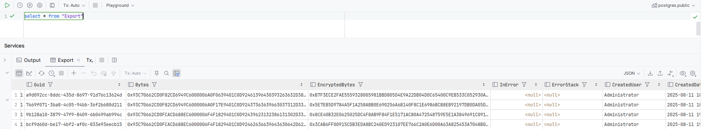
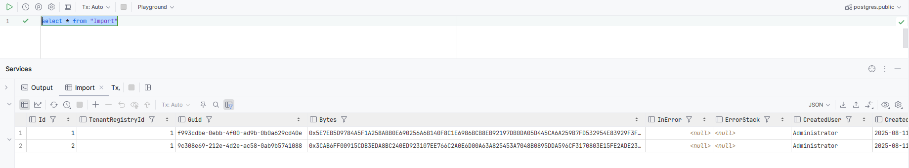

# Introduction

Preservation is functionality to allow for the Export and Import of definitions and various lookup data to facilitate
the migration of configuration environments. Entity Analysis Model Configuration Data, and all data rolling up to Entity
Analysis Models, is exported in all cases, and includes:

* Entity Analysis Models definition data.
* Request XPath definition data.
* Inline Function definition data.
* Inline Script definition data., but not including the Inline Script itself.
* Gateway Rule definition data.
* Sanction matching definition data, but not including the Sanctions data itself.
* Tag definition data.
* Time To Live Counter definition data.
* Abstraction Rule definition data.
* Abstraction Calculation data.
* HTTP Adaptation definition data, but not the models which are available on a remote basis.
* Activation Rule definition data.
* Case Workflow definition data:
    * Case Workflow Status definition data.
    * Case Workflow XPath definition data.
    * Case Workflow Form definition data.
    * Case Workflow Action definition data.
    * Case Workflow Display definition data.
    * Case Workflow Macro definition data.
    * Case Workflow Filter definition data.

In the case of certain data rolling up to Entity Analysis Models, the data can be both selectively exported and imported
in the case of:

* Exhaustive models, including training data, which has the potential to be very large.
* Lists and List Values, which has the potential to contain sensitive or production data.
* Dictionaries and Dictionary Values, which has the potential to contain sensitive or production data.

Overrides are deliberately **not** carried by Preservation, in either direction.  An override suppresses or
forces an Activation Rule for one live key value, such as a card or a customer;  it is operational data belonging
to a running estate, not model configuration, and moving it between environments would carry production decisions
into places they were never meant to reach.  Overrides are administered on the Override page and expire on their
own Delete Expiry Date.

Visualisation Registry (reports configuration) data, and all data rolling up to Visualisation Registries, can be
selectively
exported, but is adjacent configuration not otherwise subordinate to Entity Analysis Model definition data.

Roles and Role Permissions can also be selectively exported, and are likewise adjacent configuration not otherwise
subordinate to Entity Analysis Model definition data. Users themselves, and the allocation of Users to Tenants, are
never exported or imported; see Role Import and Orphaned Users below for the consequence of this for existing Users
when Roles are imported.

# Production Data

Production data is not exported and the Preservation functionality is not intended as a replacement for database or
cache backup procedures. Production data includes, but is not limited to:

* Archive transaction data.
* Case data, such as:
    * Case Notes.
    * Case Event data.
    * Case Execution Log data.
    * Case Search and Case Filter Session data.
    * Case Form data.
    * Case Audit data.
    * Case File Uploads.
* Search Key Cache calculation data, such as:
    * Search Key Cache Instance Data.
    * Distinct Values processed in Search Key Cache Instance for each key.
    * Abstraction Values that are stored also in created for each key value, and also stored in cache.
* System Performance and Monitoring data:
    * HTTP Processing Counters.
    * Asynchronous Queue Balances.
    * Entity Analysis Model Asynchronous Queue Balances.
    * Entity Analysis Model Processing.
* Users.
* Tenant Registry.
* Tenant Registry User Allocations.
* Sanctions.
* Engine Instance data.
* Model Synchronisation data.
* Reprocessing instance data.
* Inline Script code data.
* Any and all data in the Redis cache.
* Migrations Version History data.

# Navigating to Preservation

Preservation answers two different concerns, and each has its own page under Administration >>> Preservation:

| Concern       | Page                | Purpose                                                                                              |
|---------------|---------------------|------------------------------------------------------------------------------------------------------|
| **Move**      | JEMP Import & Export | Carry configuration between environments as an encrypted `.jemp` file.                              |
| **Safeguard** | Snapshots           | Keep, compare and restore the configuration of one estate, so there is always a way back.            |

Both assume the "Allow Preservation Import and Export" permission is granted to the Role. Restoring a snapshot needs
the separate permission described under Snapshots.

# Move

The JEMP Import & Export page begins with a single **Password**, shared by the export and the import below it. It is
the only secret needed to move a file: the key is derived from it as described in the encryption scheme below, and
nothing about the environment is involved. The password must be at least 12 characters. Until it is, the page says
so and both Download and Preview stay switched off, and the server refuses to export with a shorter one.

## Export

Each kind of optional data has its own switch, and beside it the number of items it carries and how large it is, taken
from the live configuration, with a running total:

| Switch         | Default | Carries                                                                               |
|----------------|---------|---------------------------------------------------------------------------------------|
| Visualisations | On      | Visualisation Registry data and all data rolling up to it.                            |
| Roles          | On      | Role and Role Permission data. See Role Import and Orphaned Users below.               |
| Lists          | On      | Lists and List Values, which may contain sensitive or production data.                 |
| Dictionaries   | On      | Dictionaries and Dictionary Values, which may contain sensitive or production data.    |
| Advanced Analytics | On  | Advanced Analytics definitions.                                                        |
| Exhaustive     | Off     | Exhaustive models and training data, which has the potential to be very large.         |

Pressing Download compresses and encrypts the export model to the scheme below and saves a file. The file name is a
GUID allocated in the auditing of the export process, as described below. The file extension is .jemp, which stands
for Jube Encrypted Message Pack.

The file is not human-readable: it is encrypted and authenticated, and cannot be opened without the password.

Given binary serialisation and compression .jemp files are very small, which allows for the simple exchange of files
via email, irrespective of content filtering.

## Import

Importing is three steps: choose a `.jemp` file, preview it, and confirm. Only .jemp files are eligible for upload,
decryption, deserialisation and import.

**Preview** decrypts and reads the file with the password and compares it with the live configuration. Nothing is
imported and nothing from the file is stored on the server, so the browser keeps the file and sends it again when the
import is confirmed. The preview shows:

* How many entities the import would add, remove and change, and how many are unchanged, by section and then entity by
  entity, with the before and after of every changed property. Identifiers, GUIDs, audit stamps, versions and the
  numeric references between entities are ignored, because they differ between environments without meaning anything.
* **Warnings**, which do not stop the import: the file carries no approval history (see Approval History below), the
  file carries no Roles (an import replaces the tenant's Roles, so they would be removed), the file carries Lists or
  Dictionaries that may hold production data, or the file is of an older format.
* **Blockers**, which disable the confirmation: for example a Role that would have to be re-keyed.
* The Users who would be left without a Role and deactivated (see Role Import and Orphaned Users below), and whether
  the importing User stays active.

The preview is dropped when the password or the file changes, so a stale preview can never be imported.

**Import** needs the confirmation box ticked, and replaces the configuration of the tenant the User is switched into
with the contents of the file. Assuming the decryption is valid to the scheme, the bytes are decompressed,
deserialised and iterated to import all data. A success message is displayed, or an error in the event of failure.

**Every import first takes a safety snapshot** of the configuration it is about to replace, named "Before import of"
followed by the identifier of the package and with everything included, so an import can always be undone from the
Snapshots page.

# Snapshots

An Export produces an encrypted file for a person to keep. A **Snapshot** is the same export body, kept inside Jube
instead, stored as JSON in a jsonb column so that it can be both restored and queried.

Snapshots exist so there is always a way back. The intention is that a snapshot is taken before configuration
changes, so the state before the change can be restored, and so the estate can be examined as it stood at a point in
time without reading through audit tables.

Snapshots are reached from Administration >>> Preservation >>> Snapshots. The page has four parts: take a snapshot,
the list of what has been taken, compare, and restore. The list shows the tenant's snapshots, most recent first, with
the name, source, when it was taken and by whom, how many Models the body holds, its size and whether it completed.
The body itself is never listed, only described, but a row's Download action saves the JSON.

## Taking one

Take snapshot records the tenant's configuration as it currently stands, with an optional name for the reason.
A snapshot is always whole: Exhaustive models, their training data and their trial history are included, because a
snapshot that left them out could not restore the tenant to the state it recorded. Nothing in the running
configuration is changed by taking a snapshot.

Each snapshot records **what took it**:

| Source | Meaning |
|---|---|
| Preservation page | A person pressed Take snapshot |
| Model sync | A model synchronisation state change caused one to be taken |
| Ask Jooby | AskJooby took one before changing configuration, so the change can be undone |
| Before import | An import of a `.jemp` file or the restore of a snapshot took one before replacing the configuration |

The user is recorded in every case, including where a process forced the snapshot rather than a person asking for
it, so it is always possible to see whose change a snapshot belongs to. A snapshot that failed is marked as failed and
can be deleted but not compared, restored or downloaded.

## Comparing

Compare shows what differs between two snapshots, or between a snapshot and the live configuration: choose a From and a
To, each of which can be "Live configuration", and press Compare. A row's Compare action compares that snapshot with
the live configuration. Both sides must differ, and a comparison of two identical sides says so.

The result is the same as the import preview: counts of entities added, removed, changed and unchanged, by section and
then entity by entity with the before and after of each changed property, under the same rules for what is ignored.
Very large differences are cut off at five thousand entries, with the counts still complete and a note saying so.

Every comparison is recorded, with its counts, in the PreservationDiff table, and the page shows its identifier.

## Restoring one

Restore on a row first shows a preview of what would change, as an import preview does, and rolls the tenant back to
that snapshot only once the confirmation box is ticked, by running the same import a Preservation package uses. **This
replaces configuration and is not itself reversible**, but because the restore takes a "Before import" snapshot first,
it can be undone by restoring that snapshot. Restore is disabled for a snapshot that did not complete or is in error.

Restoring is guarded by its own permission, **Import Preservation Snapshot**, separate from the permission that
allows taking snapshots and exporting. Taking a snapshot records state; restoring one replaces the whole tenant's
configuration, and the two are not the same risk. On upgrade the permission is granted to the Administrator role
alone and must be granted deliberately to any other role. Where a role does not hold it, the page says so and the
restore is disabled rather than merely refused on use.

## Why JSON rather than the encrypted package

The body could have been stored as the same compressed, encrypted MessagePack an Export produces. It is stored as
JSON so that snapshots can be **queried**: the column is `jsonb` with a GIN index, so the estate as it stood at a
given moment can be interrogated directly, which an opaque encrypted blob could not support.

That choice has a consequence worth stating plainly. A snapshot body is the tenant's configuration in the clear,
inside the database. It is confined to the tenant that took it and reading it needs the Preservation permission, but
it is not encrypted at rest in the way an exported file is.

# Consistency

Encryption goes a long way to ensure the integrity of the exported data for import, reference the encryption scheme as
below.
Furthermore,
assuming decompression and deserialisation are also valid, the
file import happens inside a database transaction, and so has consistency guarantees. In the event of import failure, it
can be
assured that data is not left in a partial state and that the existing data is not corrupted (i.e. all, or nothing at
all is imported).

An import identifier will have been created, outside a transaction and before any attempt at decryption, decompression of
deserialisation.

The import process follows the following steps, assuming deserialisation has taken place:

* A database transaction is opened.
* For each entity (i.e. table) and for tenant that the user is switched into, not the tenant of origination, all data is
  deleted logically (i.e.
  subject to audit). The import identifier is used to identify the import event that brought about the logical delete,
  such that it can be rolled back conceptually.
* The export model will be wholly iterated and data inserted.
* Assuming no errors the database transaction is committed. The import record is updated to confirm success.
* On error the database transaction is rolled back. The import record is updated to signal failure, and the error
  messages stored alongside it. Very little information is communicated for the reason of an import failure to the end
  user, although it is comprehensively stored in audit.

A transaction cannot be commited unless all inserts have occured without error. Given that data is only updated in a
transaction, it is not possible to have a partial import, nor lose existing data as deletes happen in the same
transaction, and any exception, anywhere, brings about a transaction rollback.

# Approval History

Every entity under maker checker governance carries its approval history in the export: the full set of approval,
rejection, retraction and resubmission records for each exported entity, exactly as the checkers left them. On import
the history is replayed identically. Each imported entity keeps the version number it had at export, its history
records are re-pointed at the entity's new identifier in the importing tenant, and nothing else about them changes, so
an entity whose current version was approved at export is live the moment the import commits, under the approval of the
checker who originally approved it, while an entity that was awaiting approval imports still awaiting approval. The
import never approves anything on its own authority when the file carries a history.

A file exported before the approval history was carried has no such records, and for that file alone the import falls
back to the earlier behaviour: every imported entity is stamped approved at its current version, attributed to the
importing user.

One boundary is deliberate: the superseded row copies in the Version tables are audit history and are not exported, so
an entity that was awaiting approval of a pending change imports with its pending change as the current row and its
last approved version recorded in the history but not substitutable. Approving or retracting the pending change in the
importing tenant resolves it, exactly as it would have in the tenant of origin.

# Role Import and Orphaned Users

When Include Roles is enabled, every existing Role and Role Permission belonging to the tenant is logically deleted
and replaced wholesale by the Roles contained in the imported file, in the same manner as other entities described
above.

Users are never included in an export or import (see Production Data above), and a User's allocation to a Role is
by the Role's GUID, not its database identity. If the .jemp file did not originate from the same environment, the
Roles it contains will carry different GUIDs to the Roles they replace. Any User whose Role GUID does not match one
of the newly imported Roles becomes orphaned: they no longer resolve to any Role, and since permission and login
checks join through the Role, an orphaned User is functionally unable to use the system at all.

There is no way to automatically determine which imported Role an orphaned User should be reallocated to, since
that mapping does not exist anywhere in the imported file, so this cannot be resolved automatically as a data
migration concern. Instead, as the final step of every import, all Users in the tenant are checked for orphaning as
a consequence of the import. If any are found, a single Role named "Orphaned Preservation Import" is created and
granted every permission in Permission Specification, and every orphaned User in the tenant, not only the User who
performed the import, is reallocated to it. This is performed inside the same transaction as the rest of the
import, so it either succeeds alongside the import or rolls back with it.

With one exception, every User reallocated to the "Orphaned Preservation Import" role is also deactivated
(Active = 0), since a User silently gaining full permissions is not a safe default to leave standing. The exception
is the User performing the import: they are reallocated to the same temporary role but left active, so the import
does not lock out the person who just performed it.

This guarantees that the importing User is never locked out of the tenant after an import from a foreign
environment, but it is a deliberately broad, temporary measure for everybody else. Following such an import, an
administrator should review the membership of the "Orphaned Preservation Import" role via Administration >>>
Security >>> Roles, reallocate each User to the appropriate Role for their function, reactivate them, and then
remove the temporary role.

# Compression Scheme

Serialisation happens using the MessagePack Library, which is a high performance binary serializer:

https://github.com/MessagePack-CSharp/MessagePack-CSharp

The compression is provided for by the MessagePack Library and the compression scheme is Lz4BlockArray.

# Encryption Scheme

Serialisation of the export model containing all data is performed by MessagePack, and the result is a byte
array that is then encrypted with AES-256 in Galois/Counter Mode (AES-GCM), which both encrypts and authenticates.

The only secret is the password supplied during export and import. It must be at least 12 characters; the server
refuses to export with a shorter one, and there is no way to export without a password. The key is derived from the
password with PBKDF2 (HMAC-SHA256, 600,000 iterations) and a random 16 byte salt generated afresh for every file. The
salt is not secret, and is stored in the file, so that the same password gives a different key for every file and
precomputed tables of keys are of no use. No environment variable is involved, so a file can be imported into any
Jube environment given only its password.

The layout of a file is a header, the cipher text and the authentication tag:

| Bytes | Content                                                             |
|-------|---------------------------------------------------------------------|
| 4     | The marker `JEMP`.                                                  |
| 1     | The format version, currently 3.                                    |
| 4     | The PBKDF2 iteration count, big-endian, held so it can be raised later. |
| 16    | The random PBKDF2 salt.                                             |
| 12    | The random AES-GCM nonce.                                           |
| n     | The cipher text, the same length as the compressed MessagePack.     |
| 16    | The AES-GCM authentication tag.                                     |

The header is authenticated as associated data, so altering any byte of the file, the header included, makes
decryption fail. Decryption cannot tell a wrong password from a damaged file and reports the same failure for both,
so a file reveals nothing about the password.

Such is the strength of the scheme that there is no means to recover a file should the password become lost. It is
however possible to recover the unencrypted bytes from the export auditing, but only on the same instance of Jube
that created it.

## Compatibility

This format replaced an earlier one, and the change is a breaking one. **A `.jemp` file exported by an earlier
release of Jube cannot be imported**, whether or not it was exported with a password, and a file exported now cannot
be imported by an earlier release. The `PreservationSalt` and `JempFileLegacyEncryptionFallback` environment
variables no longer exist and are ignored if still set. Configuration that must move from an earlier release has to be
re-created in the new one, for example by exporting it again from the new release once it has been rebuilt there.

# Auditing

There are several audit tables available for the Preservation functionality.

The Export table details all instances of an export, and includes unencrypted and encrypted bytes of the export model:

```sql
select *
from "Export"
```



The Import table details all imports of .jemp files, or rather bytes:

```sql
select *
from "Import"
```



The PreservationDiff table details every comparison and preview, whether of a package against the live configuration,
of a snapshot against the live configuration, or of two snapshots, with the counts of what was added, removed and
changed and the human-readable result held in a jsonb column named Json:

```sql
select "Id", "DiffKindId", "LeftSnapshotId", "RightSnapshotId", "RightLabel", "AddedCount", "RemovedCount", "ChangedCount"
from "PreservationDiff"
```

The PreservationSnapshot table holds the snapshots, including those taken before an import.
