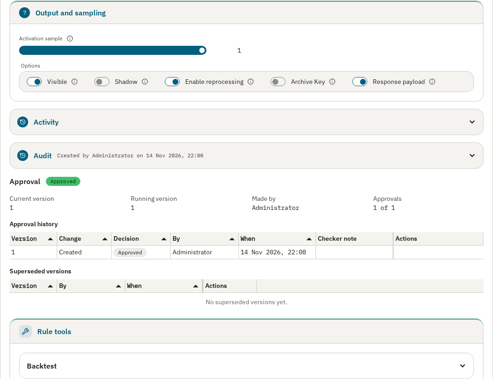

# Reprocessing Eligibility

Reprocessing allows for the contents of the Archive table to be reprocessed one by one retroactively, which is useful if a new rule has been created and some historic management is required.

It should be noted that reprocessing is computationally expensive and should not be used in place of a forward only transaction or event methodology. A common use case is to facilitate the reprocessing of an extremely targeted specification, such as a particular high risk client or customer subset. There are a number of ways to remove load from the reprocessing task, the first of which is that only the Activation Rules marked as eligible are evaluated, as described in this page, with the filtering and sampling of the records themselves described in [Reprocessing Filters](../ReprocessingFilters/index.html).

## Where it lives

Eligibility is a property of the Activation Rule. Navigate through the menu to Models, open the model, then the Activation Rules hub card, and open the Activation Rule, for example Volume1DayUSDForIPOver100 in the default model. The switch Enable reprocessing is in the group Output and Sampling.

| Value               | Description                                                                                               | Example |
|---------------------|-----------------------------------------------------------------------------------------------------------|---------|
| Enable reprocessing | Whether the Activation Rule is subject, and visible, to a reprocessing job. It is off for a new Activation Rule. | True    |

To set a rule to be eligible for reprocessing, it is a simple matter of switching Enable reprocessing on and saving the Activation Rule, which creates a version in the common manner described in [Child Objects](../../../Navigation/ChildObjects/index.html).

Reprocessing relies upon the Activation Rule configuration as it stands in the engine. It follows that the change must be approved before it has any effect upon reprocessing, whereupon it is taken up by the engine at its next cycle, and no explicit synchronisation is required.

By way of example, suppose a new Activation Rule has been written to catch a pattern that came to light last week, and the question is which of last week's transactions it would have caught. Enable reprocessing is switched on for that rule alone and the change approved, a [Reprocessing Filter](../ReprocessingFilters/index.html) is created with a window of seven days, and a run is requested. Each archived transaction of the week is then passed through the model again with only that rule evaluated, and the archived record of each transaction the rule matches is updated to show the activation, without a single case being created or notification sent, and without the many other Activation Rules of the model being evaluated a second time.

SHOT id=reprocessing-eligibility-output-and-sampling
     route=/models
     steps=open-default-model, open-hub:Activation Rules, open-row:VolumeThresholdByAccountId, scroll-to:Output and sampling
     frame=record
     state=the VolumeThresholdByAccountId Activation Rule of the default model scrolled to the Output and sampling group of its form, showing the Activation sample slider and the switches Visible, Shadow, Enable reprocessing, Archive Key and Response payload, of which Visible, Enable reprocessing and Response payload are switched on, with the Activity, Audit and Approval sections beneath
     conveys=eligibility for reprocessing is one switch among the output switches of the Activation Rule
     alt=The Output and sampling group of an Activation Rule record showing the Activation sample slider and the switches Visible, Shadow, Enable reprocessing, Archive Key and Response payload, with Enable reprocessing switched on, above the Approval section

## Behaviour

Reprocessing jobs are responsible for fetching data from the Archive table, filtering and performing model invocation for each event returned.

When reprocessing takes place, model invocation is almost exactly the same as if it were being called real-time, and on a similar one by one basis in order of transaction processing date. However, when it comes to executing Activation Rules as part of model invocation, only rules that have been marked as Enable reprocessing are evaluated, and Activation Rules not so marked are suppressed for the run.

### The cache

Reprocessing takes its data from the archive and reads the cache, but does not write to it: a replayed transaction does not re-add its payload to the cache, does not move the latest reference date, does not increment TTL counters and does not claim the idempotency keys used by case creation and notifications.

While the transaction is sourced from the Archive, it is important to note that the transaction is replayed through the invoke engine on the same basis as a real-time transaction, and abstraction and TTL counter values are read from the cache as it is now. It follows that care must be taken to ensure that time frames of eligibility in the Cache exceed that filtered from the Archive. The availability of cache data must be sufficient to provide coverage for not only the transaction, but crucially the maximum range required of abstraction rules. In the absence of the transaction existing in the cache it is not added (reprocessing never writes the cache), so abstraction rules would assume a standing start for any history the cache no longer holds, and may not be wholly accurate for the older part of the window.

TODO(verify): owner to confirm that reading the cache as it is now (not as it was at the reference date of the transaction) is the intended semantics of replay; it is the behaviour of the code.

### What is suppressed on a replay

Only the following side effects are suppressed on a replay, and each is checked by a test:

* Cache writes.
* TTL counter increments.
* The activation watcher.
* Case creation, which is to say a replay never creates a case.
* Response elevation stamping and dispatch (holds, notifications and webhooks).
* The write-ahead log.

The archive record itself is updated in place and its previous version is kept.

TODO(verify): owner to check that this list reads correctly for a compliance audience; the sources are IterateActivationRulesExtensions, ActivationRuleTtlCounterExtensions, ActivationRuleCreateCaseObjectExtensions, ResponseElevationRangeExtensions and ExecuteCacheEntriesExtensions.

## Permissions and security

Switching Enable reprocessing is a change to the Activation Rule, and requires permission 17, Read Write Activation Rule. The permissions governing the filters and the runs themselves are set out in [Reprocessing Instance](../ReprocessingInstances/index.html).
