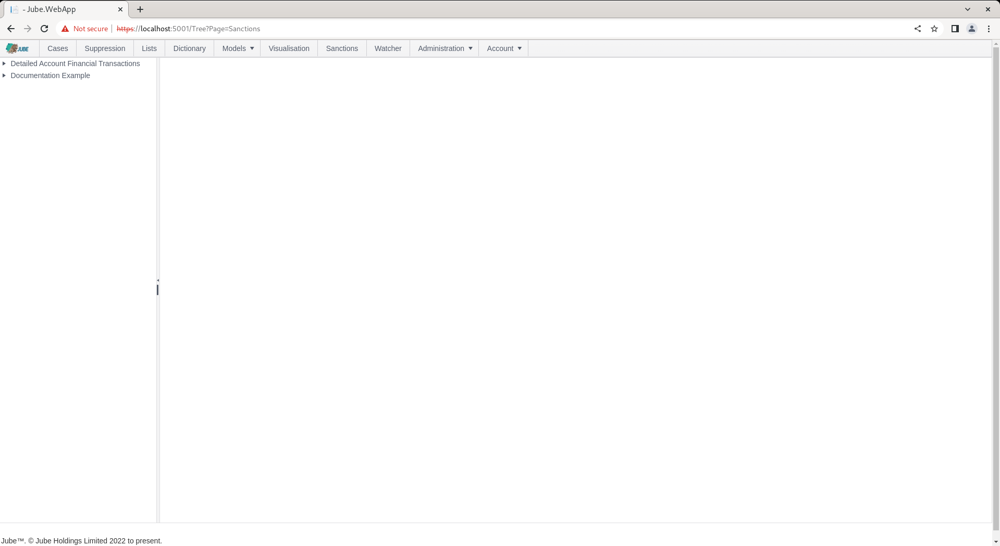
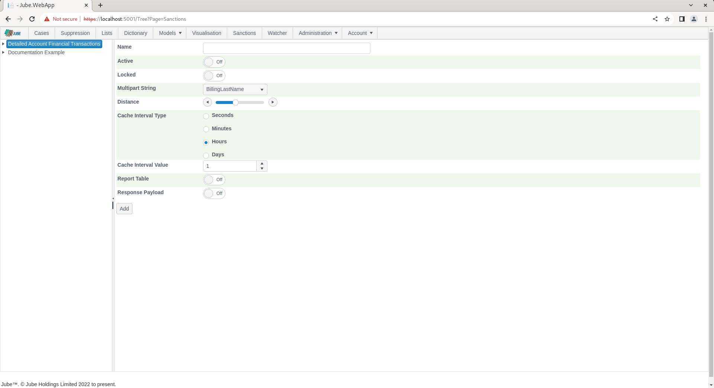
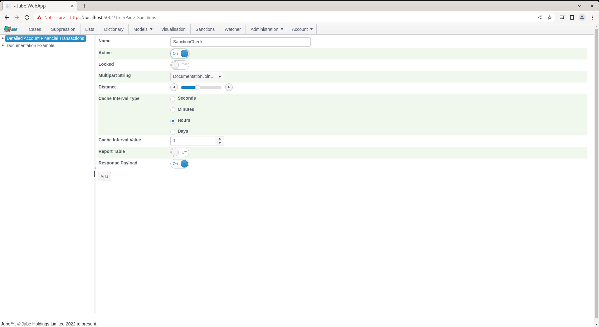
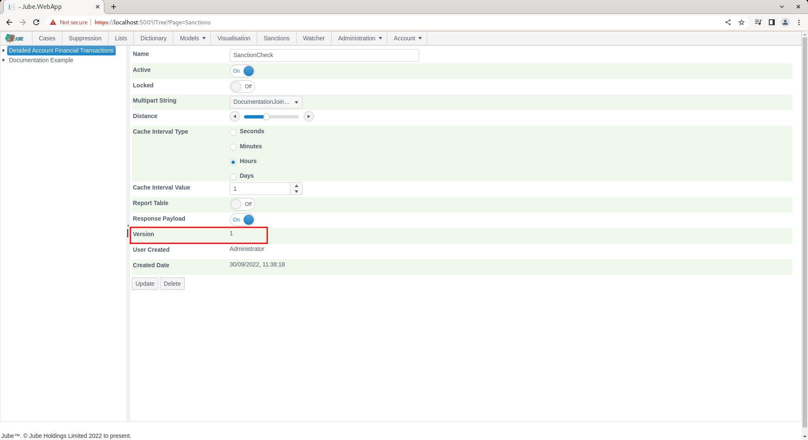
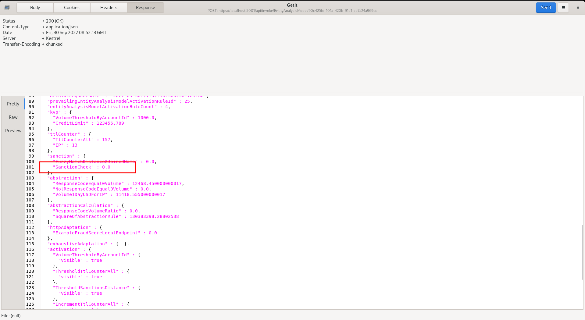
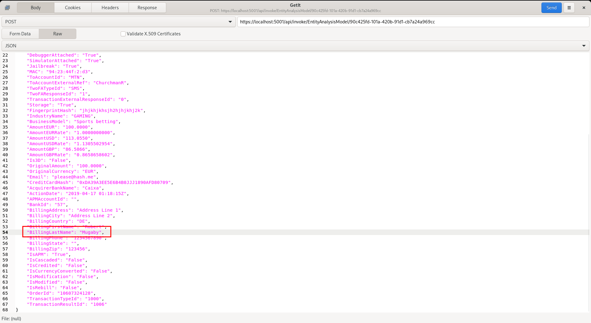
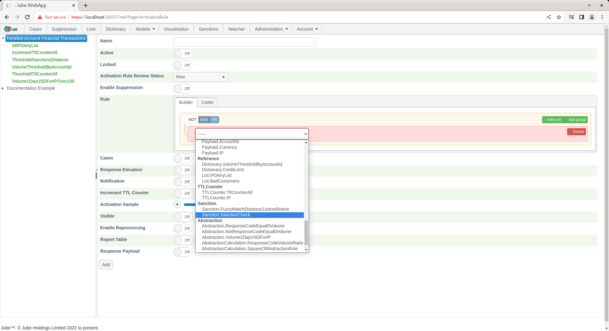

# Sanction Model Invocation

Sanctions matching can also be achieved by model invocation, taking the Multipart string from the data payload.

To perform Sanctions checking in model invocation, start by creating the specification, navigating to Models >>
References >> Sanctions:

Click on the model in the top left hand corner to begin the process of adding a Sanctions matching reference:

The parameters available to the Sanctions checking matching in model invocation are as follows:

| Value                | Description                                                                                                                                                                                                                                                                                                                                                                               | Example           |
|----------------------|-------------------------------------------------------------------------------------------------------------------------------------------------------------------------------------------------------------------------------------------------------------------------------------------------------------------------------------------------------------------------------------------|-------------------|
| Multipart String     | The multi part string containing the full name separated by a space character (and only a space).                                                                                                                                                                                                                                                                                         | Billing Full Name |
| Distance             | The maximum Levenshtein Distance for the stepping of the fuzzy logic matching. Must be between 0 and 5.                                                                                                                                                                                                                                                                                   | 2                 |
| Cache Interval Type  | As sanctions screening is computationally expensive and the underlying data is fairly slow moving, it is possible to cache a multipart string. The value interval type for the purposes of maintaining the cached distance mean score. Underlying accepted values are `s` (seconds), `n` (minutes), `h` (hours), any other value (including `d`) is treated as days.                     | d                 |
| Cache Interval Value | As above parameter,  the value detailing the length of time the cached scores should be available for the multi part string.                                                                                                                                                                                                                                                              | 1                 |
| Aggregation Type     | How the distances of every matched sanction entry are combined into the single value made available for rule evaluation - see [Aggregation Type and Confidence](#aggregation-type-and-confidence) below. Defaults to Average if left unset.                                                                                                                                               | Average           |
| Max Distance Ratio   | Overrides the server-wide SanctionsLevenshteinMaxDistanceRatio Environment Variable for this Sanction entry only. Scales down the allowed Levenshtein distance in proportion to the shorter of the two token lengths being compared, so short tokens cannot match too loosely even when Distance allows a larger edit distance overall. Leave unset to use the server-wide default (0.3). Must be between 0 and 1 if set. | 0.3               |
| Max Coverage Ratio   | Overrides the server-wide SanctionsLevenshteinMaxCoverageRatio Environment Variable for this Sanction entry only. Rejects a candidate match whose token count differs too greatly from the input's token count (for example, matching a single name against an entry built from many more, or far fewer, tokens than the input has). Leave unset to use the server-wide default (2.0). Cannot be negative if set.        | 2.0               |

Recall that an Inline Function - by the name of DocumentationJoinNames was created as an Inline Function - concatenated
the values from BillingFirstName and BillingLastName, separating with a space, thus becoming a Multipart string for the
purpose of the Sanctions algorithm.

Complete the Sanction check matching entry as below, targeting the DocumentationJoinNames data element:

Click Add to create a version of the sanction:

Synchronise the model via Entity >> Synchronisation and repeat the HTTP POST to
endpoint [https://localhost:5001/api/invoke/EntityAnalysisModel/90c425fd-101a-420b-91d1-cb7a24a969cc](https://localhost:5001/api/invoke/EntityAnalysisModel/90c425fd-101a-420b-91d1-cb7a24a969cc)
for response as follows:

An element under sanctions will only be available if there is a match on the sanctions with the distance specified in
the configuration entry. In the example above, the return of 0 means absolute match, otherwise, a distance value is
produced by combining every matching entry's distance according to the Aggregation Type set on the page (Average by
default - see below), keeping in mind that several matches might be returned from several lists. Model invocation cannot
make use of individual match records - only the single aggregated value is available for evaluation. Keep in mind also
that the maximum allowable distance specified to be returned is 2, so if distance is any greater than 2 characters of
change, it will not be included in the match at all (being judged to be unmatched).

For completeness and to show the aggregation concept with the default Average setting, change the billing last name in
the transaction JSON to "Mugaby":

Repeat the HTTP POST to
endpoint [https://localhost:5001/api/invoke/EntityAnalysisModel/90c425fd-101a-420b-91d1-cb7a24a969cc](https://localhost:5001/api/invoke/EntityAnalysisModel/90c425fd-101a-420b-91d1-cb7a24a969cc)
for response as follows:

It can be seen in the response that the average distance has been returned as 1.

The aggregated distance is available to Abstraction Rules, Activation Rules and Abstraction Calculations for evaluation,
as follows for an empty Activation Rule:

## Aggregation Type and Confidence

Aggregation Type controls how the distances of every matched sanction entry are combined into the single value
described above. The options are:

| Aggregation Type | What it returns                                                                                                                                                                     |
|------------------|-------------------------------------------------------------------------------------------------------------------------------------------------------------------------------------|
| Sum              | The sum of every matched entry's Levenshtein distance.                                                                                                                              |
| Average          | The mean distance across every matched entry. This is the default and the only option available before this feature was added, so existing configurations behave exactly as before. |
| Count            | The number of matched entries, rather than a distance at all.                                                                                                                       |
| Max              | The largest (worst) distance among the matches.                                                                                                                                     |
| Min              | The smallest (best) distance among the matches.                                                                                                                                     |
| First            | The distance of whichever match was produced first - the underlying match order is not guaranteed, so this option is best avoided where a stable, repeatable value matters.         |
| Last             | The distance of whichever match was produced last - the same order caveat as First applies.                                                                                         |
| Confidence       | A single 0-1 score blending three signals - see below. Unlike the other options, higher means a stronger match rather than lower.                                                   |

### Confidence

Confidence answers a different question than a raw distance does: not just "how close was the best match", but "how
much should this match be trusted". It blends three factors, multiplied together, so a weak signal on any one factor
pulls the overall score down:

* **Closeness** - how exact is the single best-matching sanctioned name. This is 1.0 for a perfect (zero-distance)
  match and shrinks toward 0 the more characters would need changing to make it exact.
* **Separation** - does the best match clearly stand out from the other candidate matches, or is it just one of many
  similarly-weak near-misses? A best match that is much closer than the average of the other candidates pushes this
  toward 1; a best match about as close as everything else pushes it down.
* **Skew weight** - a reliability discount on the separation signal, based on how many candidate matches were found
  and the shape of their distances. With very few candidates (fewer than three), there isn't enough information to
  trust the shape of the distribution, so this discounts toward a neutral value; with enough candidates (twelve or
  more) the adjustment applies at full strength.

Confidence is most useful as a single sortable/thresholdable score for triage, where Average or Min would otherwise
require an analyst to also eyeball how many other candidates were nearby and how ambiguous the match was.

## Stop Tokens

Before two names are compared, common honorific and religious/cultural titles (for example, titles equivalent to
"Sheikh" or "Imam" common in some naming conventions) are stripped from both sides of the comparison, so that a name
written with such a title compares correctly against a sanctions list entry that omits it, and vice versa - without
either being penalised by the extra token in the edit-distance calculation. The list of stop tokens is server-wide
(not configurable per Sanction entry) and is described in [Sanctions Loader](../SanctionsLoader/index.html).