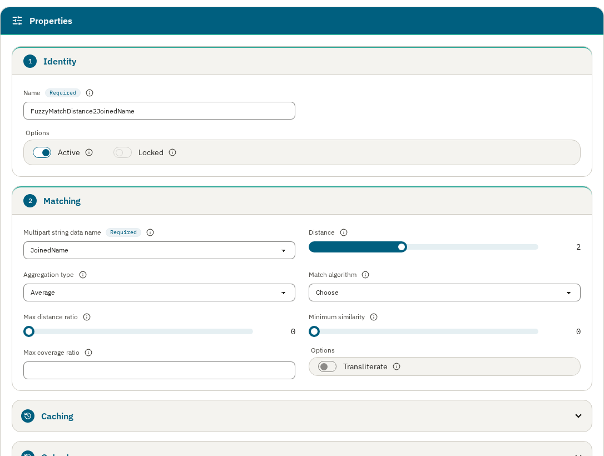
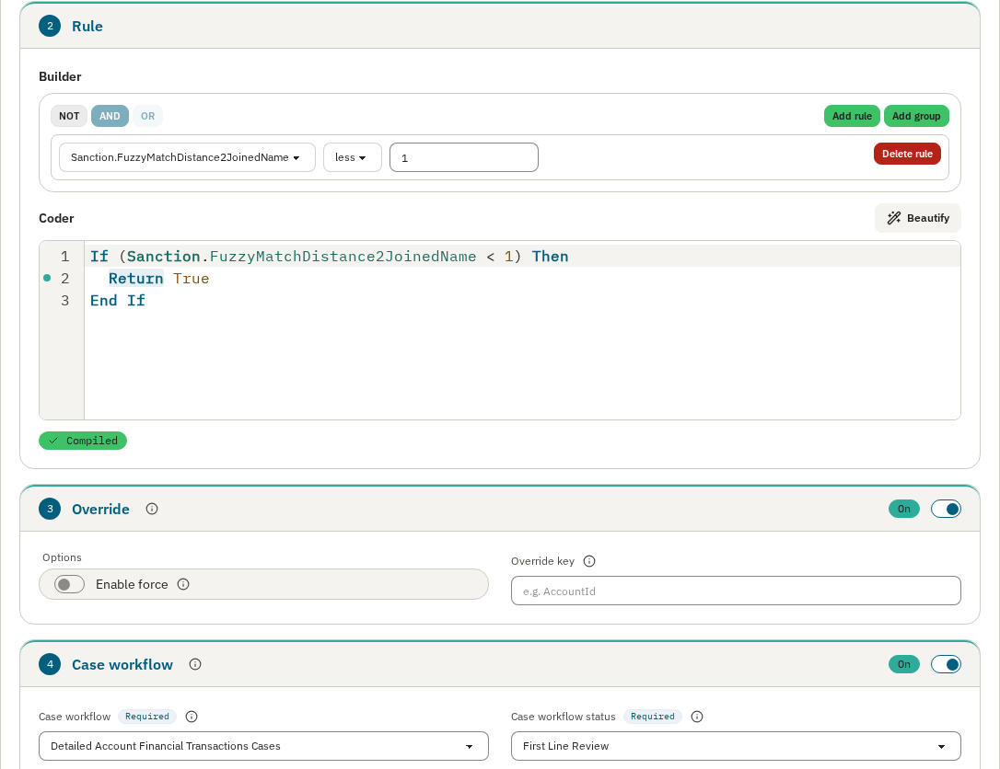

# Sanction Model Invocation

A sanction check answers, for every transaction a Model processes, the question that [Sanction Searching](../SanctionSearching/index.html) answers for a name typed by hand: does the name in this transaction resemble a name on a sanctions list, and how closely. Where the Sanctions page returns every matching entry for a person to read, a sanction check must reduce the matches to a single number, as a rule can only compare one value with a threshold. The manner in which an individual match is decided, and the meaning of distance, of the distance ratio and of the coverage ratio, is set out under How a match is decided on that page, and is the same here.

Sanctions matching can also be achieved by model invocation, taking the Multipart string from the data payload. A sanction check is specified against a Model, whereupon each transaction processed by the Model has the nominated data element matched against the sanctions loaded by the engine, with the distances of the matches being reduced to a single value that is made available to rules and, optionally, returned in the response.

## Where it lives

Navigate through the menu to Models, open the model, then the Sanctions hub card. Creating, changing, approving and deleting a sanction check follows the common manner described in [Child Objects](../../../Navigation/ChildObjects/index.html).

SHOT id=sanctions-model-invocation-record
     route=/models
     steps=open-default-model, open-hub:Sanctions, open-row:FuzzyMatchDistance2JoinedName
     frame=record
     state=the FuzzyMatchDistance2JoinedName sanction check of the default model opened, with the Identity and Matching groups expanded showing the Multipart string data name of JoinedName and a Distance of 2, and the Caching, Output and Audit groups collapsed
     conveys=a sanction check names the data element to screen and how loosely it is to be matched
     alt=A sanction check opened beneath the default model, showing the Matching group with the multipart string data name, the distance slider, the aggregation type, the match algorithm and the ratios



## Fields

The parameters available to a sanction check in model invocation are as follows, arranged in the groups Identity, Matching, Caching and Output, the latter two starting collapsed:

| Value                      | Description                                                                                                                                                                                                                                                                                                                                                                                                                       | Example                      |
|----------------------------|-----------------------------------------------------------------------------------------------------------------------------------------------------------------------------------------------------------------------------------------------------------------------------------------------------------------------------------------------------------------------------------------------------------------------------------|------------------------------|
| Name                       | The name of the sanction check, by which rules refer to it and under which the value is returned in the response.                                                                                                                                                                                                                                                                                                                 | FuzzyMatchDistance2JoinedName |
| Active                     | Whether the sanction check takes part in the processing of a transaction. Active is off for a new sanction check and must be switched on.                                                                                                                                                                                                                                                                                         | True                         |
| Locked                     | Whether the sanction check is protected from change.                                                                                                                                                                                                                                                                                                                                                                              | False                        |
| Multipart string data name | The data element of the Model supplying the multipart string, being the full name separated by a space character (and only a space). It is selected from the data elements available to the Model.                                                                                                                                                                                                                               | JoinedName                   |
| Distance                   | The maximum Levenshtein Distance for the stepping of the fuzzy logic matching. It is 2 for a new sanction check.                                                                                                                                                                                                                                                                                                                  | 2                            |
| Aggregation type           | How the distances of every matched sanction entry are combined into the single value made available for rule evaluation, as described in [Aggregation Type and Confidence](#aggregation-type-and-confidence) below. The form offers Average for a new sanction check, and a sanction check stored without a value is likewise taken by the engine as Average.                                                                              | Average                      |
| Match algorithm            | How a screened name is compared with a list entry, as described in [Match algorithm and transliteration](#match-algorithm-and-transliteration) below. It is Levenshtein edit distance per name part for a new sanction check.                                                                                                                                                                                                    | Levenshtein edit distance per name part |
| Max distance ratio         | Overrides the server wide SanctionsLevenshteinMaxDistanceRatio Environment Variable for this sanction check only. Scales down the allowed Levenshtein distance in proportion to the shorter of the two token lengths being compared, such that short tokens cannot match too loosely even when Distance allows a larger edit distance overall. Where unset, the server wide default (0.3) is used.                               | 0.3                          |
| Minimum similarity         | For the Jaro-Winkler and Token set algorithms only, the least similarity, from 0 to 1, that counts as a match. Where unset, 0.9 is used. Levenshtein ignores it.                                                                                                                                                                                                                                                                  | 0.9                          |
| Max coverage ratio         | Overrides the server wide SanctionsLevenshteinMaxCoverageRatio Environment Variable for this sanction check only. Rejects a candidate match whose token count differs too greatly from the token count of the input (for example, matching a single name against an entry built from many more, or far fewer, tokens than the input has). Where unset, the server wide default (2.0) is used.                                    | 2.0                          |
| Transliterate              | Where on, Cyrillic and Greek script is transliterated to Latin on both the screened name and the list entries before they are compared.                                                                                                                                                                                                                                                                                           | False                        |
| Cache interval             | As sanctions screening is computationally expensive and the underlying data is fairly slow moving, it is possible to cache the result for a multipart string. This is the type of interval for which the cached value is maintained, being Seconds, Minutes, Hours or Days (stored as `s`, `n`, `h` and `d`). It is Hours for a new sanction check.                                                                              | Days                         |
| Cache value                | As the above parameter, the value detailing the length of time for which the cached value should be available for the multipart string.                                                                                                                                                                                                                                                                                           | 1                            |
| Archive Key                | Where on, a matching row is written to the sanctions archive key table for the transaction.                                                                                                                                                                                                                                                                                                                                       | False                        |
| Response payload           | Where on, the value of the sanction check is returned in the response of the model invocation.                                                                                                                                                                                                                                                                                                                                    | True                         |

A new sanction check is offered with Distance of 2, Match algorithm of Levenshtein edit distance per name part, Max distance ratio of 0.3, Minimum similarity of 0.9, Max coverage ratio of 2, Cache interval of Hours, Cache value of 1, and Active, Locked, Archive Key and Response payload all off. Distance, Max distance ratio and Minimum similarity are sliders, Max coverage ratio is a number, and Cache interval is a choice of one of the four.

## Validation

A sanction check is validated in the server, and is rejected where:

* Name is empty, is longer than 256 characters, or is already in use by another sanction check of the Model.
* Multipart string data name is empty, or is longer than 256 characters.
* Distance is not between 0 and 5.
* Cache value is negative, or exceeds the limit for the Cache interval chosen (2,000,000,000 seconds, 52,560,000 minutes, 876,000 hours or 36,500 days).
* Cache interval is not one of Seconds, Minutes, Hours or Days.
* Aggregation type, where set, is not one of the eight types.
* Max distance ratio, where set, is not between 0 and 1.
* Max coverage ratio, where set, is negative.
* Match algorithm, where set, is not one of the three algorithms.
* Minimum similarity, where set, is not between 0 and 1.

## Example

In the default model, an Inline Function by the name of JoinedName concatenates the values of BillingFirstName and BillingLastName, separating them with a space, thus becoming a Multipart string for the purposes of the Sanctions algorithm:

```vbnet
Return Payload.BillingFirstName & " " & Payload.BillingLastName
```

The sanction check of the default model, FuzzyMatchDistance2JoinedName, targets that data element:

| Value                      | Setting                       |
|----------------------------|-------------------------------|
| Name                       | FuzzyMatchDistance2JoinedName |
| Multipart string data name | JoinedName                    |
| Distance                   | 2                             |
| Cache interval             | Hours                         |
| Cache value                | 1                             |
| Response payload           | True                          |
| Active                     | True                          |

Upon a sanction check being approved, and taken up by the engine at its next cycle, an HTTP POST to the endpoint [https://localhost:5001/api/invoke/EntityAnalysisModel/90c425fd-101a-420b-91d1-cb7a24a969cc](https://localhost:5001/api/invoke/EntityAnalysisModel/90c425fd-101a-420b-91d1-cb7a24a969cc), with a billing name of Robert Mugabe in the transaction JSON, returns the value in the sanction element of the response:

```json
"sanction": {
  "FuzzyMatchDistance2JoinedName": 0.0
}
```

TODO(verify): confirm on a running system the casing of the sanction element in the response of the model invocation, and correct the two listings on this page if it differs.

A value for a sanction check will only be available if there is a match on the sanctions within the distance specified in the configuration entry, and only where Response payload is on. In the example above, the return of 0 means an absolute match, otherwise a distance value is produced by combining the distance of every matching entry according to the Aggregation type of the sanction check, keeping in mind that several matches might be returned from several lists. Model invocation cannot make use of individual match records, as only the single aggregated value is available for evaluation. Keep in mind also that the maximum allowable distance specified to be returned is 2, so if the distance is any greater than 2 characters of change, it will not be included in the match at all, being judged to be unmatched.

For completeness, and to show the aggregation concept with the Average setting, changing the billing last name in the transaction JSON to "Mugaby" and repeating the HTTP POST returns the following:

```json
"sanction": {
  "FuzzyMatchDistance2JoinedName": 1.0
}
```

It can be seen in the response that the average distance has been returned as 1.

The aggregated distance is available to Abstraction Rules, Activation Rules and Abstraction Calculations for evaluation, being referred to as `Sanction.Name`, as in the ThresholdSanctionsDistance Activation Rule of the default model, which matches where the name is an exact match to a sanctioned name:

```vb
If (Sanction.FuzzyMatchDistance2JoinedName < 1) Then
  Return True
End If
```

SHOT id=sanctions-model-invocation-threshold-rule
     route=/models
     steps=open-default-model, open-hub:Activation Rules, open-row:ThresholdSanctionsDistance, scroll-to:Rule
     frame=record
     state=the ThresholdSanctionsDistance Activation Rule of the default model scrolled to its Rule group, showing the condition of the rule in the Builder and the equivalent rule text in the Coder beneath, which compares Sanction.FuzzyMatchDistance2JoinedName with 1
     conveys=the aggregated distance of a Sanction is tested in an Activation Rule by its name, in the Builder or the Coder
     alt=The Rule group of the ThresholdSanctionsDistance Activation Rule showing its condition in the Builder and the rule text in the Coder, which tests whether Sanction.FuzzyMatchDistance2JoinedName is less than 1



## Aggregation Type and Confidence

Aggregation type controls how the distances of every matched sanction entry are combined into the single value described above. By way of example, suppose a name in a transaction matches three listed entries, at distances of 0, 1 and 2. Sum returns 3, Average returns 1, Count returns 3, Max returns 2 and Min returns 0. It can be seen that the choice decides what a rule is in fact testing: a rule upon Min asks whether there is any exact or near match at all, a rule upon Count asks how many entries the name resembles, and a rule upon Average or Sum is softened or hardened by the weaker matches alongside the best. For every type other than Count and Confidence, a lower value is a closer match and 0 is exact. The options are:

| Aggregation type | What it returns                                                                                                                                                                         |
|------------------|-----------------------------------------------------------------------------------------------------------------------------------------------------------------------------------------|
| Sum              | The sum of the Levenshtein distance of every matched entry.                                                                                                                             |
| Average          | The mean distance across every matched entry. This was the only option available before this feature was added, so configurations existing from that time behave exactly as before.     |
| Count            | The number of matched entries, rather than a distance at all.                                                                                                                           |
| Max              | The largest (worst) distance among the matches.                                                                                                                                         |
| Min              | The smallest (best) distance among the matches.                                                                                                                                         |
| First            | The distance of whichever match was produced first. The underlying match order is not guaranteed, so this option is best avoided where a stable, repeatable value matters.              |
| Last             | The distance of whichever match was produced last, the same caveat as to order applying as for First.                                                                                   |
| Confidence       | A single score from 0 to 1 blending three signals, as described below. Unlike the other options, higher means a stronger match rather than lower.                                       |

### Confidence

Confidence answers a different question than a raw distance does: not only how close the best match was, but how much the match should be trusted. It blends three factors, multiplied together, such that a weak signal on any one factor pulls the overall score down:

| Factor      | Description                                                                                                                                                                                                                                                                                                                              |
|-------------|------------------------------------------------------------------------------------------------------------------------------------------------------------------------------------------------------------------------------------------------------------------------------------------------------------------------------------------|
| Closeness   | How exact the single best matching sanctioned name is. This is 1.0 for a perfect (zero distance) match and shrinks toward 0 the more characters would need changing to make it exact.                                                                                                                                                    |
| Separation  | Whether the best match clearly stands out from the other candidate matches, or is merely one of many similarly weak near misses. A best match that is much closer than the average of the other candidates pushes this toward 1, whereas a best match about as close as everything else pushes it down.                                 |
| Skew weight | A reliability discount on the separation signal, based on how many candidate matches were found and the shape of their distances. With very few candidates (fewer than three) there is not enough information to trust the shape of the distribution, so this discounts toward a neutral value, whereas with enough candidates (twelve or more) the adjustment applies at full strength. |

Confidence is most useful as a single score for triage, which can be sorted and given a threshold, where Average or Min would otherwise require an analyst to also consider how many other candidates were nearby and how ambiguous the match was.

## Stop Tokens

Before two names are compared, common honorific and religious or cultural titles (for example, titles equivalent to "Sheikh" or "Imam", common in some naming conventions) are stripped from both sides of the comparison, so that a name written with such a title compares correctly against a sanctions list entry that omits it, and vice versa, without either being penalised by the extra token in the calculation of the edit distance. The list of stop tokens is server wide (not configurable for each sanction check) and is described in [Sanctions Loader](../SanctionsLoader/index.html#stop-tokens).

## Match Detail

Each sanction check reduces every entry it matches to the single aggregate number placed in the response and used by rules. So that an analyst can see what the number was made of, the closest matches are also kept with the archived transaction, under `sanctionMatch` and the name of the check:

| Field     | Meaning                                                                  |
|-----------|--------------------------------------------------------------------------|
| id        | The identifier of the sanction entry.                                    |
| source    | The identifier of the sanction entry source (list) it came from.         |
| reference | The reference of the entry within that list, for example the SDN number. |
| value     | The listed name as held in memory, folded and lower case.                |
| distance  | The edit distance of the match, the worst distance across its tokens.    |

The matches are ordered closest first and then by entry id, and at most `SanctionMatchDetailMaximum` are kept (5 by default, with 0 keeping none and leaving only the aggregate). The detail is stored in the same cache entry as the aggregate, so a result served from the cache carries its detail too, although it should be noted that a result cached before the detail was introduced carries none until it expires or is computed again.

As the detail is capped for each check, all of the matches for a name can be read by searching for it in the Sanctions page, as described in [Sanction Searching](../SanctionSearching/index.html).

The sanctions lens of the [Case Key Journal](../../CaseManagement/WorkingCaseKeyJournal/index.html) shows one extra column for each check, named after the check with "matches", listing the matched entries with their reference, source and distance. The source is shown there as its identifier.

## Match algorithm and transliteration

Each sanction check chooses how a screened name is compared with a list entry. Levenshtein is the default and is unchanged, the other two being options.

| Algorithm        | How it decides                                                                                                                                                                                                                                                                         | Use it when                                                                         |
|------------------|----------------------------------------------------------------------------------------------------------------------------------------------------------------------------------------------------------------------------------------------------------------------------------------|-------------------------------------------------------------------------------------|
| Levenshtein (1)  | Each part of the screened name is paired with its closest part of the entry and must be within the maximum distance of the check, scaled by the maximum distance ratio. Parts may come in any order, and the number of parts must be within the coverage ratio.                        | The default. Predictable and the best balanced choice on the labelled sample below. |
| Jaro-Winkler (2) | The same pairing, but a pair is accepted when its Jaro-Winkler similarity is at least the Minimum similarity (0.9 if unset) and its edit distance is still within the maximum distance of the check. Jaro-Winkler favours a shared beginning.                                          | Names whose spelling varies late in each part.                                      |
| Token set (3)    | The whole name: each part is paired with its closest part by Jaro-Winkler, order is ignored, and the score falls for every part left unmatched. Accepted at or above the Minimum similarity. The coverage ratio is not used, and the maximum distance applies to the sorted names.     | Reordered or incomplete names. It finds more, and more false positives.             |

In the form the three are offered as Levenshtein edit distance per name part, Jaro-Winkler similarity per name part, and Whole name, ignoring the order of its parts.

Transliterate converts Cyrillic and Greek script to Latin letters on both the screened name and the list entries before comparing, such that Иван Петров can match Ivan Petrov. It should be left off for lists and inputs that are all Latin. Other scripts, Arabic and Chinese among them, are not transliterated, and there is no phonetic matching.

The algorithm, the minimum similarity and transliteration are part of the cache key, so checks that differ in them never share a cached result, and the [rescreening](../SanctionRescreening/index.html) job uses them too. The Sanctions page, for the purposes of a manual search, uses Levenshtein only.

On a labelled sample of 24 name pairs (12 the same person, 12 different) shipped as a unit test, with a maximum distance of 3: Levenshtein found 9 of the 12 with 1 false match, Jaro-Winkler at 0.9 found 7 with 1 false match and at 0.95 it found 3, and Token set at 0.85 found 11 with 5 false matches. The sample is small and illustrative, and a measurement should be made against the list and names in use before a production check is changed.

## Permissions and security

Reading and writing sanction checks requires permission 11, Read Write Sanction. A user without it receives 403, and an unauthenticated request receives 401. Sanction checks are scoped to the tenant of the caller through the parent Model.
